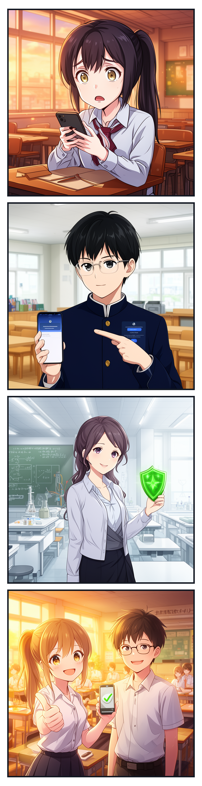
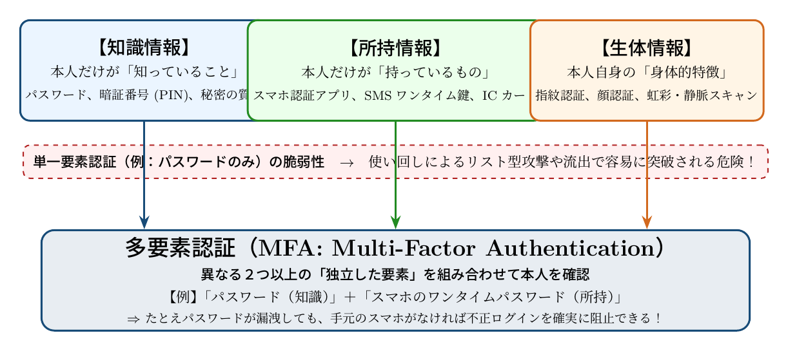

# 第1話 秘密の合言葉と見えない鍵 〜パスワード認証と多要素認証の仕組み〜

> **【放課後サイバーディフェンス・ラボ】**
> - **舞台**: 県立青葉台高校 情報科学部 ＆ 帝都科学大学 情報科学部 サイバーセキュリティ研究室
> - **登場人物**: 橘 葵（高校2年・情報科学部）、城崎 悠真（高校2年・部長）、芹沢 涼香 准教授（大学メンター / IPAアドバイザー）
> - **学習テーマ**: パスワードの脆弱性と使い回しリスク、認証の3要素（知識・所持・生体）、多要素認証（MFA）の原理
> - **参照規格・公式情報**:
>   - [IPA 独立行政法人 情報処理推進機構：デジタルスキル標準（DSS）](https://www.ipa.go.jp/jinzai/skill-standard/dss/index.html)
>   - [内閣官房 国家サイバー統括室](https://www.cyber.go.jp/)
>   - [サイバーセキュリティ.com：不正アクセス・情報漏洩ニュース速報](https://cybersecurity-jp.com/news)

---

## 🎨 4コマ漫画・ストーリーイラスト (Draw Things 生成)

---

## 📖 小説本文

　放課後の情報教室は、西日に照らされて琥珀色の静寂に包まれていた。
　窓から差し込む光の粒が、整然と並んだデスクトップパソコンの筐体や、埃をかぶった電子工作の部品を黄金色に縁取っている。しかし、その穏やかな情景とは対照的に、橘葵の表情は険しいものだった。

「……嘘でしょ。なんで？」

　彼女の手元にあるスマートフォンは、青白い警告画面を放ち、まるで氷のような冷たさを放っている。画面には『不審なログインの試行を検知しました』という無機質な文字が並んでいた。
　葵は、自分が愛してやまないオンラインゲームのアカウントに、見覚えのない地域からアクセスがあったことを通知されていた。

「……またか。昨日も変なメールが来たと思ったら、今度はこれだ」

　指先を震わせながら画面を見つめる彼女の背後に、静かな足音が響いた。
「何があったんだ、橘」
　声をかけたのは、城崎悠真だった。彼は情報科学部長としてこの教室を預かっており、常に冷静な眼差しで周囲を観察している。彼の手には、まだ湯気が立ち上るカフェオレの紙コップが握られていた。

「城崎くん……見て。私のアカウント、乗っ取られそうになってる。でも、パスワードは変なものじゃないはずなのに」
　葵がスマートフォンを差し出すと、悠真は眉を潜め、画面を覗き込んだ。彼は一口カフェオレを啜り、淡々と分析を始めた。

「……これを見る限り、典型的な『アカウントリスト攻撃』の可能性が高いね」
「アカウント……リスト？ それって何？」
「君が他のサイトで使っているパスワードが、どこかのデータ流出事件で漏洩していること。ハッカーは、その漏洩した『IDとパスワードのセット』を自動で次々と別のサービスに流し込んで試すんだ。これを『Credential Stuffing（クレデンシャル・スタッフィング）』と呼ぶ」

　悠真は近くのホワイトボードに、チョークを走らせた。
「君、複数のサイトで同じパスワードを使い回しているだろう？」
「えっ……あ、うん。だって覚えられないから」
　葵が顔を赤くして俯く。
「それが致命的なんだ。ブルートフォース攻撃っていう『総当たり攻撃』なら、パスワードの文字列を一つずつ変えて試行するから、複雑なものなら突破は難しい。でもリスト攻撃は違う。君が既に『正解』として登録している鍵を、別の扉に押し当てているだけなんだよ」

　葵は絶句した。自分の不用意な習慣が、見えない海の中で誰かに狙われているという事実が、急に現実味を持って迫ってきた。

* * *

「――だから、パスワードだけを頼りにするのは、もう限界があるっていうことなの」

　教室のドアが開き、凛とした声が響いた。
　入ってきたのは、スーツのジャケットを軽く羽織った女性だった。彼女は大学の情報科学部で准教授を務める芹沢涼香だ。時折、国家レベルのサイバーセキュリティに関する啓発活動にも関わっているという、この界隈では名の知れた研究者である。

「先生、来てくれたんですね」
　葵が顔を上げると、芹沢は人当たりの良い笑みを浮かべた。彼女は机の上に資料を置くと、葵と悠真の前に立った。
「葵さん、驚かせてごめんなさいね。でも、今の時代、自分の身を守るための知識は、ゲームの攻略法と同じくらい重要なものよ」

　芹沢はホワイトボードの図を指し示した。
「パスワードは『知識情報』の一つに過ぎないわ。私たちが目指すべきは、『多要素認証（MFA）』の徹底よ」

　彼女は淀みのない手つきで、三つの円を描いた。
「セキュリティの世界には、認証の三要素があるわ。一つ目は『知識情報』。それはあなたが知っていること。パスワードや暗証番号のことね。二つ目は『所持情報』。あなたが今持っているもの。スマホに届くワンタイムパスワード（OTP）や、物理的なセキュリティキーが含まれるわ。そして三つ目は『生体情報』。指紋、顔、虹彩……あなた自身の特徴よ」

　芹沢はカフェオレのカップを置くと、葵の目をまっすぐに見つめた。
「もし、ハッカーが君のパスワード（知識）を手に入れたとしても、彼らは君のスマホ（所持）を持っていない。あるいは、君の顔（生体）を偽装することができない。複数の要素を組み合わせることで、一つの鍵が盗まれただけで全てが終わるという事態を防ぐ。これがMFAの強さよ」

　葵は、芹沢の言葉を反芻するように聞き入った。
「……つまり、私がパスワードを使い回してたのは、自分の家の鍵をコピーして、街中の全てのドアに同じ鍵を挿しているようなものだったってこと？」
「ええ、まさにその通りよ。とても効率的だけど、防犯としては最悪ね」
　芹沢はいたずらっぽく笑った。

* * *

　教室の外では、完全に日が落ちていた。
　窓の外の景色は濃い群青色に染まり、室内には蛍光灯の光が冷ややかに反射している。

「IPAや国家サイバー統括室のような機関も、今はこの『リテラシー』の向上を最優先で進めているわ。技術的な防壁を作ることも大事だけど、それを使う人間がどう動くかが一番の鍵になるから」
　芹沢は、手元のタブレットでいくつかの資料を開いた。
「デジタルスキル標準（DSS）という指標もあるけれど、まずは葵さんが今日知ったこと、この『見えない鍵』の仕組みを正しく理解することから始まるのよ」

　葵は、自分のスマートフォンを見つめ直した。
　先ほどまでの不安は、どこか別のものへと変質していた。それは恐怖ではなく、一種の昂りだった。
「……なんだか、面白いな」
　彼女が呟いた。
「パスワードの裏側にある仕組みとか、どうやって守っているのかっていう技術。それって、まるで高度な魔法みたいなものじゃない？」

　悠真が少しだけ口角を上げた。
「魔法っていうよりは、数学と論理の積み重ねだね。でも、その『見えない防衛線』を構築する側になるのは、なかなか刺激的な仕事だと思うよ」

　葵はノートを広げ、芹沢の教えたキーワードを書き留め始めた。
　自分の身を守るための第一歩。それは、ただ守られるだけの受動的な存在から、仕組みを理解し、コントロールする側へ近づくことへの入り口だった。

「私、大学でこれをもっと学びたいかも」
　葵の声は少しだけ上ずった。
「サイバーセキュリティの研究室……どんなことが学べるんだろう。この『見えない鍵』の先には、どんな世界が広がってるの？」

　芹沢は満足げに頷いた。
「その好奇心こそが、最高の防御策になるわ。さあ、まずは自分のアカウントから、正しい多要素認証を設定することから始めましょうか」

　葵は再びスマートフォンを手に取った。
　画面の青白い光は、もう彼女を怯えさせるものではなかった。それは未知の領域へ踏み出すための、道標のように見えていた。
　窓の外では、夜の帳が完全に下りていた。しかし、葵の瞳の中には、新しい知識の火が灯っていた。

---

## 📊 TikZによるセキュリティ構造図解

### 認証の3要素と多要素認証（MFA）の防御アーキテクチャ

---

## 💡 高校生のためのセキュリティ深掘りコラム

### 1. なぜ「パスワードの使い回し」は破られるのか？
- **ブルートフォース攻撃（総当たり攻撃）**:
  あらかじめ決めた文字種（英数字記号など）を片っ端から試す攻撃。パスワードが十分に長ければ（12文字以上など）天文学的な試行回数が必要となり防御可能です。
- **アカウントリスト攻撃（Credential Stuffing / パスワードリスト攻撃）**:
  どこか別のWebサービスから流出した「ID（メールアドレス）とパスワードのリスト」をそのまま別のサービスに入力してログインを試みる攻撃です。[サイバーセキュリティ.com](https://cybersecurity-jp.com/news)等で日々報じられる情報漏洩事件の多くが、この攻撃の二次被害に繋がっています。**どんなに複雑なパスワードでも、使い回していれば一箇所の漏洩ですべての扉が開いてしまう**のです。

### 2. 認証の3大要素（Factor）を知る
セキュリティ工学では、本人確認の要素を大きく3つに分類します。
1. **知識情報（What you know）**: パスワード、PINコード、合言葉など。本人のみが知っていること。
2. **所持情報（What you have）**: スマートフォンの認証アプリ（Google Authenticator等）、SMSワンタイムパスコード、FIDO2対応セキュリティキーなど。本人のみが持っている物理的実体。
3. **生体情報（What you are）**: 指紋、顔、虹彩、静脈など。本人の身体的特徴。

### 3. 多要素認証（MFA）が最強の盾と呼ばれる理由
同じ要素を2つ重ねる（例：パスワード＋秘密の質問 ＝ どちらも知識情報）のは「多段階認証」ですが、「多要素認証」ではありません。
**「知識（パスワード）」＋「所持（手元のスマホに届くワンタイムキー）」**のように異なる独立した要素を掛け合わせることで、万一ダークウェブ等にパスワードが流出しても、攻撃者はあなたの手元にある物理スマートフォンを持っていないため、不正ログインを確実に水際で遮断できます。

### 4. 大学で学ぶ「情報科学・サイバーセキュリティ」への道
大学の情報工学部やサイバーセキュリティ学科では、こうした認証の背後にある「ハッシュ関数（SHA-256など）」や「公開鍵暗号基盤（PKI）」、「ゼロトラスト・アーキテクチャ」などの数学的・工学的理論を学びます。単に「気をつける」だけでなく、**「安全な社会のインフラを設計する守護者（ホワイトハッカー・アーキテクト）」**を目指すワクワクする学問領域が待っています！
