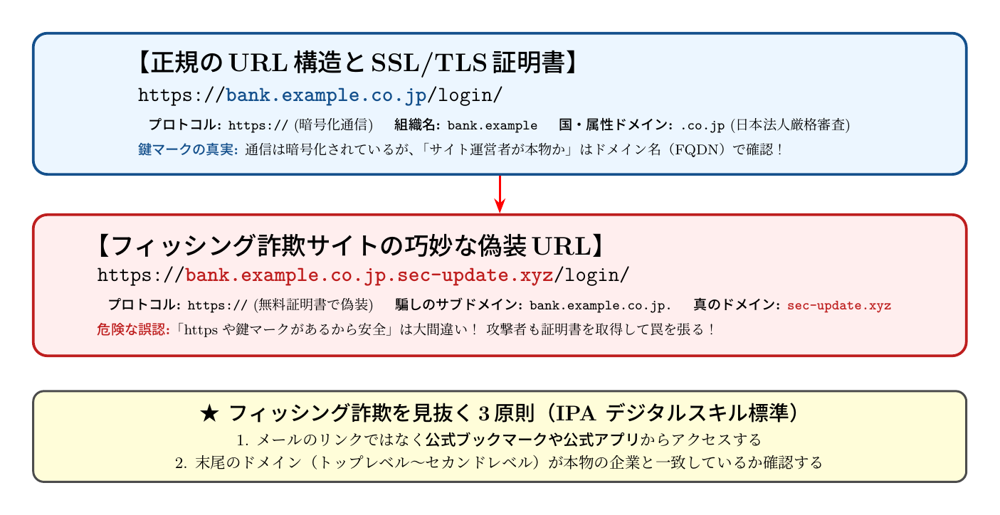

# 第2話 偽りの手紙と本物の目印 〜フィッシング詐欺の見抜き方とURLの秘密〜

> **【放課後サイバーディフェンス・ラボ】**
> - **舞台**: 県立青葉台高校 情報科学部 ＆ 帝都科学大学 情報科学部 サイバーセキュリティ研究室
> - **登場人物**: 城崎 悠真（高校2年・部長）、橘 葵（高校2年・部員）、芹沢 涼香 准教授（大学メンター / IPAアドバイザー）
> - **学習テーマ**: スミッシングとソーシャルエンジニアリング、URLの階層構造、電子証明書（HTTPS）の真実
> - **参照規格・公式情報**:
>   - [IPA 独立行政法人 情報処理推進機構：デジタルスキル標準（DSS）](https://www.ipa.go.jp/jinzai/skill-standard/dss/index.html)
>   - [内閣官房 国家サイバー統括室：フィッシング対策方針](https://www.cyber.go.jp/)
>   - [サイバーセキュリティ.com：フィッシング詐欺・偽装サイト被害速報](https://cybersecurity-jp.com/news)

---

## 🎨 4コマ漫画・ストーリーイラスト (Draw Things 生成)

---

## 📖 小説本文

　放課後の情報科学部室。窓から差し込む西日が、並べられたサーバーラックとモニターの放熱ファンが回る微かな音を包み込んでいた。
　橘葵は、スマートフォンの画面を見つめたまま、指先を止めていた。

「……えっ、これ、私の荷物？」
　葵の眉が跳ね上がる。彼女の手元にある端末には、一通のSMS（ショートメッセージ）が表示されていた。
『【重要】不在のため配送を中断しました。再配達の受付は以下のURLよりお願いいたします。』

　画面の下部には、青くハイライトされたリンクがある。葵の指が反射的にその上へと動こうとした瞬間、隣に座っていた城崎悠真が、音もなくその手首を掴んだ。

「待て。クリックする前に、一度深呼吸しろ」
　悠真の声は低く、落ち着いていた。彼は葵の端末から視線を逸らさず、じっと画面を凝視している。
「……え、だって、昨日頼んだネット通販の荷物届いてないんだもん。これ、本物じゃない？」
「本当にそうかな。このメッセージ、不自然な点が多い」

　悠真はスマートフォンの画面を指先でなぞりながら、解説を始めた。
「まず、『緊急性』だ。配送業者なら、わざわざSMSでいきなり再配達の受付を急がせるか？ 不安や焦りを煽って、冷静な判断力を奪う。これは『ソーシャルエンジニアリング』という手法の一種だ」
「そーしゃる……えっと、心理的な隙を突くってこと？」
「その通りだ。特に宅配便や金融機関を装ったものは、被害者が『今すぐ何とかしなきゃ』と思う瞬間を狙う。この『緊急事態』という演出自体が、詐欺の入り口なんだよ」

　葵は自分の指先を見つめ、少しだけ背筋を正した。
「……確かに、ちょっと焦ってたかも」
「いいか、葵。技術的な仕組みを知る前に、まず自分の心が動かされた瞬間を疑うことだ。それがサイバーセキュリティの第一歩だよ」

* * *

　二人は部室の大型モニターの前に移動した。そこには先ほどのSMSに含まれていたURLが映し出されている。
「このURLを見てくれ」
　悠真の声に、葵が身を乗り出した。
　表示されているのは、一見すると宅配業者のものに見えるが、よく見ると非常に複雑な文字列が並んでいる。

「ここを左から読むんじゃなくて、右から左へ見ていくのがコツだ」
　悠真はホワイトボードのペンを取り、URLの一部を書き出した。
「まず一番右端を見てくれ。これが『ccTLD』、国別コードトップレベルドメインやgTLDと呼ばれるものだ。今回の例では……そう、非常に怪しいドメインが使われている」
　彼はさらに左へ進む。
「次に、その左側にあるのが組織のドメイン名だ。そして、一番左側にあるのが『サブドメイン』。ここが罠なんだよ。例えば『yamato-transport.com』という本物のドメインの前に、偽の『re-delivery-center』という名前をくっつけることで、一見すると公式なページのように見せかけている」

「あ……なるほど。一番右側のドメインが本当の持ち主で、左側はただの飾りってこと？」
　葵の目が輝きだす。
「その通り。URLの構造は階層構造になっている。ユーザーは左側のサブドメインばかりを見てしまいがちだが、システムが実際に参照するのは右側のドメインなんだ。この『名前の魔術』に騙されないためには、この階層構造を正しく理解する必要がある」

　そこへ、部室のドアがノックされた。
「お疲れ様。いいところを見ているわね」
　入ってきたのは、大学の准教授であり、IPA（情報処理推進機構）のアドバイザーも務める芹沢涼香だった。彼女は凛とした佇まいながらも、どこか柔らかな笑みを浮かべている。

「芹沢先生！ 今、URLの階層構造について勉強してたんです」
　葵が元気よく声をかけた。
「ええ、いい視点ね。特に現代のフィッシング詐欺では、巧妙に本物に近いサブドメインを並べる手法が多用されているわ。ただ、それだけでは防げないこともある。次のステップに進みましょう」

* * *

　芹沢はモニターの端にある小さな鍵マークのアイコンを指差した。
「葵さん、このURLを見て。先頭に『https://』って付いていて、横に鍵のマークがあるわね。これを見れば安心だと思わない？」

　葵は迷わず首を縦に振った。
「ええ！ 先生、ネットで見たことあります。鍵マークがあれば、安全なサイトだって教えてくれるんですよね？」
　芹沢は静かに首を横に振った。その表情には、教育者としての厳格さと慈愛が同居していた。

「いいえ、それは大きな誤解よ。HTTPSやSSL/TLS証明書が保証するのは、『通信の暗号化』と『相手の身元確認』であって、『そのサイトが善意のサイトであること』ではないわ」
　悠真も身を乗り出して聞き入る。

「……どういうことですか？」
　葵の問いに、芹沢は手元の資料を開いた。
「例え話をするわね。あなたが銀行の窓口に行こうとして、非常に頑丈な金庫の扉（暗号化）を通り、身分証を提示した相手（証明書）と対面したとしましょう。その相手が『私は銀行員です』と正しい身分証を見せてくれたとしても、もしその場所自体が『巧妙に作られた偽物の銀行』だったらどうかしら？」

　葵は絶句した。
「……偽物の銀行の、偽物の職員……」
「正解よ。HTTPSは『通信路が安全であること』を保証するけれど、あなたが接続している相手が詐欺師であれば、詐欺師との間の通信が安全に暗号化されるだけ。つまり、『安全なトンネルを通って、確実に詐欺師の元へデータが届く』ということなの。鍵マークがあるからといって、安易に個人情報を入力してはいけないわ」

　芹沢は画面をスクロールし、実際の被害事例を表示した。
「実際に、金融機関を装ったフィッシングサイトで『HTTPS』が付いているからと信じ込み、数百万の資産を奪われたケースは後を絶たないわ。攻撃者は技術を駆使して、本物そっくりな証明書を取得する技術まで持っているのよ」

* * *

　部室の空気は、先ほどよりもずっと張り詰めたものになっていた。
「……なんだか、今まで自分が思っていたよりも、ずっと高度で、そして恐ろしい世界なんだね」
　葵がぽつりと呟いた。
「そう。でも、だからこそこの分野は面白い。守るべきものがあるからこそ、技術が必要になるのよ」
　芹沢は温かいコーヒーを一口飲み、窓の外を見やった。

「私は大学で、こうしたネットワーク技術やセキュリティの研究をしているけれど、一番のやりがいは『知ることで守れる』という実感ね。脆弱性を一つ見つけるたびに、それは誰かのプライバシーや資産を守るための武器になる。ただコードを書くのではなく、社会の安全を支える構造を作る。それが情報科学の魅力よ」

　悠真は自分のスマートフォンを見つめた。
「……守備側（ディフェンダー）の視点を持つってことか。攻撃の手法を知り、仕組みを理解することで、初めて本当の防御ができる」
「ええ。情報の海は広くて複雑だけど、そのルールを正しく知ることは、自分の身を守るための知恵になるわ」

　芹沢は二人に向かって微笑んだ。
「今日学んだことはまだ入り口に過ぎないけれど、この『仕組み』への好奇心を忘れないで。次に来るのは、より複雑な認証の仕組みよ。準備はいい？」

　葵は拳を握りしめ、力強く頷いた。
「はい！ 次のステップも教えてください！」
　悠真も小さく頷き、モニターの奥に広がる複雑なネットワークの構造へと意識を向けた。放課後の部室に、新たな探究の火が灯った。

---

## 📊 TikZによるセキュリティ構造図解

### 正規URL vs フィッシング詐欺サイトのドメイン構造比較

---

## 💡 高校生のためのセキュリティ深掘りコラム

### 1. 「人の心の隙」を突くソーシャルエンジニアリング
フィッシング詐欺（Phishing）やスミッシング（SMSフィッシング）は、高度なコンピュータ攻撃というよりも、「緊急！荷物のお届け」「24時間以内に確認しないとアカウント凍結」など、**人間の恐怖や焦燥感・好奇心を利用して冷静な判断を奪う「ソーシャルエンジニアリング」**です。

### 2. URLを「右から左」に読む技術
URLのホスト名部分は、ピリオドで区切られた右側から階層が上がっていきます。
- 例: `login.example.co.jp` の場合、本体は `.co.jp` の中にある `example` という企業組織です。
- 詐欺サイトの手口: `example.co.jp.sec-login.xyz` のように、左側に有名企業の名前を並べて安心させ、**真のドメイン末尾を怪しい文字列（`.xyz` 等）に偽装**します。必ず「プロトコル（https://）の直後ではなく、最初のスラッシュ（/）の直前」に注目する習慣をつけましょう。

### 3. 「鍵マーク（HTTPS）があるから安心」は時代遅れ？
かつて「通信が暗号化されている（HTTPS）＝ 安全なサイト」と言われた時代もありましたが、現在は攻撃者自身も無料のSSL/TLS証明書を簡単に取得できます。
- **HTTPSが保証すること**: 端末とサーバー間の通信が途中で盗聴・改ざんされていないこと。
- **HTTPSが保証しないこと**: そのサーバーの運営者が詐欺師ではないこと。
「鍵マークがある詐欺サイト」が当たり前になった現代だからこそ、ドメイン名そのものを確かめるリテラシーが不可欠です。

### 4. 大学で学ぶ「ネットワーク工学と暗号技術」
大学の情報系学部では、インターネットの名前解決を支える「DNS（Domain Name System）」の階層アーキテクチャや、第三者認証機関（CA）による公開鍵暗号基盤（PKI）の数学的証明、Webアプリケーションの脆弱性検出を体系的に学びます。ネットの土台を理解することで、巧妙な詐欺攻撃の構造が手にとるように見えてくる面白さがあります。
