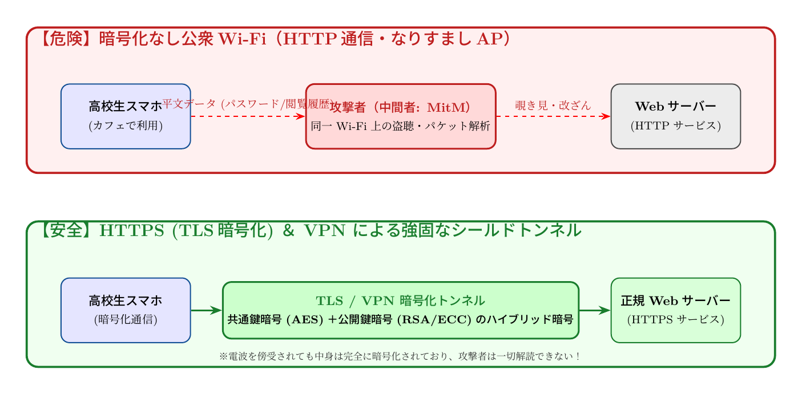

# 第3話 街角の電波は誰のもの？ 〜公衆無線LANの危険性と通信の暗号化（HTTPS）〜

> **【放課後サイバーディフェンス・ラボ】**
> - **舞台**: 駅前カフェ「テラス・サイバネティクス」 ＆ 帝都科学大学
> - **登場人物**: 城崎 悠真（高校2年・部長）、橘 葵（高校2年・部員）、芹沢 涼香 准教授（大学メンター / IPAアドバイザー）
> - **学習テーマ**: 公衆無線LANのパケット傍受リスク、中間者攻撃（MitM）、TLS暗号化トンネルとVPNの仕組み
> - **参照規格・公式情報**:
>   - [IPA 独立行政法人 情報処理推進機構：公衆無線LAN利用時のセキュリティ対策](https://www.ipa.go.jp/security/anshin/measures/wireless_lan.html)
>   - [総務省：Wi-Fi提供者向け・利用者向けセキュリティガイドライン](https://www.soumu.go.jp/)
>   - [サイバーセキュリティ.com：公衆Wi-Fi情報詐取・中間者攻撃ニュース](https://cybersecurity-jp.com/news)

---

## 🎨 4コマ漫画・ストーリーイラスト (Draw Things 生成)

---

---

## 💬 4コマ漫画キャラクターセリフ（日・英対訳）

挿絵の4コマ漫画（文字なし）の各コマに対応したキャラクターのセリフです。小説本文の導入としてもお楽しみいただけます。

| コマ | 展開 / シチュエーション | 🗣️ 日本語セリフ (Japanese) | 🌐 英語セリフ (English) |
|:---:|:---|:---|:---|
| **第1コマ** 【起】 | **カフェで野良フリーWi-Fiを見つけて喜ぶ葵** パスワード不要の公衆無線LANを見つけ、ギガが浮くと無邪気に喜ぶ葵。 | **葵**: 「見て見て悠真君！ 『Free_WiFi_Guest』って電波があるよ！ パスワードなしでネット使い放題だ〜！」 | **Aoi**: "Look, Yuma! There's a network called 'Free_WiFi_Guest'! Free internet with no password needed—jackpot!" |
| **第2コマ** 【承】 | **悠真が危険な電波傍受を真剣に警告** テーブル越しに接続を制止し、暗号化されていない電波の危険性を説く悠真。 | **悠真**: 「ちょっと待って、葵。暗号化されていない野良Wi-Fiは、通信内容が周囲に丸見えなんだ。悪意ある人がパケットを盗聴しているかもしれないよ。」 | **Yuma**: "Wait just a second, Aoi. Unencrypted public Wi-Fi broadcasts all your traffic out in the open. A malicious actor nearby could be eavesdropping on every packet." |
| **第3コマ** 【転】 | **芹沢先生による暗号化トンネルの解説** 光るトンネルモデルを掲げ、HTTPSやVPNによるデータ保護を教える芹沢准教授。 | **芹沢先生**: 「電波の海を安全に渡るには『暗号化』というトンネルが必要よ。HTTPS通信やVPNを使えば、データをカプセル化して第三者の盗聴を完全にシャットアウトできるの。」 | **Prof. Serizawa**: "To safely cross the ocean of radio waves, you need an encrypted tunnel. Using HTTPS and a VPN encapsulates your data, completely locking out third-party eavesdroppers." |
| **第4コマ** 【結】 | **安全な通信で安心してカフェ学習を楽しむ二人** VPN保護を有効化し、コーヒーを片手に安心してパソコン学習を進める二人。 | **葵**: 「VPNをオンにしたから、これでもう安心だね！ 美味しいコーヒーを飲みながら課題頑張ろう！」 **悠真**: 「ああ。仕組みを正しく知っていれば、街の電波も心強い味方になるね。」 | **Aoi**: "Now that VPN is on, we're totally safe! Let's get our assignments done while enjoying this delicious coffee!" **Yuma**: "Right. Once you understand how it works, public networks become a reliable ally." |

---

## 📖 小説本文

　街角のカフェ『L'Aube』は、焙煎された豆の香りと、微かなジャズの旋律に包まれていた。
　窓際の席に座る城崎悠真は、手元のノートPCを叩くことだけに集中していた。メカニカルキーボードが奏でる規則正しい打鍵音は、周囲の喧騒を切り裂く心地よいリズムを刻む。

「ねえ、悠真君！　見て、この『Free_WiFi_Guest』ってやつ。パスワードなしで繋がるよ！」

　隣の席から、橘葵が身を乗り出してスマートフォンの画面を見せてきた。彼女の指先は、接続ボタンを押そうとして今にも跳ね飛ばされそうだ。

「……待って、葵。その接続ボタン、押す前に一度だけ考えて」
「えー、だってギガが減らないんだよ？　これさえ繋がれば、動画もSNSも無制限に楽しめるって……」
「それこそが罠の入り口だよ」

　悠真は視線を画面から外さず、淡々と告げた。葵は「えっ？」と顔をしかめる。

「『無料』という甘い誘いは、往々にしてセキュリティを放棄していることの代償だ。特にこの手のパスワードなしの公衆無線LAN。それを使っている間、君の端末から出るデータは、いわば『裸』で街中に放流されているのと同じなんだよ」

「裸って……そんなことあるの？」
　葵の瞳に動揺の色が混じる。悠真はキーボードを叩く手を止め、彼女の方を向いた。

「想像してみて。電波っていうのは、誰でも拾えるものだ。君がカフェのWi-Fiに繋いでいる時、その信号は壁を通り、空を飛び、周囲のあらゆる機器に届いている。もし悪意のある第三者が近くで『パケットスニッファ』というツールを動かしていれば、君が見ている画面の内容や、入力したパスワードの一部が筒抜けになる可能性がある」

「それって……誰でも見れるってこと？」
「そうだ。特に『中間者攻撃（Man-in-the-Middle）』という手法を使えば、攻撃者は君とルーターの間に立って、通信を中継するだけでいい。君は正しくネットに繋がっているつもりでも、実際には犯人のサーバーを経由して、彼らの監視下でデータをやり取りしていることになる」

　悠真の言葉に、葵は背筋を凍らせたような表情をした。画面の中の輝く世界が、一瞬で薄暗い路地裏に変わったかのような錯覚。

* * *

「実際、いかに危険な状況なのか、少しだけ見せてあげよう」
　悠真は手元の端末を操作し、あるソフトウェアを立ち上げた。画面上には複雑なログの羅列が高速で流れ始める。
「例えば、この『Evil Twin（エビル・ツイン）』という手法を見てくれ。攻撃者は本物のWi-Fiと同じ名前のアクセスポイントを偽装して設置する。君のスマホは、より強い電波を発信している偽のアクセスポイントを『本物』だと誤認して自動で繋がってしまうんだ」

「嘘……そんなの、見分けるの無理じゃない？」
　葵の声が震える。悠真は画面上の緑色のシールドアイコンを指し示した。

「だからこそ、僕たちは『暗号化』という盾が必要になる。例えば君が見ているブラウザのURL。左側に鍵のマークがついているか、それとも『https』で始まっているかを確認するんだ。これがHTTPS通信だ」
「あ、あそこね！　いつもついてるけど、何が良いの？」

「それは、TLS（Transport Layer Security）というプロトコルを使って、通信の内容を複雑な数学の数式で保護しているからだよ。データがパケットとして街中に飛散しても、それを盗み見ても中身は解読不能な『ゴミ』のような文字列に変換されている。鍵を持っていない人間には、絶対に開けられない箱の中に手紙を入れて送るようなものだ」

「数学の数式……？　それってどうやって守ってるの？」
　葵の問いに対し、悠真は少しだけ誇らしげに目を細めた。
「そこが面白いところなんだ。実は、全部を一つの暗号で守るわけじゃない。高速な『共通鍵暗号』と、安全な『公開鍵暗号』を組み合わせたハイブリッド方式を使っている。最初に公開鍵を使って安全に合言葉を共有し、その後の大量のデータ通信は共通鍵で一気に処理する。この絶妙なバランスが、現代のインターネットを支えているんだよ」

* * *

「……面白い理論ね。でも、もう少し美しく説明できるわ」

　背後から、落ち着いた、しかし芯の通った声が響いた。
　二人が振り返ると、そこには上品なスーツを纏い、知的な眼鏡をかけた女性が立っていた。手にはカフェオレのカップを揺らし、彼女は悠真たちの座るテーブルへと歩み寄る。

「……芹沢先生？」
　葵が驚いた声を上げた。大学の情報科学部でサイバーセキュリティを研究している准教授だ。

「偶然、このカフェに立ち寄ったのだけれど。面白い議論をしていたわね」
　芹沢は微笑みながら椅子を引き、座った。彼女の指先がテーブルの上で優雅に動く。
「悠真君の言う通り、公衆無線LANの脆弱性は『情報の不可視性』の欠如にあるわ。電波は物理的に誰でも拾えるもの。だからこそ、私たちはその上に『数学による境界線』を引かなければならない」

　彼女は手元のタブレットに指先で図形を描き出した。
「VPN（Virtual Private Network）を想像してみて。それは、公衆無線LANという荒れ果てた海の中に、あなただけの専用のトンネルを掘るようなものよ。カプセル化。データを別のパケットの中に包み込み、さらに暗号で封印する。この『暗号化トンネル』の美しさは、情報理論の極致にあるわ」

「情報の秘匿性と、通信の効率性……その両立を数学で解決するっていうことですね」
　悠真の目が、獲物を見つけた predator のように鋭く光った。

「ええ。素数分解の困難さや、楕円曲線上の離散対数問題といった難問が、私たちのプライバシーを守る盾になっている。高度な数学が、見えない電波の中に『安全な領域』を創り出しているの。これこそがサイバーセキュリティの本質よ」

　芹沢はそう言って、自分のコーヒーを一口啜った。その表情には、純粋な知的好奇心を抱く者だけが持つ熱が宿っていた。

* * *

　カフェを出た後、街の空気は先ほどよりもずっと違って感じられた。
　頭上の電信柱、道端の看板、そして見えない空を突き抜けて飛び交う膨大な数の無線信号。それらは今や、ただのノイズではなく、高度な数式によって守られ、あるいは狙われ、複雑な駆け引きが行われている戦場のように見えた。

「ねえ、悠真君。さっきの『暗号数学』ってやつ……私にもわかるようになるかな？」
　葵が少しだけ不安げに尋ねる。

　悠真はノートPCを鞄にしまい、夜の街を見渡した。
「最初は難しいよ。でも、鍵の仕組みを一つずつ解き明かしていく過程は、パズルのようなものだ。一つの数式が巨大なネットワークを守っているという事実は、すごくロマンチックじゃないか」

　彼は自分のスマートフォンを取り出し、ブラウザを開いた。
　そこにはいつものように、小さな緑色のシールドマークが表示されている。
　その背後にある膨大な計算量と、それを支える数学の美学。
　悠真は、それに対する知的好奇心に胸が高鳴るのを感じた。

「さあ、次は『公開鍵暗号』の仕組みについて、もっと深く掘り下げてみよう。葵、君も一緒に行くなら、覚悟しておいてよ」

　彼の言葉に、葵は「もう、勉強のハードル上げないでよ！」と笑いながらも、次のページをめくる準備をするように、力強く頷いた。
　街角の電波は誰のものか。
　その答えは、彼らの知的好奇心の先にある、幾何学的な美しさの中に隠されている。

---

## 📊 TikZによるセキュリティ構造図解

### 中間者攻撃（MitM）の脅威とTLS/VPN暗号化トンネルの保護

---

## 💡 高校生のためのセキュリティ深掘りコラム

### 1. 「電波は空中に撒き散らされている」という事実
有線LANケーブルと異なり、無線LAN（Wi-Fi）の電波は周囲数十メートルに同心円状に広がっています。暗号化キー（鍵マーク）が設定されていない無料Wi-Fiでは、**同じ電波を受信できる誰でも特殊なツールを使ってパケット（通信データ）を傍受可能**です。さらに、実在するカフェや駅の名前を騙った「悪魔の双子（Evil Twin）アクセスポイント」を攻撃者が設置しているケースもあります。

### 2. 中間者攻撃（Man-in-the-Middle: MitM）とは？
端末と本来の通信相手（サーバー）の間に攻撃者が割り込み、双方になりすまして通信を中継・盗聴・改ざんする手口です。平文通信（HTTP）の場合、閲覧中のWebサイトや入力したID・パスワード、プライベートなやり取りが筒抜けになってしまいます。

### 3. HTTPSとVPNがデータを不可視化する仕組み
- **HTTPS（TLS 1.3など）**:
  ブラウザとWebサーバーの間で、最初に「公開鍵暗号」を使って秘密の鍵を安全に共有し、以降のやり取りを高速な「共通鍵暗号（AESなど）」で暗号化します。これにより、たとえ電波を傍受されても、第三者には「意味不明なランダム文字列」にしか見えません。
- **VPN（Virtual Private Network）**:
  端末とVPNサーバーの間に強固な仮想暗号化トンネルを作り、Wi-Fi区間のすべての通信をまるごと包み込んで隠蔽します。公衆Wi-Fiを利用する際の強力な盾となります。

### 4. 大学で学ぶ「情報セキュリティと暗号理論」
大学の情報通信学科や数学科・情報数理工学科では、素因数分解の困難さに基づくRSA暗号や、楕円曲線暗号（ECC）、さらに量子コンピュータでも解読できない「耐量子計算機暗号（PQC）」などの最先端数学を学びます。単なるルールを守るだけでなく、**「数学という絶対の法則で世界を守る技術」**を学ぶことができる非常にエキサイティングな分野です。
