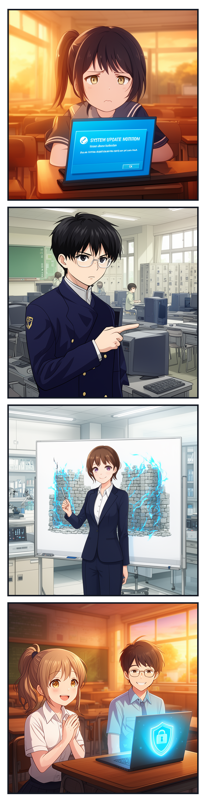
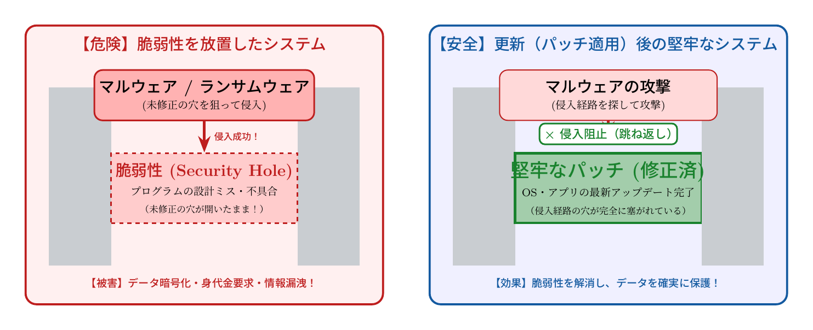

# 第4話 忍び寄るトロイの木馬 〜マルウェアの種類とソフトウェア更新の真実〜

> **【放課後サイバーディフェンス・ラボ】**
> - **舞台**: 県立青葉台高校 情報科学部 ＆ 帝都科学大学先端セキュリティラボ
> - **登場人物**: 城崎 悠真（高校2年・部長）、橘 葵（高校2年・部員）、芹沢 涼香 准教授（大学メンター / IPAアドバイザー）
> - **学習テーマ**: マルウェアの種類と生態、脆弱性（セキュリティホール）の原理、セキュリティアップデート（パッチ）の必須性
> - **参照規格・公式情報**:
>   - [IPA / JPCERT/CC：Japan Vulnerability Notes (JVN)](https://jvn.jp/)
>   - [IPA：サイバーセキュリティ注意喚起（ランサムウェア対策）](https://www.ipa.go.jp/security/anshin/measures/ransomware.html)
>   - [サイバーセキュリティ.com：ランサムウェア感染・サプライチェーン攻撃速報](https://cybersecurity-jp.com/news)

---

## 🎨 4コマ漫画・ストーリーイラスト (Draw Things 生成)

---

## 💬 4コマ漫画キャラクターセリフ（日・英対訳）

挿絵の4コマ漫画（文字なし）の各コマに対応したキャラクターのセリフです。小説本文の導入としてもお楽しみいただけます。

| コマ | 展開 / シチュエーション | 🗣️ 日本語セリフ (Japanese) | 🌐 英語セリフ (English) |
|:---:|:---|:---|:---|
| **第1コマ** 【起】 | **システム更新の通知を邪魔者扱いする葵** ノートPCの更新ポップアップを鬱陶しそうに見つめ、後回しにしようとする葵。 | **葵**: 「また更新通知……？ 今ちゃんと動いてるんだから、いちいち再起動なんてしたくないよ〜！」 | **Aoi**: "Another update notice...? My PC is working just fine right now, I really don't wanna restart it again!" |
| **第2コマ** 【承】 | **悠真の鋭い指摘：脆弱性は城門の壊れた鍵** 冷静な眼差しで、更新を怠ると侵入者の足がかりになる危険を諭す悠真。 | **悠真**: 「後回しにするのは危険だ、葵。更新は欠陥（脆弱性）を塞ぐパッチだ。放置するのは泥棒に城門を開けておくのと同じだよ。」 | **Yuma**: "Postponing it is dangerous, Aoi. Updates patch critical vulnerabilities. Leaving it unfixed is like leaving the castle gates wide open for thieves." |
| **第3コマ** 【転】 | **芹沢先生によるマルウェア4分類と城壁防御の解説** ホワイトボードに城壁の修復を描き、ウイルス・ワーム・トロイの木馬・ランサムウェアの脅威を説く芹沢准教授。 | **芹沢先生**: 「マルウェアは脆弱性の隙間から忍び込みます。特にトロイの木馬やランサムウェアは正規の顔をして侵入するの。最新パッチこそが最強の城壁よ。」 | **Prof. Serizawa**: "Malware slips through unpatched cracks. Trojans and ransomware often disguise themselves as legitimate files. Keeping software up-to-date is your strongest fortress wall." |
| **第4コマ** 【結】 | **アップデート実行！青い防壁に包まれる安心感** 納得して「今すぐ更新」をクリックし、爽快な笑顔を浮かべる葵と見守る悠真。 | **葵**: 「よし、アップデート完了！ これで我が家の城門もしっかり補修されたね！」 **悠真**: 「その通り。日頃のメンテナンスが最強のディフェンスだよ。」 | **Aoi**: "Alright, update finished! Now our digital castle gate is fully reinforced!" **Yuma**: "Exactly. Everyday maintenance is our ultimate defense." |

---

## 📖 小説本文

窓際の席で、橘葵は眉間に深い皺を刻んでいた。ノートPCの画面には、無視し続けているはずのシステム更新通知が、執拗なまでの存在感を放って居座っている。

「……また出てる。もう、いいじゃない。今動いてるんだから、変にいじらなくていいでしょ」

葵が唇を尖らせて呟く。彼女にとって、この青い「更新」ボタンは、平穏な日常を壊す厄介な闖入者のように見えた。せっかくカスタマイズした環境が、アップデートのせいで動かなくなるかもしれない――そんな漠然とした恐怖が、彼女の指を止めていた。

「葵、それ『後で』って後回しにしている間に、門の鍵が壊れてるかもしれないよ」

隣の席から声をかけたのは、城崎悠真だった。彼は手元の端末を操作しながら、眼鏡の奥の瞳を細めた。部長らしい落ち着いた声だが、その内容は至極真っ当な忠告だ。

「門の鍵って……パソコンの話？」
「そう。OSやソフトウェアは、常に穴が開いた状態で流通していることがある。更新っていうのは、その穴を塞ぐための『パッチ』を当てる作業なんだ。放置するっていうのは、泥棒に『どうぞ入ってください』って案内板を出しているのと同じことだよ」

悠真は椅子を回転させ、葵の画面を指差した。
「君が心配してる『動かなくなるかも』っていうリスクよりも、知らないうちに中身を覗かれたり、勝手に操作されたりするリスクの方が、今の時代は遥かに高いんだ」

葵は少しだけ顔をしかめ、それでも通知を閉じることだけは拒否した。その様子を、背後に立つもう一人の人物が静かに見守っていた。

* * *

大学の講義室に近い、高度なセキュリティ研究室の一角。
そこには、案内役としてやってきた芹沢涼香がいた。彼女は白衣のような清潔感のあるジャケットを纏い、ホワイトボードの前に立った。

「先ほど悠真君から聞いたけれど、葵さんは『更新』に対して少し慎重なのね。それはユーザーとしては正しい感覚だわ。でも、技術者の視点から見ると、その『慎重さ』が時として最大の隙を生んでしまうこともあるの」

涼香はペンを手に取り、黒板に大きく『マルウェア』と書き込んだ。

「世の中にはいろんな種類の悪意がある。まずは基本の分類から整理しましょうか。例えば『ウイルス』。これは宿主が必要な存在よ。ファイルやプログラムに寄生して、実行されることで増殖する。風邪と同じで、誰かが持ち込むことで広がるわね」

彼女は淀みなく言葉を紡いでいく。
「一方で、『ワーム』は宿主はいらない。自らネットワークを駆け巡り、勝手に複製を繰り返してシステムを埋め尽くす。まるで生態系の侵略者のように。そして……これが一番厄介なのが『トロイの木馬』よ」

涼香がホワイトボードに「贈り物」のイラストを描き、その中に隠れた牙を描き加えた。
「一見すると便利なツールや無害なソフトの顔をして潜り込んでくるけれど、中身は攻撃の拠点。ユーザーに『これ便利そう！』とインストールさせることで、自ら門を開けさせるの。そして最近、最も社会的な脅威となっているのが『ランサムウェア』ね」

「……身代金要求型、ってやつだよね」
葵が呟く。

「ええ。データを暗号化して人質に取る。これ、ただのいたずらじゃないのよ。実際にサイバーセキュリティに関する報道を見てごらん。医療機関のシステムが停止して手術ができなくなる、中小企業のバックアップデータがすべて奪われて倒産に追い込まれる……そんな事件が、今この瞬間も世界中で起きているわ」

* * *

涼香はホワイトボードの端に『脆弱性（セキュリティホール）』と書いた。
「なぜアップデートが必要なのか。その核心にあるのがこれよ。ソフトウェアは人間が書くもの。どんなに優秀なエンジニアでも、設計ミスや予期せぬバグを完全に排除することはできない。この小さな欠陥……つまり『脆弱性』を見つけた瞬間、それは攻撃者にとっての『地図』になるわ」

彼女の声には、学問に対する真摯な熱が宿っていた。
「攻撃者は、ソフトウェアに穴が見つかったというニュースを聞けば、即座にそれを突くためのツールを作り始める。公開された情報は、彼らにとっての武器になるの。だから、メーカーが『修正パッチ』を配布した瞬間、それは『攻撃者が穴を見つけた』という事態への緊急事態なのよ」

涼香は葵の目を真っ直ぐに見つめた。
「更新ボタンを押すことは、単なるメンテナンスじゃない。それは『城壁の修復』なの。壊れた箇所に新しい石を積み上げ、敵の侵入を防ぐための最前線の防衛作業。それを放置することは、城壁の一部をわざと壊したまま放置するようなもの。……葵さん、あなたが愛しているそのパソコンやデータを守れるのは、結局はこの『更新』という行為だけなのよ」

講義室の空気は、先ほどまでの「面倒な事務作業」の話とは一変し、緊迫した防衛戦の最前線を想起させる重みへと変わっていた。

* * *

研究室を出て、夕暮れに染まり始めたキャンパスを歩きながら、葵は自分の手元のスマホを見つめた。
そこにも「システムアップデート」の通知が届いている。

「……城壁の修復、か」

彼女は小さく呟いた。これまでは、アップデートをすることで何かが壊れることを恐れていた。しかし今は、そのボタンを押さないことによって、自分の居場所や大切な思い出のデータが、正体不明の誰かに荒らされる恐怖が上回っていた。

悠真が隣で微笑んでいる。
「どう思った？」

葵は少しだけ誇らしげに、あるいは覚悟を決めたような表情で答えた。
「……ちょっと、城壁の守り手（ガーディアン）になった気分。これ、ただの『面倒な通知』じゃないね」

彼女はスマホを取り出し、迷いのない指先で「今すぐインストール」のボタンをタップした。画面にプログレスバーが表示され、細かなパーセンテージが刻まれていく。

それは、見えない脅威から自分を守るための、静かな、しかし確実な抵抗の始まりだった。

涼香は遠くでその様子を見つめながら、ふっと表情を緩めた。
「いいわね。次はその『城壁』をどう設計するか、セキュアプログラミングの話に進みましょうか」

彼女の瞳には、複雑なシステムアーキテクチャの深淵と、それを守り抜こうとする若者たちの熱意が映っていた。

---

## 📊 TikZによるセキュリティ構造図解

### 脆弱性の放置リスク vs セキュリティパッチによる修復・防御モデル

---

## 💡 高校生のためのセキュリティ深掘りコラム

### 1. 「悪意あるソフトウェア」マルウェアの4大分類
- **コンピュータウイルス**: 他の正常な実行ファイルやマクロに寄生（感染）して悪さを働くプログラム。
- **ワーム**: 宿主ファイルを必要とせず、ネットワーク経由で自分自身の複製を勝手に拡散させる自立型プログラム。
- **トロイの木馬**: 有用なゲームや便利ツールに見せかけてユーザーに自ら実行させ、裏でバックドアを開く罠。
- **ランサムウェア**: 端末内の写真や文書ファイルを勝手に強力な暗号でロックし、「元に戻したければ身代金を払え」と脅迫する極めて悪質なマルウェア。

### 2. 脆弱性（セキュリティホール）とは何か？
プログラムは人間が書いたもの（数百万行〜数千万行のコード）であるため、どうしても「メモリ管理のミス」や「入力チェックの漏れ」などの欠陥（バグ）が生まれます。このうち、**外部から不正操作や情報奪取に悪用できてしまうバグを「脆弱性（セキュリティホール）」**と呼びます。

### 3. なぜ「アップデートの先延ばし」が最も危険なのか？
セキュリティパッチ（修正プログラム）が公開された瞬間、攻撃者は「どんな穴が塞がれたのか」を逆アセンブル（リバースエンジニアリング）して解析し、**パッチを当てていない無防備な端末を狙い撃ちにする攻撃コード（エクスプロイト）**を瞬時に作成・ばら撒きます。
「後でやろう」と数日間放置するだけで、ネットに繋がっている端末は世界中の自動スキャンボットの標的になってしまいます。

### 4. 大学で学ぶ「システム安全工学とリバースエンジニアリング」
大学の計算機科学科・情報工学科では、プログラムがOSのメモリ（スタック領域やヒープ領域）をどのように使用するかというコンピュータアーキテクチャの根底を学びます。バッファオーバーフローなどの脆弱性がなぜ発生するのか、そして**「欠陥の出ない安全なプログラム（セキュアコーディング）」**をどう構築するかを学ぶことは、最高峰のエンジニアになるための必須教養です。
