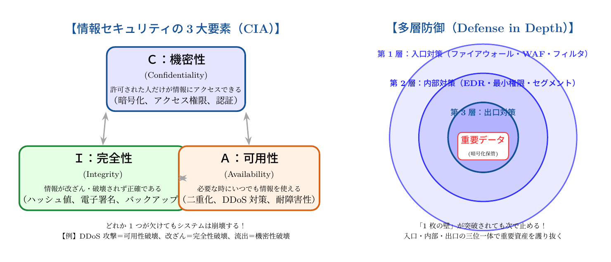

# 第5話 三つの宝珠を守る城壁 〜情報セキュリティの3大要素（CIA）と多層防御〜

> **【放課後サイバーディフェンス・ラボ】**
> - **舞台**: 県立青葉台高校 情報科学部 ＆ 帝都科学大学先端サイバー防衛指令室
> - **登場人物**: 城崎 悠真（高校2年・部長）、橘 葵（高校2年・部員）、芹沢 涼香 准教授（大学メンター / IPAアドバイザー）
> - **学習テーマ**: CIAの3要素（機密性・完全性・可用性）、真正性と責任追跡性、多層防御（入口・内部・出口対策）
> - **参照規格・公式情報**:
>   - [IPA 独立行政法人 情報処理推進機構：デジタルスキル標準（DSS）セキュリティアーキテクチャ](https://www.ipa.go.jp/jinzai/skill-standard/dss/index.html)
>   - [内閣官房 国家サイバー統括室：サイバーセキュリティ基本法と重要インフラ防護](https://www.cyber.go.jp/)
>   - [サイバーセキュリティ.com：DDoS攻撃・システムダウン・Web改ざん被害速報](https://cybersecurity-jp.com/news)

---

## 🎨 ストーリーイラスト (Draw Things 生成)

---

## 📖 小説本文

窓の外では、放課後の校庭をオレンジ色の西日が長く引き延ばしている。
部活動の活動場所である旧校舎の一室。城崎悠真は、無機質なディスプレイに映る文字列を見つめながら、眉間に深い皺を刻んでいた。

「……このアルゴリズムをさらに洗練させれば、理論上は突破不可能な暗号が構築できるはずだ。鍵さえ厳重に管理すれば、データは完璧に守られる」

悠真の声は低く、確信に満ちていた。彼は情報の「秘匿性」に執着していた。彼にとってセキュリティとは、強固な金庫を作り、そこに大切なものを閉じ込めることと同義だった。

「ねえ、悠真くん。それって、本当に『守ってる』って言えるのかな？」

隣の席で椅子を回して座っていた橘葵が、ポテトチップスを口に運びながら首を傾げた。彼女は悠真の理論的な思考とは対照的に、より「使う側」の感覚を重視するタイプだ。

「何のこと？ 暗号化してさえいれば、外部の人間は中身を覗くことなんてできないよ」

「だって、もし学校のサーバーがダウンして、テストの成績表が見られなくなったらどうするの？ それだって『セキュリティ問題』じゃない？」

葵の言葉に、悠真は一瞬だけ思考を止めた。
「……それは可用性の問題だ。私が今取り組んでいるのは、情報の機密性を保つためのものだよ」

「でもさ、見られないなら意味がないでしょ。テストの点数が見たい時に見られないのは、自分の部屋の鍵をかけすぎて、自分も中に入れなくなってるようなもんじゃない？」

葵の指摘はシンプルだが、鋭い。悠真はモニターから視線を外した。確かに、彼が追求している「強固な壁」は、時として正当な利用者を拒絶する刃にもなり得る。

* * *

ノックの音が響き、重い扉が開いた。
入ってきたのは、大学から招へいされた特別講師であり、部活動のアドバイザーでもある芹沢涼香だった。彼女は白衣のような清潔感のあるジャケットを羽織り、手にタブレットを持って微笑んでいる。

「お疲れ様。二人の議論、ここまでは聞こえていたわよ」

涼香はホワイトボードの前に立つと、チョークを手に取った。
「悠真くん、君は『鍵』を極めようとしている。それは素晴らしいことよ。でも、セキュリティの真髄は、その鍵だけで完結するものではないの」

彼女はホワイトボードに大きな円を描き、そこに三つの文字を書いた。

「機密性（Confidentiality）、完全性（Integrity）、そして可用性（Availability）。この『CIA』という三つの要素のバランスこそが、情報セキュリティの基礎であり、守るべき三つの宝珠なのよ」

涼香は誇張された身振りで説明を続けた。
「機密性は、許可された人だけが見られること。悠真くんが今向き合っているものね。でも、それだけでは足りない。例えば、データが正しい状態であること――完全性が保たれているか。改ざんされていないか。これはハッシュ値やデジタル署名で保証されるものよ」

彼女は葵の方を向き、頷いた。
「そして葵さんが言った『見られること』――可用性。必要な時に、必要な人が、正しくアクセスできること。これが崩れれば、どんなに高度な暗号化も無意味になってしまうわ」

悠真はペンを置き、ホワイトボードを見つめた。
「……つまり、三つの要素のどれか一つでも欠ければ、システムは破綻するということですね」

「その通りよ」涼香は頷いた。「例えば、ランサムウェア攻撃を見てごらん。犯人はデータを暗号化して『機密性』を奪うだけでなく、組織のシステムを停止させて『可用性』を破壊し、さらにはバックアップを消去して『完全性』さえも奪い去る。これら三つを同時に、あるいは巧妙に組み合わせることで、組織を麻痺させるの」

* * *

涼香はタブレットを操作し、いくつかのニュース記事を映し出した。
「最近の動向を見てちょうだい。大規模なDDoS攻撃によって主要な公共サービスが数時間停止した事件や、企業のバックアップデータが破壊され、復旧すら不可能になった事例……。これらはすべて、CIAのうちの『可用性』と『完全性』への攻撃よ」

葵は身を乗り出して画面を見た。
「えっ、バックアップまで壊されるの？ 予備があるから大丈夫って思ったら、それも消されちゃうなんて……」

「そう。だからこそ、私たちは『多層防御（Defense in Depth）』という哲学を必要とするの」

涼香はホワイトボードに、巨大な城郭のイラストを描き始めた。
「セキュリティを一重の壁で守ることはできない。城郭を想像してほしい。まず外側に、不審者を寄せ付けない『外壁』がある。これがファイアウォールや入口の対策よ」

彼女は城の内部にさらに壁を描き加えた。
「次に『内郭』。侵入されたとしても、すぐに王城へ辿り着けないようにする仕切り。これがEDR（Endpoint Detection and Response）やネットワークの細分化ね。そして、最も奥にある『天守閣』……ここがデータの最深部よ。ここでようやく悠真くんの得意な『暗号化』が機能する」

「外壁で防ぎ、内郭で遅延させ、天守閣で守る……」
悠真が呟いた。

「そう。一つの壁を突破されたからといって、すべてが終わりではないように設計する。多層の防衛線を用意することで、攻撃者のコストを上げ、被害を最小限に食い止める。これが現代のセキュリティガバナンスにおいて最も重要な考え方の一つなのよ」

悠真は自分のノートを見つめた。
それまでは「どうやって最強の鍵を作るか」だけを考えていた。しかし今、彼の視界には、その鍵を収めるための広大な城郭の設計図が浮かび上がっていた。

* * *

部活動の時間が終わり、夕闇が校舎を包み込んでいた。
悠真は一人、自分のデスクに残ったホワイトボードの図面を見つめていた。

「……多層防御、か」

彼は手元のノートに、新しい見出しを書いた。『システム設計論：城郭モデルにおける資産保護』。
ただコードを書くことだけがエンジニアの仕事ではない。いかにしてこの三つの宝珠を守り、かつ社会に役立てるための「仕組み」を構築するか。その複雑なパズルを解くことへの知的な興奮が、彼の胸に芽生えていた。

そこへ、葵が顔を出した。
「あ、まだ残ってたんだ。……なんか、今の話聞いてから、悠真くんの顔つきが変わったね。ちょっと……『ガチ』な感じ」

悠真は少しだけ口角を上げた。
「ああ。次は、この城郭の『内郭』にどんな仕掛けを組み込めるか、考えてみることにしたんだ」

「へぇー、かっこいいこと言うね。じゃあ、私はその城の中で一番使いやすい『門』の設計を考えるから、協力してよ！」

葵の明るい笑い声が、静かな教室に響いた。
悠真はペンを握り直し、次のページへと書き進めた。彼の中に、サイバーセキュリティという広大な学問への、純粋で熱い憧れが形になり始めていた。

---

## 📊 TikZによるセキュリティ構造図解

### CIAの3大要素と多層防御（同心円モデル）

---

## 💡 高校生のためのセキュリティ深掘りコラム

### 1. セキュリティの土台を支える「CIA」とは？
情報セキュリティとは、単に「パスワードをかけて漏洩を防ぐ（機密性）」ことだけではありません。国際標準（ISO/IEC 27001）やIPAでも定義される以下の3本柱がバランスよく満たされて初めて、安全なシステムと言えます。
- **C（Confidentiality: 機密性）**: 適切な権限を持つ人だけが情報にアクセスできること。（漏洩防止・暗号化）
- **I（Integrity: 完全性）**: 情報が正確であり、改ざんや欠落がないこと。（改ざん検知・ハッシュ値）
- **A（Availability: 可用性）**: 必要な時に、いつでも遅延なくサービスを利用できること。（二重化・耐障害性）

### 2. 「可用性」を狙い撃ちにするDDoS攻撃
大量のパソコンやIoT機器を乗っ取って一斉に標的サーバーへ無駄な通信を送りつける**「DDoS（分散型サービス不能）攻撃」**は、機密性を盗むのではなく**「可用性をゼロにして業務を停止させる」攻撃**です。チケット予約サイトやオンラインゲーム、自治体サイトがアクセス集中でダウンさせられるのは、まさに可用性が脅かされた実例です。

### 3. お城に学ぶ「多層防御（Defense in Depth）」の極意
中世の堅牢な城は、一本の堀や一つの門だけで守られていたわけではありません。
- **入口対策（外堀・大手門）**: ファイアウォールやWAFで不正侵入を水際でブロック。
- **内部対策（城内の迷路・内郭）**: たとえ門が破られても、EDR（エンドポイント検知）やネットワーク分離で被害拡大を防ぐ。
- **出口対策（天守閣の宝物庫）**: 侵入者がデータを持ち出そうとしても暗号化や持ち出し遮断（DLP）で阻止する。
「100%破られない壁はない」という前提に立ち、何重もの盾を用意するのが現代サイバーセキュリティの神髄です。

### 4. 大学で学ぶ「セキュリティガバナンスとリスクマネジメント」
大学の情報社会科学部や経営情報学科、先端工学部では、技術的なプログラミングだけでなく、「限られた予算と時間の中で、どの資産をどう多層防御で守るべきか」という**リスク分析手法やセキュリティガバナンス**を学びます。社会全体の重要インフラを俯瞰し、守護の戦略を立てる「セキュリティストラテジスト（CISO）」への道が開かれています。
