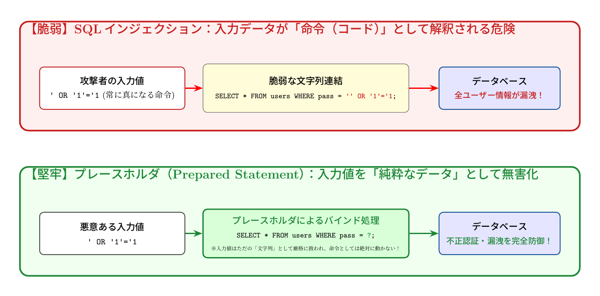

# 第6話 データベースの合言葉と呪文の罠 〜SQLインジェクションと安全なプログラミング〜

> **【放課後サイバーディフェンス・ラボ】**
> - **舞台**: 県立青葉台高校 情報科学部 ＆ 帝都科学大学
> - **登場人物**: 城崎 悠真（高校2年・部長）、橘 葵（高校2年・部員）、芹沢 涼香 准教授（大学メンター / IPAアドバイザー）
> - **学習テーマ**: SQLインジェクションの脆弱性原理、プレースホルダ（バインド機構）、データとコードの分離思想
> - **参照規格・公式情報**:
>   - [IPA：安全なウェブサイトの作り方（セキュリティ実装ガイダンス）](https://www.ipa.go.jp/security/vuln/websecurity.html)
>   - [OWASP Top 10：インジェクションの脅威](https://owasp.org/www-project-top-ten/)
>   - [サイバーセキュリティ.com：Webサイト改ざん・SQLインジェクション漏洩速報](https://cybersecurity-jp.com/news)

---

## 🎨 ストーリーイラスト (Draw Things 生成)

---

## 💬 4コマ漫画キャラクターセリフ（日・英対訳）

挿絵の4コマ漫画（文字なし）の各コマに対応したキャラクターのセリフです。小説本文の導入としてもお楽しみいただけます。

| コマ | 展開 / シチュエーション | 🗣️ 日本語セリフ (Japanese) | 🌐 英語セリフ (English) |
|:---:|:---|:---|:---|
| **第1コマ** 【起】 | **検索フォームに入力した「呪文」で全データ流出！？** フォームに `' OR '1'='1` と入れただけで非公開データがずらりと表示され、唖然とする悠真。 | **悠真**: 「……嘘だろ。ただの入力フォームなのに、全ユーザーの非公開データがそのまま引き出せてしまった……！」 | **Yuma**: "...You've got to be kidding me. Just typing into an ordinary form exposed every user's private records...!" |
| **第2コマ** 【承】 | **葵の驚き：文字列の連結が生んだ致命的な罠** コードの `WHERE name = ' + input + '` を指差し、悪意ある呪文がSQL文を改変した手口に気づく葵。 | **葵**: 「ユーザーの入力した文字をそのままSQLに合体させてる……！ だから命令文がすり替わっちゃったんだ！」 | **Aoi**: "The code literally concatenates raw user input into the SQL query...! That's why the command got hijacked!" |
| **第3コマ** 【転】 | **芹沢先生によるプレースホルダ（バインド機構）の指南** 「データ」と「命令」を絶対に混ぜてはいけない原則と、安全なプレースホルダ構造をホワイトボードで解説する芹沢准教授。 | **芹沢先生**: 「文字列連結は最も危険な悪手です。プレースホルダ（バインド機構）を使えば、悪意ある文字列も単なる『無害なデータ』として処理されるのよ。」 | **Prof. Serizawa**: "String concatenation is the most dangerous pitfall. By using prepared statements with placeholders (binding), malicious code is treated strictly as 'harmless data'." |
| **第4コマ** 【結】 | **セキュアコーディング完了！安全なデータベースへ** コードをプレースホルダに書き換え、テストで不正入力が完全に弾かれたのを確認して笑顔で頷き合う二人。 | **悠真**: 「よし、バインド機構の実装完了。どんな不正な文字列が来ても、命令として解釈されることはない。」 **葵**: 「プログラミングの安全って、こういう細かな配慮の積み重ねなんだね！」 | **Yuma**: "Alright, prepared statements are fully in place. No malicious input will ever be executed as code." **Aoi**: "Secure programming truly comes down to these thoughtful, rigorous habits!" |

---

## 📖 小説本文

放課後の情報科学部室は、西日の斜光が埃の粒子を黄金色に染め上げていた。
　
「ちょっと待って、悠真くん。これ……おかしいよ」
　
橘葵がディスプレイを指差し、眉をひそめた。彼女の視線の先には、部活動の紹介サイトのログイン画面が表示されている。
　
「おかしいって、何が？」
　
城崎悠真は椅子を回転させ、彼女の横に寄り添った。葵はいたずらっぽく笑いながら、キーボードを叩く。
　
「さっきからずっと、パスワードを適当な文字列で入れてるのに、全然弾かれないの。それどころか、変な記号を入れてみたら……見て」
　
彼女が入力した文字列は、『' OR '1'='1』だった。
　
葵がエンターキーを押し込んだ瞬間、画面が瞬きするように点滅し、次の瞬間には「管理者へようこそ」というメッセージと共に、部員名簿の全データが表示された。
　
「え……」
　
悠真の喉から、乾いた音が漏れた。自分の作ったシステムが、正しく動作しているのではなく、意図しない挙動を許容してしまったのだ。

* * *

「……これ、僕の書いたコードのせいだ」
　
部室の静寂の中に、悠真の低い呟きが響いた。彼はノートパソコンの画面を凝視し、Pythonで記述したバックエンドの処理を一行ずつ追い始めた。
　
原因は明白だった。データベースに対して発行するSQL文を構築する際、彼はユーザーからの入力をそのまま文字列として結合していたのだ。
　
「『username = '（入力値）' AND password = '（入力値）'』っていう命令を作るつもりが……」
　
悠真は指先で画面上のコードをなぞる。葵が入力した記号が含まれると、SQL文の構造そのものが書き換わってしまう。本来「パスワードが一致するか」を判定するはずの場所が、「『1=1』という常に正しい条件」にすり替わったのだ。
　
システムは、ユーザーから送られてきた「データ」を、プログラムへの「命令」として誤認した。
　
「これじゃあ、鍵をかけるどころか、ドアの構造そのものを勝手に変えられてるようなもんじゃないか……」
　
葵が身を乗り出す。彼女の瞳には、技術的な落とし穴に対する驚きと、それを見つけた高揚感が混ざり合っていた。
　
「SQLインジェクション……。教科書で見たことあるけど、実際に自分のコードで起きるってのは、ちょっとゾクッとするね」

* * *

その時、部室のドアがノックされた。入ってきたのは、以前から悠真たちの進捗を指導している大学の芹沢涼香准教授だった。
　
「おや、面白い表情をしているね。何かが起きたのかい？」
　
彼女は柔和な笑みを浮かべながらも、その目は鋭くディスプレイを見つめた。悠真が慌ててコードと現在の状況を説明すると、芹沢は深く頷いた。
　
「典型的な脆弱性だね。これを知らずに商用システムを公開すれば、取り返しのつかない事態になる」
　
彼女はタブレットを取り出し、ニュース記事のヘッドラインをいくつか映し出した。
　
「大規模なECサイトで、顧客の個人情報やクレジットカード情報が数百万件規模で流出した事件。その多くは、君たちが今直面しているような、基礎的なSQLインジェクションが原因だったりするんだよ」
　
彼女の声には、技術者としての厳格さが宿っていた。
　
「データと命令を混同してはいけない。これはセキュアプログラミングにおける鉄則だ。プログラムは『何をするか』という構造（命令）と、『何を対象にするか』という内容（データ）を、物理的に分離して扱う必要がある」
　
芹沢の言葉に、悠真は思わず背筋を伸ばした。単に「バグを直す」という次元ではない。ソフトウェア工学としての設計思想の問題なのだ。

* * *

「じゃあ、どうすればいいんですか？ 文字列をくっつけるのをやめるだけじゃダメなんですか？」
　
葵の問いに、芹沢は満足そうに頷いた。
　
「いい質問だね。解決策は『プレースホルダ』、つまりプリペアドステートメントを使うことだ」
　
彼女がホワイトボードに数行のコードを書き込んでいく。
　
「SQL文の構造をあらかじめ固定してしまい、ユーザーからの入力はその『穴』を埋めるだけのデータとして扱う。これなら、入力の中にどんな記号が含まれていようとも、システムはそれを『命令の一部』として解釈することはできなくなる」
　
悠真は即座にキーボードを叩き始めた。彼はPythonのDBライブラリを修正し、文字列結合を廃止して、プレースホルダを用いたクエリへと書き換えていく。
　
一分後、葵が再び『' OR '1'='1』を入力した。
　
画面には「ログインに失敗しました」という無機質なメッセージが表示された。
　
「……やった」
　
悠真は深く息を吐いた。ただの「動くもの」を作るフェーズは終わり、ここから「安全なもの」を作るフェーズへと足を踏み入れた瞬間だった。
　
「これって、データベース論だけじゃなくて、もっと深いところに関係してるんですよね？」
　
悠真の問いに、芹沢は誇らしげに微笑んだ。
　
「その通りだ。形式言語理論やセキュアソフトウェア工学といった分野では、こうした『命令とデータの境界』をいかに厳密に定義するかが重要なテーマになる。君の好奇心は、正しい方向に向かっているよ」
　
夕暮れの部室で、悠真は自分の書いたコードを見つめた。そこに流れるのは、単なる文字の羅列ではない。強固な論理と、守り抜くための意志が刻まれた「呪文」の正体だった。

---

## 📊 TikZによるセキュリティ構造図解

### SQLインジェクションの攻撃原理 vs プレースホルダによる無害化防御

---

## 💡 高校生のためのセキュリティ深掘りコラム

### 1. 「データ」が「命令」に化ける恐怖：SQLインジェクション
Webサイトの検索窓やログインフォームに入力された文字列を、サーバー側でそのままSQL文（データベース操作言語）に文字列結合してしまうと、攻撃者は細工したSQLの欠片（例: `' OR '1'='1`）を送り込むことで、開発者の意図しないSQL命令を実行させてしまいます。
これにより、**「パスワードを知らなくても他人のアカウントで強制ログイン」「顧客データベース全体の不正抜き取り」「データの全削除」**など、壊滅的な被害が発生します。

### 2. 根本的な解決策：「プレースホルダ（Prepared Statement）」
SQLインジェクションを防ぐ世界標準の技術が**「プレースホルダ（バインド機構）」**です。
1. まずSQLの命令構造（骨組み）だけをデータベースにコンパイルさせて確定させる（例: `WHERE pass = ?`）。
2. 後からユーザーの入力値を「純粋なデータ（値）」として後付けで当てはめる。
この仕組みにより、どんなに巧妙なSQL構文が入力値に含まれていても、データベースはそれを**「ただの文字列データ」として機械的に処理するため、命令として暴走することは絶対にありません**。

### 3. 歴史とOWASP Top 10
SQLインジェクションは20年以上前から知られている古典的な脆弱性ですが、国際的なWebセキュリティ推進組織「OWASP（Open Worldwide Application Security Project）」の脅威ランキング（OWASP Top 10）において、常に上位にランクインし続けています。[サイバーセキュリティ.com](https://cybersecurity-jp.com/news)でも、中小ECサイトでの顧客クレジットカード情報漏洩事件の多くがSQLインジェクションを起点としています。

### 4. 大学で学ぶ「プログラミング言語論とデータベース理論」
大学の情報理工学部やコンピュータ科学科では、関係代数（リレーショナル代数）に基づくデータベースの基礎理論や、コンパイラがプログラムの構文木（AST: Abstract Syntax Tree）をどう解析するかという計算機科学の真髄を学びます。単にフレームワークを使うだけでなく、**「コンピュータが言葉をどう解釈しているのか」**を数理的に探求する面白さがここにあります。
