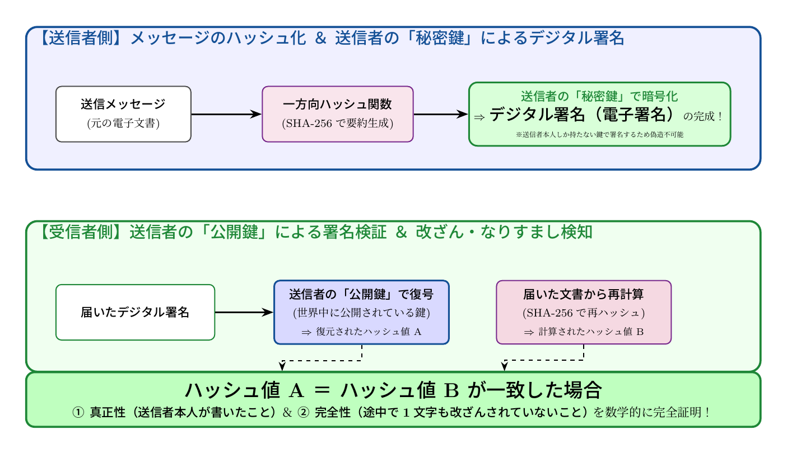

# 第7話 割れない南京錠と魔法の印鑑 〜公開鍵暗号とデジタル署名の数理〜

> **【放課後サイバーディフェンス・ラボ】**
> - **舞台**: 県立青葉台高校 情報科学部 ＆ 帝都科学大学 数理情報セキュリティ研究室
> - **登場人物**: 城崎 悠真（高校2年・部長）、橘 葵（高校2年・部員）、芹沢 涼香 准教授（大学メンター / IPAアドバイザー）
> - **学習テーマ**: 共通鍵暗号の鍵配送問題、公開鍵暗号の鍵ペア、デジタル署名の数理モデル、ハッシュ関数
> - **参照規格・公式情報**:
>   - [IPA 独立行政法人 情報処理推進機構：暗号技術ガイドライン（CRYPTREC）](https://www.ipa.go.jp/security/cryptrec/)
>   - [内閣官房 国家サイバー統括室：暗号政策と耐量子計算機暗号（PQC）の展望](https://www.cyber.go.jp/)
>   - [サイバーセキュリティ.com：ソフトウェア署名改ざん・送信元なりすまし速報](https://cybersecurity-jp.com/news)

---

## 🎨 ストーリーイラスト (Draw Things 生成)

---

## 📖 小説本文

窓の外では、校庭の木々が秋の風に揺れ、乾いた葉の音が規則的に響いている。放課後の部室には、わずかに埃の舞う空気と、古いサーバーから漏れる微かな駆動音だけが漂っていた。

「……でも、先生。そこが一番の難問じゃないんですか？」

橘葵が、手元のノートにペンを置いた。彼女は少し首を傾げ、真剣な眼差しを芹沢涼香に向ける。

「鍵を送らなきゃいけないなら、その『鍵を運ぶ過程』で盗られたら終わりですよね？ 共通鍵暗号っていうのは、二人で同じ鍵を持つっていうことですよね。じゃあ、最初の一回、どうやって相手に鍵を届けるんですか？」

芹沢は穏やかな笑みを浮かべた。彼女は机の上に置かれた、実物の南京錠と、それに対応する小さな鍵を指先で弄ぶ。

「いい指摘ね、葵さん。それが『鍵配送問題』。共通鍵暗号の最大の弱点よ。遠く離れた場所にいる人と秘密を共有しようとする時、最初の一歩をどう踏み出すか。この問題を解決するために、数学はとんでもない『魔法』を編み出したの」

城崎悠真は、その言葉に身を乗り出した。彼はノートの端に「鍵配送問題」と書き込み、ペンを握り直す。彼の瞳には、論理的な美しさを求める知的好奇心が宿っていた。

「魔法……というより、発想の転換ですよね」

「そう。従来のやり方では『共通の鍵』が必要だったけれど、公開鍵暗号はその前提をひっくり返したわ。鍵を二種類用意するの。誰にでも配っていい『公開鍵』と、自分だけが厳重に保管する『秘密鍵』。このペアが、現代のインターネットを守る基礎になっているのよ」

芹沢は南京錠を手に取り、机の上に置いた。

「想像してみて。私は、この開いた南京錠を世界中に配る。誰でもいいわ。そして、私に秘密を送りたい人は、その南京錠を使って箱をロックする。鍵は、私だけが持っているの。だから、たとえ運送中に誰かに箱を盗まれたとしても、中身を開けることはできない。誰も『施錠』はできるけれど、『解錠』ができるのは世界で唯一の持ち主だけ」

悠真の顔に驚愕の色が走った。

「……つまり、鍵そのものを送る必要がないってことですか？ 相手の南京錠を先に送っておけば、その後の通信で鍵を盗まれる心配がない」

「正解よ、悠真くん。それが公開鍵暗号の本質。RSAや楕円曲線暗号といった理論は、この『一方向性』の数学的性質を利用しているわ。大きな数の素因数分解や、離散対数問題といった、計算量的に『逆算が極めて困難』な現象を、安全性の担保に変えたのよ」

悠真は自分の手元を見つめた。公開鍵と秘密鍵。この非対称性が生み出すエレガントな構造に、彼は思わず息を呑んだ。

* * *

「でも先生、それだと『秘密を守る』ことはできても、『誰が送ってきたか』を確認するのは難しいままじゃないですか？」

葵の疑問は止まらない。彼女はさらに深く、システムの核心へと踏み込もうとしていた。

「確かに。公開鍵で暗号化されたメッセージを受け取った時、それは確かに『私の南京錠で閉められた箱』であることはわかる。でも、それが本当に先生が送ったものなのか、それとも誰かがなりすまして送ったものなのかは証明できない。……あ、いや、それなら別の仕組みがあるんですよね？」

芹沢は頷き、ホワイトボードの前に立った。

「鋭いわね。そこで登場するのが『デジタル署名』よ。これは公開鍵暗号の『逆転の発想』で動いているわ」

彼女はチョークを手に取り、図を描き始めた。

「さっきまでの話を整理すると、秘密を守るために『受信者の公開鍵』を使ったわよね？ デジタル署名は逆よ。送信者が自分の『秘密鍵』を使って、メッセージに印を付けるの。そして、受信者は送信者の『公開鍵』を使って、その印が正しいかを確認する」

「逆転……？」

悠真が呟いた。

「ええ。自分だけが持つ秘密鍵で暗号化（署名）をする。そうすることで、『この印を残せるのは世界でこの人しかいない』という証明ができるのよ。これによって、なりすましを防ぎ、同時に内容が改ざんされていないことも保証する。デジタル署名は、いわば『数学的な魔法の印鑑』なの」

「それって、どうやって『中身が変わっていないこと』まで証明するんですか？」葵が身を乗り出す。

芹沢は微笑んで、新たな概念を提示した。

「そこで必要になるのが『ハッシュ関数』よ。メッセージ全体を複雑な数式に放り込んで、固定長の短い文字列に変換するの。これを『ダイジェスト』と呼ぶわ。例えばSHA-256といった関数。この特徴は、元のデータがほんの一文字でも変われば、出力されるダイジェストが全く違うものになること。そして、一度計算したら元のデータに戻すことは絶対にできない『一方向性』を持っている」

芹沢はホワイトボードに数式に近い流れを書いた。

「まず送信者は、送りたいメッセージをハッシュ関数に通してダイジェストを作る。そのダイジェストを自分の秘密鍵で暗号化する。これがデジタル署名よ。受信者は、届いたメッセージを自分でハッシュ関数に通してダイジェストを作り、それと送られてきた署名を送信者の公開鍵で復号した結果と比較する。一致すれば、中身が改ざんされておらず、かつ正当な本人からの送信であることが証明されるの」

悠真は目を見開いた。複雑な情報の塊を、一瞬で固有の「指紋」に変換し、それを秘密鍵で封印する。その指紋のわずかな変化さえも見逃さない数学の厳密さが、信頼の拠り所となっていることに、彼は震えるような感動を覚えた。

* * *

「……すごい。単なる暗号技術じゃなくて、情報の正当性を担保するための哲学に近いものがあるんですね」

悠真は思案に暮れたような表情で言った。部室の窓から差し込む夕日が、彼の横顔を長く照らしている。

「そうよ、悠真くん。これはただの数式じゃない。現代社会における『信頼』という概念そのものを支えている技術なの」

芹沢の声は少し熱を帯びていた。彼女はタブレットを取り出し、いくつかのニュース記事を表示させた。

「例えば、最近ニュースになるソフトウェアのサプライチェーン攻撃。開発者が公開したプログラムに、第三者が悪意のあるコードを紛れ込ませる事件。これを防ぐための最前線にあるのがデジタル署名よ。アップデートファイルに正しい署名がない、あるいは署名が壊れていれば、システムはそれを拒絶する。私たちのスマートフォンやPCが安全に動いているのは、この数学的な印鑑が裏側で常に守ってくれているからなの」

葵が、ニュースの見出しをじっと見つめる。

「SPF、DKIM、DMARC……メールのなりすましを防ぐための技術も、全部このデジタル署名の応用なんですね」

「その通り。メールが本当に特定のドメインから送られたものかを確認する仕組みも、すべては公開鍵とハッシュ関数の組み合わせで成り立っているわ」

芹沢の話が進むにつれ、部室の空気は密度を増していった。ただの「暗号」という言葉の裏側に、巨大な社会インフラとしての責任と、それを支える数学の重みが立ち上がってくる。

「素数や合同式……教科書で習う退屈な数字の羅列が、実は世界中の通信を守り、偽造を防ぎ、経済を回している。それが、私たちの文明の防壁になっている」

悠真は自分の手元にあるノートを見つめた。そこには、先ほど書き込んだ数式や概念が並んでいる。それらはもはやただの記号ではなく、人類が築き上げた信頼の礎（いしずえ）のように見えた。

「数学というものに、美しさがあるのはわかっていたけど……これほどまでに『力強い』ものだとは思いませんでした」

悠真の声は静かだったが、確かな熱を帯びていた。

「いい言葉ね、悠真くん。数学は、抽象的な思考の果てにある純粋な知性であり、同時に現実を支える最も強固な土台でもある。この『割れない南京錠』と『魔法の印鑑』の数理を理解することは、現代の情報の海を泳ぐための羅針盤を手に入れることと同じなのよ」

芹沢は満足そうに頷いた。
窓の外では、完全に日が落ちていた。しかし、部室の中に残った熱気は、まだ消えることなく漂っていた。悠真はペンを置き、深く息を吐いた。彼の脳内では、公開鍵と秘密鍵、そしてハッシュ関数が織りなす幾何学的な美しさが、鮮やかな星座のように繋がり始めていた。

---

## 📊 TikZによるセキュリティ構造図解

### デジタル署名（電子署名）の作成と検証フロー

---

## 💡 高校生のためのセキュリティ深掘りコラム

### 1. 「鍵配送問題」を打ち破った公開鍵暗号の革命
古くからの「共通鍵暗号（シーザー暗号やAES）」は、暗号化と復号に同じ鍵を使うため、「その鍵をどうやって安全に相手に渡すか」という**鍵配送問題**に直面します。
1970年代に発明された**「公開鍵暗号（Public Key Cryptography）」**は、この常識を覆しました。
- **公開鍵（Public Key）**: 誰に配っても良い鍵（開いた南京錠のようなもの）。
- **秘密鍵（Private Key）**: 本人だけが厳重に隠し持つ鍵（解錠用の専用キー）。
誰もが公開鍵で箱をロック（暗号化）できますが、その箱を開けられるのは世界でただ一人、秘密鍵を持つ受取人だけです。

### 2. 「逆転の発想」で生まれるデジタル署名
この鍵ペアの仕組みを**逆向き**に使ったのが「デジタル署名」です。
1. 送信者が、自分だけの**「秘密鍵」で暗号化**したデータ（署名）を作成する。
2. 受信者は、世界中に配られている送信者の**「公開鍵」で復号**を試みる。
もし送信者の公開鍵で綺麗に復号できれば、**「この署名は世界で唯一、秘密鍵を持っている本人しか作れなかった」**ことが数学的に証明されます（真正性・否認防止）。

### 3. ハッシュ関数（SHA-256）との二人三脚
大きな電子文書全体を直接暗号化すると計算に時間がかかるため、実際には**一方向ハッシュ関数（SHA-256など）**を用いて文書を短い固定長データ（ハッシュ値）に圧縮してから秘密鍵で署名します。
もし途中で文書が1文字でも書き換えられると、ハッシュ値が雪崩のように全く別の値に変化するため、**「途中で改ざんされていないこと（完全性）」**も瞬時に判定できます。

### 4. 大学で学ぶ「数理情報科学・数論・現代暗号」
大学の数学科や情報科学科では、フェルマーの小定理やオイラーの定理、巨大な素数を使ったRSA暗号の構成、そして楕円曲線上の群論を学びます。さらに近年では、将来の量子コンピュータでも解読できない**「耐量子計算機暗号（PQC: Post-Quantum Cryptography）」**の研究が世界中で熱狂的に進められています。数学という純粋な真理が、世界中の金融や国家インフラを守る最強の盾になる感動を味わえる学問です。
