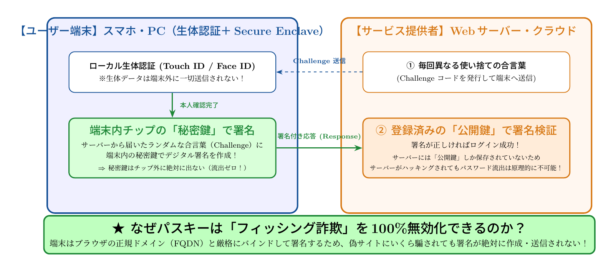

# 第8話 覚えない合言葉と手のひらの証明 〜パスキー（FIDO2）とパスワードのない未来〜

> **【放課後サイバーディフェンス・ラボ】**
> - **舞台**: 県立青葉台高校 情報科学部 ＆ 帝都科学大学
> - **登場人物**: 城崎 悠真（高校2年・部長）、橘 葵（高校2年・部員）、芹沢 涼香 准教授（大学メンター / IPAアドバイザー）
> - **参照規格・政府＆海外機関情報**: デジタル庁、総務省、内閣官房国家サイバー統括室、米CISA、IPA

---

## 🎨 ストーリーイラスト (Draw Things 生成)

---

## 💬 4コマ漫画キャラクターセリフ（日・英対訳）

挿絵の4コマ漫画（文字なし）の各コマに対応したキャラクターのセリフです。小説本文の導入としてもお楽しみいただけます。

| コマ | 展開 / シチュエーション | 🗣️ 日本語セリフ (Japanese) | 🌐 英語セリフ (English) |
|:---:|:---|:---|:---|
| **第1コマ** 【起】 | **無数のパスワードにうんざりする葵** 記号・大文字混在の複雑なパスワードを何十個も覚えきれず、思わず頭を机に突っ伏す葵。 | **葵**: 「16桁で英数記号混在、しかも使い回し禁止って……もう人間の記憶力の限界だよ〜！」 | **Aoi**: "16 characters with symbols, uppercase, and no reuse... This is way beyond human memory limits!" |
| **第2コマ** 【承】 | **悠真がスマホを指紋にかざして一瞬でログイン！** パスワードを一文字も入力せず、指紋センサーに触れただけで安全に認証を完了させる悠真。 | **悠真**: 「葵、もうパスワードを記憶する時代は終わりつつあるよ。これを見てごらん。『パスキー（Passkey）』なら指紋一つで即座にサインインだ。」 | **Yuma**: "Aoi, the era of memorizing passwords is coming to an end. Watch this—with 'Passkeys', one touch on the fingerprint sensor signs me in instantly." |
| **第3コマ** 【転】 | **芹沢先生によるFIDO2とセキュアエレメントの仕組み解説** 端末内部の専用安全領域（Secure Enclave）に秘密鍵が厳重保管され、フィッシングサイトには偽鍵が絶対に渡らない構造を説く芹沢准教授。 | **芹沢先生**: 「パスキーはFIDO2規格に基づき、端末内で公開鍵暗号を行います。秘密鍵は端末の外へ絶対に出ないため、偽装サイトに騙されてパスワードを盗まれる心配が根本からゼロになるのよ。」 | **Prof. Serizawa**: "Passkeys rely on FIDO2 public-key cryptography inside your device's Secure Enclave. Since your private key never leaves the device, phishing attacks are rendered completely powerless." |
| **第4コマ** 【結】 | **葵もパスキー登録完了！パスワードのない快適な未来へ** スマホの生体認証でスピーディにログイン成功し、ストレスフリーなセキュリティに満面の笑みを浮かべる葵。 | **葵**: 「わあ、本当に一瞬で入れた！ もう長い文字列をメモして隠す必要もないんだね！」 **悠真**: 「便利さと最強の安全性が両立する。これがパスワードレスの世界だよ。」 | **Aoi**: "Wow, it logged in in a split second! No more jotting down long passwords on sticky notes!" **Yuma**: "Maximum convenience meets bulletproof security. That's the passwordless future." |

---

## 📖 小説本文

　窓の外では、夕暮れ時の湿った風が銀杏の葉を揺らしている。
　大学の研究棟の一角にある会議室は、電子機器の微かな駆動音と、わずかに漂うコーヒーの香りに満ちていた。

「……結局、人間には限界があるっていうことですよね」

　城崎悠真は、手元のタブレットを投げ出すように机に置いた。彼の眉間には、長年の「パスワードの苦悩」からくる深い皺が刻まれている。
「『英大文字・数字・記号を混ぜて十二文字以上』。正直、もう覚えきれないんです。それも、サービスごとに違うならなおのこと。僕たちはなぜ、機械のために記憶を犠牲にしなきゃいけないんでしょうか」

「あはは、悠真くんの悩み、すごく共感できる！」
　隣でスマートフォンを弄っていた橘葵が、弾けるような笑顔で身を乗り出した。
「でも、最近のスマホって便利じゃない？ 顔を向けるだけとか、指を置くだけで『はい、本人です』って通してくれるじゃん。それって、パスワードを打つよりずっと安全な気がするんだけど」

　二人の視線の先には、落ち着いた佇まいで資料を整理している女性がいた。芹沢涼香だ。彼女は大学の情報科学部で准教授を務め、デジタル庁や総務省の認証ガイドラインにも深く関わっている。
「その『ポチッ』という操作の裏側にあるのは、単なる利便性の追求だけではありません。それは、私たちが数十年間積み上げてきた『パスワードという概念』からの脱却なんです」

　涼香はホワイトボードにペンを走らせた。
「現在、政府も総務省も強力に推進しているのが『パスキー（FIDO2）』という技術です。これは単なる『指紋認証の導入』ではなく、セキュリティの根本的なパラダイムシフトを意味しています」

* * *

　涼香は、ホワイトボードに二つの鍵のイラストを描いた。
「まず、これまでのパスワード方式を思い出してください。あなたがサイトにログインする時、サーバー側にはあなたの『秘密の合言葉』が保存されています。つまり、サーバーが攻撃を受けてハッキングされた瞬間、あなたのパスワードは丸見えになる。これが従来の弱点でした」

　彼女は「公開鍵暗号」という文字を書き込んだ。
「パスキーの仕組みは、それとは真逆です。例えば、あなたがこのサイトに登録する時、デバイス内の『セキュアチップ』という極めて強固な領域に『秘密鍵』が生成され、閉じ込められます。この鍵は、絶対に外へ持ち出せません。そして、サーバー側には『公開鍵』だけが渡されます」

　悠真が顔を上げた。「公開鍵……つまり、合言葉の代わりに『鍵のペア』を使うってことですか？」
「その通りです。ログインする時、サーバーはデバイスに対して『この計算をして答えてください』というチャレンジを送ります。あなたのスマホやPCはその指令を受け取り、内部の秘密鍵を使って計算結果を返します。これを『チャレンジ＆レスポンス認証』と呼びます」

　葵が目を輝かせた。「待って、それって、サーバー側にパスワードが置いてないってこと？」
「ええ。だから、たとえサービス運営会社のサーバーがハッキングされても、盗まれるのは『公開鍵』だけです。公開鍵だけでは、あなたのデバイスを操作することはできません。秘密鍵は常にあなたの手のひらの中、あるいはあなたの顔の裏側に守られているのですから」

* * *

　悠真は、自分のスマホを手に取り、その小さな機械の中に「絶対に外に出ない鍵」が眠っていることを想像した。
「それなら、フィッシング詐欺にも強くなるんですね」

「鋭いですね、悠真くん」
　涼香は満足げに頷いた。
「従来のパスワードなら、偽サイトに自分の合言葉を入力してしまえば終わりです。でも、パスキーの場合、ブラウザとハードウェアの間に『ドメインとの紐付け』が行われます。あなたが本物のサイトにいる時だけ、デバイスは鍵を解放します。偽のサイトにアクセスした時、デバイスは『このサイトは許可されていません』と判断して鍵を渡さない。つまり、ユーザーが騙されても、システムが物理的に防御してくれるんです」

　涼香は手元の資料をめくり、海外の動向について語り始めた。
「これは日本だけの話ではありません。CISA（アメリカサイバーセキュリティ・インフラセキュリティ庁）やFIDOアライアンスといった国際的な組織も、この潮流を強く推し進めています。世界中で数億、数十億のアカウントが、この『パスワードレス』な未来へ移行しようとしています」

　葵が感心したように呟いた。「なんだか、魔法みたい。でも、そんな高度な技術の裏には、すごい数学があるんでしょ？」

　涼香の表情が、研究者としての熱を帯びて輝いた。
「ええ。その『数学的証明』こそが、私たちの知的好奇心を刺激する部分です。ただ便利なだけでなく、暗号プロトコルがいかに正確に検証されているか、ハードウェアセキュリティがいかに物理的な隔離を実現しているか。これらは現代情報科学の最前線です」

* * *

　会議室の照明が、少しずつ夕闇に飲み込まれ始めていた。
　悠真は、先ほどまで感じていた「パスワードを覚える苦労」という小さなストレスが、大きな技術的興奮へと昇華されるのを感じた。

「つまり、僕たちは『記憶』という不完全な人間の能力に頼るのをやめて、『数学とハードウェアによる証明』の時代へ進もうとしているんですね」
　悠真の声には、先ほどとは違う熱が宿っていた。

「そう。人間を機械に合わせるのではなく、技術で人間の不備を補完する。それがデジタル庁や総務省が進めていることの本質です」
　涼香は穏やかに微笑んだ。

　葵は自分のスマホを手に取り、指紋センサーをそっと撫でた。
「これ、ただの便利ボタンじゃないんだね。この小さなチップの中に、世界を守るための鍵が隠れてるってことか……。なんだか、ちょっと誇らしくなっちゃうかも」

　悠真は再びタブレットを手に取った。今度は苦情を書き込むためではなく、パスキーのプロトコルについて調べ直すために。
「次は、この『チャレンジ＆レスポンス』の具体的なアルゴリズムを詳しく教えてもらえますか、先生？」

　涼香はペンを置き、満足そうに頷いた。
「ええ、喜んで。それこそが、次世代のセキュリティを支える基礎となる知識ですから」

　窓の外では、夜の帳が下りていた。しかし、室内には、新しい時代への知的好奇心が灯るような、熱い議論の余韻が漂っていた。

---

## 📊 TikZによるセキュリティ構造図解

---

## 💡 高校生のためのセキュリティ深掘りコラム

### 1. なぜ「パスワードを覚える時代」は終わるのか？
長年、私たちは「12文字以上で大文字・小文字・記号を混ぜ、使い回さず、定期的に変更する」という不可能な要求を強いられてきました。その結果、メモ帳への平文保存や簡単なパスワードの使い回しが蔓延し、多くの漏洩事件を引き起こしました。
これに対し、**デジタル庁や総務省、さらには米CISAが強力に推進しているのが「パスキー（Passkey / FIDO2）」**です。「人間が秘密を記憶する」のではなく、**「端末の安全なチップ（Secure Enclave等）に強固な暗号鍵を持たせ、本人は指紋や顔認証でそれを解錠するだけ」**という根本的なパラダイムシフトです。

### 2. パスキーが誇る2大絶対防御
- **① サーバー流出への耐性**:
  サービス事業者のサーバーに預けるのは「公開鍵」だけです。万一事業者のデータベースがハッキングされても、公開鍵は誰に見られても安全な鍵であるため、**パスワードのように不正ログインに使われることは原理的に不可能です**。
- **② フィッシング詐欺（偽サイト）への耐性**:
  パスキーはOSとブラウザが連携し、現在アクセスしている正規のWebサイトドメイン（例: `bank.example.co.jp`）と厳格にペアリングされています。もしユーザーがスミッシング等に騙されて巧妙な偽サイト（例: `bank.example.co.jp.scam.xyz`）を開いてしまっても、**ブラウザがドメイン不一致を検知して鍵署名を一切拒絶するため、フィッシング詐欺が100%成立しません**。

### 3. グローバル標準「FIDO2 / WebAuthn」の広がり
Apple、Google、Microsoftが全面協力し、2026年現在、世界で50億個以上のパスキーが稼働しています。金融機関や証券会社、通信キャリアでも「パスキー必須化」の動きが加速しており、パスワードレス認証は次世代社会の当たり前のインフラとなりつつあります。

### 4. 大学で学ぶ「耐タンパー性ハードウェアとプロトコル検証」
大学の情報工学部やハードウェアセキュリティ研究室では、暗号鍵を物理的なサイドチャネル攻撃（消費電力や電磁波の解析）から守る「耐タンパー（Tamper-resistant）技術」や、数理論理学を用いて暗号プロトコルに欠陥がないかを自動証明する「形式手法（Formal Methods）」を学びます。ソフトウェアとハードウェアが融合する最先端のセキュリティ工学の世界です。
