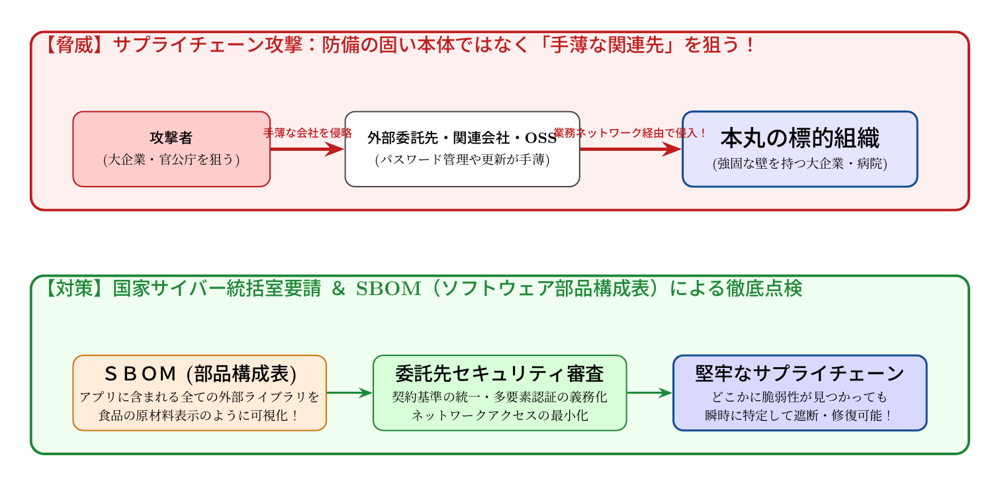

# 第9話 見えない裏口と材料の目録 〜サプライチェーン攻撃とソフトウェアの原材料表示〜

> **【放課後サイバーディフェンス・ラボ】**
> - **舞台**: 県立青葉台高校 情報科学部 ＆ 帝都科学大学
> - **登場人物**: 城崎 悠真（高校2年・部長）、橘 葵（高校2年・部員）、芹沢 涼香 准教授（大学メンター / IPAアドバイザー）
> - **参照規格・政府＆海外機関情報**: デジタル庁、総務省、内閣官房国家サイバー統括室、米CISA、IPA

---

## 🎨 ストーリーイラスト (Draw Things 生成)

---

## 📖 小説本文

放課後の部室は、夕刻の陽光が長く伸びて、埃の舞う空間を黄金色に染め上げていた。
　電子工作とアプリ開発を趣味とする「テック・クリエイティブ部」の部室には、数台のノートパソコンと、いくつもの基板が散らばっている。

「ねえ、これ……すごくない？」

　橘葵が、タブレット端末の画面を身を乗り出すようにして見せながら声を上げた。彼女の眉間には、困惑と驚きが混ざった深い皺が刻まれている。
「大病院や有名企業がハッキングされたってニュース、見た？　でもね、原因がちょっと変なの」

　部長の城崎悠真は、キーボードを叩く手を止めて彼女の横に移動した。画面には、数日前からネット上で騒がれているサイバー攻撃の事案の概要が表示されている。
「変ってのは？」
「直接、その病院や企業を狙ったわけじゃないんだって。……実は、彼らにシステムを納入したり、保守を任せたりしている『小さな下請け会社』のサーバーに最初に入り込んだらしいの」

　悠真は画面の文字を凝視した。
「……サプライチェーン攻撃か。つまり、本丸を攻めるんじゃなくて、裏口や配送ルートを狙うってことだな」
「そう！　セキュリティがガチガチに固められている大企業でも、取引先の小さな会社の対策が甘ければ、そこを足場にして中に入り込める……。それって、まるで要塞の門を破るんじゃなくて、食材を運ぶトラックに毒を混ぜるようなものじゃない？」

　葵の言葉に、悠真は背筋に冷たいものが走るのを感じた。
　彼は今、部活動で開発している「地域共生アプリ」のコードを見つめていた。彼らのアプリは、高度な機能を実装するために、世界中から公開されているオープンソース（OSS）のライブラリを数多く組み込んでいる。便利さの代償として、それら一つひとつに潜むリスクを完全に把握できているのか、という問いが頭をよぎった。

* * *

「……これを見てくれ」
　悠真は自分のノートパソコンを葵に向けた。画面には、開発環境で実行した依存関係のツリー表示が出力されていた。
「僕たちが使っているこのライブラリ、実は他にもたくさんのライブラリを呼び出しているんだ。そして、その先のライブラリがさらに別のものを……」

　画面上では、一本の枝から無数に分かれる樹木の枝のような構造が展開されていた。
「一つひとつの部品は小さくて、それぞれは正当なものかもしれない。でも、この『依存関係』という迷宮のどこか一箇所に、悪意を持ったプログラマーが仕込んだバックドアがあったら？」
　悠真の声は、わずかに震えていた。
「それだけで、僕たちのアプリを通じてユーザーの情報が外に漏れるかもしれない。俺たちが『便利』と手放しで受け入れているOSSの数々が、実は巨大な、見えないサプライチェーンの一部になっているんだ」

　葵は呆然としてそのツリーを見つめた。
「……まるで、お菓子を買う時に、どんな材料が入っているか全く分からない状態で食べているみたい……」
「そうだ。それが今のソフトウェア開発の現実なんだよ。便利さと引き換えに、僕たちは『信頼』の出所をあいまいにしている」

　その時、部室のドアがノックされた。入ってきたのは、このプロジェクトのアドバイザーを務める大学の准教授、芹沢涼香だった。
「二人とも、いい表情ね。まさに今、最もホットで、かつ最も深刻な問題に直面している顔よ」

* * *

　芹沢はいつものように、落ち着いた、しかし芯の通った声で話し始めた。彼女の手には、最近の政府機関から出された注意喚起の資料が握られていた。
「2026年10月、内閣官房の国家サイバー統括室や警察庁が相次いで出した注意喚起を読んだ？　内容は『委託先を経由した不正アクセス』の増加。これはもう、個別の技術問題じゃなくて、社会構造の問題なのよ」

　彼女はホワイトボードの前に立ち、マーカーを手に取った。
「例えば、私たちがスーパーでパンを買う時を思い出して。アレルギーがある人は、『原材料表示』を必ず確認するわよね？　卵が入っているか、小麦が入っているか。それと同じことが、今のソフトウェアの世界でも必要とされているの」

　芹沢はホワイトボードに大きく「SBOM」という文字を書いた。
「これが『Software Bill of Materials』。つまりソフトウェアの原材料表示よ。そのプログラムがどんな部品で構成されているのか、どのライブラリを、どのバージョンで使っているのかを網羅した目録のことね」

　葵が顔を上げる。
「原材料表示……。だから、あの大病院の事件も、『どの部品に問題があったか』を突き止めるために、このリストが必要になるってこと？」
「その通りよ、葵さん。SBOMがあれば、脆弱性が発見された時に『私たちのシステムは影響を受けるか？』を瞬時に特定できる。一方で、今はこの複雑な依存関係のせいで、どこに毒が混じっているか把握できない事案が多発しているわ」

　芹沢はさらに言葉を継いだ。
「海外でもCISA（米国サイバーセキュリティインフラセキュリティ庁）などが動いているわ。彼らは『KEV（Known Exploited Vulnerabilities）』というカタログで、実際に悪用されている脆弱性を公開している。私たちはそれらと対峙しながら、信頼できる部品だけを選び抜く技術を磨かなければならないのよ」

* * *

　放課後の部室に、静かな緊張感が漂った。
　悠真は自分の画面を見つめ直す。そこにある依存関係のツリーは、単なる「便利な道具のリスト」ではなく、守らなければならない「信頼の証」へとその意味を変えていた。

「……なんだか、今まで自分が書いたコードを誇りに思っていたのが、少し恥ずかしくなってきたよ」
　悠真が苦笑しながら呟いた。
「ただ動くものを作るだけじゃダメなんだ。それが誰かの手に渡り、社会の一部として組み込まれるなら、その『信頼性』まで設計しなきゃいけない」

「それって、すごくかっこいいことじゃない？」
　葵が目を輝かせて言った。
「『ただのプログラマー』じゃなくて、『安全を保証するエンジニア』になるってことだよね」

　芹沢は満足そうに頷き、部室のドアへ向かった。
「ええ。それこそが『ソフトウェアエンジニアリング』であり、『信頼性工学』の核心よ。技術の裏側にある責任を引き受けること。それが、次世代のクリエイターに求められる資質ね」

　彼女が去った後、部室には再び静寂が訪れた。
　悠真はマウスを握り直し、改めて依存関係のツリーを表示した。
「……よし。まずはこのライブラリの一覧から整理しよう。どこに何が入っているか、全部『見える』ようにするんだ」

　窓の外では、街の灯りが一つずつ点り始めていた。彼らが見つめる画面の中にあるのは、無数の部品で編み上げられた巨大な構造体。
　その透明性を確保するための戦いは、まだ始まったばかりだった。

---

## 📊 TikZによるセキュリティ構造図解

---

## 💡 高校生のためのセキュリティ深掘りコラム

### 1. 本丸ではなく「脇道」を突く：サプライチェーン攻撃
大企業や重要インフラ組織は、厳重なセキュリティ投資を行っており正面突破は容易ではありません。そこで攻撃者が目をつけたのが、業務で繋がっている**「中小の下請け企業」「海外現地法人」「外部委託先」「取引先の保守端末」**です。
防備の薄い委託先のVPNやID・パスワードを突破し、そこから信頼関係（ネットワークの接続許可）を悪用して本丸の重要データを盗み出す手口を「サプライチェーン攻撃」と呼びます。2026年10月にも、内閣官房国家サイバー統括室や警察庁が事業者に向けた緊急対策要請を一斉に発出しています。

### 2. ソフトウェアの原材料表示：SBOM（Software Bill of Materials）とは？
私たちが日々利用している現代のアプリケーションは、開発者がゼロから書いたコードだけでなく、世界中の開発者が公開している**膨大な数のオープンソース（OSS）ライブラリやフレームワーク**が積み木のように組み合わさって動いています。
- もし、その中にある無名のライブラリ1つに致命的な脆弱性（セキュリティホール）が混入していたらどうなるでしょうか？
- どのアプリにどのバージョンの部品が使われているかを瞬時に把握するために生まれたのが**「SBOM（ソフトウェア部品構成表）」**です。
食品のパッケージに「小麦・大豆・卵」と原材料が明記されているように、ソフトウェアの全構成部品を機械可読な形式（SPDXやCycloneDX）で一覧化することで、海外で新たな脆弱性が公表された際も数分で影響範囲を特定できます。

### 3. 海外（米CISA）の動向：「Secure by Design」
米国CISA（サイバーセキュリティ・社会基盤安全保障庁）も、製品の設計段階から安全性を組み込む「Secure by Design」を強く提唱し、政府調達においてSBOMの提出を義務付けるなど、世界中でサプライチェーン全体の安全保障が国際ルールとなりつつあります。

### 4. 大学で学ぶ「ソフトウェア工学と信頼性数理」
大学の情報理工学部やシステム工学科では、複雑に絡み合うソフトウェアの依存関係グラフを数理的に分析し、脆弱性の波及経路を特定するアルゴリズムや、安全なソフトウェアサプライチェーンを構築するための自動検証技術を学びます。単なるプログラミングにとどまらず、**「社会を支える巨大システムの信頼性を数学的に保証する」**現代最先端の工学分野です。
