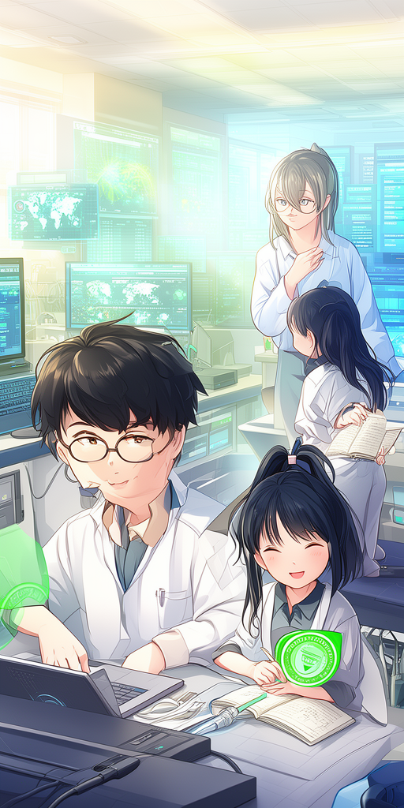
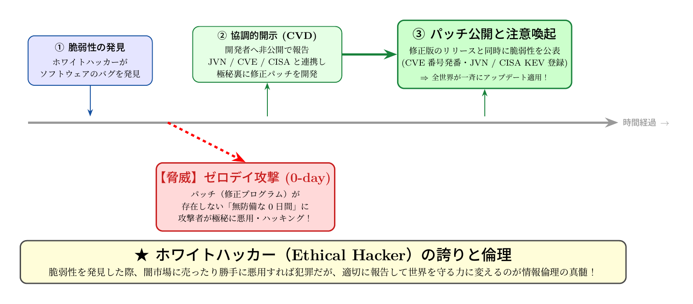

# 第10話 ゼロの日を越える翼 〜ゼロデイ脆弱性と世界を守るホワイトハッカー〜

> **【放課後サイバーディフェンス・ラボ】**
> - **舞台**: 県立青葉台高校 情報科学部 ＆ 帝都科学大学
> - **登場人物**: 城崎 悠真（高校2年・部長）、橘 葵（高校2年・部員）、芹沢 涼香 准教授（大学メンター / IPAアドバイザー）
> - **参照規格・政府＆海外機関情報**: デジタル庁、総務省、内閣官房国家サイバー統括室、米CISA、IPA

---

## 🎨 ストーリーイラスト (Draw Things 生成)

---

## 💬 4コマ漫画キャラクターセリフ（日・英対訳）

挿絵の4コマ漫画（文字なし）の各コマに対応したキャラクターのセリフです。小説本文の導入としてもお楽しみいただけます。

| コマ | 展開 / シチュエーション | 🗣️ 日本語セリフ (Japanese) | 🌐 英語セリフ (English) |
|:---:|:---|:---|:---|
| **第1コマ** 【起】 | **開発者すら知らない未知の脆弱性（ゼロデイ）が発覚！** 修正パッチが地球上に存在しない「0-day」の緊急速報を見て、戦慄する葵。 | **葵**: 「パッチが存在しない脆弱性……！？ 防ぐ手立てがないまま攻撃されるなんて、どうすればいいの……！？」 | **Aoi**: "A vulnerability with zero available patches...?! If attacks happen before fixes exist, what can we even do...?!" |
| **第2コマ** 【承】 | **悠真が解説するCVE識別番号とCVSS重要度スコア** 世界共通の脆弱性識別番号（CVE）と危険度を測るCVSSスコア画面を開き、冷静に被害範囲を分析する悠真。 | **悠真**: 「これが『ゼロデイ（0-day）』の恐怖だ。でも世界中の専門家が『CVE識別番号』で情報を共有し、暫定回避策（Workaround）を急ピッチで検証しているよ。」 | **Yuma**: "This is the terror of a 'Zero-Day'. But cybersecurity experts worldwide share data via CVE IDs and rapidly deploy temporary workarounds." |
| **第3コマ** 【転】 | **芹沢先生による協調的開示（CVD）とホワイトハッカーの倫理** バグを見つけても悪用せず、開発者へ極秘報告して修正を待つ「協調的脆弱性開示（CVD）」の重要性を語る芹沢准教授。 | **芹沢先生**: 「高度な技術を持つ者は、世界を壊すためではなく守るために力を使います。脆弱性を発見し、安全に報告して修復を促す倫理――それが『ホワイトハッカー』の誇りです。」 | **Prof. Serizawa**: "Those with advanced technical mastery must use their skills to protect, not destroy. Finding flaws, reporting them privately, and coordinating repairs—that is the honorable ethics of an ethical white hacker." |
| **第4コマ** 【結】 | **緊急パッチ配信！世界中の端末が救われる** 開発元から公式パッチが届き、青空の下でホワイトハッカーたちの見えない連帯と献身に胸を熱くする葵と悠真。 | **葵**: 「見えないところで、世界中のホワイトハッカーたちが私たちを守ってくれているんだね……！」 **悠真**: 「いつか僕たちも、その守護者の一員として世界に貢献しよう。」 | **Aoi**: "Behind the scenes, ethical hackers across the globe are tirelessly protecting all of us...!" **Yuma**: "Someday, let's join those digital guardians and protect the world too." |

---

## 📖 小説本文

深夜の放課後、部室に漂うのは古い電子機器が発する微かな熱気と、連日の解析作業で乾いた空気だけだった。

城崎悠真は、モニターの青白い光に照らされ、自身の影を背後に投げ出していた。ディスプレイには、あるオープンソース・プロジェクトのソースコードが数千行の滝のように流れている。彼は数時間前から、特定のライブラリにおけるメモリ管理の不備――わずか数行の論理的ミス――に執着していた。

「……これ、本当にいけるのか」

悠真の声は、自らの耳に届くほど小さかった。指先がキーボードの上で微かに震える。彼はある特定の操作を模倣し、メモリの境界を超えてデータを書き込めることを突き止めた。それは単なるバグではない。権限昇格や任意コード実行を可能にする、致命的な「脆弱性」だ。

このコードは世界中で使われている。もし悪意のある者がこれを見つけ出し、修正パッチが配布される前に攻撃を仕掛ければどうなるか。

「……悪用されたら、取り返しがつかない……」

悠真の脳裏に、不穏な予感が過った。彼はまだ、自分が何を見つけてしまったのかの全貌を正確には把握していなかった。ただ、その穴が世界中のネットワークのどこかに存在する「開いた窓」になっていることだけは確信していた。

***

「……ねえ、悠真。顔色が最悪だよ」

背後から声をかけたのは、部員の橘葵だった。彼女はいつものように明るい表情を浮かべていたが、その瞳には真剣な色が宿っている。

「あ、葵か。……ちょっと、ショックなものを見つけちゃってさ」
「『ショック』ってレベルじゃないでしょ。それ、もし悪いハッカーに先越されたら……」

葵は悠真の隣に座り、モニターを覗き込んだ。彼女は情報の感度が高く、海外のセキュリティニュースを常にチェックしている。

「修正パッチが出る前の『ゼロデイ』攻撃になっちゃうよね。*The Hacker News* とか *BleepingComputer* で、毎日新しい脆弱性の悪用ニュースがトップに躍り出てるじゃない。今回のは……これ、かなり深刻なやつじゃない？」
「ああ。特定の条件をクリアすれば、システムを乗っ取れる可能性がある」

悠真は苦い表情で頷いた。自分の発見が、正しく扱われなければ世界を脅かす武器になり得る。その事実に、胃のあたりが重く沈み込むような感覚があった。

「どうする？ 公開しちゃう？ それとも……」
「いいや、そんなことしたら混乱を招くだけだ。僕たちは、ただの『見つけ人』じゃない。責任を持たなきゃいけない」

悠真は拳を握りしめた。技術という力を持つ者が、それをどう扱うか。その境界線が今、目の前のコードの向こう側に横たわっている。

***

翌日、二人は大学の講義室を訪れた。そこにいたのは、彼らが信頼する指導教官であり、サイバーセキュリティの専門家である芹沢涼香だった。

芹沢は眼鏡の奥の瞳を細め、悠真たちが提示した解析結果を見つめた。彼女は穏やかな、しかし重みのある声で語り始めた。

「素晴らしい発見ね。でも、悠真君。この瞬間から、君たちの役割が変わるわ」
「役割……ですか？」
「ええ。ただの『バグを見つけた学生』ではなく、『脆弱性を管理する守護者』としての第一歩よ」

芹沢はホワイトボードに大きな文字で『CVD（協調的脆弱性開示）』と書いた。

「この脆弱性をいきなり公表すれば、悪意ある者が即座に武器化するわ。だからこそ、私たちは『協調的』である必要があるの。まず、開発元に通知し、修正パッチの作成を促す。その過程で、IPAやJPCERTのような国内機関、あるいは国際的な枠組みを通じて報告を行う。それが正しいルールよ」

彼女は専門用語を淀みなく解説していく。CVE（共通脆弱性識別子）が付与され、CVSSスコアによって深刻度が評価される。そして、米CISAのKEV（既知の悪用脆弱性カタログ）に載ることで、世界中のシステム管理者に「今すぐ防衛せよ」という警告が飛ぶ仕組み。

「CVE番号は、脆弱性の『名前』よ。それによって世界中の技術者が同じ問題を共有し、対策を講じることができる。君たちの発見を、攻撃のための武器にするのではなく、世界を守るための『盾』に変えるための手続きなの」

悠真は、彼女の言葉を聞きながら自分の手を見つめた。自分の指先から生み出された知識が、正しい手順を踏むことで誰かの守りになる。その事実に、恐怖はいつの間にか静かな使命感へと変わっていた。

***

講義室を出た後、夕暮れに染まるキャンパスを歩きながら、悠真はふと思った。

「……俺、何のためにこの技術を学んでるんだろう」
「それが、答えじゃない？」

葵が隣で笑った。彼女の言葉には、重みがあった。

悠真は空を見上げた。自分の知見が、正しい道を通って世界へと繋がっていく。それは誰にも見えないデジタルな道かもしれないが、そこには確実に、守るべき人々の日常がある。

「……俺は、ただのハッカーになりたくない。技術で誰かを傷つける奴じゃなくて、この複雑なネットワークの裏側で、誰も気づかない穴を塞り続ける『盾』になりたい」

悠真の声には、迷いがなかった。
彼が手にしたのは、破壊のための鍵ではない。世界を守るための翼だ。

「セキュリティアナリスト……か。いい目標じゃないか」
「うん。君なら、きっとできるよ」

校門を出る二人の背中には、夕陽の光が長く伸びていた。城崎悠真の心の中には、今、一つの明確な進路が描かれていた。高度なサイバーセキュリティ技術を極め、世界の最前線で「ゼロの日」を越え続けるための決意。

それは、若きホワイトハッカーとしての、最初で最も重要な誓いだった。

---

## 📊 TikZによるセキュリティ構造図解

---

## 💡 高校生のためのセキュリティ深掘りコラム

### 1. 防御側の準備が「ゼロ日」：ゼロデイ（0-day）攻撃とは？
ソフトウェアに未知の脆弱性（バグ）が見つかったとき、開発者が修正プログラム（パッチ）を公開する前、あるいは公開と同時に攻撃者がその穴を悪用することを**「ゼロデイ攻撃（Zero-Day Exploit）」**と呼びます。
防御側にとって「対策を打つ猶予期間が0日（ゼロ日）」であることからこの名がついています。海外の大手セキュリティメディア（*The Hacker News*や*BleepingComputer*）が連日速報する重大インシデントの多くが、このゼロデイ脆弱性を起点としています。

### 2. 世界を守る国際ルール：協調的脆弱性開示（CVD）
正義の研究者（ホワイトハッカー）が脆弱性を発見したとき、勝手にSNSで公開したりダークウェブで売却することは厳禁です。
1. **非公開での通報**: まず開発者（ベンダー）または各国の調整機関（日本のIPA/JPCERT・米国のCERT/CC等）に極秘裏に報告します。
2. **パッチの共同開発**: 開発者が修正プログラムを完成させるまで、情報は厳重に秘密に保たれます。
3. **同時公開**: パッチの配布準備が整った日に初めて、脆弱性の情報（CVE番号）と対策方法が世界へ一斉に公表されます。
この世界規模の協力体制を**「協調的脆弱性開示（Coordinated Vulnerability Disclosure: CVD）」**と呼びます。

### 3. CVEと米CISAの「KEVカタログ」
世界中で発見された脆弱性には、重複を防ぐため一意の識別番号**「CVE（Common Vulnerabilities and Exposures）」**が付与されます（例: CVE-2026-xxxxx）。さらに米CISA（サイバーセキュリティ・社会基盤安全保障庁）は、実際にサイバー攻撃で悪用されている深刻な脆弱性を**「KEV（既知の悪用脆弱性）カタログ」**に登録し、政府機関や民間企業へ強制的なパッチ適用期限を設けて注意を促しています。

### 4. 大学で学ぶ「リバースエンジニアリングとホワイトハッカーの倫理」
大学の情報理工学部や高度サイバー人材育成プログラムでは、バイナリ解析やファジング（自動バグ検出技術）といった高度な攻撃分析手法を学びます。強大な力を持つからこそ、**「技術を正義のために行使する倫理観（情報モラル・サイバー法）」**を身につけたホワイトハッカーは、国家やグローバル社会から今もっとも求められている守護者です。
