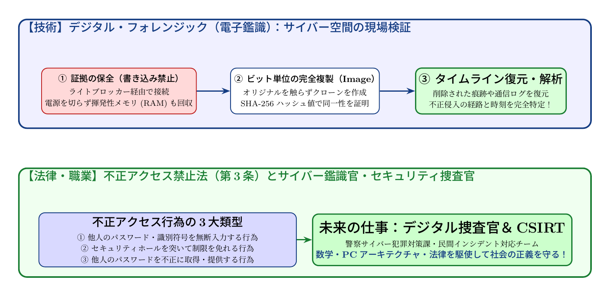

# 第11話 砂浜の足跡と電子の鑑識官 〜デジタル・フォレンジックと不正アクセス禁止法〜

> **【放課後サイバーディフェンス・ラボ】**
> - **舞台**: 県立青葉台高校 情報科学部 ＆ 帝都科学大学
> - **登場人物**: 城崎 悠真（高校2年・部長）、橘 葵（高校2年・部員）、芹沢 涼香 准教授（大学メンター / IPAアドバイザー）
> - **学習テーマ**: デジタル・フォレンジック（電子鑑識）、ライトブロッカー、SHA-256ハッシュ同一性、不正アクセス禁止法（第3条）、サイバー警察官・CSIRT
> - **参照規格・政府＆海外機関情報**: デジタル庁、総務省、内閣官房国家サイバー統括室、米CISA、IPA、OWASP、FIDO Alliance

---

## 🎨 ストーリーイラスト (Draw Things 生成)

---

## 📖 小説本文

放課後のコンピュータ室は、夕刻の陽光が窓から差し込み、埃の粒子を黄金色に染め上げていた。
部活動の拠点であるこの部屋には、文化祭に向けた特設サーバーの唸るような駆動音が低く響いている。

「……おかしいな。このログ、さっきまでのものと違う」

城崎悠真は、モニターの光に照らされた顔をわずかに顰めた。キーボードを叩く指先が、一瞬だけ止まる。画面には、深夜の時間帯に試行された無数のログインエラーの記録が並んでいた。それも、単なる打ち間違いとは思えない規則的なパターン――特定のIPアドレスから、総当たりでパスワードを突破しようとした痕跡だ。

「悠真くん、それって……誰か、うちのサーバーに入り込もうとしてる？」

隣で覗き込んでいた橘葵が、顔を強張らせて声を上げた。彼女の大きな瞳には、無機質な文字列の羅列が映っている。

「可能性は高いね。ただの不注意じゃない。誰かが意図的に、このサーバーの門を叩いている」

悠真の声には、動揺よりも鋭い好奇心が混じっていた。しかし、その直後、彼は何かに気づき、手を止めた。システム管理の基本として、不審な挙動を検知した際の「鉄則」を思い出していたからだ。

「……葵、動かないで。このままの状態で、絶対に再起動したりはしちゃダメだ」
「えっ？　でも、変なものが入ってたら、一度リセットしたほうが安全じゃない？」
「逆だよ。今動かせば、メモリ上の証拠や一時ファイルが上書きされて、犯人が残した『足跡』を消してしまう可能性がある。今の状態をそのまま保つことが最優先だ」

悠真の言葉に、葵が「ええっ」と声を上げた。その時だった。

* * *

「その判断は正しいわ、城崎くん」

静かな声が、部室の入り口から響いた。
振り返ると、そこには大学の准教授であり、顧問も務める芹沢涼香が立っていた。彼女は手にした資料を抱え、落ち着いた足取りで二人の元へ歩み寄る。

「芹沢先生！　ちょうどいいところに。このログを見てくれませんか？」
「ええ、見せてもらいましょう」

涼香は悠真の背後に立ち、モニターを凝視した。彼女の鋭い視線が、一列の数字の羅列をなぞる。

「……これは典型的なブルートフォース攻撃の痕跡ね。でも、彼らはまだ完全には侵入できていない。幸い、私たちのセキュリティ設定が機能しているわ」

彼女は眼鏡のブリッジを指先で押し上げ、真剣な表情になった。

「でも、ここからが重要よ。これを見つけた瞬間から、このサーバーは『現場』になったの。警察や裁判所が証拠として採用できる状態にするには、正しい手順を踏まなければならないわ」

「現場……ですか？」
葵が身を乗り出す。

「そう。デジタル・フォレンジックという技術が必要になるわ。それは、電子の海の中に残された犯人の『足跡』を、一粒の砂も壊さずに採取する作業のことよ」

涼香はそう言うと、机の上に置かれた予備のストレージデバイスを指差した。

「例えば、このデバイスを使って『ライトブロッカー』という装置を介してコピーを取るの。これは、元のデータに一切の書き込みをさせないための物理的な障壁ね。これを使わずに接続するだけで、OSが自動的に更新ファイルを書き込んでしまい、証拠の純粋性が損なわれることがあるのよ」

「書き込みを防ぐ……。まるで、踏み込んだ瞬間に形が変わってしまう砂浜を、そのままの形で固めるようなものですね」
悠真が呟いた。

「ええ、その通りよ。そしてコピーを取ったら、次は『ビット単位の完全クローン』を作成する。特定のファイルだけを抜くのではなく、空き領域や消去されたゴミデータまで含めて、まるごと複製を作るの。なぜなら、犯人が必死に隠した痕跡は、往々にして『削除済み』の領域に潜んでいるからよ」

涼香の説明に、葵はうっとりとしたような表情で聞き入った。

「それだけじゃ終わらないわ。コピーしたデータと元のデータが『完全に一致していること』を証明しなきゃいけない。そこで使うのが『SHA-256ハッシュ値』というものよ」
彼女はホワイトボードに複雑なアルゴリズムの断片を書き込んだ。

「これは、データの指紋のようなもの。どんなに巨大なデータでも、この計算式を通せば固有の短い文字列になるわ。もし一文字でも内容が変われば、このハッシュ値は劇的に変化する。これで『証拠品を改ざんしていないこと』を数学的に証明するの」

悠真はモニターを見つめながら、頭の中で複雑な手順を組み立て直していった。
「ライトブロッカーで保護し、ビット単位で複製を取り、ハッシュ値で同一性を保証する……。そして最後に、それらから『タイムライン解析』を行うわけですね」

「正解よ。いつ、誰が、どの操作を行い、どのファイルにアクセスしたか。点在するログを時間軸に並べ替えることで、犯人の動機や行動範囲が見えてくる。それがデジタル・フォレンジックの醍醐味であり、正義を守るための鍵になるの」

* * *

涼香は、ホワイトボードの端に「不正アクセス禁止法」という文字を大きく書き込んだ。

「技術だけでは不十分よ、城崎くん。法的な裏付けがあって初めて、それは『証拠』として社会に通用する。日本には『不正アクセス行為の禁止等に関する法律』があるわ。他人のIDやパスワードを無断で入力すること、あるいはシステムの脆弱性を突いて侵入すること……これらはすべて明確な犯罪よ」

彼女は少しだけ声を強めた。

「さらに、他人のアカウント情報を不正に取得しようとする行為も禁止されている。私たちが今見ているこのログの主は、確実にこの法律を犯している可能性が高いわ」

「法律……。僕たちはただの部活動のサーバーを守っているだけだと思っていましたが、これは社会のルールに触れる問題なんですね」
悠真が背筋を伸ばす。

「そう。だからこそ、この技術を学ぶことには大きな意義があるのよ。例えば、警察のサイバー犯罪対策課では、こうした高度な解析を行って犯人を特定する鑑識官たちが活躍しているわ。あるいは企業のCSIRT――インシデント対応チーム――と呼ばれる組織で、企業の大切な情報を守るためにセキュリティ調査員が奔走している」

葵が身を乗り出し、目を輝かせた。
「それって、まるで……ドラマに出てくるサイバー捜査官みたいじゃないですか！」

「ええ、まさにそれね。でも、彼らはドラマのヒーローとしてだけじゃなく、技術と法律の知識という武器を持って社会の不正に立ち向かっているの。彼らの仕事は、誰にも気づかれないところでデジタルな守護者として機能しているわ」

涼香は二人の顔を見渡し、穏やかな微笑みを浮かべた。

「コンピュータの仕組みを知ることは、単に便利な道具を使いこなすことじゃない。それは、社会の構造を理解し、そこにある不正や歪みに立ち向かうための『力』を手に入れることなの。あなたが今、このサーバーのログを見て驚いたその気持ちこそが、正義を守る第一歩よ」

悠真は再びモニターを見た。先ほどまでただの「邪魔な数字」にしか見えなかったログの列が、今は守るべき対象としての重みを伴って迫ってくるように感じられた。

「……僕も、この技術を使って、誰かを守れるようになりたいです」
悠真の言葉は、夕闇に溶けゆく校庭の静寂の中に、確かな意志を伴って響いた。

葵も隣で頷き、拳を握りしめる。
「私も！　砂浜の足跡を見つけるみたいに、犯人の隠れた意図を見つけ出せるようになりたいです！」

窓の外では、最後の陽光が消え、夜の帳が下りていた。しかし、二人の瞳には、これから始まる新しい学びへの情熱という名の火が灯っていた。

---

## 📊 TikZによるセキュリティ構造図解

---

## 💡 高校生のためのセキュリティ深掘りコラム

### 1. サイバー犯罪の現場検証：デジタル・フォレンジックとは？
事件現場の足跡を調べるように、コンピュータやネットワーク上に残された通信ログや電子データを法的に有効な証拠として保全・解析する技術を**「デジタル・フォレンジック（Digital Forensics）」**と呼びます。不用意にパソコンを再起動したり通常通り電源を切ると、揮発性メモリ（RAM）内の痕跡やアクセス日時が上書きされ、証拠が台無しになってしまいます。

### 2. 電子証拠の完全性を守る3大技術
法廷で証拠として認められるためには、解析作業中にデータを改ざんしていないことの証明が必須です。
- **ライトブロッカー（Write Blocker）**: ハードディスクへの書き込み信号を物理的・論理的に遮断する装置。
- **ビット単位の複製（Forensic Image）**: 空き領域も含めてセクタ単位で完全コピーを作成し、原本は金庫に保管。
- **SHA-256ハッシュ照合**: 複製前と複製後のハッシュ値が完全一致することを確認し、1ビットの狂いもない同一性を保証します。

### 3. 不正アクセス禁止法とホワイトハッカーの境界線
日本の「不正アクセス行為の禁止等に関する法律」では、他人のID・パスワードを無断入力することや、脆弱性を突いてアクセス制限をすり抜ける行為が厳しく禁止されています。善意であっても他人のサーバーの脆弱性を勝手に検証することは違法になり得ます。正義のセキュリティ専門家は、明確な許可とルール（利用規約・開示ポリシー）のもとでのみ技術を行使します。

### 4. 大学で学ぶ「電子法医学」とサイバー捜査官への道
大学の情報学部や法学融合コースでは、コンピュータアーキテクチャやOSの低レイヤー構造、暗号解読、そして電子証拠法を学びます。警察庁サイバー警察局の特別捜査官や、民間大手企業のインシデント対応チーム（CSIRT）のフォレンジックアナリストなど、社会の正義と秩序を技術で支えるやりがいの大きな職業です。
