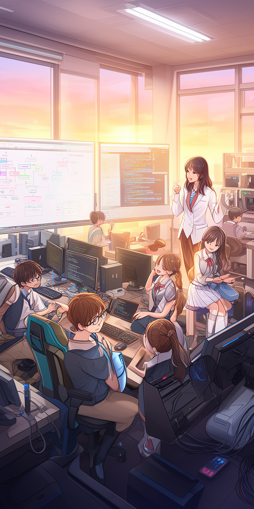
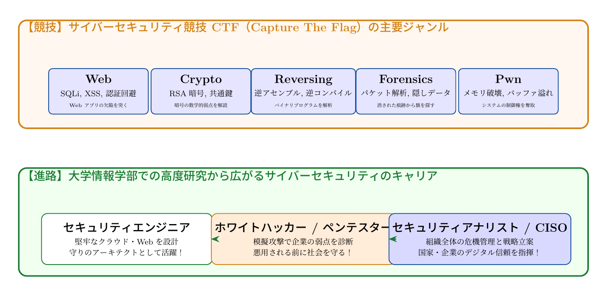

# 第13話 旗を掲げる守護者たち 〜サイバーセキュリティ競技（CTF）と未来への扉〜

> **【放課後サイバーディフェンス・ラボ】**
> - **舞台**: 県立青葉台高校 情報科学部 ＆ 帝都科学大学
> - **登場人物**: 城崎 悠真（高校2年・部長）、橘 葵（高校2年・部員）、芹沢 涼香 准教授（大学メンター / IPAアドバイザー）
> - **学習テーマ**: CTF（Capture The Flag）競技、5大ジャンル（Web, Crypto, Reversing, Forensics, Pwn）、大学情報学部、セキュリティキャリア
> - **参照規格・政府＆海外機関情報**: デジタル庁、総務省、内閣官房国家サイバー統括室、米CISA、IPA、OWASP、FIDO Alliance

---

## 🎨 ストーリーイラスト (Draw Things 生成)

---

## 💬 4コマ漫画キャラクターセリフ（日・英対訳）

挿絵の4コマ漫画（文字なし）の各コマに対応したキャラクターのセリフです。小説本文の導入としてもお楽しみいただけます。

| コマ | 展開 / シチュエーション | 🗣️ 日本語セリフ (Japanese) | 🌐 英語セリフ (English) |
|:---:|:---|:---|:---|
| **第1コマ** 【起】 | **初めてのCTF（セキュリティ競技）に挑む葵と悠真！** 制限時間が刻々と迫るコンテスト画面を前に、パズルと謎解きに目を輝かせる葵。 | **葵**: 「これがCTF（旗取り合戦）……！ Webの脆弱性診断から暗号解読まで、まるでハイテクな謎解きゲームみたい！」 | **Aoi**: "So this is a CTF (Capture The Flag)...! From finding web flaws to breaking crypto, it's like a high-tech puzzle quest!" |
| **第2コマ** 【承】 | **悠真のファインプレー：隠されたバイナリからFlagを獲得！** デバッガで実行ファイルをリバースエンジニアリングし、隠されたフラグ文字列を発見してガッツポーズの悠真。 | **悠真**: 「解けた！ リバースエンジニアリングで暗号化ルーチンを特定してFlagを回収したぞ！ `FLAG{w3lc0m3_t0_cber_w0rld}` だ！」 | **Yuma**: "Solved it! Reverse-engineered the binary, decoded the crypto routine, and captured the flag: `FLAG{w3lc0m3_t0_cber_w0rld}`!" |
| **第3コマ** 【転】 | **芹沢先生が語る大学情報理工学研究と未来のセキュリティキャリア** CTFで培われる実践的スキルが、大学の自律AI防衛研究や、企業のCISO・ペネトレーションテスターへ直結する道を語る芹沢准教授。 | **芹沢先生**: 「CTFで培う好奇心と技術は、大学での高度研究や社会を守るセキュリティエンジニアへの確かな架け橋になります。世界が最も必要としている人材なのよ。」 | **Prof. Serizawa**: "The practical agility honed in CTFs bridges directly into university informatics research and vital careers like penetration testers and CISOs. You are training to become defenders the world urgently needs." |
| **第4コマ** 【結】 | **チーム総合入賞！未来の守護者への新たな旅立ち** スコアボード上位に青葉台高校の名前が輝き、ハイタッチで笑顔を弾けさせる葵と悠真。 | **葵**: 「やったー、入賞できた！ 私、大学で本格的にセキュリティを研究したい！」 **悠真**: 「僕もだ。ここからが僕たちの本当のサイバーディフェンスの始まりだね。」 | **Aoi**: "We did it, we ranked in the top leaderboard! I definitely want to study cybersecurity at university!" **Yuma**: "Me too. This is where our real journey as cyber defenders truly begins." |

---

## 📖 小説本文

深夜の静寂を切り裂くのは、高速で打ち込まれるキーボードの打鍵音と、唸りを上げるPCの冷却ファンの回転音だけだった。
　薄暗い室内では、二台のモニターから放たれる青白い光が、城崎悠真と橘葵の顔を交互に照らしている。画面上には、「CTF Final Stage」という文字と共に、残り時間が刻一刻と削られていくカウントダウンが表示されていた。

「……まだ、見つからない。このWebサーバーの挙動、普通じゃないよ」

　葵が声を押し殺すように呟いた。彼女の指先は、細かく震えながらマウスを操作している。モニターには、複雑なHTTPリクエストの履歴と、解析の途上にあるパケットの断片が並んでいた。
　悠真は眼鏡のブリッジを押し上げ、画面を凝視する。彼の視線の先には、数千行に及ぶソースコードの断片がある。

「葵、このエンドポイント、単なる認証バイパスじゃない。……見て、このレスポンスヘッダー。特定の文字列が含まれていない時だけ、別のポートへリダイレクトしようとしてる」
「えっ、それって……」
「ああ。隠されたディレクトリを直接叩くんじゃなくて、特定の『鍵』をパケットに混ぜなきゃいけないってことだ。これまで学んだWeb脆弱性の知識だけじゃ、突破できない」

　悠真の声には、焦燥よりも研ぎ澄まされた集中力が宿っていた。これまでの数ヶ月、彼らはこの瞬間のために、暗号の基礎からネットワークの構造、そしてOSの深部までを血肉としてきた。

* * *

「……あった。葵、見て。このパケットの中に、異常なノイズが混じってる」

　葵が叫ぶように声を上げた。彼女はフォレンジックの問題で培った「違和手を見抜く目」をフル回転させていた。
「これ、ただの通信エラーじゃないよ。特定のバイト列を、規則的に置換してる。……悠真君、これ、XOR暗号じゃない？」

「……違うな。もっと複雑だ。見てくれ、このビットシフトの法則……」
　悠真が瞬く間にスクリプトを書き換え、計算式を流し込む。画面上を高速で駆け抜ける数値の羅列。一秒ごとに減っていく残り時間は、今や三桁を割り込んでいた。

「……これだよ！ このノイズを取り除いて、ビット演算を逆転させれば……」
　悠真の指が踊る。葵もまた、隣の画面で抽出したパケットデータを整理し、彼に最適な情報を送り続ける。個別の知識が一つに繋がり、巨大なパズルが組み上がるような感覚。

「認証の仕組みを理解して、Webの裏側に潜り込み、ネットワークの隙間に隠された断片を拾い上げる……。これまでの全部が、今この瞬間のためにあったんだね」
　葵の瞳に、熱い光が宿る。

* * *

「あと、六十秒……」

　カウントダウンの数字が赤く点滅し始めた。空気は張り詰め、二人の呼吸さえも止まったかのように感じられた。
　悠真が最後のコマンドをエンターキーへと叩きつける。画面が一瞬だけ暗転し、その後、システムから返ってきた文字列が表示された。

【flag{Th3_Gu4rd14n5_0f_D1g1t4l_W0rld}】

「……やった……」
　葵が椅子に深く背をもたれさせ、大きなため息とともにその場に崩れ落ちた。同時に、モニターの隅で「SUCCESS」の文字が輝き、順位表に二人の名前が躍り出る。
　悠真もまた、震える手でマウスを握りしめたまま、呆然と画面を見つめていた。数ヶ月間の苦闘、幾度も挫折した夜、そして共に知恵を絞った時間。そのすべてが、この一筋の文字列に集約されていた。

「……すごいよ、悠真君。私たち、本当にやり遂げたね」
　葵の声は、感極まった様子で震えていた。

* * *

　競技終了の通知と共に、二人のデバイスにビデオ通話の受付が表示された。画面の向こう側には、見慣れた、しかしどこか凛とした表情を浮かべる女性――芹沢涼香准教授の姿があった。

「おめでとう、二人とも。素晴らしい完走ね」
　彼女の温かな声がスピーカーから流れる。画面越しの彼女は、誇らしげに微笑んでいた。

「……先生。でも、まだ自分たちの実力がどこまで通用するのか、自信はありません」
　悠真が正直な気持ちを口にする。すると芹沢は、ゆっくりと首を振った。

「悠真君、葵さん。セキュリティの技術は、確かに強力な武器になる。でも、一番大切なのは『守るための意志』よ。今日、二人が旗を見つけたのは、単に知識があったからじゃない。このシステムを守らなければならないという使命感、そして正しくデジタル社会を支えたいという熱意があったからよ」

　彼女は、凛とした表情で言葉を続けた。
「セキュリティは怖いものではないわ。それは、人々が安心して日々の生活を送り、大切な誰かと繋がり続けるための『優しい盾』なの。技術の先にあるのは、常に人の幸せであるべき。……その志を抱くなら、あなたたちはもう、立派な守護者の第一歩を踏み出したと言えるわ」

　画面の中の言葉が、二人の胸に深く突き刺さった。
「先生……僕、決めたよ。大学に入ったら、あなたの研究室でさらに深く学びたい。この盾を、もっと強く、もっと広く広めるための技術を身につけたいんだ」
　悠真が力強く宣言する。

「私も！ 私も、世界を守れるエンジニアになりたい。……もう、パスワードを適当に使い回すような初心者の葵じゃない。本当の意味で、みんなの居場所を守れる人になりたいの！」
　葵もまた、目に涙を浮かべながら拳を握りしめた。

　二人の顔には、それまでの疲れをすべて吹き飛ばすような晴れやかな笑顔が浮かんでいた。
　窓の外では、夜明けの光が少しずつ空を白く染め始めている。それは、彼らがこれから歩む未来への扉が開いた合図のようだった。

---

## 📊 TikZによるセキュリティ構造図解

---

## 💡 高校生のためのセキュリティ深掘りコラム

### 1. 知的防衛スポーツ：CTF（Capture The Flag）の魅力
セキュリティ技術やコンピュータサイエンスの知識を駆使して、暗号文やプログラムに隠された特定の文字列（Flag: `flag{...}`）を見つけ出しポイントを競う競技が**CTF（Capture The Flag）**です。世界中のホワイトハッカーや大学研究者、学生がチームを組んで参加する、サイバー時代の知性あふれるeスポーツです。

### 2. CTFの主要5大ジャンル
- **Web**: Webアプリの脆弱性（SQLi、XSS、認証不備）を突いて情報を獲得。
- **Crypto**: 暗号アルゴリズム（RSA、楕円曲線等）の実装ミスや数学的弱点を解読。
- **Reversing（逆アセンブル）**: コンパイル済みバイナリをGhidraやIDAで解析し、判定ロジックを解明。
- **Forensics（フォレンジック）**: 通信パケット（pcap）や破損ディスク、画像メタデータから痕跡を抽出。
- **Pwn（バイナリ脆弱性）**: メモリバッファオーバーフローなどを駆使してシステムの権限を奪取。

### 3. 高校生から目指すセキュリティキャリアと国家戦略
日本政府（内閣官房国家サイバー統括室、デジタル庁、総務省）やIPAは、「デジタルスキル標準（DSS）」を掲げ、高度IT・セキュリティ人材の育成を国家最重要課題に位置づけています。
- **セキュリティエンジニア**: 攻撃に強いクラウドやWebサービスをゼロから設計するアーキテクト。
- **ペネトレーションテスター（ホワイトハッカー）**: 認可を得て擬似攻撃を行い、企業のシステムの盲点を事前に発見・保護。
- **セキュリティアナリスト / SOC**: 24時間365日、サイバー攻撃を監視・撃退する防衛の司令塔。
- **CISO（最高情報セキュリティ責任者）**: 組織全体の経営戦略とサイバーリスク管理を統括する経営幹部。

### 4. 大学情報科学部で広がる未来の扉
暗号数学、人工知能、分散システム、セキュアOSなど、大学の情報学部での学びはすべてが現代社会を守る強力な盾となります。「誰かの大切な日常とデジタル社会の信頼を守りたい」――その純粋な知的好奇心こそが、未来のトップセキュリティプロフェッショナルへと続く最も確かな鍵です。
