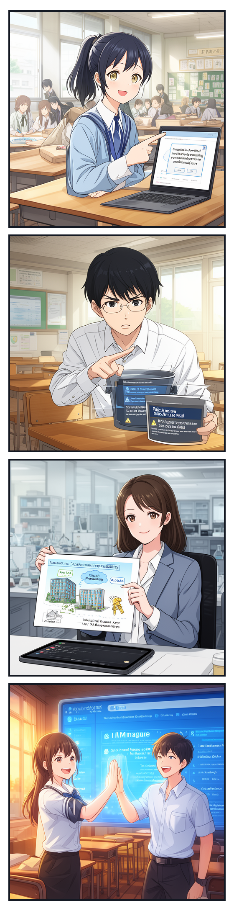
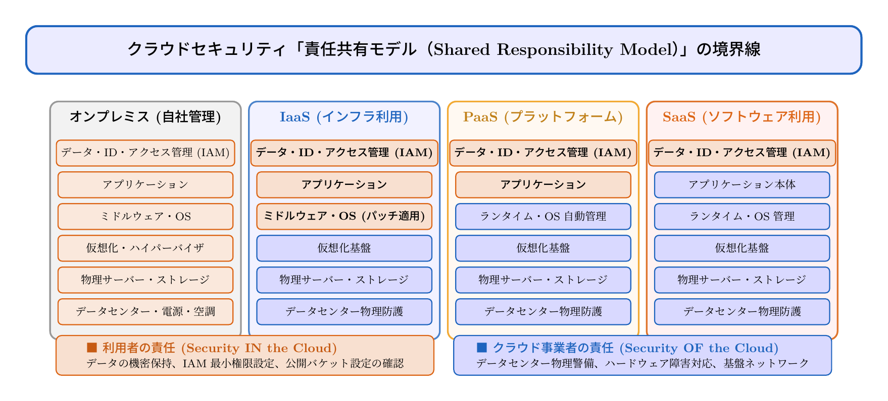

# 第14話 見えない空の保管庫 〜クラウドセキュリティと責任共有モデル〜

> **【放課後サイバーディフェンス・ラボ】**
> - **舞台**: 県立青葉台高校 情報科学部 ＆ 帝都科学大学先端セキュリティラボ
> - **登場人物**: 橘 葵（高校2年・部員）、城崎 悠真（高校2年・部長）、芹沢 涼香 准教授（大学メンター / IPAアドバイザー）
> - **学習テーマ**: クラウドサービス（IaaS/PaaS/SaaS）、責任共有モデル（Shared Responsibility Model）、IAM最小権限の原則、クラウドストレージの公開設定ミス防止
> - **参照規格・公式情報**:
>   - [IPA：クラウドサービス安全利用の手引き](https://www.ipa.go.jp/security/guide/cloud/)
>   - [IPA / NIST：SP 800-145 クラウドコンピューティングの定義](https://www.ipa.go.jp/security/reports/oversea/nist/sp800-145.html)
>   - [デジタル庁：政府共通クラウド（ガバメントクラウド）セキュリティ標準](https://www.digital.go.jp/)

---

## 🎨 4コマ漫画・ストーリーイラスト (Draw Things 生成)

---

## 💬 4コマ漫画キャラクターセリフ（日・英対訳）

挿絵の4コマ漫画（文字なし）の各コマに対応したキャラクターのセリフです。小説本文の導入としてもお楽しみいただけます。

| コマ | 展開 / シチュエーション | 🗣️ 日本語セリフ (Japanese) | 🌐 英語セリフ (English) |
|:---:|:---|:---|:---|
| **第1コマ** 【起】 | **大手のクラウドだから全部安全でしょ？** 文化祭の機密資料をクラウドにアップロードし、手放しで安心しきる葵。 | **葵**: 「世界的大手のクラウドサービスに保存したから、もう何があっても絶対安全だよね！」 | **Aoi**: "Since it's saved in a world-class major cloud service, it's completely safe no matter what happens!" |
| **第2コマ** 【承】 | **悠真の警告：バケットの全世界公開事故！** 設定を調べ、意図しない「全パブリック公開」になっている危険を指摘する悠真。 | **悠真**: 「待って葵！ クラウドの基盤が頑丈でも、公開範囲を『パブリック（全世界）』にしてたら誰でも丸見えだよ！」 | **Yuma**: "Wait, Aoi! Even if the cloud infrastructure is solid, if the access permissions are set to 'Public', anyone on earth can read it!" |
| **第3コマ** 【転】 | **芹沢先生による「責任共有モデル」とマンションの例え解説** 建物のオートロック（事業者）と各部屋の鍵（利用者）の違い、IAMの最小権限原則を説く芹沢准教授。 | **芹沢先生**: 「これが『責任共有モデル』です。事業者が守るのは土台のインフラ。データや鍵の管理（IAM）は私たち利用者の責任なのよ。」 | **Prof. Serizawa**: "This is the 'Shared Responsibility Model'. The provider protects the underlying infrastructure, but managing data and keys (IAM) is strictly our responsibility." |
| **第4コマ** 【結】 | **IAM権限設定完了！正しい鍵をかけて万全の防衛へ** 最小権限のアクセス制御を適用し、安全な共同作業環境を整えて笑顔でハイタッチを交わす二人。 | **葵**: 「オートロックに甘えず、自分の部屋の鍵もしっかり施錠したよ！ これで文化祭も安心だね！」 **悠真**: 「その通り。クラウドの真の力は、正しい権限設計があってこそ発揮されるんだ。」 | **Aoi**: "I didn't rely only on the auto-lock—I made sure our room's key is tightly locked! Now our school festival is secure!" **Yuma**: "Spot on. The true power of the cloud shines only when proper access control is in place." |

---

## 📖 小説本文

放課後の生徒会室は、文化祭に向けた準備の熱気で満ちていた。
窓の外では部活動の掛け声が響き、室内には数台のノートパソコンと資料の山が広げられている。

「ねえ、悠真君。これ、もう全部クラウドに上げたから大丈夫だよね？」

葵が、弾けるような笑顔で画面を指差した。彼女の手元にある端末には、文化祭で展示予定の機密事項――制作過程のスケッチや予算案を含む――フォルダが表示されている。

「ああ、アップロードは完了しているね。……でも、葵。君は本当に『大丈夫』だと思ってる？」
「えっ？ だって、あの大手クラウドサービスを使ってるんだよ？ 世界中の企業も使ってるくらいすごい会社なんだから、セキュリティも完璧なはずじゃない。魔法の金庫に預けてるようなものだよ」

彼女の言葉には一点の曇りもない。葵にとって、クラウドという存在は「どこか遠い、守られた聖域」としての認識でしかなかった。

悠真は少しだけ眉をひそめ、キーボードを叩く指を止めた。
「魔法の金庫……。確かに基盤は堅牢かもしれないけど、それは『入り口』の話だ。もし君が、その金庫の扉を誰にでも開く設定にしていたらどうなるかな？」
「えっ、そんなこと……私、そんな設定なんてしてないよ」
「それが問題なんだ。最近、世界中で『公開設定のミス』によるデータ流出事件が多発している。いわゆる『バケットの全世界公開』という事故だ。鍵がかかっているのは建物全体であっても、中にある個別の部屋の鍵を誰が管理するかは……」

悠真の言葉を遮るように、端末のスピーカーから凛とした声が響いた。画面の中では、大学の研究室からビデオ通話で参加している芹沢准教授の姿があった。

「――その『鍵』のあり方こそが、クラウドにおける最も重要なテーマです」

* * *

モニター越しに現れた芹沢涼香は、眼鏡の奥の瞳を鋭く光らせた。彼女は文化祭実行委員会の技術顧問として、このプロジェクトのセキュリティを指導する立場にある。

「悠真君、葵さん。クラウドを安全に使うための鉄則を教えましょう。それは『責任共有モデル』という概念です」
芹沢は手元のタブレットを操作し、一つの図解を映し出した。そこには、雲（クラウド）の形をした大きな箱と、その中にある小さな箱のイラストがあった。

「例えば、皆さんが賃貸マンションに住むとしましょう。大家さんは、建物の構造を維持し、共用部のオートロックを管理します。つまり、『クラウド基盤そのものの安全』――Security OF the Cloud――を守るのは事業者の責任です」
彼女は指先で図の大きな箱を指した。

「しかし、入居者が自分の部屋の鍵を閉め忘れたり、勝手に合鍵を不特定多数に配ったりして家財道具が盗まれたら、それは大家の責任でしょうか？」
「……いえ、入居者の責任です」
葵が思わず答えた。

「その通りです。クラウドにおける『データやアクセス権限の管理』――Security IN the Cloud――は、利用者の責任です。大手のサービスを使っていればすべてが自動的に守られるという幻想を捨ててください。彼らは『土台』を守ります。しかし、その土台の上で何を作り、誰に何を見せるかを決めるのは、あなたたちなのです」

悠真が深く頷く。「つまり、プラットフォームの堅牢性を過信して、自分たちの設定ミスを見過ごすのが一番のリスクだということですね」
「正解です。特に今日から取り組んでほしいのが『IAM』、アイデンティティとアクセス管理です。誰に（Identity）、どのデータへの（Access）、どの操作を許可するか。これを最小権限の原則に基づいて設計し直す必要があります」

* * *

芹沢教授の講義が終わった後、部屋の空気は一変した。
葵は自分の端末をじっと見つめ、少しだけ顔を強張らせていた。

「……私、本当に大丈夫だと思ってたけど。もし、予算案がネットに流れてたらと思うと、ゾッとするね」
「だからこそ、今から総点検をしよう」

悠真は立ち上がり、ホワイトボードに現在のフォルダ構成を書き出した。
「まずは現状の権限設定を一つずつ確認する。葵、君は『閲覧のみ』の権限が必要な部員たちのリストを整理して。私は各フォルダの公開範囲が『パブリック（全世界公開）』になっていないか、監査ツールを使ってチェックする」

二人は一手に取り掛かった。
「あ……これ、見つけたかも」
葵が声を上げた。文化祭の装飾用素材が入っているフォルダの一つに、意図しない警告マークが出ていた。

「『匿名アクセス許可』になってる。これだと、URLを知っている人なら誰でも中身が見れちゃう設定だ……」
彼女の声に、焦燥と驚きが混じった。
「うわっ、本当だ。たぶん、資料を共有しようとして『一番楽な設定』を選んじゃったんだね」

悠真は手際よく設定画面を開き、権限の変更を開始した。
「共有相手を生徒会メンバーの学内アカウントのみに限定。閲覧権限と編集権限を厳密に分離する。これでよし」

* * *

作業を終えた頃には、窓の外の空は深い群青色へと染まっていた。
葵は大きく伸びをして、ほっと息をついた。

「よかった……！ これで本当に安心だね」
「ああ。便利だからこそ、設定の責任を持つ。それがクラウド時代を生きる僕たちのリテラシーなんだ」

画面越しに見ていた芹沢准教授が、満足そうに微笑んだ。
「素晴らしい対応でした、二人とも。これであなたたちの文化祭の機密は、本物の鉄壁の鍵で守られましたよ。さあ、次は未来の知性――AIと向き合う準備を始めましょう」

葵と悠真は顔を見合わせ、頼もしい笑顔で力強く頷き合った。

---

## 📊 TikZによるセキュリティ構造図解

---

## 💡 高校生のためのセキュリティ深掘りコラム

### 1. 「クラウド＝安全」の誤解と責任共有モデル
Amazon Web Services（AWS）やMicrosoft Azure、Google Cloudなどのメガクラウド事業者は、世界最高水準のデータセンター物理防護や耐震・停電対策、ネットワーク監視を行っています。
しかし、クラウドの防衛には**「Security OF the Cloud（クラウド事業者の責任）」**と**「Security IN the Cloud（利用者の責任）」**という明確な境界線が存在します。
利用者がストレージのアクセス権限を「全公開（Public Read）」にしてしまったり、APIキーをGitHubに誤ってコミットしてしまった場合、クラウド事業者がどれほど頑丈でも情報流出を防ぐことはできません。

### 2. IAM（Identity and Access Management）と最小権限の原則
クラウド運用の最重要原則が**「最小権限の原則（Principle of Least Privilege）」**です。
- **必要最小限の権限のみ付与**: 「とりあえず管理者権限（Administrator）」を付与するのではなく、「特定フォルダの読み取りのみ」「バックアップの実行のみ」など業務に必要な権限だけを与えます。
- **MFAの義務化**: クラウド管理コンソールのアカウントには、必ず多要素認証（MFA）を義務付け、万一のパスワード漏洩でも即時侵入を防ぎます。
- **定期的な権限棚卸し**: 卒業した生徒や退職した社員のアカウント、プロジェクト終了後の共有リンクは即座に無効化します。

### 3. 大学情報科学科での学びと進路
大学の情報通信工学科や分散システム工学研究室では、クラウド上のマイクロサービスアーキテクチャや、Kubernetesなどのコンテナオーケストレーション、ゼロトラストなネットワーク設計を数理的・実践的に研究します。
将来は**クラウドアーキテクト**、**DevSecOpsエンジニア**、**クラウドセキュリティスペシャリスト**として、官公庁のデジタル基盤やグローバル企業のミッションクリティカルなクラウド運用を支える花形キャリアへとつながっています。
