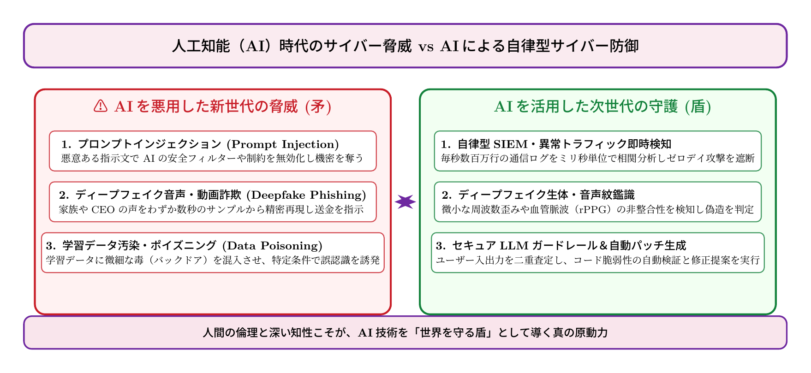

# 第15話 知性をまとう盾と矛 〜人工知能（AI）の悪用脅威と防衛の未来（第1部 完結）〜

> **【放課後サイバーディフェンス・ラボ】**
> - **舞台**: 県立青葉台高校 情報科学部 ＆ 帝都科学大学先端セキュリティラボ
> - **登場人物**: 橘 葵（高校2年・部員）、城崎 悠真（高校2年・部長）、芹沢 涼香 准教授（大学メンター / IPAアドバイザー）
> - **学習テーマ**: 生成AIのセキュリティ脅威（プロンプトインジェクション・ディープフェイク詐欺・データ汚染）、AIによる自律ログ解析・防御自動化、第1部完結と新たな世代への継承
> - **参照規格・公式情報**:
>   - [OWASP：Top 10 for Large Language Model Applications (LLM Top 10)](https://owasp.org/www-project-top-10-for-large-language-model-applications/)
>   - [IPA：AIセーフティ・AIセキュリティガイドライン](https://www.ipa.go.jp/security/reports/ai/)
>   - [内閣府：AI事業者ガイドライン（AIセーフティ・インスティテュート AISI）](https://www.cas.go.jp/jp/seisaku/ai/)

---

## 🎨 4コマ漫画・ストーリーイラスト (Draw Things 生成)

---

## 💬 4コマ漫画キャラクターセリフ（日・英対訳）

挿絵の4コマ漫画（文字なし）の各コマに対応したキャラクターのセリフです。小説本文の導入としてもお楽しみいただけます。

| コマ | 展開 / シチュエーション | 🗣️ 日本語セリフ (Japanese) | 🌐 英語セリフ (English) |
|:---:|:---|:---|:---|
| **第1コマ** 【起】 | **AIが私の声で電話をかけてきた！？ ディープフェイクの戦慄** 数秒の音声データから本物そっくりの声で送金指示を出す詐欺音声を聞き、戦慄する葵。 | **葵**: 「えっ！？ これ、私の声と全く同じ……！？ AIが私のふりをして誰かを騙そうとしてるの！？」 | **Aoi**: "What?! That sounds exactly like my own voice...! Is an AI trying to impersonate me to scam people?!" |
| **第2コマ** 【承】 | **悠真の分析：プロンプト注入とAIの脆弱性** AIの指示をすり替えるプロンプトインジェクションの手口と、AIを悪用した新たなサイバー脅威を解説する悠真。 | **悠真**: 「知性を手に入れた攻撃者は手強いよ。指示を上書きする『プロンプトインジェクション』や、ディープフェイクで人間の心理を直接攻撃してくるんだ。」 | **Yuma**: "Intruders armed with AI are formidable. They override safeguards via 'Prompt Injection' and weaponize deepfakes to manipulate human psychology directly." |
| **第3コマ** 【転】 | **芹沢先生が語る「知性をまとう盾」と人間の倫理** 毎秒数百万件のログを自律分析するAI防御と、最後に正しさを決める人間の心の大切さを説く芹沢准教授。 | **芹沢先生**: 「矛がAIなら、守る盾もまたAIです。しかし、どれほど技術が進化しても、誰を守りどう使うかを決めるのは『人間の倫理と温かい知性』なのよ。」 | **Prof. Serizawa**: "If the spear is AI, our defending shield must also be AI. Yet no matter how fast tech evolves, only human ethics and warm conscience can decide who to protect and why." |
| **第4コマ** 【結】 | **第1部堂々完結！未来のサイバー空間を守る新たな旅立ち** 悠真は大学の芹沢研へ進学、葵も未来の防衛エンジニアを胸に誓い、晴れやかな青空の下でバトンを握り合う二人。 | **悠真**: 「僕たちの高校でのラボは今日で一区切りだ。次は大学の先端研究室で待っているよ、葵。」 **葵**: 「はい、悠真先輩！ 私も絶対に先生の研究室へ追いつきます！ 私たちのディフェンスはここから始まります！」 | **Yuma**: "Our high school lab reaches its grand finale today. I'll be waiting for you in the university's advanced research lab, Aoi." **Aoi**: "Yes, Yuma! I will definitely follow you to Professor Serizawa's lab! Our cyber defense journey has only just begun!" |

---

## 📖 小説本文

窓から差し込む西日が、部室の埃を黄金色に染め上げている。
放課後の静寂の中、規則的なキーボードの打鍵音だけが、この空間の鼓動として響いていた。

橘葵は、モニターに映し出される無数のログの奔流を見つめていた。かつての自分なら、この複雑な文字列の羅列を前にして「何かが壊れてしまう」という漠然とした恐怖に震えていたはずだ。パスワードを使い回すことがバレることを恐れ、ネットの海に怯えていたあの頃の自分に、今の葵は笑いかけたい。

「……終わったね、悠真先輩」

隣で椅子を回転させた城崎悠真が、穏やかな笑みを浮かべた。彼の表情には、部活動の集大成とも言えるプロジェクトを完遂した充実感が滲んでいる。
「ああ。これだけのトラフィックを自律的にフィルタリングするモデル、完成したな」

葵は自分の手を見つめた。震えていた指先は、今は正確にキーを叩き、防御のコードを書き換えている。
「でも、まだ足りない気がするんです。AIが進化すればするほど、攻撃の手口も巧妙になる。……私たちが作った『盾』だけで守りきれるのか、まだ自信が持てなくて」

葵の言葉に、部室の扉が開いた。
「その『自信』の正体は、技術への純粋な知的好奇心と、守りたいという意志の混ざりものよ」

凛とした声と共に現れたのは、芹沢涼香だった。帝都科学大学の准教授であり、二人の指導者でもある彼女は、手にしたタブレットを操作しながら歩み寄る。

* * *

「さあ、第1部の最後の講義を始めましょう。これは『防衛』の最前線であり、『知性』の境界線についての話よ」

芹沢は部室のプロジェクターを起動した。壁一面に映し出されたのは、最新のAI悪用事例の分析データだ。
「今、私たちの前に立ちはだかっているのは、単なるウイルスじゃない。AIを『武器』として扱う者たちよ。例えば、この『プロンプトインジェクション』。AIに対する指示の裏側に巧妙な命令を潜り込ませ、システムに意図しない動作を強制させる。あるいは、数秒の音声データからあなたの声を完璧に模倣するディープフェイク詐欺」

画面には、葵の声に酷似した合成音声が流れた。
『葵です。緊急事態です。すぐに生徒会の予備資金を指定口座に振り替えてください』
「……っ！」
葵は息を呑んだ。自分の声で、自分のイントネーションで、まったく身に覚えのない指示を出す。その技術は、すでに現実の社会で悪用され始めている。

「データの汚染（データポイズニング）も深刻よ。AIに学習させるデータを意図的に書き換え、特定のバックドアを仕込む。攻撃者は『矛』としてAIを使い、我々はその『矛』を防ぐために、さらに高度なAIを『盾』として構築する。毎秒数百万件の異常トラフィックを瞬時に検知し、遮断するガードレール。ディープフェイクの微細な周波数歪みを見抜く生体鑑識アルゴリズム。技術は、指数関数的に進化しているわ」

芹沢の言葉に、葵は拳を強く握りしめた。
「でも、技術だけでは解決できない壁がある。AIは最適解を計算することはできるけれど、『正しさ』や『倫理』を自ら生み出すことはできないからよ」

彼女は二人を見つめ、静かに、そして力強く言葉を継いだ。
「矛も盾もAIが担う時代だからこそ、最後に必要なのは人間の心。この技術をどう使いたいか、誰を守りたいかという強い意志。それだけが、いかなる高度AIにも代替できない最後の防衛線なの」

* * *

部活動の最終日。
部室には、葵と悠真、そして二人の背中を追いかけてきた部員たちが集まっていた。窓の外では、秋の風が木々を揺らし、澄み渡る青空がどこまでも広がっている。
「今日で、僕たちの代の活動は一区切りとなる」

悠真が前に出て、静かに語り始めた。
「僕たちはここで、ただのパソコン操作や技術を学んだんじゃない。技術の裏にある責任を、そしてそれを誰かのために使いこなすための覚悟を学んできた。……葵、君はもう、あの頃の『怯えていた少女』じゃない」

悠真の優しい眼差しが葵に注がれる。
「僕は、帝都科学大学の芹沢研究室へ進学することが決まった。あそこは最先端のサイバーディフェンス研究の現場だ。……葵、君はどうする？」

葵は胸に手を当て、自らの内側に広がる熱い想いを再確認した。
第1話でパスワードの警告に青ざめていた放課後。フィッシング詐欺の見抜き方。街角Wi-Fiの暗号化。SQLインジェクションの罠。割れない公開鍵暗号。パスキーの未来。そして今日のAI防衛。
それらすべてが、今、一つの揺るぎない確信に変わっていた。

彼女は顔を上げ、満面の笑みと凛とした声で答えた。
「……私も、行きます。絶対に、先生の研究室へ！ 技術の最前線で、誰もが安心して暮らせる優しい盾を作りたいんです。私は、ただの受け手で終わりたくありません。サイバー空間を正しく守る側に立ちたいです！」

部室中に拍手と温かい歓声が響き渡った。
葵の瞳には、もう迷いなど微塵もなかった。

* * *

夕暮れ時、部室の鍵を閉め、校門へと向かう坂道。
「じゃあな、葵。部室のことは後輩たちに託したぞ。春になったら、大学のラボで待ってるから」
「はい、悠真先輩！ 後輩たちには、私が先輩から教わった『仕組みを知れば怖くない』って言葉を、しっかり伝えていきます！」

二人は夕焼け空の下、力強く右手を掲げてハイタッチを交わした。
一つの物語が終わり、そしてまた、新しい世代の守護者たちが芽吹いていく。
放課後サイバーディフェンス・ラボの扉は、未来へと向かって今、どこまでも大きく開かれていた――。

【第1部 完】

---

## 📊 TikZによるセキュリティ構造図解

---

## 💡 高校生のためのセキュリティ深掘りコラム

### 1. 人工知能（AI）の悪用脅威：プロンプトインジェクションとディープフェイク
大規模言語モデル（LLM）の普及に伴い、AI固有の脆弱性を狙う攻撃が国際的な脅威となっています。
- **プロンプトインジェクション**: システム指示（System Prompt）を無視させ、機密情報の漏洩や不正コードの出力を強要する攻撃手法（OWASP LLM Top 10の第1位）。
- **ディープフェイク（音声・映像のなりすまし）**: 短時間の音声サンプルから本人そっくりの音声を生成し、家族や会社役員を装って金銭を詐取するソーシャルエンジニアリングの極致。
- **データポイズニング**: 機械学習モデルの訓練データに意図的なノイズを混入させ、特定の条件下でのみセキュリティ検知をすり抜けさせる攻撃。

### 2. AIによるサイバーディフェンスの最先端
攻撃側がAIを活用するならば、防御側もAIを最大限に活用して対抗します。
- **自律型SIEM/SOAR**: 毎秒数百万件におよぶネットワークパケットや端末ログを機械学習でリアルタイム相関分析し、人間のアナリストが気づく前に攻撃パケットを自動隔離します。
- **ディープフェイク鑑識技術**: 音声周波数の不自然な高周波減衰や、映像内の顔の微小な血流変化（脈波）の不整合をディープラーニングで解析し、偽造コンテンツをミリ秒単位で見抜きます。

### 3. 第1部完結に寄せて：大学情報科学研究と次世代へのメッセージ
第1話から第15話までを通じて学んできたサイバーセキュリティの原理は、すべて大学の情報科学部・工学部で体系的に研究されている学問に直結しています。
暗号数学、通信プロトコル、OSカーネル、分散クラウド、機械学習理論――。
サイバー空間は、人間が作り出した世界で最も広大でエキサイティングなフロンティアです。高度な技術を学び、それを「誰かを傷つけるため」ではなく「社会の安心と人々の自由を守る盾」として使う志を持つ若い世代の挑戦を、心から歓迎します。
