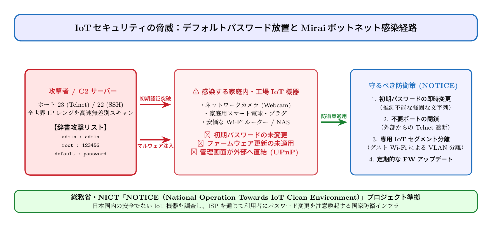

# 第16話 街角の監視者たち 〜スマート家電の隙と見えないボットネット〜

> **【放課後サイバーディフェンス・ラボ（第2部：新世代編）】**
> - **舞台**: 県立青葉台高校 情報科学部 ＆ 帝都科学大学先端セキュリティラボ
> - **登場人物**: 神崎 蓮（高校1年・IoT班）、白石 結衣（高校1年・暗号数理班）、城崎 悠真（大学1年・芹沢研TA / 部活OB）、芹沢 涼香 准教授（大学メンター）
> - **学習テーマ**: IoT機器の初期パスワード放置の危険性、Miraiボットネットによる無差別TelnetスキャンとDDoS攻撃加担、総務省・NICT「NOTICE」プロジェクト、VLANによるIoTセグメント分離
> - **参照規格・公式情報**:
>   - [総務省・NICT：NOTICE（IoT機器調査・注意喚起プロジェクト）](https://notice.go.jp/)
>   - [IPA：IoT開発・利用におけるセキュリティ設計の手引き](https://www.ipa.go.jp/security/reports/oversea/nist/iot.html)
>   - [JPCERT/CC：Mirai亜種によるIoT機器への感染に関する注意喚起](https://www.jpcert.or.jp/)

---

## 🎨 4コマ漫画・ストーリーイラスト (Draw Things 生成)

---

## 💬 4コマ漫画キャラクターセリフ（日・英対訳）

挿絵の4コマ漫画（文字なし）の各コマに対応したキャラクターのセリフです。小説本文の導入としてもお楽しみいただけます。

| コマ | 展開 / シチュエーション | 🗣️ 日本語セリフ (Japanese) | 🌐 英語セリフ (English) |
|:---:|:---|:---|:---|
| **第1コマ** 【起】 | **自作IoTカメラが動いて大はしゃぎの蓮** 基板に組んだマイコンカメラの緑LEDが点灯し、得意満面に自慢する蓮。 | **蓮**: 「見てくれよ結衣！ 部室の見守りカメラ完成だ！ スマホからバッチリ映像が見えるぞ！」 | **Ren**: "Check it out, Yui! Our clubroom security camera is up and running! I can see the live feed right on my phone!" |
| **第2コマ** 【承】 | **結衣の冷徹な指摘：初期パスワードとTelnet全開** 端末を覗き込み、デフォルトの `admin/admin` とポート23開放に呆れる結衣。 | **結衣**: 「……論外です。認証が `admin/admin` の初期値のまま、ポート23（Telnet）が全世界に開いています。」 | **Yui**: "...Unbelievable. You left the credentials as the default 'admin/admin', and port 23 (Telnet) is wide open to the whole world." |
| **第3コマ** 【転】 | **悠真TAが登場！MiraiボットネットとNOTICEの警告** 部室を訪れた先輩の悠真が、世界中から届く無差別侵入スキャンのログを解説。 | **悠真**: 「やあ蓮、結衣さん。そのままだと数分で『Mirai』に感染して、大規模DDoS攻撃の踏み台にされるよ。」 | **Yuma**: "Hey Ren, Yui. If you leave it like that, it'll get infected by Mirai within minutes and weaponized as a DDoS bot." |
| **第4コマ** 【結】 | **強固な個別パスワード変更完了！新世代コンビの始動** 不要ポートを閉じ、強固なパスワードに更新して安堵の笑みを交わす二人。 | **蓮**: 「危ねえ……！ 動いただけで満足しちゃダメなんだな！」 **結衣**: 「ハードウェアの便利さは、確かなセキュリティの上にしか成り立ちません。」 | **Ren**: "Whew, that was close...! I can't just be happy that it turns on!" **Yui**: "Hardware convenience is only meaningful when built upon solid security." |

---

## 📖 小説本文

窓から差し込む四月の陽光は、まだ少しだけ肌寒さを孕んでいた。
　新しくなった情報科学部の部室には、新学期の高揚感と、それとは対照的な電子機器の乾いた熱気が充満している。

　「見てくれよ、結衣。ついに動いたんだ」

　神崎蓮は、机の上に散らばった基板やジャンパーワイヤーの山を掻き分けながら、晴れやかな笑顔を見せた。
　彼の前には、自作の筐体に収められた小型のカメラユニットがある。レンズの奥でわずかに駆動音が響き、モニターには鮮明な部室の風景が映し出された。

　「……動いているのは確かね。でも、蓮。あなたの『工作』はいつも、完成した瞬間に次の問題を引き起こす傾向があるわ」

　白石結衣は、手元のタブレットを操作しながら淡々と指摘した。彼女は数学オリンピックの経験者であり、その思考は極めて論理的で無駄がない。蓮が「形にする」ことに執着するのに対し、彼女は「構造を解明する」ことに重きを置く。

　「何のことだよ。このカメラ、Raspberry Piをベースに自作したんだ。映像の遅延も最小限に抑えられたし、あとはネット経由でどこからでもチェックできれば完璧だろ？」

　蓮は誇らしげに、ルーターと接続されたカメラの電源スイッチをいじった。彼はこのデバイスが「自分の所有物」として正しく機能することにのみ夢中だった。その裏側にある、インターネットという巨大な海への門戸が開かれたことには、ほとんど無頓着だった。

* * *

　「……おい、蓮。ちょっとこれを見てくれないか」

　背後から声をかけたのは、大学一年の城崎悠真だった。彼は芹沢研究室のTAとして部室に顔を出しており、かつてこの部を支えたOBの一人でもある。
　彼の手にはノートPCがあり、その画面には幾何学的な模様とは程遠い、無機質なログの羅列が高速で流れていた。

　「悠真先輩？ 何かあったんですか？」

　蓮が顔を背け、モニターを覗き込む。
　そこには、秒間数百件という異常な頻度で届く接続試行の記録があった。すべては特定のポート――TelnetとSSHへのアクセス要求だ。

　「君の作ったカメラ、インターネットに公開したんだろ？ それも初期設定のまま」

　悠真の声は低く、どこか呆然としたような響きを含んでいた。
　画面上の地図には、世界中から届く攻撃のソースが点灯している。ロシア、中国、ブラジル……国境を越えた無数のIPアドレスから、蓮の「おもちゃ」への侵入を試みるノック音が鳴り続けていた。

　「え……。いや、ただ繋いだだけですよ。パスワードも設定したつもりだけど……」

　「『admin/admin』だろ？ それは世界中のボットが真っ先に試す合言葉だ。君のカメラは今、この瞬間も外部から無差別なスキャンを受け続けている。まるで、鍵の掛かっていない家の前で、世界中の泥棒が一斉にドアノブをガチャガチャと回しているような状態だ」

　結衣がタブレットを置き、モニターへ歩み寄った。彼女の瞳に、冷徹な分析の光が宿る。
　「……離散数学的に見れば、この攻撃のパターンは非常に単純ね。しかし、その規模は個人の悪意というより、自動化された『群れ』によるものだわ」

* * *

　部室の空気は一変した。蓮の顔から余裕が消え、代わりに困惑と微かな恐怖が浮かぶ。
　そこへ、スマートフォンのビデオ通話が割り込んだ。画面の向こうには、大学の准教授であり、このプロジェクトの指導者である芹沢涼香の姿があった。

　「悠真君、状況はどうかな。……ああ、蓮君も一緒なら、少しだけ話をさせてほしい」

　芹沢は眼鏡の奥の瞳を鋭く光らせた。彼女は総務省やNICTが進めるIoT防衛プロジェクトの最前線に立つ人物だ。
　彼女は淡々と、しかし重みのある言葉を紡ぎ始めた。

　「蓮君。あなたが作ったそのカメラは、今この瞬間から『ボット』に変貌する可能性がある。Miraiというボットネットの歴史を知っているかな？」

　蓮は首を横に振った。
　「それは……大規模なDDoS攻撃に使われたという話ですけど」

　「その通り。しかし、それは遠い過去の話ではないわ。スマート家電やルーターといった、セキュリティ意識の低いIoT機器は、ボットネットにとって最高の餌場なのよ。攻撃者はあなたのカメラを乗っ取り、それを『兵器』の一部として組み込む。そして、一斉に国家のインフラ――電力網や通信網――へと押し寄せる。あなたの『趣味』が、知らないうちに誰かの社会を破壊する加担者になる可能性があるの」

　結衣が小さく息を呑む。
　「自分の作ったものが、悪意を持って使われる……。それが現実としてそこにあるってことですか」

　「ええ。だからこそ、私たちは防衛の原則を徹底しなければならない。まずは強固な個別パスワードへの変更。次に、不要なポートの遮断。そして、ネットワークの可視化……いわゆるNOTICEプロジェクトのような思想が必要なのよ。デバイスがネットに繋がるということは、常に監視され、常に攻撃を受ける準備があることを意識すること。それがデジタル時代の生存戦略よ」

* * *

　通話が終わった後、部室には重苦しい沈黙が流れた。
　蓮は震える手でキーボードを叩き、カメラの管理画面を開いた。
　彼は今まで「動けばいい」という思考でハードウェアを組み立ててきた。しかし、今目の前にあるのは、自分の無知が招くかもしれない巨大な穴だった。

　「……結衣。手伝ってくれ。パスワードの生成、あとルーターのファイアウォール設定。君の得意な論理で、最強の鍵を一緒に作ってほしい」

　蓮の声には、先ほどまでの無邪気な熱狂とは違う、真剣な決意がこもっていた。
　結衣はわずかに口角を上げた。それは彼女なりの、信頼の証だった。

　「いいわよ。数学的なエントロピーを最大化するパスワードなら、私に任せて。……でも、次からは勝手にネットへ晒すのは禁止ね」

　二人は並んでモニターに向き合った。
　蓮が物理的な回路を組み、結衣が論理の盾を築く。
　窓の外では、新学期の春がさらに鮮やかさを増していく。しかし部室の中では、見えない世界の脅威と向き合うための、静かな、しかし熾烈な戦いが始まろうとしていた。

　蓮は自分のカメラを見つめた。それはもう単なる「おもちゃ」ではない。彼らが守るべき、デジタルな境界線の最前線だった。

---

## 📊 TikZによるセキュリティ構造図解

---

## 💡 高校生のためのセキュリティ深掘りコラム

### 1. スマート家電と「Miraiボットネット」の恐怖
ネットワークカメラ、スマートテレビ、Wi-Fiルーター、スマート照明など、世界中で急速に普及するIoT（Internet of Things）機器。
しかし、多くの機器が「出荷時の初期ID・パスワード（`root : 123456`, `admin : admin` など）」のままインターネットに直結されています。
2016年に出現したマルウェア**「Mirai」**は、全世界のIPアドレス空間を高速スキャンし、辞書攻撃で初期設定のIoT機器を次々と乗っ取りました。数十万台規模のIoT機器が「ボットネット（ゾンビPC網）」へと組織化され、米国の主要DNSプロバイダへ1Tbpsを超える壊滅的なDDoS攻撃を浴びせ、Twitter（現X）やNetflixなどの世界的大手サービスを一斉に麻痺させたのです。

### 2. 総務省・NICT「NOTICE」プロジェクト
日本国内では、このようなサイバー攻撃の踏み台化を未然に防ぐため、総務省・NICT（情報通信研究機構）およびISPが連携した国家防衛プロジェクト**「NOTICE（National Operation Towards IoT Clean Environment）」**が常時運用されています。
NOTICEでは、外部からアクセス可能なIoT機器に対し、デフォルトのパスワード等の既知の脆弱な組み合わせを入力する安全な調査を実施し、問題が確認された機器の利用者にプロバイダ経由でパスワード変更を注意喚起しています。

### 3. 大学情報工学科・IoTセキュリティ研究の最前線
大学の情報工学部や組み込みシステム研究室では、省電力・低スペックなマイコンチップ上でいかに高速かつ軽量な暗号処理（Lightweight Cryptography）を実現するか、また家庭内ネットワークをVLANで物理的・論理的に分離するマイクロセグメンテーション技術が研究されています。
ハードウェア工作が好きな高校生にとって、**IoTセキュリティエンジニア**や**組み込みファームウェアエンジニア**は、モノづくりとサイバー防衛を直結させる極めて魅力的な進路です。
