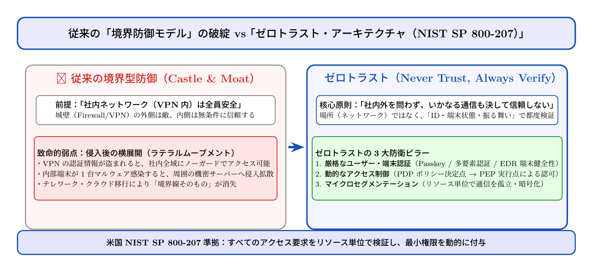

# 第17話 城壁のない砦 〜ゼロトラストと「決して信頼しない」約束〜

> **【放課後サイバーディフェンス・ラボ（第2部：新世代編）】**
> - **舞台**: 県立青葉台高校 情報科学部 ＆ 帝都科学大学先端セキュリティラボ
> - **登場人物**: 神崎 蓮（高校1年・IoT班）、白石 結衣（高校1年・暗号数理班）、城崎 悠真（大学1年・芹沢研TA）、芹沢 涼香 准教授（大学メンター）
> - **学習テーマ**: 従来の境界型防御（城壁モデル）の限界、内部侵入後の横展開（ラテラルムーブメント）、米国NIST SP 800-207ゼロトラスト原則（Never Trust, Always Verify）、リソース単位の動的アクセス制御
> - **参照規格・公式情報**:
>   - [米NIST：SP 800-207 ゼロトラスト・アーキテクチャ](https://csrc.nist.gov/publications/detail/sp/800-207/final)
>   - [デジタル庁：政府情報システムにおけるゼロトラスト適用方針](https://www.digital.go.jp/)
>   - [IPA：ゼロトラスト導入指南書](https://www.ipa.go.jp/)

---

## 🎨 4コマ漫画・ストーリーイラスト (Draw Things 生成)

---

## 💬 4コマ漫画キャラクターセリフ（日・英対訳）

挿絵の4コマ漫画（文字なし）の各コマに対応したキャラクターのセリフです。小説本文の導入としてもお楽しみいただけます。

| コマ | 展開 / シチュエーション | 🗣️ 日本語セリフ (Japanese) | 🌐 英語セリフ (English) |
|:---:|:---|:---|:---|
| **第1コマ** 【起】 | **学内Wi-Fiなら全部使い放題と喜ぶ蓮** 部室サーバーを「LAN内アクセスフリー」に設定し、椅子にふんぞり返る蓮。 | **蓮**: 「校内Wi-Fiに入りさえすれば、IDもパスワードもなしで部室サーバー使い放題！ これぞ最強の便利さだろ！」 | **Ren**: "Once you connect to school Wi-Fi, you get unlimited access to all club servers without passwords! Pure convenience!" |
| **第2コマ** 【承】 | **結衣の論理的警鐘：城壁の中の感染爆発** ホワイトボードに崩れた城壁を描き、横展開（ラテラルムーブメント）の脅威を説く結衣。 | **結衣**: 「極めて短絡的です。もし部員のスマホが1台でも感染したら、城壁の内部から全データが盗まれます。」 | **Yui**: "Dangerously naive. If a single student's phone gets infected, malware can loot every database from inside the walls." |
| **第3コマ** 【転】 | **芹沢先生によるゼロトラスト原則の指導** タブレット画面を掲げ、NIST SP 800-207の「決して信頼せず常に検証せよ」を説く芹沢准教授。 | **芹沢先生**: 「社内だから安全という神話は終わりました。場所ではなく、ユーザーのIDと端末の健全性を毎回検証する『ゼロトラスト』が必要です。」 | **Prof. Serizawa**: "The myth of 'safe inside' is dead. We need 'Zero Trust'—never trust, always verify user identity and device health continuously." |
| **第4コマ** 【結】 | **マイクロセグメンテーション完了！真の防衛へ** 最小権限の動的アクセス制御を組み上げ、晴れやかな笑顔でハイタッチを交わす蓮と結衣。 | **蓮**: 「境界線の壁に頼るんじゃなくて、ファイル一つ一つにしっかり鍵をかけるんだな！」 **結衣**: 「はい。これこそが現代の破られない要塞です。」 | **Ren**: "Instead of relying on an outer wall, we lock each file individually!" **Yui**: "Indeed. That is what a truly unbreakable modern fortress looks like." |

---

## 📖 小説本文

放課後の部室は、夕闇が迫る窓の外の景色と、青白く光る数台のモニターのコントラストに包まれていた。
「見てよ結衣！　これ、最高じゃない？　学内Wi-Fiさえ繋げば、俺の作った部室サーバーのデータも自由自在。VPNの設定もあんなに苦労したのに、中に入っちゃえば『おらえ、仲間だ』って全開で通してくれるんだよ」
　神崎蓮は、誇らしげにキーボードを叩きながら笑った。画面上には、権限設定の甘さを露呈したファイル群が整然と並んでいる。彼は自ら構築したネットワークの「便利さ」に酔いしれていた。一度境界を突破すれば、あとはすべてが自分の庭であるという確信。それは彼にとって、最も効率的な設計の結果だった。

　しかし、隣でその操作を見守っていた白石結衣の表情は、快活な蓮とは対照的に険しいものだった。彼女は細い指先で顎を突き、モニターに映るディレクトリ構造を凝視する。
「……蓮、それって『城壁さえ超えれば、中の人は全員味方』っていう中世の騎士道精神みたいな設計じゃない？」
「え、何が？」
「だって、このままだと、もし誰か一人がマルウェアに感染しただけで、部室のサーバー全部が『味方のもの』として開放されちゃうよ。城壁の門を突破されたら、中の部屋は全部開けっ放しってこと。それじゃあ、防御の穴がデカすぎる」
　結衣の声には、論理的な危惧が宿っていた。彼女の指摘は、現代のセキュリティにおける「境界防御」の致命的な矛盾――内部端末の感染による横展開（ラテラルムーブメント）の恐怖を正確に射抜いていた。

* * *

「結衣さんの言う通りです。今の蓮君の設計は、いわば『高い壁で囲まれた広大なホール』ですね」
　静かな声が部室に響いた。芹沢涼香が、手元のタブレットから視線を上げていた。彼女は大学の准教授であり、このプロジェクトの技術顧問でもある。
「かつての情報社会では、その『城壁』さえ作れば安全だと思われていました。でも、今の時代は違います。攻撃者はもう、外から壁を壊しに来るだけじゃない。正規のユーザーが使うデバイスを乗っ取ったり、フィッシングで中に入り込んだりする。一度内側に潜り込めば、境界防御は無力化されるんです」
　涼香は淡々と、しかし重みを持って続けた。
「現代のネットワークにおいて、『内側だから信頼する』という前提自体が、最大の脆弱性になりつつある。私たちは、その『信頼』の概念を根底から作り直さなければなりません」

　それまで黙って聞いていた蓮は、自分の作ったシステムの「便利さ」が、実は「危うさ」の裏返しであったことに気づき、少しだけ顔を引きつらせた。
「じゃあ……どうすればいいんだよ。全部にパスワードをかけまくったら、使い勝手が最悪になるだろ？」

* * *

「そこで登場するのが『ゼロトラスト・アーキテクチャ』です」
　背後から声をかけたのは、大学生の悠真だった。彼は芹沢研のTAとして、部室のネットワーク再構築を技術的にリードしている。
「要は、NIST SP 800-207の原則に従うんです。『Never Trust, Always Verify（決して信頼せず、常に検証せよ）』。相手が『内側』にいるか、あるいは『味方』であるかなど関係ない。すべてのアクセス要求を、その都度疑い、検証する仕組みです」
　悠真はモニターの横に立ち、複雑なネットワーク構成図を指し示した。
「具体的には、三つの柱（ピラー）で考えます。一つ目は『IDと端末の健全性評価』。単にパスワードを知っているかだけじゃなく、そのデバイスが最新の状態か、不審な挙動をしていないかを常にチェックする。二つ目は『リソース単位のアクセス認可』。PDP（ポリシー決定点）とPEP（ポリシー執行点）を設けて、特定のサーバーへのアクセスごとに、その時々の権限を判定するんです」
　悠真の説明に、蓮の目が輝き始めた。
「それって、個別の部屋ごとに鍵をかけるみたいなもんか？」
「そう。それを『マイクロセグメンテーション』と呼びます。ネットワークを細かく区切り、必要な通信だけを許可する。こうすれば、一箇所が突破されても、被害はそこだけに封じ込められる」

　蓮は画面を見つめ、自分の設計図を脳内で書き換え始めた。
「……なるほど。俺の『便利さ』は、誰にも信頼していないことを前提にした『高度な管理』の上に成り立つものだったんだな」

* * *

　その夜、部室の明かりは消えることなく灯り続けた。
　蓮と結衣は、悠真の指導のもとでネットワーク構成の再構築に没頭していた。かつての「開かれたホール」のような設計を壊し、細かな権限の壁を積み上げていく作業だ。
「これ、一個のファイルにアクセスするたびにチェックが入るってこと？　ちょっと面倒じゃない？」
　蓮が苦笑しながら呟く。
「面倒なのは、安全を買うためのコストよ」
　結衣は真剣な眼差しで、マイクロセグメンテーションのルールを一つずつ設定していく。
「でも、この仕組みを徹底すれば、誰かがウイルスに感染しても、他のサーバーには一歩も近づけない。私たちの『砦』は、壁があるから守られるんじゃなくて、個々の扉が強固だから守られるようになるのね」

　蓮はキーボードを叩く手に力を込めた。
「ああ、わかってるよ。俺の『便利さ』を壊して、新しい『信頼の形』を作るってことだな」
　彼らは協力し合い、ルールの定義を書き込み、アクセス制御のフローを組み立てていく。画面上のコンソールに、正確な許可証が発行されるたびに、二人の間には達成感が共有された。
　深夜の部室。そこにはもう、無防備な城壁はない。あるのは、一歩進むごとに「君は誰か？」「その端末は安全か？」と問いかけ続ける、厳格で知的な約束だけだった。

---

## 📊 TikZによるセキュリティ構造図解

---

## 💡 高校生のためのセキュリティ深掘りコラム

### 1. 従来の「境界型防御（城壁モデル）」はなぜ崩壊したのか？
かつての企業や学校ネットワークは、中世の城壁都市に例えられました。
「外側のインターネットは敵（危険）」であり、「内側のLANやVPN内部は全員味方（安全）」とみなし、境界線のファイアウォールさえ強固であれば安全だと信じられていたのです。
しかし、以下の変化によって城壁モデルは完全に破綻しました：
- **クラウドへの移行**: データやサーバーが社内ではなく外部のメガクラウドに分散した。
- **テレワーク・モバイル端末の普及**: 社員や生徒が自宅やカフェなど様々な場所からアクセスするようになった。
- **標的型フィッシングとサプライチェーン侵害**: 社内のPCが1台でも感染すると、ファイアウォールは何の役にも立たず、内部を自由に攻撃（ラテラルムーブメント）されてしまう。

### 2. ゼロトラストの核心「Never Trust, Always Verify」
米国NIST（国立標準技術研究所）が定めた規格**SP 800-207**では、ゼロトラストの基本理念を**「決して信頼せず、常に検証せよ（Never Trust, Always Verify）」**と定義しています。
- **ネットワークの場所を信じない**: 社内LANからの通信であろうと、外部カフェからの通信であろうと、全く同じ厳格さで検証します。
- **リソース単位の動的認可**: PDP（ポリシー決定点）が「誰が、どの端末から、どんな振る舞いでアクセスしているか」を評価し、PEP（ポリシー実行点）が最小限のアクセスのみを動的に許可します。
- **マイクロセグメンテーション**: ネットワークを細かな独立区画に分割し、万一1つの端末が侵害されても他区画への横展開を物理的・論理的に封じ込めます。

### 3. 大学情報科学・セキュリティアーキテクチャの進路
大学の情報理工学科や情報ネットワーク専攻では、分散環境におけるID基盤（IDaaS、OAuth2.0、OpenID Connect）や、暗号化通信トンネル、端末健全性監視（EDR/XDR）のアルゴリズムを研究します。
将来は**ゼロトラスト・アーキテクト**や**エンタープライズ・セキュリティエンジニア**として、政府機関やグローバル企業の次世代基盤を設計する中核リーダーとして活躍できます。
