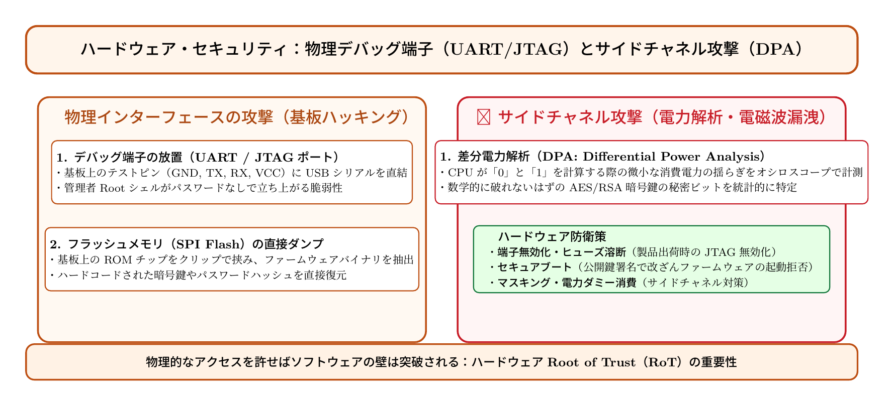

# 第18話 基板の上の囁き 〜物理端子ハッキングと差分電力解析の罠〜

> **【放課後サイバーディフェンス・ラボ（第2部：新世代編）】**
> - **舞台**: 県立青葉台高校 情報科学部 ＆ 帝都科学大学先端セキュリティラボ
> - **登場人物**: 神崎 蓮（高校1年・IoT班）、白石 結衣（高校1年・暗号数理班）、城崎 悠真（大学1年・芹沢研TA）、芹沢 涼香 准教授（大学メンター）
> - **学習テーマ**: 物理デバッグ端子（UART/JTAG）経由のRootシェル奪取、フラッシュメモリの直接読み出し、サイドチャネル攻撃（差分電力解析：DPA）による暗号鍵漏洩、ハードウェアRoot of Trust（RoT）とセキュアブート
> - **参照規格・公式情報**:
>   - [IPA：組み込みシステムのセキュリティ設計・検証ガイドライン](https://www.ipa.go.jp/)
>   - [CRYPTREC：サイドチャネル攻撃対策・暗号実装ガイド](https://www.cryptrec.go.jp/)
>   - [NIST：SP 800-193 プラットフォーム・ファームウェア回復性（PFR）](https://csrc.nist.gov/)

---

## 🎨 4コマ漫画・ストーリーイラスト (Draw Things 生成)

---

## 💬 4コマ漫画キャラクターセリフ（日・英対訳）

挿絵の4コマ漫画（文字なし）の各コマに対応したキャラクターのセリフです。小説本文の導入としてもお楽しみいただけます。

| コマ | 展開 / シチュエーション | 🗣️ 日本語セリフ (Japanese) | 🌐 英語セリフ (English) |
|:---:|:---|:---|:---|
| **第1コマ** 【起】 | **基板のデバッグ端子を発見して大歓喜の蓮** 古いルーターのケースを開け、基板上のUARTテストピンを見つけて喜ぶ蓮。 | **蓮**: 「見てくれ結衣！ 基板にTXとRXのピンが出てるぞ！ ここにシリアルケーブルを挿せば……！」 | **Ren**: "Look at this, Yui! There are TX and RX pins exposed on the board! If I hook up a serial cable here...!" |
| **第2コマ** 【承】 | **パスワードなしでRootシェル奪取！結衣の戦慄** 画面に管理者プロンプト `#` が一瞬で現れ、ソフトウェアの壁が一瞬で崩れたことに息を呑む結衣。 | **結衣**: 「……嘘でしょう？ 暗号化ログインもパスワードも一切要求されず、管理者権限が取れてしまいました……！」 | **Yui**: "...Unbelievable! Without any password or encryption prompt, we've gained full root access...!" |
| **第3コマ** 【転】 | **悠真TAによる差分電力解析（DPA）の実演** オシロスコープの波形を見せ、CPUの消費電力の揺らぎから秘密鍵ビットが漏洩する原理を解説。 | **悠真**: 「物理層を握られると暗号の数理も無力化されるんだ。チップの消費電力を測るだけで秘密鍵が特定できる『サイドチャネル攻撃』だよ。」 | **Yuma**: "When physical access is compromised, math alone can't save you. 'Side-channel attacks' extract secret keys simply by measuring power consumption." |
| **第4コマ** 【結】 | **セキュアブートとヒューズ溶断の知恵に感動！** 出荷時のデバッグ端子無効化とセキュアブートの仕組みを理解し、互いの得意分野を認め合う二人。 | **蓮**: 「物理的な回路からしっかり守ってこそ、本物のエンジニアリングだな！」 **結衣**: 「はい。数理とハードウェアが手を取り合ってこそ、完璧な盾になります。」 | **Ren**: "Protecting the physical circuits is what true engineering is all about!" **Yui**: "Indeed. Only when math and hardware unite do we create an absolute shield." |

---

## 📖 小説本文

無機質な研究室の空気には、微かな電子部品の焦げたような匂いと、高周波の機器が発する熱気が混ざり合っていた。
　神崎蓮は、デスクの上に広げられた古いルーターの基板を覗き込み、ピンセットで精密な作業を行っている。拡大鏡越しに見える緑色のプリント基板には、幾層にも重なったチップと、蜘蛛の巣のように張り巡る細い配線が刻まれていた。

「……あった。これだ」

　蓮の声に、隣でノートを取っていた白石結衣が顔を上げた。
　蓮は誇らしげに、基板の隅に隠れるように配置された四つの小さなピンを見つけた。それは通常のユーザーには見えない、開発者向けのデバッグ用端子――UART（ユニバーサル非同期トランシーバ）だった。

「この端子を叩けば、OSのシェルに直接アクセスできる可能性がある。設計者が『物理的に触れないはずだ』と高を括っている隙を突くのさ」

　蓮は手慣れた動作でUSB-to-TTL変換アダプタを接続し、ノートPCに繋いだ。数秒の沈黙の後、黒い画面に文字が流れ始めた。
　`Login:`
　
　蓮が適当なユーザー名を入力する。パスワードは不要だった。
　`root@router:~#`

　その文字列が表示された瞬間、蓮の顔に弾けるような笑みが浮かんだ。
「見てよ、結衣。数学的な壁を突破する前に、物理的な『ドア』が開けっ放しになってる。ハードウェアの脆弱性ってのは、こういうところにあるんだ」

　結衣は呆然と画面を見つめた。彼女にとって、セキュリティとは高度な暗号アルゴリズムや複雑なプロトコルによって構築される抽象的な防壁のことだった。しかし今、目の前にあるのはあまりにも無防備な事実だった。
「……信じられない。あんなに強固な認証システムを実装していても、物理的な端子が残っていれば一瞬で突破されてしまうの？」

　蓮は頷き、満足げにピンセットを置いた。
「それがハードウェアハッキングの醍醐味だよ。設計者の『油断』を、物理的な接触で暴くんだ」

* * *

　次の瞬間、結衣の常識はさらに大きな衝撃によって粉砕された。
　研究室の奥では、大学から来た城崎悠真が、巨大なオシロスコープと高精度な電流プローブを準備していた。彼は、蓮が見つけた脆弱性と対照的な、より高度で執拗な攻撃手法――サイドチャネル攻撃、特に差分電力解析（DPA）のデモンストレーションを始めようとしていた。

「いいかい、結衣さん。AES暗号は数学的には極めて堅牢だ。ブルートフォースで解くのは天文学的な時間がかかる」
　悠真は、基板に接続されたプローブの先端を指差した。
「でも、このチップが計算を行っている最中、電力は消費される。そしてその消費電力の『揺らぎ』には、処理しているデータの断片が含まれているんだ」

　画面には、複雑な波形が高速で流れていった。結衣は身を乗り出した。
「……ただのノイズじゃないわね。規則的なパターンがある」

「その通り。計算プロセスの中で、特定のビットを処理する時と、別のビットを処理する時では、微小な電力の差が出る。それを数千回、数万回と収集して統計的に処理すれば――」
　悠真がエンターキーを押す。
　画面上のグラフに、突如として鋭いスパイクが現れた。

「……嘘よ」
　結衣の声が震えた。
　理論上は絶対に破れないはずのAES鍵の一部が、電力波形の相関関係から導き出され、モニターに表示されたのだ。数学的な完全性が、物理的な現象によって丸裸にされている。

「暗号自体は正しい。でも、その暗号を動かしている『肉体』が、秘密を漏らしてしまっているんだ」
　悠真の言葉に、結衣は言葉を失った。彼女が信じていた数学の城壁が、物理層という土台から崩れ去っていく様子を目の当たりにした瞬間だった。

* * *

「ソフトウェアがいかに数学的に強固でも、物理層を奪われれば城は落ちる。それはこの世界の真理だ」

　背後から重厚な声が響いた。芹沢涼香准教授だった。彼女は結衣の肩に手を置き、オシロスコープの波形を一緒に見つめた。
「結衣さん、ショックを受けるのは当然です。でも、これは『魔法』ではなく物理現象です。だからこそ、我々は物理層での対抗策を講じなければならない」

　芹沢はホワイトボードにいくつかのキーワードを書き込んでいった。
「まず、蓮君が見つけたようなデバッグ端子の無効化です。出荷前にヒューズを溶断し、物理的にパスを断つ。これが最も原始的で強力な防衛策の一つです。そして次に『セキュアブート』。起動のたびにハードウェアレベルで署名を検証し、改ざんされたコードを実行させない仕組みですね」

　蓮も興味深そうに身を乗り出した。
「電力解析への対策はどうするんですか？ 物理的に電流を隠すのは難しいですよね」

「いい質問です、蓮君」
　芹沢は微笑みながら、別の概念を書き加えた。
「『マスキング』と『シャッフル』です。演算の過程で意図的なノイズ（ダミー演算）を混ぜて消費電力を攪乱する、あるいは処理の順番をランダムに入れ替える。数学的に正しい計算を維持しながら、物理的な痕跡を消す。これが現代のハードウェアセキュリティの最前線です」

　結衣は、自分のノートを強く握りしめた。
「……私はソフトウェアの美しさばかりを見ていた。でも、そのソフトウェアを動かすための『器』が、いかに脆く、そして同時に守るべき対象であるかを知らなかった」

* * *

　実験が終わった後の静かな研究室で、蓮と結衣は並んで椅子に座っていた。
　蓮は手元の基板を眺め、結衣は自分のノートに書き込んだ新しい防衛策の数式を見つめている。

「……お互い、見えてなかったな」
　蓮が苦笑しながら言った。
「俺は『物理的なドア』の開け方だけを追求して、その奥にある暗号の複雑さを甘く見てた。お前は逆に、数学の完璧さに集中しすぎて、現実の基板が放つ熱や電気の流れを見落としてた」

　結衣は顔を上げ、少しだけ口角を上げた。
「ええ。でも、この二つの視点が必要だってことが分かったわ。蓮君の『物理的な突破』と、私の『数学的な防衛』。両方を組み合わせないと、本当の意味でのセキュリティは築けない」

　蓮は基板を手に取り、再びハンダごてを手に取った。
「よし。じゃあ次は、お前の理論を完璧に守り抜けるような、俺の最強の『城』を組んでみようぜ」

　結衣もペンを走らせた。
「いいわよ。その城が物理層から崩れないか、私が数学的に証明してあげるわ」

　窓の外には夜が訪れつつあったが、二人の瞳には、次なる課題への情熱が宿っていた。基板の上の囁きは、彼らの挑戦によって、より強固な知恵へと変貌し始めていた。

---

## 📊 TikZによるセキュリティ構造図解

---

## 💡 高校生のためのセキュリティ深掘りコラム

### 1. 物理アクセスを許した時の脅威：UART / JTAGポート
ソフトウェアがいかに頑丈でも、攻撃者が機器を物理的に入手・分解できる場合、全く異なる次元の攻撃が可能になります。
製品の基板上には、開発者がデバッグやファームウェア書き込みを行うための端子**「UART（汎用非同期送受信）」**や**「JTAG（バウンダリスキャン端子）」**が配置されています。
本来は出荷時に端子パターンを削ったり、チップ内のヒューズを電気的に切断（溶断）して無効化すべきところを放置していると、市販の安価なUSBシリアル変換モジュールを数本繋ぐだけで、パスワードなしでLinuxの管理者（Root）シェルが立ち上がってしまう事故が多発しています。

### 2. 秘密の漏洩：サイドチャネル攻撃（DPA / EMA）
暗号アルゴリズム（AESやRSA）そのものは、現在のスーパーコンピュータでも解読に何億年もかかる強固な数理に基づいています。
しかし、それを計算する**「物理チップの挙動」**に目を向けると話が変わります。
CPUが「0」を演算するときと「1」を演算するときでは、内部のトランジスタのスイッチングによって、微小な消費電力や漏洩電磁波に測定可能な差異が生じます。
これを高精度のオシロスコープで数千〜数万回記録し、統計処理を行う**「差分電力解析（DPA: Differential Power Analysis）」**を用いると、数学を解くことなく秘密の暗号鍵ビットを直接特定できてしまいます。

### 3. ハードウェア防衛策と大学での研究
この脅威を防ぐため、ハードウェアセキュリティでは以下の対策が研究・実装されています：
- **マスキング技術**: 計算途中のデータに乱数を掛け合わせ、消費電力と暗号鍵の相関を完全に断ち切る。
- **セキュアブート**: ハードウェア内のROM（改ざん不能なRoot of Trust）に書き込まれた公開鍵で、起動するOSファームウェアの電子署名を検証し、不正コードの実行を拒絶する。
大学の電気電子工学科や情報物理研究室では、半導体設計（FPGA/ASIC）レベルでの耐タンパー性（物理解析耐性）の研究が世界中で活発に行われています。
