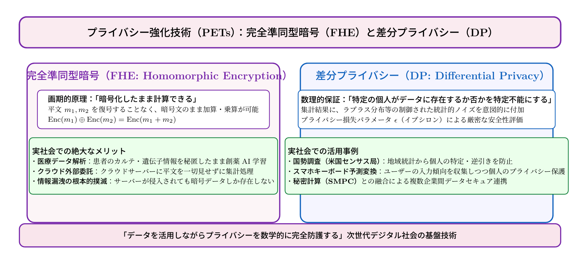

# 第19話 秘密を明かさぬ計算 〜完全準同型暗号と差分プライバシーの魔法〜

> **【放課後サイバーディフェンス・ラボ（第2部：新世代編）】**
> - **舞台**: 県立青葉台高校 情報科学部 ＆ 帝都科学大学先端セキュリティラボ
> - **登場人物**: 白石 結衣（高校1年・暗号数理班）、神崎 蓮（高校1年・IoT班）、城崎 悠真（大学1年・芹沢研TA）、芹沢 涼香 准教授（大学メンター）
> - **学習テーマ**: プライバシー強化技術（PETs: Privacy-Enhancing Technologies）、暗号化したまま演算可能な完全準同型暗号（FHE）、個人特定を数学的に防ぐ差分プライバシー（DP）、プライバシー損失パラメータε（イプシロン）
> - **参照規格・公式情報**:
>   - [個人情報保護委員会（PPC）：プライバシー強化技術（PETs）の活用指針](https://www.ppc.go.jp/)
>   - [米NIST：差分プライバシー入門（NIST SP 800-226）](https://csrc.nist.gov/)
>   - [IPA：秘密計算・プライバシー保護データ連携技術動向](https://www.ipa.go.jp/)

---

## 🎨 4コマ漫画・ストーリーイラスト (Draw Things 生成)

---

## 💬 4コマ漫画キャラクターセリフ（日・英対訳）

挿絵の4コマ漫画（文字なし）の各コマに対応したキャラクターのセリフです。小説本文の導入としてもお楽しみいただけます。

| コマ | 展開 / シチュエーション | 🗣️ 日本語セリフ (Japanese) | 🌐 英語セリフ (English) |
|:---:|:---|:---|:---|
| **第1コマ** 【起】 | **アンケート集計でプライバシー流出に悩む蓮** 生徒の生活習慣データを集計しようとして、個人が特定されてしまう問題に頭を抱える蓮。 | **蓮**: 「うーん……統計グラフを作りたいんだけど、回答の組み合わせで誰のデータかバレちゃいそうなんだよ！」 | **Ren**: "Ugh... I want to chart this student survey, but combining answers might totally give away who is who!" |
| **第2コマ** 【承】 | **結衣が語る暗号の奇跡：完全準同型暗号（FHE）** 黒板に数式を書き、「暗号化したまま計算できる」夢の暗号理論を熱く語る結衣。 | **結衣**: 「これを見てください。『完全準同型暗号』なら、データを一度も平文に戻すことなく、暗号文のまま集計が可能です。」 | **Yui**: "Look at this formula. With Fully Homomorphic Encryption, we can calculate data while keeping it entirely encrypted." |
| **第3コマ** 【転】 | **芹沢先生による差分プライバシー（DP）の解説** 光の粒子を掲げ、制御された統計的ノイズで個人の存在を完璧に隠す数理を説く芹沢准教授。 | **芹沢先生**: 「そして『差分プライバシー』は、特定の個人がデータに存在するか否かを数学的に隠す魔法のノイズ（ε）を与えるのよ。」 | **Prof. Serizawa**: "And 'Differential Privacy' injects calibrated mathematical noise (ε) to make individual presence mathematically indistinguishable." |
| **第4コマ** 【結】 | **秘密を守り抜くセキュア集計ツールの完成！** データを安全に活かすPETsの威力に感動し、満面の笑みを交わす蓮と結衣。 | **蓮**: 「データの中身を見ないのに、正しい合計や平均が出るなんて魔法みたいだ！」 **結衣**: 「魔法ではありません。これこそが、人々を守る数学の純粋な力です。」 | **Ren**: "Getting accurate totals without ever seeing the raw data feels like pure magic!" **Yui**: "It's not magic. It is the pure, protective power of mathematics." |

---

## 📖 小説本文

研究室の空気は、微かな電子機器の駆動音と、窓から差し込む午後の陽光によって、どこか静謐な熱を帯びていた。
　神崎蓮は、モニターに映し出された膨大なアンケート結果を前に、深くため息をついた。画面上には、部員たちが正直に打ち明けた悩みや、身体の不調に関する記述が並んでいる。

「……これじゃあ、分析に使えない」

　蓮は頭を抱えた。目的は、部員のメンタルヘルスを把握し、より良い練習環境を整えるための統計を取ることだ。しかし、そのためのデータにはあまりにも個人のプライバシーが色濃く反映されている。
「特定の個人だと推測されるような記述をそのまま集計すれば、誰が何を言ったかが筒抜けになる。かといって、完全に匿名化して抽象度を上げすぎれば、本当に必要な『小さな予兆』まで消えてしまう……」

　隣でその様子を眺めていた白石結衣が、眼鏡の縁を指先で押し上げた。彼女はノートPCのキーボードを叩く手を止め、険しい表情で画面を見つめている。
「データのジレンマね。社会を良くするための『知見』を抽出したいけれど、そのために個人の秘密をさらけ出させるリスクを冒すことへの恐怖。今の技術では、クラウドに計算を投げる際に一度平文に戻さなければならないから、その瞬間にすべてが漏洩する可能性がある……」

　結衣の言葉には、暗号数理を深く学んできた者特有の、鋭くも切実な危惧がこもっていた。

* * *

「その『壁』を壊すための魔法、見せてあげるよ」

　背後から声をかけたのは、大学のティーチング・アシスタント（TA）を務める城崎悠真だった。彼は手に持ったタブレットを操作しながら、ホワイトボードに複雑な数式を次々と展開していく。
「……えっ？」
　蓮が顔を上げると、悠真は自信に満ちた笑みを浮かべていた。

「いいかい、これが『完全準同型暗号（FHE）』だ。これまでの暗号技術は、データを守るための『金庫』だった。中身を見るためには鍵が必要で、計算をするには一度金庫から中身を取り出さなきゃならなかった。でも、この技術は違う」

　悠真の指がホワイトボードを弾く。
「『暗号化したまま』で足し算や掛け算ができるんだ。サーバー側は、中身が何であるかを知ることなく、ただ計算処理だけを行う。暗号化されたデータの塊を放り込めば、サーバーはそれをこねくり回して、正解の暗号化データを返してくれる。中身（平文）に触れることなく、結果だけを取り出す。……これこそが暗号界の聖杯だよ」

　結衣の瞳が、一瞬で輝きを変えた。彼女の視線は数式へと釘付けになる。
「……信じられない。数学的に、加法構造を保ったまま射影空間で計算を完結させるってこと？ データの秘匿性と計算可能性を両立させるための代償としての計算コストの問題は……」
「今はまだ重いけど、どんどん進化してる。君たちのやりたいことは、この数式の美しさの延長線上にあるんだよ」

　悠真の解説に、結衣はノートに猛烈な勢いでペンを走らせ始めた。彼女にとってそれは単なる技術紹介ではなく、純粋な数学的真理との邂逅だった。

* * *

「でも、計算が終わった後の『結果』はどうする？」

　静かな声が部屋に響いた。入ってきたのは、大学の准教授である芹沢涼香だった。彼女は落ち着いた足取りで歩み寄り、悠真の描いた数式の隣に、新たな概念を書き加えた。

「FHEで計算過程を守っても、最終的な統計結果から『特定の個人』の存在が逆算できてしまうリスクは残るわ。例えば、非常に珍しい疾患のデータが含まれていれば、その集計結果自体が個人の特定につながる可能性がある」

　芹沢はチョークを置き、結衣と蓮を見渡した。
「そこで必要になるのが『差分プライバシー（DP）』。これは数学的な『ノイズ』の魔法よ」

　彼女はホワイトボードにラプラス分布の式を書き込んだ。
「全体としての統計精度を保ちながら、個々のデータへの影響を意図的にぼかす。特定の個人が含まれているかいないかで、出力結果が劇的に変わらないように、計算結果に微細なノイズを付加するの。この『プライバシー損失』の度合いを示すパラメータ、$\epsilon$（イプシロン）の設計こそが、数理の美しさの極致だわ」

　結衣は息を呑んだ。
「ノイズをただ混ぜるんじゃなくて、数学的に制御された分布に従って付加する……。それによって、個人の秘密を守りつつ、全体の真実だけを抽出する」

「そう。プライバシーと有用性のトレードオフを、$\epsilon$という一つの指標でコントロールする。これは単なる技術じゃない。人間が社会の中で共生するための『境界線』を数式で定義しているのよ」

　芹沢の言葉に、結衣は自身のノートを見つめた。そこには、彼女が憧れた「数学の美しさ」と、蓮が解決したかった「倫理的な課題」が、一つの数式として溶け合おうとしていた。

* * *

　沈黙が流れた後、蓮が小さく呟いた。
「……つまり、FHEで『計算の過程』を守って、DPで『結果の輪郭』をぼかす。この二つを組み合わせれば、僕たちがやりたかったことができるんだ」

　蓮の瞳には、先ほどまでの当惑は消え、強い意志が宿っていた。
「部員たちのプライバシーを一切侵害せずに、彼らが抱えている課題の『地図』だけを正確に描き出す。誰にも秘密を明かさず、でも全員のために動けるツール……」

　結衣が顔を上げ、蓮と同じ方向を見つめた。彼女は自分のノートを閉じ、力強く頷く。
「……最高にクールな設計ね。数学的な美しさが、人のための技術に変わる瞬間。これこそが私たちが求めていた答えだわ」

　結衣の指先がキーボードの上で踊り始めた。彼女の頭の中では、複雑な関数と確率分布が、一つの洗練されたシステムへと組み上がっていく。
　窓の外には、夕焼けが世界をオレンジ色に染め上げている。それはまるで、高度な数式が複雑に絡み合いながらも、最終的に一つの調和した答えへと収束していくかのような、鮮やかな色彩のグラデーションだった。

「よし、やってみよう。誰も傷つけない、秘密を守り抜くための計算を」

　蓮の言葉に呼応するように、結衣が笑った。二人の前には、理論と情熱が交差する、真っ白なキャンバスのような画面が広がっていた。

---

## 📊 TikZによるセキュリティ構造図解

---

## 💡 高校生のためのセキュリティ深掘りコラム

### 1. プライバシーのジレンマと「PETs（プライバシー強化技術）」
ビッグデータやAIの時代において、社会は深刻なジレンマに直面しています。
「医療データや購買履歴を活用して難病治療法や便利なサービスを開発したい」という強いニーズがある一方で、「個人の病歴や行動履歴を外部クラウドに預けると漏洩やプライバシー侵害が怖い」という当然の拒絶感があります。
この対立を打ち破るブレイクスルーとして世界中が注目しているのが**「PETs（Privacy-Enhancing Technologies：プライバシー強化技術）」**です。

### 2. 暗号界の聖杯「完全準同型暗号（FHE）」
従来の暗号（AESやRSA）では、暗号化されたデータに対して足し算や検索を行う場合、必ず一度「秘密鍵で平文に復号」する必要がありました。復号した瞬間にサーバーのメモリ上でデータが露出するため、クラウドへの外部委託には常に漏洩リスクがつきまとっていました。
2009年にクレイグ・ジェントリーによって提唱された**「完全準同型暗号（FHE: Fully Homomorphic Encryption）」**は、平文を一切見ることなく、暗号文のまま任意の足し算と掛け算を何度でも実行できます。
クラウド事業者は暗号化された結果だけを利用者に返し、利用者だけが自分の秘密鍵で復号して正しい答えを得られるため、サーバーが世界最強のハッカーに乗っ取られていたとしても、平文データは絶対に盗まれません。

### 3. 差分プライバシー（DP）と現代社会への応用
もう一つの強力な技術が**「差分プライバシー（Differential Privacy）」**です。
集計結果にラプラス分布などの緻密に計算された微小な統計ノイズを加えることで、「ある特定の個人がそのデータベースに含まれていたとしても、いなかったとしても、集計結果の出力確率がほぼ変わらない」ことを数理的に保証します。
米国国勢調査やApple、Googleのスマートフォン入力統計などで実際に導入されており、現代社会の個人情報保護の国際デファクトスタンダードとなっています。
