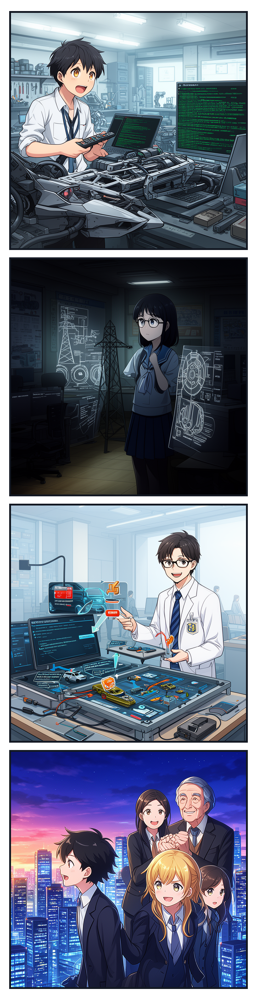
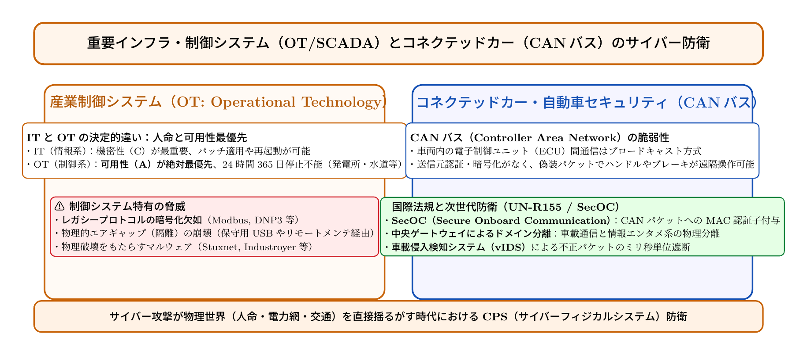

# 第20話 走るネットワークと灯火の防衛 〜制御システム（OT）と自動車セキュリティ〜

> **【放課後サイバーディフェンス・ラボ（第2部：新世代編）】**
> - **舞台**: 県立青葉台高校 情報科学部 ＆ 帝都科学大学先端セキュリティラボ
> - **登場人物**: 神崎 蓮（高校1年・IoT班）、白石 結衣（高校1年・暗号数理班）、城崎 悠真（大学1年・芹沢研TA）、芹沢 涼香 准教授（大学メンター）
> - **学習テーマ**: 産業制御システム（OT/SCADA）の可用性最優先原則、コネクテッドカーの車載ネットワーク（CANバス）の脆弱性、国際法規UN-R155、メッセージ認証（SecOC）、車載侵入検知（vIDS）、第2部前半完結と未来への誓い
> - **参照規格・公式情報**:
>   - [IPA / 経済産業省：サイバー・フィジカル・セキュリティ対策フレームワーク（CPSF）](https://www.meti.go.jp/)
>   - [国連欧州経済委員会（UNECE）：自動車サイバーセキュリティ国際規則 UN-R155](https://unece.org/)
>   - [JASPAR（自動車技術総合機構）：車載ネットワークセキュリティ標準（SecOC）](https://www.jaspar.jp/)

---

## 🎨 4コマ漫画・ストーリーイラスト (Draw Things 生成)

---

## 💬 4コマ漫画キャラクターセリフ（日・英対訳）

挿絵の4コマ漫画（文字なし）の各コマに対応したキャラクターのセリフです。小説本文の導入としてもお楽しみいただけます。

| コマ | 展開 / シチュエーション | 🗣️ 日本語セリフ (Japanese) | 🌐 英語セリフ (English) |
|:---:|:---|:---|:---|
| **第1コマ** 【起】 | **自作RCカーのCANパケット解析に夢中の蓮** ロボット車台の通信バスを調べ、車が100個以上のマイコンの塊だと知る蓮。 | **蓮**: 「うおっ！ 車の中って全部ネットワークで繋がってるんだ！ CANバスって規格でハンドルもモーターも指示が出てる！」 | **Ren**: "Whoa! Modern cars are literally networks on wheels! The CAN bus broadcasts every single steering and motor command!" |
| **第2コマ** 【承】 | **結衣の戦慄：認証のない通信と制御システム（OT）の重み** 発電所や自動車では停止（ダウン）が人命事故に直結する重みに息を呑む結衣。 | **結衣**: 「……待ってください。CAN通信に暗号や送信元認証がなければ、偽パケットでブレーキが遠隔操作されてしまいます……！」 | **Yui**: "...Wait. If CAN messages lack authentication, a forged packet could remotely hijack the brakes...!" |
| **第3コマ** 【転】 | **悠真TAによるSecOC認証と車載IDS（vIDS）の実演** テストベンチで偽装パケットを瞬時に弾くSecOCメッセージ認証と車載IDSの動作を解説。 | **悠真**: 「だからこそ国際規則UN-R155が制定されたんだ。SecOCでMAC認証子を付与し、偽パケットをミリ秒単位で遮断するんだよ。」 | **Yuma**: "That's why international regulation UN-R155 was established. SecOC attaches MAC authentication codes to block rogue packets in milliseconds." |
| **第4コマ** 【結】 | **第2部前半完結！人命と社会インフラを守る新たな誓い** 夕焼けの街並みを見つめ、サイバーフィジカル空間の守護者として歩む決意を固める蓮と結衣。 | **蓮**: 「デジタルが現実の車や街を動かしてるんだ。俺たちの作った技術で、絶対に事故を起こさせない！」 **結衣**: 「はい。数理の盾で、人々の命と当たり前の日常を守り抜きましょう。」 | **Ren**: "Digital code physically drives cars and whole cities now. We will never let our tech cause harm!" **Yui**: "Yes. With our shield of mathematics, let us protect human lives and everyday peace." |

---

## 📖 小説本文

放課後の実習室には、鈍い金属の匂いと、高性能なサーバーから発せられる熱気が混ざり合っていた。
　神崎蓮は、作業台の上に無造作に置かれた自動車の電子制御ユニット（ECU）を見つめていた。かつて彼が自作RCカーのモーターを制御するために苦心した記憶が、今の目の前の「巨大なシステム」と重なる。

「……これだけ小さな箱が、あんなに複雑なことをこなしてるのか」

　蓮の呟きに、隣で端末を操作していた白石結衣が顔を上げた。
「そうよ。でも、それがただの『機械』じゃないのが問題なのね。今の車は、まさに走るネットワークそのものなんだから」

　背後から声をかけたのは、大学のTAを務める城崎悠真だった。彼は手元のタブレットを操作し、車内の通信経路を可視化した図を投影した。
「蓮くん、君のRCカーでもCANバスを使ったことあるだろう？ それと同じ原理だけど、現代の乗用車は桁違いだ。ハンドル、ブレーキ、エンジン、エアコン、さらには自動運転のためのセンサーまで。全部がこの『CAN（Controller Area Network）』っていう一本の背骨で繋がってる」

　図の中では、無数の信号が複雑に交差していた。
「一つ一つのユニットが独立して動いているようで、実は密接に同期している。だからこそ、もしこのネットワークのどこかに『偽装パケット』を流し込むことができれば……例えば、ブレーキを制動させない、あるいはハンドルを急旋回させるっていう命令をねじ込むことが可能になっちゃうんだ」

　蓮は思わず息を呑んだ。自分の趣味だったRCカーの制御が、もし街中を走る数トンもの鉄の塊を操る攻撃の糸口になるという事実に、背筋に冷たいものが走った。
「……ただの『故障』じゃなくて、『意図的な操作』。それが現実にあるってことか」

　悠真は頷き、画面上の信号の一つを強調した。
「その通り。だからこそ、今の自動車産業ではサイバーセキュリティが最優先事項になっている。国連の協定（UN-R155）も、車両の型式認証にサイバーセキュリティ対策を必須として求めている。車はもう単なる移動手段じゃない。命を乗せて走る巨大なコンピュータなんだ」

* * *

　次の瞬間、部屋の照明がわずかに落ち、壁一面の大型モニターに別の光景が映し出された。
　それは自動車ではなく、広大なダムと、それを取り囲む発電所の施設だった。

「車から視点を移してみましょう」
　静かな、しかし芯の通った声が響いた。教壇に立つのは芹沢涼香准教授だ。彼女は手元のリモコンを操作し、工場の制御システム（OT）の監視画面を表示させた。

「蓮くん、結衣さん。先ほどまで話していた『守るべきもの』は、車だけじゃないわ。水道、電気、ガス……私たちの社会を支えるインフラすべてが対象よ」

　結衣はモニターに映る複雑な数式とデータフローを見つめながら、その重圧に息を呑んだ。
「産業制御システム（OT）の世界では、ITの世界とは異なる絶対的なルールがあるわ。それが『可用性』。つまり、いかなる時も止めてはいけないということ」

　芹沢は一歩前に踏み出した。
「機密性の高いメールや個人情報を守るなら、最悪の場合、システムを一時的に停止させて隔離することもできる。でも、発電所や水道施設はどうかしら？ 攻撃を受けているからといって、突然街の電気を落としたり、水の供給を止めていいわけにはいかない。それは人命に直結する事態を引き起こすからよ」

　画面の中では、異常なデータ流入を検知したアラートが赤く点滅していた。
「サイバー防衛の最前線は、この『動かし続けなければならない』という過酷な制約との戦いなの。システムの安定性を保ちながら、いかにして侵入者を排除し、正常な操作だけを通すか。ここには、理論上の正解よりも、現実の命を守るための執念が必要になるわ」

　結衣の手が震えた。彼女はこれまで数学的な美しさや論理の整合性を求めてきた。しかし、目の前の画面に映っているのは、その論理を突き詰めた先にある「人間の命」への責任だった。
「……守るための技術が、誰かの日常を守るための盾になる……」

* * *

「では、実際にどうやって守るのか。具体的な『盾』の構造を見てみよう」
　悠真が再び実機デモの準備に取り掛かった。彼の前には、実験用の車両通信ユニットと、それを監視するセキュリティゲートウェイが設置されている。

「車載侵入検知システム、通称vIDS（vehicle Intrusion Detection System）だ。これは車内の通信を常時監視して、『おかしい』動きを瞬時に見抜くセンサーのようなものさ」

　悠真の操作で、模擬的な攻撃パケットがシステムに投げられた。
「見てて。この車両から送られてくるブレーキ制御信号には、本来なら『認証』が必要だ。そこで使われるのがSecOC（Secure On-board Communication）というプロトコルだよ」

　画面には、メッセージの末尾に付与されるMAC（メッセージ認証符号）が高速で計算され、照合される様子が表示された。
「この鍵を使って正当な通信であることを証明するんだ。偽装パケットを送ろうとしても、正しい鍵を持っていないから弾かれる。さらにvIDSが、異常な挙動のパターンを学習して、未知の攻撃手法にも即座に反応する」

　蓮は身を乗り出した。
「……つまり、防壁を高くするだけじゃなくて、常に『監視』し続けて、違和感を察知した瞬間に遮断するっていうことか」

「その通り。そしてその技術は、車から発電所まで共通の思想で繋がっている。デジタルが現実の物理現象を動かす時代において、私たちの仕事は、その境界線を死守することなんだ」
　悠真の声には、技術者としての誇りと、それゆえの覚悟が宿っていた。

* * *

　実習が終わった後の放課後。
　西日が差し込む実習室で、蓮と結衣は並んでモニターを見つめていた。
　窓の外には、夕闇に包まれつつも街の灯りが点り始めた景色が広がっている。あの灯り一つひとつを支えているのは、今学んだような複雑なネットワークと、それを守るための技術だ。

「蓮くん、私、決めたよ」
　結衣が静かに言った。その瞳には先ほどまでの戸惑いではなく、鋭い意志の光が宿っていた。
「私は暗号数理の知識を突き詰めるわ。SecOCのような認証技術や、インフラを守るための強固なアルゴリズムの開発。数学的な完璧さで、社会の安全を裏打ちする盾を作りたい」

　蓮は隣に座る彼女を見、それから自分の手元にあるRCカーの部品へと視線を戻した。
「……俺は、ハードの動態と制御の現場を守る側に行きたい。車そのものの構造を知り、物理的な挙動を理解した上で、いかに安全な通信経路を確保するか。設計段階からセキュリティを組み込めるエンジニアになりたい」

　二人は顔を見合わせた。
　一人は数理の深淵へ、一人は機械の構造へ。得意とする分野は違えど、目指す地平は同じだった。

「蓮くんのハードへの知見と、私の暗号技術。この二つが合わわれば……」
　結衣の声が、夕闇に溶けるように響く。

　背後では、悠真と芹沢先生が満足げに二人を見守っていた。
「いい表情だね。君たちがこれから歩む道は、決して平坦なものじゃない。技術の進化は速く、攻撃の手法も巧妙になっていく」
　芹沢の言葉に、蓮は拳を握りしめた。

「それでも、俺たちはやるよ。この街の灯りを守るために」

　若き二人のエンジニア候補生は、窓の外に広がる巨大なネットワークの森を見つめた。
　それは、まだ見ぬ未来への決意。彼らの指先から生まれるコードと設計図が、いつかこの世界の命を守るための「守護者」となるための第一歩だった。

---

## 📊 TikZによるセキュリティ構造図解

---

## 💡 高校生のためのセキュリティ深掘りコラム

### 1. 「走る巨大コンピュータ」コネクテッドカーとCANバスの脆弱性
現代の自動車には、エンジン、ブレーキ、ステアリング、エアバッグ、カーナビ、自動運転カメラなどを制御する**100個以上の電子制御ユニット（ECU: Electronic Control Unit）**が搭載されています。
これらは**CAN（Controller Area Network）**という高速シリアル通信バスで結ばれていますが、CAN規格が設計された1980年代には「車がインターネットに繋がる」ことは想定されていませんでした。
そのため、CANパケットには暗号化も「誰が送ったか」を検証する認証子もなく、外部から車載ネットワークに侵入されると、偽のパケットを流してブレーキを作動させたりハンドルを勝手に切るなどの重大な物理ハッキングが可能であることが研究者によって実証され、世界に衝撃を与えました。

### 2. 国際規則UN-R155と車載防衛（SecOC / vIDS）
この危機を受け、国連欧州経済委員会（UNECE）は自動車のサイバーセキュリティ型式認証規則**「UN-R155」**を義務化しました。現在製造される新車は、サイバー攻撃対策が証明されなければ公道を走ることができません。
- **SecOC（Secure Onboard Communication）**: 各CANメッセージに暗号学的MAC（メッセージ認証コード）とフレッシュネス値（リプレイ攻撃防止カウンタ）を付加し、偽装パケットをミリ秒単位で破棄する。
- **ドメイン分離ゲートウェイ**: 自動運転・走行系通信と、エンタメ系Wi-Fi/Bluetooth通信の間に強固なハードウェアゲートウェイを挟み、外部からの侵入を遮断する。
- **車載侵入検知システム（vIDS）**: 車載ネットワーク内の通信頻度やパケット異常を常時監視し、攻撃を検知して安全停止モードへ移行させる。

### 3. ITとOTの決定的相違：可用性（Availability）が人命を救う
発電所、水道局、化学プラント、鉄道などの**産業制御システム（OT: Operational Technology / SCADA）**では、オフィスのITとセキュリティの優先順位が劇的に逆転します。
ITでは情報の漏洩を防ぐ「機密性（C）」が最重要視されますが、OTでは**「可用性（A：絶対に止まらないこと）」が絶対最優先**です。発電所が数秒停止すれば都市全体がブラックアウトし、病院の生命維持装置や信号が停止して人命に関わるからです。
物理世界とデジタルが完全に融合した**サイバーフィジカルシステム（CPS）**を守るエンジニアは、社会の安全基盤を根底から支える、未来で最も誇り高く不可欠な職業です。
