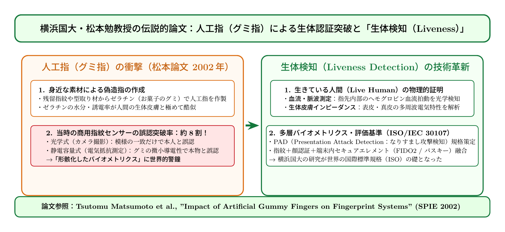

# 第21話 甘い偽指の衝撃 〜松本論文「グミ指」と生体検知（Liveness Detection）〜

> **【放課後サイバーディフェンス・ラボ（第2部：大学先端研究の扉 〜横浜国大SPIRAL論文探訪〜）】**
> - **舞台**: 帝都科学大学先端セキュリティ実習室 ＆ 横浜国立大学 SPIRAL連携セミナー
> - **登場人物**: 神崎 蓮（高校1年・IoT班）、白石 結衣（高校1年・暗号数理班）、城崎 悠真（大学1年・芹沢研TA）、芹沢 涼香 准教授（大学メンター）
> - **学習テーマ**: 松本勉教授（現・上席特別教授）の世界的名著『グミ指論文（SPIE 2002）』、人工指による生体認証突破実験、生体情報の本質的脆弱性（Revoke不能性）、なりすまし攻撃検知（PAD / Liveness Detection）、国際規格 ISO/IEC 30107、多要素認証（FIDO2 / パスキー）
> - **探訪・参照研究論文**:
>   - [横浜国立大学 サイバーセキュリティ実践教育研究センター（SPIRAL）](https://spiral.ynu.ac.jp/)
>   - Tsutomu Matsumoto, Hiroyuki Matsumoto, Koji Yamada, Satoshi Hoshino. "Impact of Artificial 'Gummy' Fingers on Fingerprint Systems." *Proceedings of SPIE - Optical Security and Counterfeit Deterrence Techniques IV*, Vol. 4677, pp. 275-289, 2002.
>   - ISO/IEC 30107: Information technology — Biometric presentation attack detection (PAD).

---

## 🎨 4コマ漫画・ストーリーイラスト (Draw Things 生成)

---

## 💬 4コマ漫画キャラクターセリフ（日・英対訳）

挿絵の4コマ漫画（文字なし）の各コマに対応したキャラクターのセリフです。小説本文の導入としてもお楽しみいただけます。

| コマ | 展開 / シチュエーション | 🗣️ 日本語セリフ (Japanese) | 🌐 英語セリフ (English) |
|:---:|:---|:---|:---|
| **第1コマ** 【起】 | **蓮の生体認証最強論と自慢** スマホの指紋センサーでロック解除し、「偽造不可能で世界最強の鍵！」と豪語する蓮。 | **蓮**: 「見てよ結衣！ 指紋認証ならパスワードと違って絶対盗まれないし、世界最強の鍵だよな！」 | **Ren**: "Look Yui! Unlike passwords, fingerprint auth can never be stolen! It's the ultimate key!" |
| **第2コマ** 【承】 | **結衣の冷徹な指摘：生体情報は変えられない** グラスの指紋痕を指差し、「生体情報は秘密情報ではないし一生変更（Revoke）できない」と突く結衣。 | **結衣**: 「甘いです。指紋は毎日ドアノブやグラスに置き忘れていますし、一度流出したら一生変えられません。」 | **Yui**: "Naïve. You leave fingerprints on glasses and doorknobs daily, and unlike passwords, you can never change them." |
| **第3コマ** 【転】 | **悠真TAによる伝説の松本論文「グミ指」解説** スーパーのゼラチンで作った人工指が名だたるセンサーの約8割を通過した歴史を披露する悠真。 | **悠真**: 「2002年、横浜国大の松本教授がお菓子のグミで作った人工指でセンサーの約8割を突破したんだ。」 | **Yuma**: "In 2002, Prof. Matsumoto of YNU proved that gelatin gummy fingers fooled about 80% of fingerprint sensors." |
| **第4コマ** 【結】 | **生体検知（Liveness）とFIDO2多要素の地平へ** 脈拍や血流を検知する生体検知と暗号数理の組み合わせに感銘を受け、先端研究への扉を開く二人。 | **蓮**: 「ゼラチンに負けたからこそ、脈拍検知やAI判定が生まれたんだ！」 **結衣**: 「暗号数理と生体検知の融合……これが大学先端研究の凄みですね。」 | **Ren**: "Because sensors were tricked by gelatin, engineers developed pulse detection and smart liveness checks!" **Yui**: "Merging cryptographic math with liveness detection... this is the true brilliance of academic research." |

---

## 📖 小説本文

帝都科学大学の先端セキュリティ実習室は、鈍い金属の光沢と、サーバーラックから発せられる微かな低周波の唸りに包まれていた。
　窓の外には夕闇が迫り、室内を照らすのは数台のモニターが放つ青白い光だけだ。

「見てくれよ、結衣。これこそが究極の鍵なんだ。パスワードみたいに打ち間違えることもないし、何より俺の指そのものが鍵だから、他人に盗まれることなんて絶対にあり得ない。この『指紋認証』は、まさに魔法のセキュリティだよ」

　神崎蓮は自慢げにスマートフォンを掲げた。彼の指が画面上部のセンサーに触れ、瞬時にロックが解除される。その無邪気な笑顔には、技術への純粋な信頼と、少しの過信が混ざり合っていた。
　しかし、隣でタブレットを操作していた白石結衣は、眉一つ動かさずに冷ややかな視線を向けた。

「……蓮、それはあまりにもナイーブな考えよ」
「えっ？」
「いい？ 生体情報は『秘密情報』ではないの。あなたは今、このスマホを開くために指紋を使ったけれど、その指で昨日コンビニのドアノブを触り、駅のつり棒を掴み、カフェのグラスを保持したでしょう？ そのすべてに、あなたの『秘密の鍵』である指紋が物理的に置き去りにされていることになるわ」

　結衣は画面をスワイプし、あるデータの断片を表示した。
「パスワードなら漏洩した瞬間に変更できる。それが『Revoke（失効）』可能な情報の強みよ。でも、自分の指紋や虹彩は一生変えられない。一度どこかのデータベースから盗まれたり、精巧に複製されたりすれば、あなたは一生その鍵を捨てることができないの。生体認証の本質的な脆弱性はそこにあるわ」

　蓮の表情が、わずかに強張りを見せた。魔法の鍵だと思っていたものが、実は「変えられない証拠」として世界に散らばっているという事実に、彼の思考は一瞬で揺れた。

✦ ✦ ✦

　数日後、彼らは横浜国立大学SPIRAL（サイバーセキュリティ実践教育研究センター）との連携セミナーに参加していた。
　会場の最前列には、大学1年生ながらTAを務める城崎悠真が立っていた。彼は誇らしげに、一つの透明な模型を机の上に置いた。

「今日は、日本のセキュリティ史における『衝撃』についてお話しします」
　悠真の声が響く。
「2002年、横浜国大の松本勉教授（当時）によって発表された伝説的な論文があります。『Impact of Artificial "Gummy" Fingers on Fingerprint Systems』。……つまり、『グミ指』による生体認証突破の衝撃です」

　蓮と結衣は、机の上の模型に目を奪われた。それは、一見するとただのゼラチンでできた「偽の指」に見えた。
「これを見てください。スーパーで買えるゼラチン粉と、型取り用のプラスチックを組み合わせただけです。しかし、この『グミ指』は単に指の形を模倣しただけではありません。指紋の凹凸だけでなく、皮膚の含水率や電気伝導率まで忠実に再現されているんです」

　悠真がスライドをめくると、当時の実験結果が表示された。
「この人工指は、当時の主要な光学式および静電容量式センサーの約8割を突破してしまいました。つまり、お菓子を作るための材料で、高度なセキュリティシステムが紙のように破られてしまったのです。この事実は世界中に衝撃を与え、生体認証に対する信頼を根本から揺るがしました」

　蓮は絶句した。「グミで……破れたのか？」
　結衣もまた、その数値の高さに息を呑んだ。理論としての脆弱性が、物理的な「お菓子」によって証明されたという事実が、重く現実味を持って迫ってくる。

✦ ✦ ✦

「攻撃者がこれほど容易に壁を越えてきたからこそ、防御側も進化を余儀なくされたのです」
　壇上に上がったのは、芹沢涼香准教授だった。彼女は眼鏡の奥の瞳を鋭く光らせ、複雑な回路図とアルゴリズムの数式を投影した。

「松本論文以降、我々研究者の共通目標となったのが『生体検知（Liveness Detection / PAD：Presentation Attack Detection）』です。単に『指紋があるか』を判定するのではなく、『それが生きている人間のものか』を判定する技術ですね」
　芹沢は滔々と解説を続けた。

「例えば、PPG（光電容積脈波）センサーを用いた血流の検知。毛細血管の中を流れる血液の拍動を捉える。あるいは、赤外線反射を用いた真皮層の構造解析。最近ではAIを用いて、人間の皮膚特有の微細な毛穴の形状や、皮膚呼吸による極めて微細な隆起の変化まで検知する技術も研究されています」

　彼女の手元で、複雑な信号波形が動く。
「攻撃者は常に『よりリアルな偽物』を作り出し、防御側はそれを見破るための『より高度な生体反応の抽出』を追求する。このいたちごっここそが、現在のサイバーセキュリティにおける最前線なのです。ISO/IEC 30107という国際標準規格も、このPAD技術の進化に合わせて常に更新され続けています」

　蓮は、自分のスマホを握りしめる手に力を込めた。それは単なる「魔法」ではなく、何千人もの研究者の知恵と、攻撃者との熾烈な闘いの歴史が積み重なった結晶なのだということが、ようやく理解できた。

✦ ✦ ✦

　セミナーの終演を告げる鐘の音が響いた。
　実習室に戻った蓮と結衣は、まだモニターの前に座っていた。

「……ねえ、結衣。僕、今まで自分の指紋を信じ切ってたけど、本当はそれだけじゃ足りないんだね」
　蓮の声には、先ほどまでの無邪気な自信とは違う、真剣な熱が宿っていた。

「ええ。生体情報は強力だけど、それだけで完結するものではないわ。だからこそ、今のトレンドであるFIDO2やパスキーの仕組みが重要になるのよ」
　結衣は補足するように言った。
「生体認証を『鍵そのもの』にするのではなく、ローカルに保存された秘密鍵を解放するための『承認手段』の一つとして組み合わせる。物理的な生物学的特徴と、数学的な暗号技術を融合させることで初めて、本当の安全性が担保される」

　蓮はふと顔を上げ、結衣を見た。
「物理と情報の交差点……。俺たち、ただの高校生なのに、あんなに深い歴史に触れられるなんて。面白いじゃないか」
「ええ、面白いわね。でも、これを知った以上、もう以前のような『魔法』には戻れないわよ、蓮」

　結衣は少しだけ口角を上げた。
　二人の瞳には、夕闇の代わりに、より高度なセキュリティの地平を見つめる知的好奇心の光が宿っていた。帝都科学大学の静かな実習室で、彼らの新しい学びの第一歩が刻まれた。

---

## 📊 TikZによるセキュリティ構造図解

---

## 💡 高校生のためのセキュリティ深掘りコラム

### 1. 世界を震撼させた横浜国大・松本論文「グミ指（Gummy Finger）」の衝撃
2002年、横浜国立大学の**松本勉 教授（現・上席特別教授）**らが国際学会SPIEで発表した論文『*Impact of Artificial "Gummy" Fingers on Fingerprint Systems*』は、世界のセキュリティ業界に文字通り激震を走らせました。
スーパーマーケットで手軽に入手できる**ゼラチン粉（お菓子のグミの原料）**と型取り用プラスチックを用い、残留指紋から精巧な「人工指（グミ指）」を作製。これを当時の主要な市販指紋認証センサー（光学式・静電容量式など）に押し当てたところ、なんと**約80%という極めて高い確率で誤認証（正規ユーザーとして突破）**してしまったのです。
ゼラチンは指の微細な凹凸だけでなく、人間の皮膚に近い水分量や電気伝導度を持っていたため、当時の単純な物理センサーをいとも簡単に欺いてしまいました。

### 2. 生体情報（バイオメトリクス）の本質的弱点：「一生変えられない」
この研究が突きつけた最大の教訓は、**「生体認証は万能の銀の弾丸ではない」**という点です。
- **秘密情報ではない**: 人間は日常生活の中で、カフェのグラス、電車のつり革、スマートフォンの画面などに無意識のうちに大量の指紋を付着・放置しています。
- **Revoke（失効・変更）が不可能**: パスワードや秘密鍵が漏洩した場合は新しい文字列に変更できますが、**指紋や虹彩、静脈パターンは一生変更することができません**。一度生体データが漏洩・複製されれば、その人は永久に脅威に晒され続けます。

### 3. なりすまし検知技術（PAD / Liveness Detection）と国際規格 ISO/IEC 30107
松本論文の指摘を受け、世界中の研究者やメーカーは**「生体検知（Liveness Detection / PAD: Presentation Attack Detection）」**の開発に乗り出しました。
単に指紋の模様を見るだけでなく、以下のような「生きた人間である証拠」を同時に検証する多層防御が確立されたのです：
1. **光学式脈波・血流検知（PPG）**: 血液中のヘモグロビンが光を吸収する特性を利用し、心拍に伴う微小な脈動を測定する。
2. **赤外線・真皮層イメージング**: 皮膚表面の角質層だけでなく、偽造が困難な皮膚内部の「真皮層（毛細血管網）」を透過光で撮影する。
3. **生体電気インピーダンス計測**: 生きた人間の皮膚組織特有の高周波交流抵抗や静電容量応答をナノ秒単位で測定する。
4. **AI画像解析**: 皮膚の微細な毛穴、皮膚呼吸による微小な変形、反射スペクトルを機械学習モデルで判別する。

現在では、これらは**国際標準規格「ISO/IEC 30107」**として厳格にテスト基準が定められています。松本教授らの「攻撃研究」があったからこそ、今日の安全なスマートフォン決済やオンライン認証が守られているのです。
