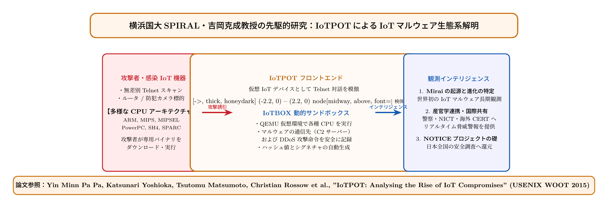

# 第22話 蜜壺が暴く暗黒生態系 〜吉岡研「IoTPOT」とIoTマルウェアの進化〜

> **【放課後サイバーディフェンス・ラボ（第2部：大学先端研究の扉 〜横浜国大SPIRAL論文探訪〜）】**
> - **舞台**: 帝都科学大学先端セキュリティ実習室 ＆ 横浜国立大学 SPIRAL 共同観測ルーム
> - **登場人物**: 神崎 蓮（高校1年・IoT班）、白石 結衣（高校1年・暗号数理班）、城崎 悠真（大学1年・芹沢研TA）、芹沢 涼香 准教授（大学メンター）
> - **学習テーマ**: 吉岡克成教授（SPIRALセンター長）らの先駆的論文『IoTPOT（USENIX WOOT 2015）』、IoTハニーポットの二段階協調アーキテクチャ、異種CPUアーキテクチャ（ARM/MIPS等）サンドボックス、IoTマルウェア生態系の解明、脅威インテリジェンスエコシステム
> - **探訪・参照研究論文**:
>   - [横浜国立大学 SPIRAL：吉岡克成研究室（CyRaP Lab）](https://spiral.ynu.ac.jp/)
>   - Pa Pa Yin Minn, Shogo Suzuki, Katsunari Yoshioka, Tsutomu Matsumoto, Takahiro Kasama, Christian Rossow. "IoTPOT: A Novel Honeypot with Analyzing Various Architectural Malware." *Proceedings of the 9th USENIX Workshop on Offensive Technologies (WOOT 15)*, 2015.
>   - 吉岡克成, 鈴木将吾, イン ミンパパ, 笠間貴弘, 松本勉. 「IoTPOT：未知のIoTマルウェア動態を解明するハニーポットシステム」, *情報処理学会論文誌*, Vol. 57, No. 9, pp. 2098-2109, 2016.

---

## 🎨 4コマ漫画・ストーリーイラスト (Draw Things 生成)

---

## 💬 4コマ漫画キャラクターセリフ（日・英対訳）

挿絵の4コマ漫画（文字なし）の各コマに対応したキャラクターのセリフです。小説本文の導入としてもお楽しみいただけます。

| コマ | 展開 / シチュエーション | 🗣️ 日本語セリフ (Japanese) | 🌐 英語セリフ (English) |
|:---:|:---|:---|:---|
| **第1コマ** 【起】 | **蓮の困惑：自作マイコンに届く謎のバイナリ** Raspberry Piに世界中から届く攻撃パケットを眺め、PC用（x86）と全く違う構造に頭を抱える蓮。 | **蓮**: 「うわっ、自作ルーターに謎のバイナリが送り込まれてる！ でもx86じゃなくてARMやMIPS向けだ……！？」 | **Ren**: "Whoa, weird binaries are raining down on my custom router! But they aren't x86, they're for ARM and MIPS...!?" |
| **第2コマ** 【承】 | **結衣の洞察：従来のハニーポットでは追えない** 端末ログを分析し、シェルを真似るだけの低対話ハニーポットではIoTマルウェアの深層挙動が暴けないと気づく結衣。 | **結衣**: 「一般的なハニーポットでは、攻撃者がダウンロードさせる多種多様なバイナリを実行・解析できません。」 | **Yui**: "Standard honeypots only mimic a shell. They cannot execute and analyze binaries across diverse architectures." |
| **第3コマ** 【転】 | **悠真TAが解説するSPIRAL「IoTPOT」の二重構造** フロントエンドで罠を張り、バックエンドの仮想QEMU群で多種CPUマルウェアを動かす吉岡研のシステムを紹介。 | **悠真**: 「そこで横浜国大の吉岡教授たちが開発したのが『IoTPOT』だ。8種類以上のCPU環境で安全に挙動を暴くんだ。」 | **Yuma**: "That's why Prof. Yoshioka's team at YNU created 'IoTPOT', safely revealing malware behaviors across 8+ CPU architectures." |
| **第4コマ** 【結】 | **暗黒生態系の解明とプロアクティブ防衛の誓い** Mirai出現の前年から世界を救う脅威観測網を築いたSPIRALの偉業に圧倒され、守備範囲を広げる二人。 | **蓮**: 「敵の攻撃手法を隅々まで解明するからこそ、完璧な対策が打てるんだな！」 **結衣**: 「観測という名の灯火で闇を照らす……まさに本物のサイバー防衛研究です。」 | **Ren**: "By thoroughly deciphering the adversary's playbook, we can build flawless countermeasures!" **Yui**: "Illuminating the darkness through relentless observation... this is true cybersecurity science." |

---

## 📖 小説本文

帝都科学大学、先端セキュリティ実習室。
　薄暗い室内には、数台のサーバーラックから発せられる微かな駆動音と、冷却ファンが回る低い重低音だけが漂っていた。神崎蓮は、モニターに映し出されるログの奔流を凝視していた。

「……おかしい。これ、全部僕のデバイスに向けられたものじゃないのか？」

　蓮は眉をひそめ、キーボードを叩く手を止めた。彼が自作したIoTデバイス――Raspberry Piをベースに構築した実験用ノードには、外部から絶え間なくパケットが届いている。しかし、その中身は単なる「攻撃の試行」というレベルを超えていた。

「蓮くん、このバイナリ群を見て。ただのシェルスクリプトじゃないわよ」

　隣でモニターを覗き込んでいた白石結衣が、鋭い視線で指摘した。彼女は指先で特定のデータブロックをなぞる。

「PC向けのx86アーキテクチャ向けじゃなくて、ARMにMIPS……それにPowerPCやSuperHまで混ざってる。これ、攻撃者はターゲットのCPUの種類を正確に把握しているか、あるいは網羅的にスキャンして『動くもの』を探しているってことよ」

　蓮は絶句した。彼が作ったのはLinuxベースの小型端末だ。それに対して、なぜ世界中のボットネットや自動化された攻撃スクリプトが、これほど多様な命令セットアーキテクチャ（ISA）向けのバイナリを投げつけてくるのか。それはまるで、鍵の形を問わずあらゆる種類の鍵を次々と差し込んでくる、執拗で無機質な暴力のようだった。

✦ ✦ ✦

　実習室の奥に設置された大型ディスプレイに、大学のTAである城崎悠真が現れた。彼は手元のタブレットを操作し、蓮たちのログと同期させた。

「……なるほど、君たちが突き当たっているのは『IoT特有の攻撃動態』の壁だね」

　悠真は眼鏡の縁を押し上げ、淡々と、しかし正確な語り口で続けた。

「従来のハニーポット――例えばKippoのようなシステムでは、攻撃者がシェルにアクセスし、何らかのコマンドを打ち込むという『対話』を観測するのが主眼だった。でも、今のIoTマルウェアは違う。彼らはまず、脆弱性を突いてバイナリをダウンロードさせ、それを直接実行させることを目的とする」

　蓮が顔を上げた。「それじゃあ、従来のハニーポットでは攻撃の『中身』まで追いきれないってことですか？」

「その通りだ。シェルの応答だけを記録しても、送られてきたバイナリが実際にデバイス上でどう振る舞うか、どんな外部サーバーと通信しようとするのかという『動態』は掴めない。そこで、横浜国立大学のSPIRALセンター長、吉岡克成教授たちが2015年のUSENIX WOOTで発表した論文が重要になるんだ」

　悠真は画面に一枚の図解を投影した。それが、世界的な評価を得た『IoTPOT』のアーキテクチャである。

「IoTPOTの画期的な点は、フロントエンドとバックエンドを分離した二段階協調システムにある。フロントエンドでは、軽量なハニーポットで低対話的に攻撃を待ち受ける。そして、攻撃者がバイナリを送り込んできた瞬間、そのバイナリを即座にバックエンドへと転送するんだ」

　結衣が身を乗り出した。「バックエンドって、実際のデバイスで動かすの？」

「いいえ、そこが魔法のポイントだよ。バックエンドではQEMUなどの仮想エミュレータ群を用意している。それも単一の環境じゃない。8種類以上の異なるCPUアーキテクチャをエミュレートする環境を並列に走らせるんだ。攻撃者がARM向けのバイナリを送ればARM環境へ、MIPSならMIPS環境へ。安全な隔離空間の中で、マルウェアを『実際に動かして』その挙動を完全に可視化する。これがIoTPOTのブレイクスルーなんだよ」

✦ ✦ ✦

　実習室の空気が一変した。蓮と結衣は、理論という名の武器を手に入れたような高揚感に包まれていた。しかし、その技術が何を暴き出してきたのかを知るには、さらに深い層へ潜る必要があった。

　画面が切り替わり、遠隔地のSPIRAL共同観測ルームとの接続が確立された。そこには、落ち着いた、しかし威厳のある雰囲気を纏った女性――芹沢涼香准教授が座っていた。

「……君たちがIoTPOTの構造に注目したのは正しい。でも、その技術で何を『見た』のか、それこそがこの研究の核心です」

　芹沢は落ち着いた声で語り始めた。彼女の背後のモニターには、世界中から集まる膨大な観測データがリアルタイムで可視化されていた。

「私たちはMiraiという有名なボットネットが現れる以前から、世界中のスマート家電を狙うサイバー犯罪集団の動態を監視し続けてきました。SPIRALが築いたこのエコシステムは、単なる『防壁』ではありません。闇の戦場を白日の下にさらすための『観測網』です」

　彼女の指先が、複雑に絡み合うネットワーク図をなぞる。

「IoTPOTによって明らかになったのは、IoTマルウェアの高度な生態系です。Bashliteのような初期のマルウェアから、熱狂的な感染活動、テルネットへの執拗な辞書攻撃……それだけではありません。他のボットネットを排除するための『キル機能』のやり取りまで可視化された。彼らは単にランダムに動いているのではなく、互いの領土を奪い合い、生存圏を広げようとする、一つの『生態系』として動いていることが判明したのです」

　蓮は息を呑んだ。画面の中のデータは、ただの数字や文字列ではない。それは暗黒の領域で蠢く意志の痕跡だった。

「守るためには、まず敵を知らなければならない」

　結衣が静かに呟いた。彼女の瞳には、これまで見てきた「攻撃の断片」ではなく、その背後にある「巨大な構造」への理解が宿っていた。

✦ ✦ ✦

　講義の余韻が残る実習室で、蓮は再び自分のデバイスのログを見つめていた。しかし、先ほどまでの戸惑いは消えていた。

「……今まで、点と点を見ていただけだったんだ」

　蓮は拳を握りしめた。世界中から飛んでくるバイナリは、単なるゴミではない。それは高度に最適化され、特定の生態系の中で研ぎ澄まされた「武器」だ。そしてSPIRALが築いた観測の灯火は、その闇を照らし出すための唯一の道標なのだと理解した。

「結衣、僕たちの次のステップは決まったよ。単に『攻撃を防ぐ』だけじゃ足りない。この生態系を理解し、彼らが狙うルートをあらかじめ予測して封じる。……自作デバイスのセキュア設計、一からやり直そう」

　蓮の言葉に、結衣は力強く頷いた。

「ええ。敵がどう動くかを知ることで、私たちの設計はより強固なものになる。SPIRALが見つけた光を、私たちの盾に変えるために」

　窓の外には、夜の帝都の街並みが広がっていた。無数のIoTデバイスが点灯するその街の裏側で、見えない戦いは続いている。しかし今、二人の手元には、その戦場を俯瞰するための知識と、それを克服するための意志が宿っていた。

　蓮は再びキーボードに指を置いた。モニターに映るカーソルが、新たな設計思想の第一行を書き込み始めた。

---

## 📊 TikZによるセキュリティ構造図解

---

## 💡 高校生のためのセキュリティ深掘りコラム

### 1. IoTマルウェアの特殊性と「CPUアーキテクチャの多様性」
一般的なパソコンやクラウドサーバーは、IntelやAMDの「x86 / x86_64」という共通の命令セット（CPUアーキテクチャ）で動いています。
しかし、家庭用Wi-Fiルーター、ネットワークカメラ（Webcam）、スマートテレビ、温湿度センサーなどの**IoT（Internet of Things）機器**は、消費電力や製造コストを抑えるため、**ARM、MIPS、PowerPC、SuperH、SPARC、Motorola 68000**など、驚くほど多様なCPUを採用しています。
攻撃者もこの環境に合わせて、同一のマルウェアソースコードから8〜10種類以上の異なるCPU向けバイナリを一斉にクロスコンパイルしてばら撒くという、PCとは全く異なる攻撃手口を発達させました。

### 2. 横浜国大・吉岡教授らの金字塔「IoTPOT」の画期的構造
2015年、横浜国立大学の**吉岡克成 教授（現・SPIRALセンター長）**らの研究チームは、この多種多様なIoTマルウェアの生態系を暴く画期的なハニーポットシステム**「IoTPOT」**を国際学会 USENIX WOOT 2015 で発表しました。
IoTPOTの最大の特徴は、**「フロントエンド（Frontend）」と「バックエンド（Backend: IoTBOX）」を鮮やかに分離した二段階協調アーキテクチャ**にあります：
- **フロントエンド（Low-Interaction）**: インターネット上に数万個の無防備なIoT機器を装った低負荷な罠を展開。Telnet辞書攻撃に対して実機のプロンプトを巧みにシミュレートし、攻撃者が送り込んでくるマルウェアのダウンロードURLや生バイナリを確実に捕捉する。
- **バックエンド（IoTBOX: High-Interaction）**: 捕捉した未知バイナリを、QEMU仮想環境上に構築された**8種類以上の異種CPUサンドボックス**へ自動転送。実際にマルウェアを動作させ、C2（指令サーバー）への通信、他端末へのスキャン、DDoS攻撃のパケット送信挙動を完全隔離された環境で詳細に記録する。

### 3. Miraiボットネット出現を予見した「脅威インテリジェンス」の先駆
2016年秋、世界中のDNSサービス（Dyn）を麻痺させ米国の東海岸全域でTwitterやNetflixをダウンさせた悪名高い**「Miraiボットネット」**。
しかし吉岡教授らのIoTPOTは、Miraiが世界を騒がせる**1年以上も前の2015年春の時点で、すでに前身となるBashliteなどのIoTボットが世界中で激しい感染競争を繰り広げている実態を学術的に可視化**していました。
敵がどのような手口で機器を乗っ取り、どのように勢力を拡大しているのか――「敵の生態系を誰よりも早く観測し、社会全体に先手（プロアクティブ）の防御策を提供する」というSPIRALの脅威インテリジェンス研究は、世界中のセキュリティ機関から最高峰の評価を受けています。
