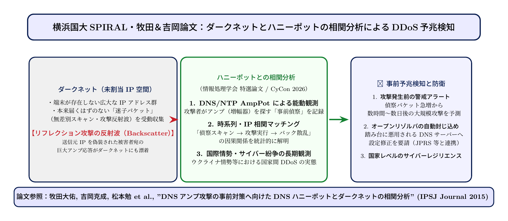

# 第23話 闇夜の反射鏡を砕け 〜ダークネットとDNSアンプ攻撃事前観測〜

> **【放課後サイバーディフェンス・ラボ（第2部：大学先端研究の扉 〜横浜国大SPIRAL論文探訪〜）】**
> - **舞台**: 帝都科学大学先端セキュリティ実習室 ＆ 横浜国立大学 SPIRAL ネットワーク監視室
> - **登場人物**: 神崎 蓮（高校1年・IoT班）、白石 結衣（高校1年・暗号数理班）、城崎 悠真（大学1年・芹沢研TA）、芹沢 涼香 准教授（大学メンター）
> - **学習テーマ**: 牧田大佑准教授・吉岡克成教授らの特選論文『DNSアンプDDoS攻撃の事前対策に向けたDNSハニーポットとダークネットの相関分析』、DNSアンプ（増幅）攻撃の物理的メカニズム、UDPの送信元IP偽装（IP Spoofing）、オープンリゾルバ問題、ダークネット（未使用IP空間）観測、攻撃予兆の事前検知
> - **探訪・参照研究論文**:
>   - [横浜国立大学 SPIRAL：サイバー空間観測・分析研究グループ](https://spiral.ynu.ac.jp/)
>   - 牧田大佑, 吉岡克成, イン ミンパパ, 鈴木将吾, 松本勉. 「DNSアンプDDoS攻撃の事前対策に向けたDNSハニーポットとダークネットの相関分析」, *情報処理学会論文誌*, Vol. 56, No. 9, pp. 1827-1837, 2015. (情報処理学会特選論文)
>   - Daisuke Makita, Katsunari Yoshioka, et al. "Analyzing and Mitigating DNS Amplification DDoS Attacks via Coordinated Honeypot and Darknet Monitoring." *NATO CCDCOE International Conference on Cyber Conflict (CyCon)*.

---

## 🎨 4コマ漫画・ストーリーイラスト (Draw Things 生成)

---

## 💬 4コマ漫画キャラクターセリフ（日・英対訳）

挿絵の4コマ漫画（文字なし）の各コマに対応したキャラクターのセリフです。小説本文の導入としてもお楽しみいただけます。

| コマ | 展開 / シチュエーション | 🗣️ 日本語セリフ (Japanese) | 🌐 英語セリフ (English) |
|:---:|:---|:---|:---|
| **第1コマ** 【起】 | **蓮の衝撃：数十バイトが数百倍のメガトン兵器へ** DNSパケットのシミュレーションを見つめ、たった1行の問い合わせが巨大な津波に化ける怪異に目を見張る蓮。 | **蓮**: 「なんだこれ！？ たった60バイトの問い合わせを送っただけで、4,000バイト以上の巨大応答が返ってくるのか！？」 | **Ren**: "What is this!? A tiny 60-byte query generates an enormous 4,000-byte response back!?" |
| **第2コマ** 【承】 | **結衣の数理分析：UDP送信元偽装とオープンリゾルバ** ホワイトボードにパケット構造を描き、UDPのコネクションレス特性とIP偽装による反射の仕組みを看破する結衣。 | **結衣**: 「UDPはハンドシェイクがありません。送信元IPを標的のアドレスに偽装すれば、巨大応答が標的に集中砲火されます。」 | **Yui**: "UDP lacks handshakes. If attackers spoof the source IP with the victim's, massive responses crush the victim." |
| **第3コマ** 【転】 | **悠真TAが語る「ダークネット」とSPIRAL牧田論文** 宇宙のブラックホールのように誰も使っていない未使用IP空間に降り注ぐパケット観測とハニーポット連携を解説。 | **悠真**: 「横浜国大の牧田・吉岡先生たちは、ダークネットとDNSハニーポットを連携させて攻撃の予兆を捉えたんだ。」 | **Yuma**: "Professors Makita and Yoshioka at YNU correlated darknet scans with DNS honeypots to detect attack preparations." |
| **第4コマ** 【結】 | **受動的対処から能動的予知へ！二人の未来構想** 攻撃が起きてから耐えるのではなく、ダークネットの予兆分析で先手を打つ研究の真価に胸を高鳴らせる二人。 | **蓮**: 「攻撃が始まる前に準備運動を見つけ出すなんて、まさに未来予知ディフェンスだ！」 **結衣**: 「ビッグデータ数理がインターネットの平和を守る……素晴らしい研究の領域です。」 | **Ren**: "Spotting their warm-up scans before the assault even begins... it's literally precognitive cyber defense!" **Yui**: "Big data mathematics guarding the peace of the internet... what an inspiring research frontier." |

---

## 📖 小説本文

帝都科学大学の先端セキュリティ実習室には、重厚なサーバーラックの駆動音と、微かな冷却ファンの回転音が低く響いていた。
　神崎蓮は、目の前の大型モニターに映し出されたグラフを凝視し、絶句していた。

「……信じられない。たった数十バイトのリクエストを送っただけなのに、返ってくる応答の量がこれほどまで膨れ上がるのか？」

　モニター上の波形は、突如として垂直に近い角度で跳ね上がっていた。DNSアンプリフィケーション攻撃（増幅攻撃）のシミュレーション結果だ。
「蓮くん、これが『増幅倍率』の恐ろしさだよ。攻撃者は標的のIPアドレスを偽装して、世界中に散らばる公開DNSサーバーに巨大なレコードを要求する。すると、それらのサーバーは善意（あるいは無防備な設定）で、リクエストの数百倍にも及ぶ巨大な応答データを、標的のネットワークへと叩きつけるんだ」

　隣でキーボードを叩いていた白石結衣が、冷静な眼差しで補足する。彼女の指先は淀みなく動き、パケットの構造を分解していく。
「ポイントは、DNSプロトコルがUDP（User Datagram Protocol）を利用していることにあるわね。TCPと違って、UDPには『3ウェイ・ハンドシェイク』という確認の工程がない。つまり、送信元IPアドレスを偽装（Spoofing）してパケットを投げても、サーバー側はそれが本物だと思って応答を返してしまう。この『情報の非対称性』こそが、サイバー兵器としての増幅効果を生む源泉なのよ」

　蓮は画面を見つめたまま、背筋に冷たいものが走るのを感じた。
「つまり、インターネット上の無防備なサーバー――『オープンリゾルバ』たちが、知らぬ間に攻撃者のための反射鏡にされているってことか……」
「その通り。一人の攻撃者が数千台の鏡を同時に動かせば、ターゲットのネットワークは瞬く間に飽和し、通信は完全に遮断される。まさにメガトン級のサイバー兵器ね」

✦ ✦ ✦

「でも、それだけじゃ説明しきれない部分がある。攻撃者はただ闇雲にリクエストを送るわけじゃないんだ」
　白石の分析に、実習室の奥から大学のTAである城崎悠真が歩み寄ってきた。彼はモニターの別の領域、ネットワーク上の「空白地帯」を示すマップを指差した。

「見てくれ、この『ダークネット（ブラックホール）』と呼ばれる空間を。ここは本来、誰も使っていないIPアドレス空間だ。しかし、ここには絶え間なくパケットが降り注いでいる。攻撃者が本番の攻撃を仕掛ける前に、彼らが最初に行うこと――それが『予備スキャン』だ」

　城崎は複雑なネットワークトポロジーの図解を映し出した。
「攻撃者は、自分の正体を隠しながら、インターネットの隅々までを探索する。誰も使っていないはずの空間にパケットが届くということは、それだけ広範囲の『標的候補』や『踏み台となるサーバー』を探っている証拠だ。この深淵なアドレス空間に降り注ぐ不審な探索パケットは、いわば嵐の前の静けさの中に響く微かな予兆なんだよ」

　蓮は、その「見えない空間」に絶え間なく流れるゴミのようなパケットの群れに、形容しがたい不気味さを感じた。
「誰もいないはずの場所で、誰かが獲物を探している……。それを見張ることはできるのか？」
「それが、今回の研究の核心なんだ」

✦ ✦ ✦

　数日後。一行は横浜国立大学のSPIRALネットワーク監視室へと足を運んでいた。
　そこには、最新鋭の監視設備に囲まれ、泰然自若とした面持ちで待つ芹沢涼香准教授の姿があった。彼女は、牧田大佑・吉岡克成両教授らによる最新の論文を手に取った。

「神崎君、白石さん。この論文『DNSハニーポットとダークネットによるDNSアンプDDoS攻撃の事前対策・相関分析』には、これまでの防御の常識を覆す概念が含まれているわ」

　芹沢はモニターに、複雑な相関分析のデータセットを映し出した。
「従来の防衛は『受動的』なものだった。攻撃を受けてから遮断壁を築く。しかし、この研究が提示しているのは『プロアクティブ（先制的）』な防御よ。鍵となるのは、ダークネットでの予備スキャンと、DNSハニーポット（AmpPot等）に記録される攻撃試行ログの『相関分析』です」

　彼女は論文の核心部分を指し示した。
「攻撃者は本番の攻撃を行う前に、必ず準備を行う。彼らがダークネットで探っているサーバーのリストと、ハニーポットに対して行われた問い合わせの動きを突き合わせることで、我々は『数時間から数日後に、どのサーバーが悪用され、どこが狙われるのか』という未来を予測できるの。つまり、攻撃が発動する前に、あらかじめ防衛網を最適化し、攻撃の芽を摘み取ることができる」

　蓮は、その高度な数理モデルとデータ解析のダイナミズムに圧倒されていた。
「……つまり、我々は『起きてから対処する』のではなく、『起きる予兆を捉えて先手を打つ』というわけか」
「ええ。膨大なビッグデータを統合し、ネットワーク全体の動態から攻撃者の意図を読み取る。これはもはや、個別のサーバーを守るゲームではなく、インターネットという巨大な生態系を守るための高度な知略なのよ」

✦ ✦ ✦

　監視室の窓の外には、夜の横浜の街並みが広がっていた。
　蓮は、モニターに映し出される無数の点滅する光――それはネットワークを流れるパケットの奔流であり、同時に守るべき人々の営みそのものだということに気づいた。

「ただの技術の話だと思ってたけど……これって、インターネットという巨大な海を守るための盾を作ってるんだな」
　蓮の言葉に、白石が小さく頷いた。彼女の瞳にも、これまでとは違う熱が宿っている。
「そうね。数理的な美しさの裏には、それを守ろうとする意志がある。予兆を捉え、未来を予測する。この知性の積み重ねこそが、混沌としたネット空間に秩序をもたらす唯一の手段なのよ」

　城崎も、誇らしげに笑った。
「その通りだ。予兆を掴むことは、犯人の足跡を追うことと同じ。私たちは、インターネットという広大なキャンバスに描かれる『攻撃者の筆跡』を見極め、それを消し去るための術を学んでいるんだ」

　神崎蓮は拳を握りしめた。
　わずか数十バイトのリクエストが、数千倍の破壊となって降り注ぐ世界。その絶望的な力に対抗するのは、同じく人間が紡ぎ出した、緻密で美しい論理と解析の技術だ。
　彼らの前に広がるのは、闇夜に反射する鏡を砕き、見えない脅威から日常を守り抜くための、壮大な知の戦場だった。

---

## 📊 TikZによるセキュリティ構造図解

---

## 💡 高校生のためのセキュリティ深掘りコラム

### 1. 「DNSアンプ攻撃（DNS Amplification Attack）」の原理
インターネットの住所録である**DNS（Domain Name System）**。通常は「`example.com` のIPアドレスを教えて」と尋ねると、サーバーが数十バイトでIPアドレスを返してくれます。
しかし攻撃者は、暗号鍵や長大なレコードを含むドメインに対して「すべての情報（`ANY` クエリやDNSSECクエリ）」を要求します。
すると、**わずか60バイト程度の要求パケットに対して、3,000〜4,000バイト以上（約50〜70倍）の巨大な応答パケット**が生成されます。これが「アンプ（増幅器）」と呼ばれる理由です。

### 2. なぜ標的に届くのか？：UDPと「送信元IP偽装（IP Spoofing）」
Web閲覧で使われるTCP通信では、通信開始前に必ず**「3ウェイハンドシェイク（SYN ➡ SYN/ACK ➡ ACK）」**を行って相手が実在するか確認するため、送信元を偽装することは極めて困難です。
しかし、DNSやNTPで使われる**UDP（User Datagram Protocol）**は、事前確認なしに一方的にパケットを送りつける「コネクションレス型」です。
攻撃者は、パケットの送信元IPアドレスを「標的（攻撃したい企業やサーバー）のIP」に書き換えて（偽装して）、世界中に存在する無防備なDNSサーバー（**オープンリゾルバ**）へ一斉にクエリを投げます。すると、数千台のDNSサーバーから標的へ向かって巨大な応答パケットの津波が一瞬で集中し、標的の回線とサーバーを完全にパンク（DDoS）させてしまうのです。

### 3. 横浜国大・牧田大佑准教授らの先駆的功績：ダークネットとの相関分析
横浜国立大学 SPIRALの**牧田大佑 准教授・吉岡克成 教授**らは、この深刻なDDoS攻撃に対して画期的な解決策を提示し、情報処理学会論文誌の**「特選論文」**を受賞しました。
- **ダークネット（Darknet）とは**: インターネット上で正式に割り当てられているものの、実際にはコンピュータやサーバーが接続されていない「未使用のIPアドレス空間（ブラックホール）」のこと。正常な通信ならパケットが届くはずがないため、ここに届くパケットはすべて**「世界中を徘徊する不正なスキャンや探索活動」**であることが分かります。
- **事前対策の相関メカニズム**:
  攻撃者は、本番のDDoS攻撃を発動する数時間〜数日前に、まず「世界中のどのDNSサーバーを踏み台（アンプの反射鏡）に使えるか」を探すための**「予備探索スキャン」**をインターネット全体に仕掛けます。
  牧田教授らは、SPIRALが運用する**DNSハニーポット（AmpPot等）に届いた問い合わせ**と、NICT等の**ダークネットに届いた無差別スキャンパケット**を時系列で高精度に照合・相関分析しました。
  その結果、**「攻撃者がどのオープンリゾルバを踏み台として選別したか」「どの標的を狙おうとしているか」をDDoS攻撃の発動前に察知し、事前に踏み台リストの遮断や標的への警告を行うという、能動的（プロアクティブ）な事前防御エコシステム**を世界で初めて実証したのです。
