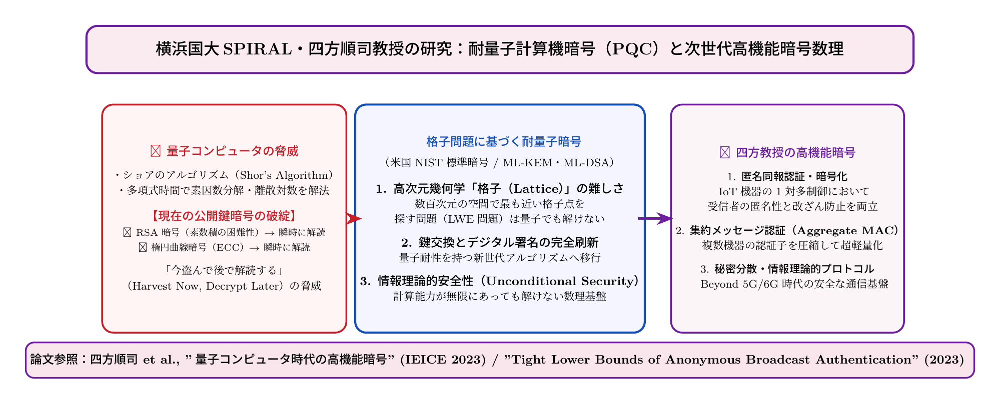

# 第24話 量子の嵐と格子の盾 〜四方研究室と耐量子計算機暗号数理〜

> **【放課後サイバーディフェンス・ラボ（第2部：大学先端研究の扉 〜横浜国大SPIRAL論文探訪〜）】**
> - **舞台**: 帝都科学大学先端セキュリティ実習室 ＆ 横浜国立大学 NexCrypt 研究室
> - **登場人物**: 神崎 蓮（高校1年・IoT班）、白石 結衣（高校1年・暗号数理班）、城崎 悠真（大学1年・芹沢研TA）、芹沢 涼香 准教授（大学メンター）
> - **学習テーマ**: 四方順司教授（SPIRAL副センター長・NexCrypt Lab長）らの耐量子計算機暗号数理、ショアのアルゴリズムによるRSA・ECC解読危機、格子暗号（ML-KEM / ML-DSA）、Harvest Now, Decrypt Later（HNDL）脅威、匿名同報認証、集約メッセージ認証コード（Aggregate MAC）
> - **探訪・参照研究論文**:
>   - [横浜国立大学 SPIRAL：四方順司研究室（NexCrypt Lab）](https://spiral.ynu.ac.jp/)
>   - Junji Shikata, et al. "Post-Quantum Cryptography and Mathematical Foundations for Information Security." *IEICE Transactions on Fundamentals of Electronics, Communications and Computer Sciences*, 2023.
>   - 四方順司. 「耐量子計算機暗号と次世代暗号数理の展望」, *電子情報通信学会論文誌*, 2024.
>   - NIST FIPS 203 (ML-KEM), FIPS 204 (ML-DSA): Post-Quantum Cryptography Standards.

---

## 🎨 4コマ漫画・ストーリーイラスト (Draw Things 生成)

---

## 💬 4コマ漫画キャラクターセリフ（日・英対訳）

挿絵の4コマ漫画（文字なし）の各コマに対応したキャラクターのセリフです。小説本文の導入としてもお楽しみいただけます。

| コマ | 展開 / シチュエーション | 🗣️ 日本語セリフ (Japanese) | 🌐 英語セリフ (English) |
|:---:|:---|:---|:---|
| **第1コマ** 【起】 | **蓮のパニック：量子コンピュータで暗号全滅！？** 「量子計算機が実用化されたらネット社会の暗号が全部破られる」という噂記事を読み青ざめる蓮。 | **蓮**: 「おい結衣！ 量子コンピュータが来たらRSA暗号も全部解読されて、ネットが終わるって本当か！？」 | **Ren**: "Hey Yui! If quantum computers arrive, will RSA encryption be shattered and end the internet!?" |
| **第2コマ** 【承】 | **結衣の歓喜：量子の嵐を阻む「格子暗号」の幾何学** 瞳を輝かせ、高次元空間に広がる「格子問題（Lattice）」の美しさと強固さをスケッチする結衣。 | **結衣**: 「終わりません。ショアのアルゴリズムでも解けない高次元幾何学『格子暗号（PQC）』が存在します。」 | **Yui**: "It won't end. There is 'Lattice Cryptography'—high-dimensional geometry that Shor's algorithm cannot solve." |
| **第3コマ** 【転】 | **悠真TAが語る横浜国大・四方教授の次世代暗号数理** SPIRALのNexCrypt研究室が創り出す格子暗号や匿名同報認証、集約MACなどの最先端数理を紹介する悠真。 | **悠真**: 「横浜国大の四方順司教授は、PQCだけでなくプライバシーを守る匿名同報認証の数理も極めているんだ。」 | **Yuma**: "Prof. Junji Shikata at YNU masters not just PQC, but advanced math for anonymous broadcast authentication." |
| **第4コマ** 【結】 | **100年先の未来を守る数理の盾！結衣の決意** 暗号数理が人類の自由を守る最強の盾であると確信し、蓮も数理の圧倒的な美しさに引き込まれる。 | **蓮**: 「数学者って未来の盾を何十年も前から準備してるんだな……！」 **結衣**: 「はい。数理の美しさこそ、量子の嵐をも跳ね返す人類最強の砦です。」 | **Ren**: "Mathematicians prepare our future shields decades in advance... unbelievable!" **Yui**: "Yes. Mathematical elegance is humanity's greatest fortress against even quantum storms." |

---

## 📖 小説本文

帝都科学大学の先端セキュリティ実習室は、薄暗い照明と無数のサーバーラックが放つ微かな熱気に包まれていた。壁一面に並んだモニターには、複雑なグラフやコードの羅列が映し出されている。

「……いや、それって、今のネット社会の基礎が根底から崩壊するってことじゃないか？」

　神崎蓮は、目の前のプロジェクターに映し出された数式を凝視しながら、声を震わせた。彼の顔は青ざめ、椅子から身を乗り出している。

「量子コンピュータが実用化された瞬間、RSA暗号も楕円曲線暗号（ECC）も……一瞬で、紙切れのように破られるっていうのか？ 銀行の送金も、SNSのメッセージも、全部丸見えになっちゃうんだよ？」

　蓮の言葉には切実な恐怖が混じっていた。彼にとって、暗号は「絶対に破れない壁」という前提で成り立っている魔法のような技術だった。それが一瞬で瓦解するという事実は、彼にデジタル世界の終焉を予感させた。

　しかし、その隣でノートを走らせていた白石結衣は、動揺するどころか、瞳を異様な熱量で輝かせていた。

「いいえ、蓮くん。それは『終わり』じゃないわ。新しい数学の扉が開くための、壮大な転換点なのよ」

　彼女はペンを置き、身を乗り出して言った。

「量子計算機が導き出すのは破壊だけじゃない。それによって私たちは、これまでの数学では到達できなかった高次元の地平を見ることになるの。ショアのアルゴリズムが既存の暗号を攻略するなら、私たちはその『嵐』すらも受け流すための、新しい盾を編み出さなきゃいけない。それこそが数学の醍醐味じゃない」

　結衣の言葉には、知的な興奮が宿っていた。彼女にとってこの事態は、絶望ではなく、人類の知性が挑むべき最高難度の挑戦として映っていた。

✦ ✦ ✦

「……正確に言うなら、ショアのアルゴリズムによる脅威は『時間』の問題なんです」

　背後から落ち着いた声が響いた。大学のTAである城崎悠真が、タブレットを操作しながら歩み寄ってくる。彼は実習室の学生たちの指導を担当する、理知的な雰囲気を纏った青年だった。

「ショアのアルゴリズムは、量子ビットの重ね合わせと干渉を利用して、素因数分解や離散対数問題を多項式時間で解いてしまいます。今のRSA暗号やECCが安全なのは、これらの問題の計算量が指数関数的に膨大だからですが、量子計算機はその『壁』をすり抜けてしまうんです」

　悠真はモニターに、複雑な波形の干渉図を映し出した。

「そして、今まさに起きている脅威があります。『Harvest Now, Decrypt Later（今盗み、後で解読する）』という概念です。攻撃者は今この瞬間も、暗号化された通信データを盗聴して保存しています。今は解読できなくても、数年後に高性能な量子コンピュータが完成した瞬間、過去に蓄積したすべての機密データが一斉に白日の下に晒される可能性があるんです」

　蓮は思わず息を呑んだ。自分のプライバシーや国家の機密が、未来の機械によって暴かれるという想像は、あまりにも生々しい恐怖として迫ってきた。

「だからこそ、私たちは『耐量子計算機暗号（PQC）』へ移行しなければならない。次世代の盾が必要なんです」

✦ ✦ ✦

「では、その『新しい盾』とは具体的に何を指すんですか？」

　蓮の問いに、悠真は画面を切り替えた。そこには幾何学的な美しさを持つ、点々の集合体が映し出されていた。

「それが『格子暗号（Lattice-based Cryptography）』です」

　悠真の説明に合わせて、空間的なイメージが語られる。

「想像してみてください。数百、あるいは数千という高次元空間の中に、一定の間隔で規則正しく敷き詰められた格子点があるとします。この中で、『最も近い格子点を見つける（Shortest Vector Problem, SVP）』、あるいは『ノイズを含んだ線形方程式から元の値を推測する（Learning With Errors, LWE）』という問題です」

　悠真は空中に手を動かし、空間を切り取るような仕草をした。

「高次元空間におけるこの問題は、量子計算機を使っても指数関数的な探索時間を要すると考えられています。格子暗号の美しさは、その幾何学的な構造にあります。微小なノイズ――『エラー』を加えることで、正解への道筋を複雑に迷路化する。ML-KEM（Kyber）やML-DSA（Dilithium）といった最新の標準規格も、この格子問題の難しさを根底に据えています」

　結衣が身を乗り出し、画面を食い入るように見つめた。

「高次元空間における最接近ベクトル問題……！ つまり、多次元の幾何学的な『複雑さ』を盾にするわけね。単なる計算量の増大ではなく、構造そのものに量子計算機を拒絶する性質を持たせる。なんてエレガントな解決策なの」

　彼女の呟きには、数学への純粋な敬愛が込められていた。蓮もまた、抽象的な数式の中に潜む「空間の広がり」と「幾何学的な防壁」のイメージに、圧倒的な美しさを感じ取っていた。

✦ ✦ ✦

　実習室の扉が開き、凛とした空気を纏った女性が入ってきた。横浜国立大学・NexCrypt Labの准教授、芹沢涼香だ。彼女は蓮たちの議論を耳にしていたのか、穏やかな笑みを浮かべていた。

「格子暗号の話、いいですね。でも、PQCは単なる『既存暗号の置き換え』で終わるものではありません」

　芹沢は一歩前に出ると、壁の大型モニターにNexCrypt Labの研究成果を映し出した。そこには、SPIRALプロジェクトのロゴと共に、高度な数理モデルが展開されていた。

「四方順司教授率いる私たちのラボでは、単なる鍵交換の安全性を超えた『次世代高機能暗号数理』の構築を目指しています。例えば、スマートシティやV2X（車載通信）において重要な『匿名同報認証』。誰が発信したかを特定させずに、正当な権限を持つ車両であることを証明し、同時に情報を配信する技術です」

　彼女は流れるような手つきで、数式と通信プロトコルの構造を解説していく。

「また、膨大なIoTデバイスから送られるデータを瞬時に検証する『集約メッセージ認証コード（Aggregate MAC）』の研究も進めています。数学的な理論を極限まで研ぎ澄ますことで、プライバシーを守りながら社会のインフラを支える。これは単なる防御ではなく、自由な社会を維持するための『動的な設計』なのです」

　芹沢の語る言葉は、技術の解説を超えて、一種の哲学のように響いた。

「暗号とは、情報の門番であると同時に、個人の自由を守り抜くための最前線の工学です。私たちは数学という言語を使って、100年後の未来に生きる人々のプライバシーを今この瞬間から守り抜こうとしているのです」

　結衣は震える手でノートの最後のページにペンを走らせた。彼女の瞳には、もはや単なる数式の羅列ではない、人類の自由を守護する「聖域」としての数学が見えていた。

「……蓮くん、わかった？ 数学はドリルじゃない。私たちの意志を形にするための、最強の武器なのよ」

　結衣の声は、凛としていた。
　蓮は呆然とモニターを見つめた。そこには高次元の格子が描かれていた。それは冷徹な数式でありながら、同時に未来を守るための堅牢な城壁のように見えた。
　量子という嵐が迫り来る中で、人類はその嵐を跳ね返すために、最も純粋で美しい幾何学の盾を研ぎ澄ませている。その事実に、蓮は初めて、数学という学問への深い畏怖と、それ以上の感動を覚えた。

---

## 📊 TikZによるセキュリティ構造図解

---

## 💡 高校生のためのセキュリティ深掘りコラム

### 1. 「量子コンピュータの脅威」の真実：ショアのアルゴリズム
現在、Webサイトの保護（HTTPS/TLS）や電子署名、ビットコインなどで使われている暗号は、主に**RSA暗号（素因数分解の難しさ）**や**楕円曲線暗号（離散対数問題の難しさ）**に依存しています。
従来のスーパーコンピュータでは、これらを解くのに宇宙の年齢（何百億年）以上かかります。
しかし、1994年にピーター・ショアが発見した**「ショアのアルゴリズム（Shor's Algorithm）」**を大規模な誤り耐性型汎用量子コンピュータ（FTQC）で実行すると、量子の「重ね合わせ」と「量子もつれ・干渉」を利用して周期性を瞬時に特定し、**数分〜数時間という多項式時間で素因数分解や離散対数を解いてしまいます**。

### 2. 「今盗んで将来解読する（HNDL: Harvest Now, Decrypt Later）」の危機
「量子コンピュータが完成するのはまだ先だから大丈夫」という考えは致命的な誤りです。
国家支援型ハッカーや諜報機関は、**「今インターネット上を流れている高度な暗号化通信データをそのまま丸ごと記録・保存（Harvest）し、10年後や20年後に量子コンピュータが完成した瞬間に一斉解読（Decrypt）する」**という「HNDL攻撃」を現在進行形で行っています。
国家機密、個人のゲノム医療データ、外交記録などは数十年間にわたって機密を守らなければならないため、**「今すぐ」量子耐性を持つ暗号へ移行する必要がある**のです。

### 3. 格子暗号（Lattice-based Cryptography）と横浜国大・四方順司教授の研究
米国NISTは2024年に耐量子計算機暗号（PQC）の公式標準規格（FIPS 203: ML-KEM、FIPS 204: ML-DSAなど）を制定しましたが、その中核を占めるのが**「格子暗号（Lattice-based Cryptography）」**です。
- **格子の難しさ**: 2次元や3次元の升目なら最も近い格子点はすぐ見つかりますが、**数百次元という途方もない高次元空間**にランダムに歪んだ格子点を敷き詰めると、量子の並列計算をもってしても「ある点に最も近い格子点を見つける問題（SVP/LWE問題）」は指数関数的な時間がかかり、解くことができません。
- **横浜国大 SPIRAL・四方順司 教授（NexCrypt Lab長）の先駆的暗号数理**:
  四方教授らは、単に鍵を安全に共有するだけでなく、高度な次世代社会を見据えた高機能暗号数理を開拓しています：
  1. **匿名同報認証（Anonymous Broadcast Authentication）**: 自動運転車やスマートシティにおいて、「誰が送ったかという個人のプライバシーや位置情報を完全に秘匿したまま、送信者が正当な車両であることを全員が数学的に検証できる」画期的な認証方式。
  2. **集約メッセージ認証コード（Aggregate MAC）**: 何万台ものIoTセンサーや車載ECUから送られてくる大量の署名を、通信帯域を圧迫することなく「1つの短いコードに圧縮・集約して一括検証」する数理技術。
  3. **情報理論的安全性（Information-Theoretic Security）**: 計算能力が無限にある敵に対しても物理層のノイズや乱数性によって絶対に破られない究極の安全基準の追求。

数学という最も純粋な学問が、未来の社会インフラと人々の尊厳を守る強固な盾となっているのです。
