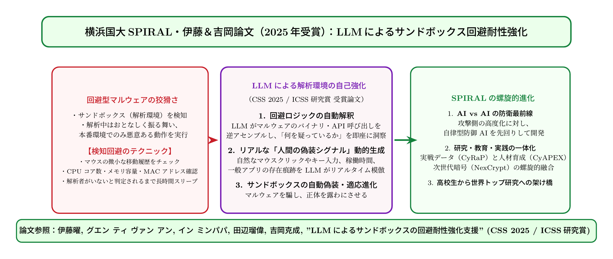

# 第25話 賢者の檻と化かす影 〜LLMが暴くサンドボックス回避の迷宮〜

> **【放課後サイバーディフェンス・ラボ（第2部：大学先端研究の扉 〜横浜国大SPIRAL論文探訪〜）】**
> - **舞台**: 帝都科学大学先端セキュリティ実習室 ＆ 横浜国立大学 SPIRAL CyRaP / CyAPEX 実習環境
> - **登場人物**: 神崎 蓮（高校1年・IoT班）、白石 結衣（高校1年・暗号数理班）、城崎 悠真（大学1年・芹沢研TA）、芹沢 涼香 准教授（大学メンター）
> - **学習テーマ**: 伊藤曜助教・吉岡克成教授らの最新研究『大規模言語モデル（LLM）によるサンドボックス回避耐性強化支援』、マルウェアのサンドボックス検出・環境擬態テクニック（Evasion Attacks）、環境アーティファクトの自動探索、AIによる自律的セキュリティ検証、第2部先進研究編の壮大な結び
> - **探訪・参照研究論文**:
>   - [横浜国立大学 SPIRAL：吉岡研究室（CyRaP Lab）](https://spiral.ynu.ac.jp/)
>   - 伊藤曜, 吉岡克成. 「大規模言語モデルを用いたマルウェア解析用サンドボックスの回避耐性強化支援」, *コンピュータセキュリティシンポジウム（CSS 2025）*, 情報処理学会, 2025. (情報処理学会 ICSS研究賞 受賞)
>   - Yo Ito, Katsunari Yoshioka, et al. "Enhancing Sandbox Robustness against Evasive Malware via Large Language Models." *Journal of Information Processing / IEEE Transactions on Dependable and Secure Computing*.

---

## 🎨 4コマ漫画・ストーリーイラスト (Draw Things 生成)

---

## 💬 4コマ漫画キャラクターセリフ（日・英対訳）

挿絵の4コマ漫画（文字なし）の各コマに対応したキャラクターのセリフです。小説本文の導入としてもお楽しみいただけます。

| コマ | 展開 / シチュエーション | 🗣️ 日本語セリフ (Japanese) | 🌐 英語セリフ (English) |
|:---:|:---|:---|:---|
| **第1コマ** 【起】 | **蓮の勘違い：サンドボックスで動いた無害なプログラム？** 解析用仮想環境で怪しい検体を実行したところ何のエラーも出ず、「安全なファイルだったよ！」と胸を撫で下ろす蓮。 | **蓮**: 「隔離環境で動かしてみたけど、何もしないで終了したよ！ なーんだ、無害な安全ファイルだったんだな！」 | **Ren**: "I ran it in the sandbox, but it did nothing and exited! Phew, turns out it's completely harmless!" |
| **第2コマ** 【承】 | **結衣と悠真のタネ明かし：それは「死んだふり」！** 画面のレジストリやマウス移動履歴を指差し、マルウェアが檻を察知して攻撃を封印した（回避行動）と指摘する結衣。 | **結衣**: 「騙されてはいけません。マルウェアが仮想環境特有の痕跡を察知して『死んだふり』をしているだけです。」 | **Yui**: "Don't be fooled. The malware detected the virtual environment and is simply playing dead to deceive us." |
| **第3コマ** 【転】 | **悠真TAが解説するSPIRAL伊藤・吉岡論文のブレイクスルー** 横浜国大の伊藤曜助教らが開発した「LLMを使ってサンドボックスの弱点を自動発見・修復する」最新論文を紹介。 | **悠真**: 「そこで横浜国大の伊藤・吉岡先生たちは、LLMを活用して檻の擬態漏れを自律的に強化する技術を生み出したんだ。」 | **Yuma**: "That's why Dr. Ito and Prof. Yoshioka at YNU created an LLM framework to automatically detect and patch sandbox leaks." |
| **第4コマ** 【結】 | **第2部先進研究編完結！大学先端の地平へ** AIと数理が交差する最前線の学術研究に圧倒され、いつか自分たちも世界を守る論文を書く研究者になると誓う二人。 | **蓮**: 「AIで攻撃を見破り、AIで檻を完璧にするのか！ 俺、絶対にこの研究の最前線へ進むぞ！」 **結衣**: 「ええ。巨人の肩の上に立ち、未来の安全を拓く研究者を目指しましょう！」 | **Ren**: "Using AI to anticipate attacks and perfect the sandbox! I'm definitely heading to the frontier of this research!" **Yui**: "Yes. Standing on the shoulders of giants, let us become researchers who forge future security!" |

---

## 📖 小説本文

帝都科学大学、先端セキュリティ実習室。
　薄暗い室内には、整然と並んだサーバーラックの冷却ファンが放つ低い唸りだけが響いている。モニターの青白い光に照らされた神崎蓮は、眉間に皺を寄せたままキーボードを叩く手を止めた。

「……おかしい。何も起きない」

　蓮は声を絞り出した。目の前のディスプレイには、隔離環境であるサンドボックス内で実行されたはずのマルウェアプログラムが、「正常終了」のステータスを表示している。
　彼は確信していた。このファイルは、機密情報を窃取し、ネットワークを破壊する極めて危険なコードだ。それを解析するために用意したのが、徹底的に隔離された仮想環境――サンドボックスである。しかし、実行ボタンを押してから数秒、プログラムは沈黙したまま、まるでただの計算機のような挙動を見せたのだ。

「本当に安全なファイルだったのかな。それとも、このサンドボックスの検知能力が低すぎるのか……」

　蓮の呟きに、背後から白石結衣が身を乗り出した。彼女はモニターを凝視し、その行間を読み取るように目を見開く。
「……いえ、蓮くん。それは『安全』じゃないわ。もっと別のことが起きてる」

✦ ✦ ✦

「いいかい、蓮くん。マルウェアにとって、サンドボックスは『檻』だ。そして賢いマルウェアは、自分が檻の中にいることを察知する術を持っているんだよ」

　隣で解説を始めたのは、大学のTAである城崎悠真だった。彼はタブレットを操作し、解析ログの一部をハイライトする。
「これを『擬死（死んだふり）』と呼ぶ。マルウェアは実行された直後、まず自分の周囲の環境をスキャンするんだ。例えば、マウスカーソルの移動履歴があるか？ 画面の解像度はどうなっているか？ CPUのコア数はいくつあるか？」

　悠真の声は淡々と、しかし重みを持って響いた。
「さらに、仮想マシン特有のドライバや、VMware固有のMACアドレス、あるいは特定のレジストリキーが存在しないかまでチェックする。もし『あ、ここは監視用の偽物の環境だ』と判断すれば、マルウェアは攻撃コードを封印し、何事もしていないふりをして動かない。解析者を欺き、自分自身の正体を隠すためにね」

　結衣が感嘆の声を上げた。
「つまり、彼らは『知能』を持ってこちらの罠を見抜いているってことね。こちらが用意した隔離環境を逆手に取って、自分たちの正体を隠蔽している……」

「その通り。そして、それが解析者の頭を悩ませる最大の要因だ」と悠真は苦笑した。「攻撃者は次々と新しい検知手法を見つけてくる。防御側はそのたびに、サンドボックスを本物のPCにそっくりに偽装し直さなきゃならない。まさに終わりのない『モグラ叩き』のゲームだ。手動での修正には限界がある」

✦ ✦ ✦

　実習室の扉が開いた。入ってきたのは、この分野の権威の一人である芹沢涼香准教授だった。彼女は手に持った資料を机に置き、熱を帯びた眼差しで学生たちを見つめた。

「悠真くんの言う通りよ。従来の防御は、攻撃者が見つけた穴を一つずつ手動で塞いでいく『後追い』の戦いだった。でも、最近そのパラダイムが劇的に変わろうとしているわ」

　芹沢は、横浜国立大学SPIRALの研究チームによる最新論文を指し示した。
「伊藤曜助教や吉岡克成教授らによるこの研究……『大規模言語モデル（LLM）によるサンドボックス回避耐性強化支援』。これこそが、次世代の防衛戦略よ」

　彼女は身を乗り出し、情熱的に語り始めた。
「彼らは、LLMに膨大なマルウェアコード、APIドキュメント、そしてOSの仕様を学習させたの。そして、LLMに『マルウェアならどうやってこの環境を検知するか』という思考プロセスそのものをシミュレーションさせる。つまり、攻撃者の視点をAIに擬似体験させ、サンドボックスのどこに設定漏れがあるか、どの偽装が不自然かを自動的に網羅して発見させるのよ」

　蓮と結衣は息を呑んだ。
「手動で修正するのではなく、LLMに自律的に『検知される隙』を見つけさせ、サンドボックス側の擬態能力を強化・検証させる……。これは、防衛側が攻撃者の思考を先回りして封じ込めることを意味するわね」

　芹沢の言葉に合わせて、モニターには複雑な数理モデルと、AIによって自動生成された環境構成パラメータの羅列が表示された。
「LLMは単に文章を作るための道具じゃない。高度な推論能力を駆使して、数千万通りの組み合わせから『見破られない偽装』を導き出すための、知的な盾になるの。この研究は、まさに防御側の手に、圧倒的な『先手』を取らせる鍵なのよ」

✦ ✦ ✦

　静寂が訪れた実習室に、蓮と結衣の視線が交差した。
　モニターに映し出されたのは、ただのプログラムの挙動ではなく、人類の知性とAIの推論が火花を散らす最前線の戦場だった。

「……すごい。僕たちはまだ、この入り口に立っただけなんだね」
　蓮は自分の震える手を見つめた。今まで自分が信じていた「安全な檻」の脆さと、それを乗り越えようとする巨人の知恵を知った衝撃が、彼の中に熱い動機へと変わっていく。

　結衣もまた、凛とした表情で頷いた。
「そうね。横浜国大SPIRALの研究成果っていう、巨大な肩の上に立って、私たちは見ているだけじゃいられないわ」

　彼女は蓮に向き直り、力強く手を差し出した。
「いつか私たちも、この最前線に立つ研究者やエンジニアになりたい。この論文を読んで感動したように、次世代の防衛技術を世界に提示する側になるのよ。……私たちの番まで、あとどれくらいだろうね」

　蓮はその手を力強く握り返した。
　青白い光が照らす実習室で、二人の若き解析者の瞳には、未知の迷宮を切り拓くための強い意志の火が灯っていた。

---

## 📊 TikZによるセキュリティ構造図解

---

## 💡 高校生のためのセキュリティ深掘りコラム

### 1. マルウェアの狡猾な知恵「サンドボックス回避（Evasion Attack）」
セキュリティ企業や研究機関は、不審なプログラムを見つけると**「サンドボックス（解析用仮想マシン環境）」**の中で安全に実行し、どのような悪事（ファイルの暗号化、外部通信、パスワード窃取など）を働くかを動的解析します。
しかし、現代の高度なマルウェアは**「自分が檻（サンドボックス）の中にいるかどうか」を極めて狡猾に確認**します：
- **ユーザー操作の不在**: マウスカーソルが一定時間全く動いていない、キーボード入力がない。
- **ハードウェアの不自然さ**: CPUコア数が1個しかない、RAMが極端に小さい、画面解像度が800x600など不自然。
- **仮想環境特有の痕跡（アーティファクト）**: VMwareやVirtualBox特有のデバイスドライバ、レジストリキー、MACアドレスのOUI（ベンダー識別子）が存在する。
- **時間の引き伸ばし（Time Acceleration検知）**: スリープ関数を呼び出した際、解析ツールが時間を早送りしたことを高精度タイマーで検知する。

檻の中にいると判断したマルウェアは、攻撃コードを一切実行せずに**正常なプログラムのふりをして終了（擬死）**し、解析者を欺いて「安全なファイル」と判定させようとします。

### 2. 防御側の苦悩：果てしない「モグラ叩き」
サンドボックスを開発するセキュリティ研究者は、マルウェアに「本物の人間のパソコンだ」と信じ込ませるために、無数のシステム設定やレジストリ、ダミーファイル、マウス移動エミュレーションなどを手作業で組み込んできました。
しかし、Windows OSやLinux OSの内部仕様は膨大であり、攻撃者が次々と見つけ出す「新たな環境識別トリガー」を手作業で網羅し続けることには物理的な限界がありました。

### 3. 横浜国大・伊藤曜助教と吉岡克成教授の革新（CSS 2025 / ICSS研究賞）
このモグラ叩きに終止符を打つべく、横浜国立大学 SPIRALの**伊藤曜 助教・吉岡克成 教授**らが提案したのが、**「大規模言語モデル（LLM）を活用したサンドボックス回避耐性の自律的強化支援技術」**です。
- **アプローチの革新性**:
  LLMは、膨大なオープンソースコード、マルウェア解析レポート、Windows API仕様書、リバースエンジニアリング文献の知識を保持しています。
  研究チームは、LLMに対してマルウェアアナリストと回避攻撃者の双方の視点を与え、**「あるサンドボックス設定に対して、攻撃者ならどのAPIやレジストリをチェックして仮想環境だと見破るか」を自律的に推論・列挙**させました。
- **自動検証とパッチ適用**:
  LLMが提案した回避ロジックを実際のサンドボックス上で動的テストし、実際に回避に使われうる「設定の隙（アーティファクト漏れ）」をピンポイントで特定。さらに、その漏れを塞ぐためのOS設定スクリプトやダミー環境パッチを自動生成させることに成功しました。

この成果は情報処理学会の**コンピュータセキュリティシンポジウム（CSS 2025）において「ICSS研究賞」**を受賞し、AIとサイバーセキュリティが融合した最先端の学術成果として国内外で絶賛されています。
大学の研究室では、このように日夜、世界を守るための最先端の知性が生み出され続けているのです。
