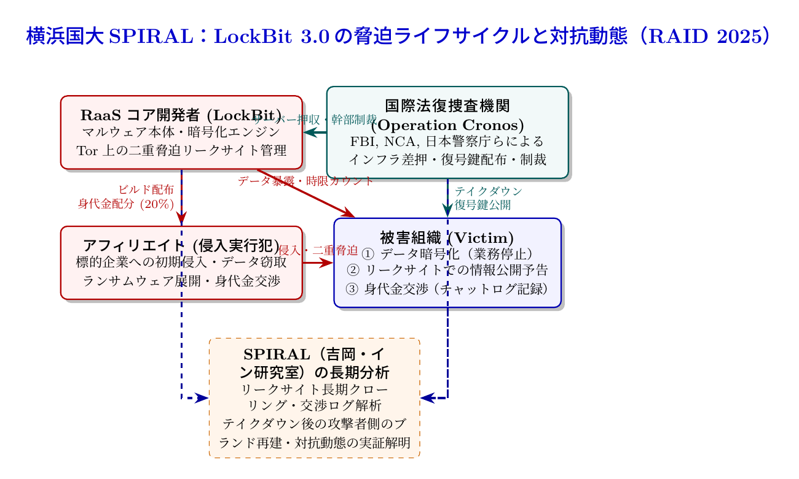

# 第26話 身代金ビジネスの暗雲 〜LockBit 3.0の脅迫ライフサイクルと国際捜査の追跡〜

> **【放課後サイバーディフェンス・ラボ（第2部：大学先端研究の扉 〜横浜国大SPIRAL論文探訪〜）】**
> - **舞台**: 帝都科学大学先端セキュリティ実習室 ＆ 横浜国立大学 SPIRAL 共同分析ルーム
> - **登場人物**: 神崎 蓮（高校1年・IoT班）、白石 結衣（高校1年・暗号数理班）、城崎 悠真（大学1年・芹沢研TA）、芹沢 涼香 准教授（大学メンター）
> - **学習テーマ**: 横浜国立大学 SPIRAL・吉岡克成教授およびイン・ミンパパ特任准教授らの国際共同研究論文（RAID 2025）、RaaS（サービス型ランサムウェア）の企業的分業構造、二重脅迫（ダブル・エクストーション）とTorリークサイト、被害組織交渉チャットログの追跡、法執行機関（LE: FBI・国家犯罪対策庁・警察庁等）による大規模テイクダウン「Operation Cronos」への攻撃者側の対抗動態、サイバー犯罪学とコンピュータ科学の融合
> - **探訪・参照研究論文**:
>   - [横浜国立大学 サイバーセキュリティ実践教育研究センター（SPIRAL）](https://spiral.ynu.ac.jp/)
>   - Yin Minn Pa Pa, Katsunari Yoshioka, et al. "A Longitudinal Analysis of LockBit 3.0's Extortion Lifecycle and Response to Law Enforcement." *Proceedings of the 28th International Symposium on Research in Attacks, Intrusions and Defenses (RAID 2025)*, 2025.

---

## 🎨 4コマ漫画・ストーリーイラスト (Draw Things 生成)

---

## 💬 4コマ漫画キャラクターセリフ（日・英対訳）

挿絵の4コマ漫画（文字なし）の各コマに対応したキャラクターのセリフです。小説本文の導入としてもお楽しみいただけます。

| コマ | 展開 / シチュエーション | 🗣️ 日本語セリフ (Japanese) | 🌐 英語セリフ (English) |
|:---:|:---|:---|:---|
| **第1コマ** 【起】 | **蓮の素朴な認識：身代金を払えば解決？** ニュースを見ながら「暗号化されたら身代金を払うしかないのかな？」と呑気に発言する蓮。 | **蓮**: 「ニュースで大企業がランサム被害に遭ってるけど、暗号化されたら身代金払うしかないのかな？」 | **Ren**: "Big companies are getting hit by ransomware on the news. If files get encrypted, do they just have to pay up?" |
| **第2コマ** 【承】 | **結衣の冷徹な指摘：二重脅迫とRaaSの罠** 「払ってもデータ流出は止まらず、悪の資金源になるだけ。二重脅迫とRaaSの分業体制です」と指摘する結衣。 | **結衣**: 「甘いです。復号鍵がもらえる保証はなく、機密データの流出暴露で二重に脅される悪質なビジネスです。」 | **Yui**: "Naïve. There's no guarantee of decryption, and it's a ruthless business that double-extorts via leak sites." |
| **第3コマ** 【転】 | **悠真TAによるSPIRAL論文とOperation Cronos解説** Torリークサイトや交渉ログを長期分析し、法執行機関の掃討作戦への対抗動態を暴いた学術研究を紹介する悠真。 | **悠真**: 「SPIRALのRAID 2025論文では、LockBit 3.0のリークサイトや交渉ログ、国際捜査への対抗動態をデータで暴いたんだ。」 | **Yuma**: "SPIRAL's RAID 2025 paper tracked LockBit 3.0's leak sites, ransom negotiations, and its counter-moves against Operation Cronos." |
| **第4コマ** 【結】 | **サイバー犯罪エコシステムの解明へ** コードの穴塞ぎだけでなく、経済的動機や犯罪組織の力学と戦う科学的アプローチに感銘を受ける二人。 | **蓮**: 「ウイルスを倒すだけじゃなく、犯罪組織の経営構造そのものと戦う学問なんだ！」 **結衣**: 「サイバー犯罪学とコンピュータ科学の融合……これこそ真の防衛ですね。」 | **Ren**: "It's not just about stopping malware, it's about taking down their entire criminal business model!" **Yui**: "Merging cyber criminology with computer science... that is true defense." |

---

## 📖 小説本文

帝都科学大学、先端セキュリティ実習室。
　窓の外には夕闇が迫り、室内のモニター群が放つ青白い光が、学生たちの顔を不規則に照らしていた。

「……結局、暗号化されたら身代金を払うしかないってこと？」

　神崎蓮は、壁面に投影されたニュース速報の映像を見つめながら、呆れたような声を漏らした。画面には、ある大手製造企業がランサムウェアの被害に遭い、システムが停止しているという見出しが躍っている。
「いや、そんな単純な話じゃないよ、蓮くん」

　隣でキーボードを叩いていた白石結衣が、眼鏡のブリッジを押し上げながら遮った。彼女の視線は、解析用端末に表示された複雑なネットワークトポロジーへと向けられている。
「『払えば鍵をくれる』というのは、彼らが提示する一番最初の手口に過ぎないわ。今の主流は、単なる暗号化だけじゃない。二重脅迫――ダブル・エクストーションがスタンダードになっているのよ」

　蓮は首を傾げた。「二重……？」
「そう。データを暗号化してアクセスを塞ぐだけでなく、盗み出した機密データを『公開するぞ』と脅すの。たとえ身代金を払って復号鍵をもらっても、流出した個人情報や技術情報の流出を防ぐ保証はどこにもない。さらに言えば、支払った金は次の攻撃のための兵器開発に再投資されるだけ。私たちが被害を嘆いている間に、彼らはその資金でより高度な攻撃手法を買い、磨き上げているのよ」

　結衣の言葉には、単なる技術的な解説を超えた、冷徹なまでの現実への洞察が含まれていた。彼女は、ランサムウェアがもはや個人の悪戯ではなく、巨大なビジネスとして構造化されていることに強い危機感を抱いていた。

✦ ✦ ✦

　数日後、彼らは横浜国立大学 SPIRAL の共同分析ルームへと移動していた。そこには、次世代のサイバーセキュリティ研究の最前線を示す膨大なデータが並んでいる。
「さあ、ここからが本番だ。今日見せたいのは、ただの攻撃手法じゃない。LockBit 3.0という巨大な犯罪シンジケートの『経営戦略』に近い動態だよ」

　大学1年のTAを務める城崎悠真が、大きなモニターに論文の要旨を映し出した。そこには、吉岡克成教授とイン・ミンパパ特任准教授らが国際シンポジウム RAID 2025 で発表した最新の研究成果が記されていた。

「この論文『A Longitudinal Analysis of LockBit 3.0's Extortion Lifecycle and Response to Law Enforcement』は、非常に野心的なものだ。彼らはTor上のダークウェブ・リークサイトを長期にわたってクローリングし、犯罪者たちの生々しい挙動を追跡した」

　悠真はスライドを操作しながら、熱を帯びた口調で解説を続けた。
「注目すべきはLockBit 3.0の構造だ。これはRaaS――Ransomware as a Service、つまり『サービスとしてのランサムウェア』というビジネスモデルを採用している。コアの開発者が高度なマルウェア本体とリークサイトを提供し、侵入を実行するアフィリエイト（実行犯）を募る。そして、奪った身代金はあらかじめ決められた比率で山分けされる……まさに現代の分業体制だ」

　悠真は画面を切り替えた。そこには、複雑な時系列チャートと、法執行機関との攻防を示す動態グラフが現れた。
「この研究の白眉は、2024年に米英日などが合同で展開した『Operation Cronos』に対する彼らの反応をデータで証明したことにある。法執行機関が彼らのインフラを叩いた際、彼らは単に逃げただけじゃない。ブランドを守るためにいかに迅速に代替サーバーを確保し、再建を試みたか。その動態を長期的な観測によって実証したんだ。これは単なるパケット解析の域を超えた、犯罪のエコシステムの解明なんだよ」

✦ ✦ ✦

　分析ルームの奥、研究室のデスクに座っていた芹沢涼香准教授が、静かに口を開いた。彼女の視線は、研究データの中に潜む「人間の意志」を捉えていた。

「悠真君の話通りです。私たちがこの研究で明らかにしたいのは、単一のウイルスコードの脆弱性ではありません。犯罪者の心理、経済的インセンティブ、そして彼らが構築した強固な組織構造の『科学的な解明』です」

　芹沢は立ち上がり、蓮と結衣の方へ歩み寄った。
「サイバー空間において、犯罪者は極めて合理的な経済主体として動いています。彼らにとって、法執行機関の包囲網を突破することは『事業継続のためのコスト』であり、ブランドの存続は重要事項です。私たちはこの論文を通じて、彼らがどのようにリスクを評価し、どのような力学で意思決定を下しているのかというエビデンス（証拠）を提示したのです」

　彼女の声には、学問としての誇りと、現実の脅威に対する厳粛な覚悟が同居していた。
「法執行機関や政策決定者が彼らを制圧するためには、勘や直感ではなく、こうした科学的な裏付けに基づいた戦略が必要です。サイバー犯罪学とコンピュータ科学を融合させること。それこそが、この論文が持つ真の価値なのです」

　蓮と結衣は、静まり返った研究室の中でその言葉を反芻した。
　画面に映し出されたのは、数多の攻撃者のチャットログや、複雑な資金洗浄のルート、そしてそれらに対抗する法執行機関の執拗な追跡の軌跡だった。そこには数字だけではない、欲望と生存への執着が渦巻いていた。

✦ ✦ ✦

　実習が終わった後、二人は静かな廊下を歩いていた。
「……ただの『ウイルス』だと思ってたけど」
　蓮の声は、最初よりもずっと低く、重みを帯びていた。
「技術的な穴を塞ぐだけじゃ、全然足りないんだな。社会を脅かす巨大な組織と戦うには、彼らのやり方や、動機そのものを理解しなきゃいけない」

　結衣は深く頷いた。彼女の瞳には、モニターの光よりも鋭く、強い意志が宿っている。
「ええ。私たちは技術者である前に、社会の構造を守るための観測者にならなければならないわ。彼らが築き上げた『悪のビジネス』を解剖し、その根源を断つための学問……それが私たちがこれから向き合うべき道なのね」

　二人の視線の先には、まだ見ぬサイバー空間の深淵が広がっている。しかし、彼らの心にはもう、以前のような漠然とした戸惑いはなかった。それは、知の最前線に立つ者が抱く、静かな、しかし確固たる決意だった。

---

## 📊 TikZによるセキュリティ構造図解

---

## 💡 高校生のためのセキュリティ深掘りコラム

### 1. ランサムウェアは「単なるウイルス」から「巨大産業」へ進化した
かつてのランサムウェア（ファイルを暗号化して解除キーと引き換えに金銭を要求するマルウェア）は、単体の悪意あるプログラムによる小規模な犯行が中心でした。しかし現代のランサムウェアは、高度に組織化された**「RaaS（Ransomware-as-a-Service：サービスとしてのランサムウェア）」**という分業ビジネスモデルへと変貌を遂げています。
- **コア開発者（Operators）**: マルウェア本体の開発、身代金交渉プラットフォーム、暗号化インフラ、ダークウェブ上のリークサイトを管理・提供する。
- **アフィリエイト（Affiliates：実行犯）**: 標的企業への初期侵入（フィッシングやVPN脆弱性悪用）を行い、データを窃取してランサムウェアを実行する。
- **身代金分配**: 支払われた身代金（ビットコインやMonero等の暗号資産）は、開発者側（10〜20%）と実行犯側（80〜90%）で自動的に山分けされる仕組みになっています。

### 2. 「二重脅迫（Double Extortion）」の凶悪なメカニズム
現代のランサムウェア攻撃で最も恐れられているのが**「二重脅迫」**です。
1. **第1の脅迫（可用性の破壊）**: 企業の基幹システムやバックアップファイルを強固に暗号化し、操業を停止させる。
2. **第2の脅迫（機密性の暴露）**: 暗号化の前にギガバイト〜テラバイト級の顧客個人情報や知的財産を外部へ持ち出し、「身代金を支払わなければTorダークウェブ上の専用リークサイト（DLS: Dedicated Leak Site）で全世界に無料公開・オークションにかける」とカウントダウンタイマーを突きつけて脅迫する。
このため、企業がオフラインバックアップからシステムを復旧できたとしても、「機密情報がネットに晒される」という恐怖から身代金支払いを余儀なくされるケースが後を絶ちません。

### 3. 横浜国大 SPIRAL による国際共同研究の金字塔（RAID 2025）
横浜国立大学 サイバーセキュリティ実践教育研究センター（SPIRAL）の**吉岡克成 教授**、**イン・ミンパパ 特任准教授**らの国際共同研究チームが、国際トップシンポジウム **RAID 2025** で発表した論文『*A Longitudinal Analysis of LockBit 3.0's Extortion Lifecycle and Response to Law Enforcement*』は、世界最強と恐れられたランサムウェアシンジケート**「LockBit 3.0」**を長期的に追跡・解剖した画期的な実証研究です。
- **実証的データ収集**: Tor上のLockBitリークサイトを長期間クローリングし、数千件に及ぶ被害組織の公表データ、支払期限タイマー、身代金交渉チャットログを網羅的に分析。
- **法執行機関（LE）への対抗動態の可視化**: 2024年2月、FBI・英国国家犯罪対策庁（NCA）・日本の警察庁など10カ国による国際共同掃討作戦**「Operation Cronos」**によってLockBitの重要インフラやソースコードが押収・無力化されました。論文では、この壊滅的打撃を受けた後にLockBitがどのように代替サーバーを立ち上げ、被害者リストを再投稿して組織の「信頼性（ブランド）」を取り戻そうと足掻いたか、その回復挙動や限界をデータで克明に証明しました。
- **研究の意義**: サイバーセキュリティは、通信プロトコルの穴を塞ぐ工学だけでなく、攻撃者の経済的インセンティブや組織力学を暴く「サイバー犯罪学（Cyber Criminology）」のエビデンスを提供することで、世界中の法執行機関や政策立案者が有効な打撃を与える武器となるのです。
