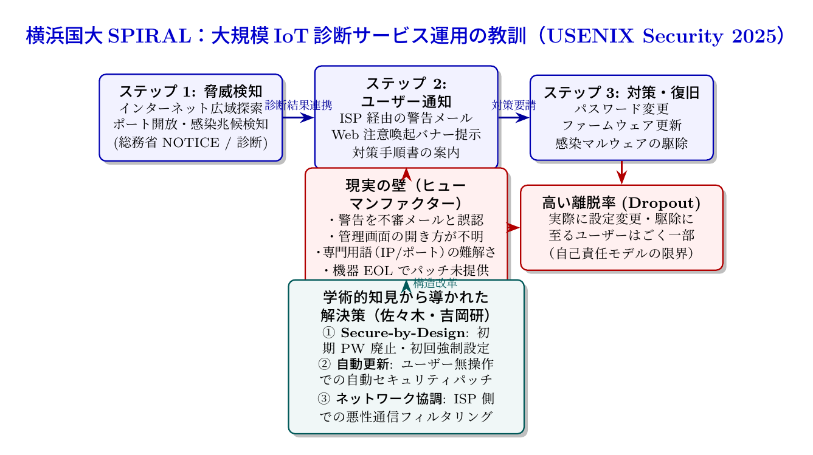

# 第27話 届かぬ警告と目覚める砦 〜大規模IoT診断サービス「Am I Infected?」の真実〜

> **【放課後サイバーディフェンス・ラボ（第2部：大学先端研究の扉 〜横浜国大SPIRAL論文探訪〜）】**
> - **舞台**: 帝都科学大学先端セキュリティ実習室 ＆ 横浜国立大学 SPIRAL 地域・社会実装ラボ
> - **登場人物**: 神崎 蓮（高校1年・IoT班）、白石 結衣（高校1年・暗号数理班）、城崎 悠真（大学1年・芹沢研TA）、芹沢 涼香 准教授（大学メンター）
> - **学習テーマ**: 横浜国立大学 SPIRAL・佐々木貴之准教授、吉岡克成教授、松本勉上席特別教授らのトップカンファレンス論文（USENIX Security 2025）、大規模IoT診断サービス「Am I Infected?」の実装と運用、総務省・NICT・ISPとの官民学連携プロジェクト（NOTICE）、ユーザー行動変容の障壁（ヒューマンファクター：難解なUI、ファームウェア更新手順の絶望的複雑さ、EOL放置機器）、自己責任論の限界と「Secure-by-Design」およびネットワーク側自動防護の必要性
> - **探訪・参照研究論文**:
>   - [横浜国立大学 サイバーセキュリティ実践教育研究センター（SPIRAL）](https://spiral.ynu.ac.jp/)
>   - Takayuki Sasaki, Katsunari Yoshioka, Tsutomu Matsumoto, et al. "Am I Infected? Lessons from Operating a Large-Scale IoT Security Diagnostic Service." *Proceedings of the 34th USENIX Security Symposium (USENIX Security 2025)*, 2025.

---

## 🎨 4コマ漫画・ストーリーイラスト (Draw Things 生成)

---

## 💬 4コマ漫画キャラクターセリフ（日・英対訳）

挿絵の4コマ漫画（文字なし）の各コマに対応したキャラクターのセリフです。小説本文の導入としてもお楽しみいただけます。

| コマ | 展開 / シチュエーション | 🗣️ 日本語セリフ (Japanese) | 🌐 英語セリフ (English) |
|:---:|:---|:---|:---|
| **第1コマ** 【起】 | **蓮の楽観論：危険を通知すれば皆すぐ直す！** 「脆弱なIoTルーターが見つかったら、持ち主にメールで知らせれば即解決！」と自信満々の蓮。 | **蓮**: 「危ないルーターを見つけたら、持ち主に『危険ですよ』って通知を送ればすぐ直してくれるはず！」 | **Ren**: "If we find a vulnerable router, sending an alert to the owner should get it fixed immediately!" |
| **第2コマ** 【承】 | **結衣の冷静な指摘：一般人の絶望的障壁** 「専門用語だらけの管理画面や更新手順は、一般人には詐欺メールに見えたり絶望の壁です」と説く結衣。 | **結衣**: 「甘いです。ルーターの設定画面を開いてファームウェアを更新するのは、一般人には絶望的な壁です。」 | **Yui**: "Naïve. Opening a router admin panel and updating firmware is a hopelessly daunting barrier for average users." |
| **第3コマ** 【転】 | **悠真TAによるUSENIX Security論文の衝撃データ** 何十万台もの大規模診断でも改善行動を起こしたのはごく僅かだったという人間行動の現実を語る悠真。 | **悠真**: 「横浜国大・佐々木准教授らのUSENIX Security 2025論文『Am I Infected?』がその現実を克明に暴いたんだ。」 | **Yuma**: "YNU Assoc. Prof. Sasaki's USENIX Security 2025 paper 'Am I Infected?' proved that reality with massive operational data." |
| **第4コマ** 【結】 | **Secure-by-Designと誰も取り残さない砦へ** ユーザーの自己責任に頼らず、初期出荷時から安全でネットワークが守る仕組みの重要性に目覚める二人。 | **蓮**: 「ユーザーに頑張らせるんじゃなく、何もしなくても安全な砦を僕たちが作らなきゃ！」 **結衣**: 「Secure-by-Designと社会基盤の連携……これこそ目指すべき工学ですね。」 | **Ren**: "Instead of burdening users, we need to build fortress devices that stay secure automatically!" **Yui**: "Secure-by-Design paired with infrastructure collaboration... that is the engineering goal." |

---

## 📖 小説本文

帝都科学大学、先端セキュリティ実習室の空気は、微かなサーバーの駆動音と、数台のワークステーションから発せられる熱気で満ちていた。
　壁一面に並んだモニターには、複雑なネットワークトポロジーの図と、無数のIoT機器から送出されるパケットのフローが映し出されている。

「だから、僕の考えはこうなんだ」
　神崎蓮は、白線の引かれたホワイトボードの前に立ち、拳を握りしめて強調した。
「脆弱なデバイスを見つけたら、即座に持ち主に通知を送る。例えば、『あなたのルーターが攻撃を受けています。今すぐ設定を変えてください』ってメールやプッシュ通知を送れば、みんな危機感を持って動くはずだ。それが最もシンプルで、誰もを救える方法だよ」

　蓮の瞳には、純粋な正義感と技術への信頼が宿っていた。彼は、セキュリティとは「正しい情報を伝えること」だと信じていた。
　しかし、その隣で腕を組んでいた白石結衣は、冷ややかな、しかしどこか悲劇的な眼差しで彼を見つめていた。

「……蓮、それは『理想』の範囲の話だね」
　結衣の声は静かだったが、その言葉には鋭い楔が含まれていた。
「世の中のほとんどの人は、自分が使っているルーターのIPアドレスもログインパスワードも知らない。ましてや、管理画面にアクセスしてファームウェアを更新するなんていう『絶望的なハードル』を越える動機なんて、ただの警告メール一つでは生まれないよ」

「えっ、でも……」
　蓮が言葉を詰まらせる。

「彼らにとって、その通知は『怪しい詐欺メール』の一種として処理される可能性が高い。あるいは、スマホの通知欄に埋もれて無視されるか。技術的な正論は、一般ユーザーの日常というノイズの中に投げ込まれた瞬間、ただのゴミになってしまうんだ」
　結衣はモニターの一角を指さした。そこには、家庭内で放置されたままの古いスマート家電のリストが表示されている。
「私たちは『正しいこと』を言おうとしているけれど、相手は『正しいこと』を知りたくないし、難しくて動けないだけなんだよ」

✦ ✦ ✦

　その時、実習室の重い扉が開き、大学のTAである城崎悠真が入ってきた。彼は手元のタブレットを操作しながら、少し複雑な表情で二人の方へ歩み寄る。

「二人の議論、いいところまで来てるね」
　悠真はホワイトボードの横に立ち、最新の研究成果がまとめられた資料を投影した。
「結衣の言う通りなんだ。実はその『理想と現実の乖離』こそが、今まさにセキュリティ研究の最前線で議論されているテーマなんだよ。特に、横浜国立大学のSPIRAL・佐々木准教授たちが発表した論文……USENIX Security 2025に採択された『Am I Infected?』の内容を知ると、君たちの感覚はより研ぎ澄まされるはずだ」

　悠真は資料を操作し、大規模な実証実験のグラフを表示させた。
「この論文は、何十万台もの一般ユーザー機器に対する大規模なセキュリティ診断サービスを実際に運用した結果を分析したものだ。総務省のNOTICEとも連動している、非常にリアルなデータだよ」

　蓮と結衣は、画面に映し出された数字に息を呑んだ。
「……これ、診断通知を送った後のユーザーの反応じゃないか？」
　結衣が問いかける。

「そう。衝撃的なのはここだ」
　悠真はグラフの一点を指した。
「脆弱性やマルウェア感染が判明し、詳細な対策手順を含めた通知を送ったとしても、実際に機器を安全に再設定したり、駆除を実行したりしたユーザーは極めて少数にとどまった。ほとんどのユーザーは、通知を受け取ったものの、具体的な行動に移ることができなかったんだ」

「なぜ……？」
　蓮が絶望に近い声を漏らす。

「論文では、その障壁（バリア）をいくつか特定している」
　悠真は淡々と、しかし重みを持って解説を続けた。
「第一に、あまりにも難解すぎる専門用語のUI。第二に、ファームウェア更新の手順があまりに複雑で、失敗を恐れて手を出せない心理的障壁。そして第三に、機器の寿命切れ（EOL）によるパッチ不在。そもそもメーカーが更新をやめていて、ユーザー側ではどうしようもないケースだ。さらに、所有者が誰かもわからないまま放置された『死んだデバイス』も数多く含まれている」

　蓮は拳を握りしめ、俯いた。自分の正義が、データという名の冷徹な現実によって打ち砕かれた瞬間だった。

✦ ✦ ✦

「技術で解決できることには限界がある。でも、絶望して終わる必要はないわ」
　背後から凛とした声が響いた。振り返ると、そこには芹沢涼香准教授が立っていた。彼女は学生たちの表情を観察するように見つめ、ゆっくりと歩み寄る。

「蓮君、結衣さん。この論文の真の意義は、『通知を送っても動かない』という事実に落胆することじゃないわ。その『動けない理由』を工学的に解明し、社会実装の障壁を取り除くための鍵を見つけようとしていることにあるのよ」

　芹沢はホワイトボードに大きく「Human Factor（人間因子）」と書き込んだ。
「サイバー防衛の最後の砦は、高度なアルゴリズムでも検知システムでもない。いかに一般市民や社会に行動変容を起こさせるかという『人間への配慮』なの。ユーザーに自己責任で守らせるのではなく、システム側がプロアクティブに動く仕組みへシフトする必要があるわ」

　彼女の熱い語りは、実習室の空気を一変させた。
「例えば、ISP（インターネットサービスプロバイダ）側で、脆弱なデバイスへの通信を自動的にフィルタリングする。あるいは、ユーザーの操作を介さずに安全なアップデートを強制するバックエンドの実装。製品出荷時のデフォルト設定そのものを『セキュア・バイ・デザイン』として再定義し、パスワードの強制変更や最新プロトコルの採用を義務付ける。これらすべては、ユーザーに『頑張らせる』のではなく、ユーザーが『何もしなくても安全な状態』へ導くための設計なのよ」

　蓮は顔を上げた。
「……つまり、僕たちが作るべきは、『警告を送るアプリ』じゃないってことか」

「ええ」と芹沢は頷いた。「『警告すら必要ないほどに安全で、かつ使い勝手の良いインフラ』の構築よ。技術者としての誇りは、高度な防御壁を築くことだけじゃない。その壁の向こう側で暮らす人々の日常を守り、彼らを迷わせないための道筋を作ることにあるわ」

✦ ✦ ✦

　実習室の明かりが、少しずつ薄れていく。
　蓮はホワイトボードに残された「Human Factor」という文字を見つめていた。自分の楽観的な仮説は打ち砕かれた。しかし、その破片の中から新しい火花が散っていることに気づいた。

「結衣……俺、気づいたよ」
　蓮は隣に座る結衣を見た。
「通知を送って『危ないよ』って叫ぶだけじゃダメなんだ。使う人が専門知識を持っていなくても、何も知らなくても、絶対に安全なハードウェアやシステムを僕たちが作らなきゃいけない。誰にも負担をかけない、透明な防衛線だ」

　結衣はわずかに微笑んだ。その瞳には、これまでの冷徹な分析とは違う、熱い光が宿っていた。
「そうね。私たちの役割は、高度な数学や暗号の技術を『難解な壁』にするんじゃなくて、それを裏側に隠して、使う人を迷わせないための優しいインターフェースに落とし込むことよ」

　結衣は手元のタブレットを取り出し、新しいプロジェクトの設計図を描き始めた。
「数学的に確実で、かつ人に優しいプロトコル……それこそが、この『Am I Infected?』の論文から僕たちが受け取った最大の教訓ね」

　二人の視線は、再びモニターへと向けられた。
　そこにはまだ解決されていない無数の脆弱性と、守るべき数千万の日常が広がっている。
　蓮は深く息を吸い込み、キーボードを叩き始めた。
　届かぬ警告の代わりに、誰も気づかない場所で静かに砦を築くための、新しい航海が始まった。

---

## 📊 TikZによるセキュリティ構造図解

---

## 💡 高校生のためのセキュリティ深掘りコラム

### 1. IoT機器のセキュリティはなぜこれほど放置されるのか？
パソコンやスマートフォンであれば、OSの自動アップデート機能やセキュリティ警告が日常的に表示されます。しかし、家庭やオフィスに設置されたWi-Fiルーター、ネットワークカメラ、スマート家電などの**IoT（Internet of Things）機器**は、一度電源を入れると押し入れや天井裏に何年も放置されがちです。
- **画面やキーボードがない**: 機器単体では異常を伝えるディスプレイがなく、攻撃されてマルウェア（Mirai等）に感染しても普段通り通信できるため、所有者は感染に気づけません。
- **初期パスワード（admin/admin等）の放置**: インターネット全体からのポートスキャンを受け、辞書攻撃で容易に乗っ取られてDDoS攻撃の踏み台（ボットネット）にされてしまいます。

### 2. 総務省・NICT・横浜国大が挑む「NOTICE」と「Am I Infected?」
日本国内では、2019年から総務省・国立研究開発法人情報通信研究機構（NICT）・インターネットサービスプロバイダ（ISP）が連携し、サイバー攻撃に悪用される恐れのあるIoT機器を調査してユーザーに注意喚起を行う国家プロジェクト**「NOTICE（National Operation towards IoT Clean Environment）」**が実施されています。
これと連動し、一般ユーザーが自ら「自分の機器が感染していないか」を簡単にWebブラウザから診断できるように設計・運用されたのが、横浜国立大学 SPIRALの**佐々木貴之 准教授、吉岡克成 教授、松本勉 上席特別教授**らが開発・実証した大規模診断プラットフォーム**「Am I Infected?（私、感染していませんか？）」**です。

### 3. 世界最高峰国際会議 USENIX Security 2025 採択論文が暴いた真実
2025年、セキュリティ研究の最高峰である **USENIX Security Symposium 2025** に採択された論文『*Am I Infected? Lessons from Operating a Large-Scale IoT Security Diagnostic Service*』は、何十万台もの一般ユーザー環境に大規模診断と注意喚起を提供した長期運用データから、極めて重要かつ衝撃的な**「ヒューマンファクター（人間行動の壁）」**を明らかにしました。
- **届かぬ警告**: 診断結果として「感染している」「脆弱な設定である」と明確な警告と詳細な修正マニュアルを提示しても、実際に機器の設定を変更したりファームウェアを更新して安全化に至ったユーザーは極めて限定的でした。
- **ユーザーが直面する絶望的な障壁**:
  1. **リテラシーの壁**: 「デフォルトゲートウェイ」「プライベートIP」「ポートフォワーディング」などの専門用語が理解できない。
  2. **心理的恐怖**: 「設定画面をいじってインターネットが繋がらなくなったら困る」「この通知自体がフィッシング詐欺ではないか」という警戒心。
  3. **EOL（End of Life）問題**: メーカーがすでにサポートを終了しており、更新用ファームウェアそのものが存在しない。
- **「自己責任」から「Secure-by-Design」への歴史的転換**:
  この研究が世界に与えた最大の示唆は、**「一般ユーザーの努力やリテラシーにセキュリティを期待するモデルは破綻している」**という冷徹な実証結果です。
  これからのサイバーセキュリティ工学は、
  1. 出荷時から安全なパスワード設定を強制する**「セキュア・バイ・デザイン（Secure-by-Design）」**
  2. ユーザーの介在なしに安全にパッチが適用される自動更新機能
  3. ISPやネットワーク事業者側での不正通信の自動隔離・フィルタリング
  というように、**「ユーザーが何もしなくても、意識しなくても守られる社会基盤づくり」**へとパラダイムシフトしなければならないことを証明したのです。
