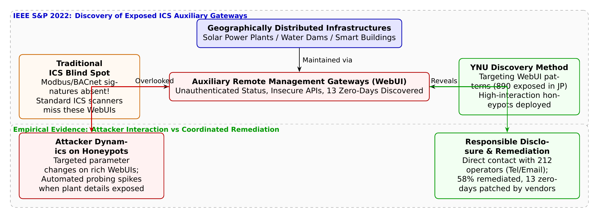

# 第28話 潜む裏口と社会インフラの防壁 〜制御システム遠隔管理機器の死角を暴け〜

> **【放課後サイバーディフェンス・ラボ（第2部：大学先端研究の扉 〜横浜国大SPIRAL論文探訪〜）】**
> - **舞台**: 帝都科学大学先端セキュリティ実習室 ＆ 横浜国立大学 SPIRAL 産業サイバーセキュリティ実験棟
> - **登場人物**: 神崎 蓮（高校1年・IoT班）、白石 結衣（高校1年・暗号数理班）、城崎 悠真（大学1年・芹沢研TA）、芹沢 涼香 准教授（大学メンター）
> - **学習テーマ**: 横浜国立大学 SPIRAL・佐々木貴之准教授、吉岡克成教授、松本勉上席特別教授らの国際最高峰論文（IEEE S&P 2022）、重要インフラ（水力ダム・メガソーラー・スマートビル等）における保守用遠隔管理ゲートウェイ（WebUI）の露見、従来の産業制御システムスキャン（Modbus/BACnet）の死角（Blind Spot）、13件のゼロデイ脆弱性特定、高対話ハニーポットによる攻撃者動態観測、212事業者への責任ある開示（Responsible Disclosure）と社会連携による是正
> - **探訪・参照研究論文**:
>   - [横浜国立大学 サイバーセキュリティ実践教育研究センター（SPIRAL）](https://spiral.ynu.ac.jp/)
>   - Takayuki Sasaki, Akira Fujita, Carlos H. Gañán, Michel van Eeten, Katsunari Yoshioka, Tsutomu Matsumoto. "Exposed Infrastructures: Discovery, Attacks and Remediation of Insecure ICS Remote Management Devices." *Proceedings of the 43rd IEEE Symposium on Security and Privacy (IEEE S&P 2022)*, pp. 2680-2696, 2022.

---

## 🎨 4コマ漫画・ストーリーイラスト (Draw Things 生成)

---

## 💬 4コマ漫画キャラクターセリフ（日・英対訳）

挿絵の4コマ漫画（文字なし）の各コマに対応したキャラクターのセリフです。小説本文の導入としてもお楽しみいただけます。

| コマ | 展開 / シチュエーション | 🗣️ 日本語セリフ (Japanese) | 🌐 英語セリフ (English) |
|:---:|:---|:---|:---|
| **第1コマ** 【起】 | **蓮の過信：インフラは専用線で隔離されてるから安全！** ダムやメガソーラーの写真を見ながら「Modbusとか専用線で固められてるからハッキングなんて無理！」と豪語する蓮。 | **蓮**: 「ダムや発電所なんて専用回線と特殊プロトコルで隔離されてるんだから、外部から侵入されるわけないだろ！」 | **Ren**: "Dams and power plants are isolated with dedicated lines and protocols! There's no way anyone can hack in!" |
| **第2コマ** 【承】 | **結衣の冷徹な指摘：保守用Webゲートウェイの死角** 「保守業者が遠隔操作するためにつけた安価なWebUIが、認証なしで世界中に公開されています」と指摘する結衣。 | **結衣**: 「甘いです。保守業者が便利だからと付けたWeb管理ゲートウェイが、認証もなしにネットへ丸見えなんです。」 | **Yui**: "Naïve. Cheap WebUI gateways added for maintenance convenience are exposed to the internet with zero auth." |
| **第3コマ** 【転】 | **悠真TAによるIEEE S&P論文の衝撃データ解説** 国内だけで890台の露見機器と13件のゼロデイを発見し、ハニーポットで攻撃者を追跡したSPIRALの研究を紹介する悠真。 | **悠真**: 「佐々木准教授らのIEEE S&P 2022論文では、国内だけで890台の露見ゲートウェイと13件のゼロデイを暴いたんだ。」 | **Yuma**: "Assoc. Prof. Sasaki's IEEE S&P 2022 paper uncovered 890 exposed gateways in Japan and 13 zero-days." |
| **第4コマ** 【結】 | **泥臭い社会連携と責任ある開示の価値へ** 電話とメールで212事業者に連絡し58%を是正した実績に感銘を受け、現場に寄り添う真の防衛を誓う二人。 | **蓮**: 「論文を書くだけじゃなく、212の事業者に電話して58%も直したなんて……本物の砦づくりだ！」 **結衣**: 「学術が社会インフラを直接守る……これこそ工学の誇りですね。」 | **Ren**: "They didn't just write a paper—they contacted 212 operators and fixed 58%! That's true defense!" **Yui**: "Academia directly shielding critical infrastructure... that is the pride of engineering." |

---

## 📖 小説本文

帝都科学大学、先端セキュリティ実習室。
壁一面に並んだ大型モニターには、巨大なダムの放流映像や、整然と並ぶ太陽光パネルの群れ、そして複雑な配線が張り巡らされたビル管理システムの設計図が映し出されていた。

「……やっぱり、これだけ巨大なインフラなら安心だよね」

神崎蓮は、モニターに映るダムの重厚な構造を見つめながら、満足げに頷いた。彼はIoT班の主力として、これまで多くのスマートデバイスを解析してきたが、その自信は今日、確信に近いものへと昇華していた。

「ModbusやBACnetといった専用プロトコルで、物理的にも論理的にも隔離されたネットワークだ。外部からこの『本丸』に直接アクセスするなんて、映画の中のハッカーのような非現実的な話だよ。僕たちが守らなきゃいけないのは、こういう鉄壁の要塞なんだ」

蓮の言葉には、技術への純粋な信頼がこもっていた。彼にとって、産業制御システム（ICS）は高度な専門知識を持つ者だけが触れられる聖域であり、一般のインターネット空間とは切り離された「安全な島」のように思えていた。

しかし、隣で腕を組んでモニターを凝視していた白石結衣は、わずかに眉を潜めた。彼女は暗号数理班として、システムの構造よりもその「隙間」を見抜くことに長けている。

「……蓮、それは『理想的な設計図』を見てるだけよ」

結衣の声は低く、しかし鋭く響いた。彼女はリモコンを操作し、ある特定の機器のWeb管理インターフェースのスクリーンショットを表示させた。

「ダムや発電所そのものは確かに隔離されてるかもしれない。でも、現場の保守員はどうやって遠隔で状況をチェックすると思ってる？ 毎日現場まで通うわけじゃない。彼らは利便性のために『勝手口』を作ったのよ」

画面には、簡素ながらも機能的なWebUIが表示された機器の画像があった。

「このリモートゲートウェイを見て。保守業者がブラウザから操作できるように設置した、汎用的なWeb管理インターフェース。これがインターネットに直接晒されているケースがあるの。しかも、認証すら不完全なまま放置されてるものも。蓮、あなたが『本丸』を誇っている間に、彼らは庭の勝手口を全開にして鍵をかけてないのよ」

「……勝手口？」
蓮の顔から余裕が消えた。結衣の指摘は、彼の「鉄壁の要塞」という幻想を鮮やかに打ち砕いた。

✦ ✦ ✦

「それこそが、現在のセキュリティにおける『盲点（Blind Spot）』なんです」

実習室の奥にある講義用デスクに立ったのは、大学1年生でありながらTAを務める城崎悠真だった。彼は手元のタブレットを操作し、最新の研究論文を投影した。

「一般的な脆弱性スキャナー、例えばShodanやCensysといったツールは非常に強力です。しかし、それらは主にModbusやBACnetといった特定の産業用プロトコル、あるいは特定のポート番号をターゲットに検索を行います。そのため、HTTPやHTTPSのWebUIで動いている『保守用機器』は、それらのスキャナーの網をすり抜けてしまうんです」

城崎は投影された論文のタイトルを強調した。
『Exposed Infrastructures: Discovery, Attacks and Remediation of Insecure ICS Remote Management Devices』。

「これは横浜国立大学のSPIRALチーム、佐々木貴之准教授らが発表したIEEE S&P 2022の論文です。彼らは独自のWebUIシグネチャ識別手法を開発し、産業用機器の『隠れた勝手口』をあぶり出しました。驚くべきことに、日本国内だけで890台もの露見機器を発見しているんです」

蓮と結衣は、その数字の大きさに息を呑んだ。

「さらに、彼らは発見した機器の中から3機種を精査し、13件ものゼロデイ脆弱性を特定しました。これは、まだ誰も修正法を知らない『未知の穴』です。彼らはこの事実を隠すことなく、研究成果として公表したんです」

城崎は論文内のグラフを指し示した。そこには、攻撃者の行動に関する生々しいデータが記されていた。

「特に興味深いのはハニーポット実験の結果です。研究チームは、施設名や現在の発電状況、水圧などがリアルに表示される『リッチなWebUI』を持つハニーポットを設置しました。すると、それら視覚的に『本物らしい』情報が表示される機器ほど、攻撃者の介入頻度が劇的に跳ね上がったんです」

「……見た目が豪華なほど、攻撃者を引き寄せるってこと？」
結衣が問いかける。

「その通りです。攻撃者は『ここなら操作できる』という確信を視覚的なUIから得てしまい、実際にパラメータの改ざんや不正アクセスを試みる頻度が高まった。つまり、ユーザーにとって便利なインターフェースが、攻撃者にとっては『標的としての魅力』を増幅させてしまうという皮肉な現象です」

✦ ✦ ✦

実習室の扉が開き、一人の女性が入ってきた。
横浜国立大学の芹沢涼香准教授だ。彼女は凛とした佇まいで、学生たちの前に立った。

「城崎君、素晴らしい解説をありがとう。そして蓮君、結衣さん。今のデータを見てどう感じたかしら」

芹沢は穏やかな、しかし重みのある声で問いかけた。
蓮は言葉を失っていた。自分が信じていた「技術的な隔離」という防壁が、いかに脆く、人間の利便性という名の隙間に依存していたかを突きつけられていたからだ。

「重要インフラの防御において、最も重要なのは『本丸の堅牢さ』だけではありません。それ以上に重要なのは、保守運用のために付けられた『勝手口』に対するガバナンスです」
芹沢はホワイトボードに大きな円を描き、その外側に小さな門を書き込んだ。

「技術者は完璧なシステムを作ろうとしますが、現場の人間は『動くこと』、そして『便利であること』を求めます。この乖離から生まれる隙間こそが、現代のサイバーセキュリティにおける最大の課題です。SPIRALチームが行ったのは、単なる脆弱性の指摘ではありません」

彼女は論文の最終章に近いスライドを映した。そこには「Responsible Disclosure（責任ある開示）」という文字があった。

「彼らは発見した890台の機器の所有者に対し、電話やメールで直接連絡を取りました。212の事業者に対して、個別に事実を伝え、修正を促したのです。その結果、58%の機器で安全化が達成されました。これは学術的な研究が、机上の空論を超えて、現実の社会インフラの防壁を修復した実例です」

結衣は拳を握りしめた。
「……ただ穴を見つけるだけじゃなくて、泥臭く、当事者と向き合って塞いでいく。それが『守る』ということなのね」

蓮もまた、モニターに映るダムの映像を再び見た。先ほどまで見えていたのは「鉄壁の要塞」だったが、今はその背後に隠れた、誰かが残した小さな鍵の穴が見えている。

「……僕たちは、技術の深さを追求するだけじゃダメなんだ。その技術が、実際の現場でどう使われ、誰がそれを支えているのか。それまで寄り添って、責任を持って穴を塞いでいく勇気が必要なんだな」

蓮の言葉に、結衣は小さく頷いた。
帝都科学大学の実習室に、静かな、しかし熱を帯びた決意が漂った。彼らの目指すべき道は、数式やコードの向こう側にある、生身の社会を守るための地道な闘いへと、その輪郭を鮮明に変えていた。

---

## 📊 TikZによるセキュリティ構造図解

---

## 💡 高校生のためのセキュリティ深掘りコラム

### 1. 「重要インフラは隔離されている」という神話の崩壊
電力、水道、鉄道、大型商業ビルなどの**産業制御システム（ICS: Industrial Control Systems / SCADA）**は、かつてはインターネットから物理的に切り離された「エアギャップ環境」にあると信じられていました。
しかし、人手不足や維持管理コスト削減、広域監視の必要性から、全国各地に点在するメガソーラー（太陽光発電所）や浄水設備、ビルの空調管理装置に**「遠隔監視・保守用ゲートウェイ機器」**が後付けされるケースが急増しています。

### 2. 従来型スキャナーが完全に見落としていた「死角（Blind Spot）」
サイバー空間の脅威調査では、ShodanやCensysといった検索エンジンが活用されますが、従来のICS調査は**Modbus（ポート502）やBACnet（ポート47808）**といった専用産業プロトコルばかりを対象にしていました。
しかし、現場の保守員が使いやすいように設置されたゲートウェイは、**通常のWebブラウザ（HTTP/HTTPS）で動くWebUI**を備えています。専用プロトコルのシグネチャを持たないため、従来のセキュリティ監視ツールからは完全に「ノーマークの死角」となっていたのです。

### 3. 横浜国大・佐々木准教授らが切り拓いた画期的成果（IEEE S&P 2022）
セキュリティ研究の世界最高峰国際会議 **IEEE Symposium on Security and Privacy (S&P 2022)** に採択された横浜国立大学 SPIRALの論文『*Exposed Infrastructures: Discovery, Attacks and Remediation of Insecure ICS Remote Management Devices*』は、この盲点に世界で初めて科学的なメスを入れました。
- **WebUIシグネチャによる独自探索**: 機器特有のHTML構造やファビコン、APIレスポンスの特徴を捉える探索技術を開発し、**日本国内だけで890台もの制御用遠隔ゲートウェイがインターネット上に直接露見している**ことを突き止めました。
- **13件のゼロデイ脆弱性を特定**: 普及している代表的3機種を詳細にリバースエンジニアリングした結果、**未認証で内部制御コマンドを送信できる脆弱性を含む13件のゼロデイ脆弱性**を発見し、製造元（ベンダー）へ責任ある開示（CVD）を行ってパッチ開発を支援しました。
- **高対話ハニーポットによる攻撃者観測**: 実機を模倣したハニーポットをネット上に公開したところ、施設名や発電ログが具体的に表示されるリッチな画面ほど攻撃者の介入が激増し、実際に不正なパラメータ書き換えが試みられることを実証しました。
- **学術から社会実装へ（58%の改善達成）**: 研究チームは論文執筆にとどまらず、露見していた**317台の管理事業者へ電話やメールで連絡を行い、212の組織と直接対話**。追跡調査の結果、連絡が取れた組織の**58%で機器の隔離やパスワード設定などの安全化措置が完了**したことを確認しました。大学研究が社会のインフラ事故を未然に防いだ金字塔です。
