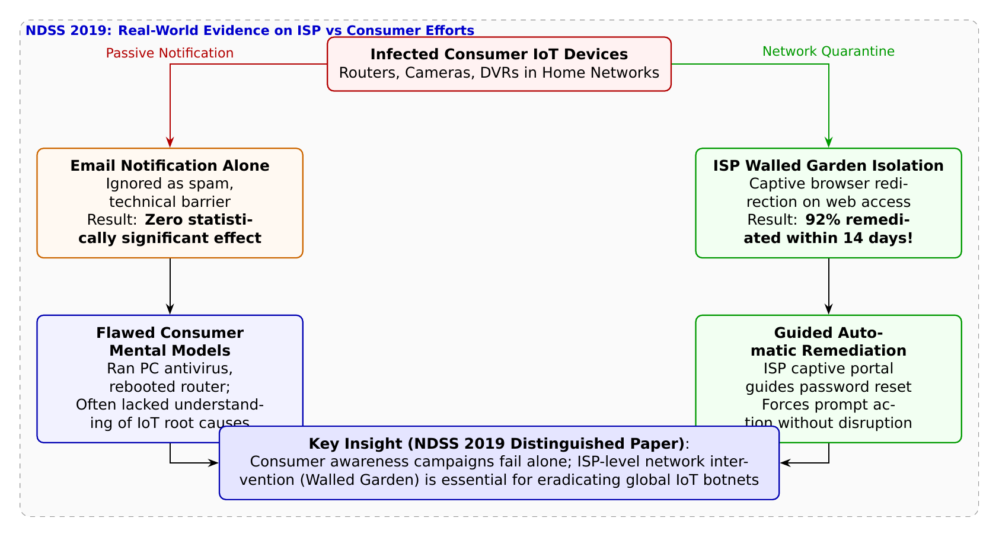

# 第29話 悪のIoTを浄化せよ 〜ISP隔離砦（Walled Garden）とMirai駆除の真実〜

> **【放課後サイバーディフェンス・ラボ（第2部：大学先端研究の扉 〜横浜国大SPIRAL論文探訪〜）】**
> - **舞台**: 帝都科学大学先端セキュリティ実習室 ＆ 横浜国立大学 SPIRAL 広域ネットワーク解析室
> - **登場人物**: 神崎 蓮（高校1年・IoT班）、白石 結衣（高校1年・暗号数理班）、城崎 悠真（大学1年・芹沢研TA）、芹沢 涼香 准教授（大学メンター）
> - **学習テーマ**: 横浜国立大学 SPIRAL・吉岡克成教授、松本勉上席特別教授らの国際最優秀論文（NDSS 2019 Distinguished Paper Award）、IoTマルウェア（Mirai等）のクリーンアップ実験、実稼働ISPにおけるランダム化比較試験（RCT）、警告メール通知の限界（効果ゼロの衝撃）、キャプティブポータル型ネットワーク隔離「Walled Garden（ウォールガーデン）」の圧倒的除染効果（14日以内に92%駆除）、一般消費者の誤ったメンタルモデル（PCアンチウイルス依存）とインフラ協調防護
> - **探訪・参照研究論文**:
>   - [横浜国立大学 サイバーセキュリティ実践教育研究センター（SPIRAL）](https://spiral.ynu.ac.jp/)
>   - "Cleaning Up the Internet of Evil Things: Real-World Evidence on ISP and Consumer Efforts to Remove Mirai." *Proceedings of the Network and Distributed System Security Symposium (NDSS 2019)*, 2019. **【Distinguished Paper Award（最優秀論文賞）受賞】**

---

## 🎨 4コマ漫画・ストーリーイラスト (Draw Things 生成)

---

## 💬 4コマ漫画キャラクターセリフ（日・英対訳）

挿絵の4コマ漫画（文字なし）の各コマに対応したキャラクターのセリフです。小説本文の導入としてもお楽しみいただけます。

| コマ | 展開 / シチュエーション | 🗣️ 日本語セリフ (Japanese) | 🌐 英語セリフ (English) |
|:---:|:---|:---|:---|
| **第1コマ** 【起】 | **蓮の楽観論：感染ルーターには注意メールを送れば即解決！** 「プロバイダが感染したルーターの持ち主にメールを送れば、誰でもすぐ直してくれるはず！」と主張する蓮。 | **蓮**: 「Miraiに感染したルーターが見つかったら、プロバイダがメールで知らせればみんなすぐ直すでしょ！」 | **Ren**: "If a router gets infected with Mirai, sending an ISP email alert will get it fixed right away!" |
| **第2コマ** 【承】 | **結衣の冷徹な指摘：メール無視と勘違いの罠** 「メールは無視されるか、PCのウイルス対策ソフトを動かして『直った』と勘違いされるだけです」と指摘する結衣。 | **結衣**: 「甘いです。メールは無視され、仮に開いてもPCのアンチウイルスを動かして安心するだけです。」 | **Yui**: "Naïve. Alert emails are ignored, or users just scan their PC with antivirus and assume it's fixed." |
| **第3コマ** 【転】 | **悠真TAによるNDSS最優秀論文の実証データ解説** メール通知の効果はゼロだが、ブラウザを一時隔離する「Walled Garden」なら14日で92%駆除された実績を語る悠真。 | **悠真**: 「吉岡教授らのNDSS 2019最優秀論文では、メールは効果ゼロ、Walled Garden隔離は92%駆除と証明されたんだ。」 | **Yuma**: "Prof. Yoshioka's NDSS 2019 award-winning paper proved email had zero effect, but Walled Garden hit 92%!" |
| **第4コマ** 【結】 | **人間を責めず、インフラの構造で守る砦へ** ユーザーの無知を責めるのではなく、ネットワーク側で包み込んで安全へ導く真の防衛に感動する二人。 | **蓮**: 「ユーザーを責めるんじゃなく、ネットが優しく包んで守る仕組みなんだ！」 **結衣**: 「人間行動と通信インフラの融合……これが学術の到達点ですね。」 | **Ren**: "Instead of blaming users, the network gently envelops and protects them!" **Yui**: "Merging human behavior with network architecture... this is the pinnacle of research." |

---

## 📖 小説本文

帝都科学大学、先端セキュリティ実習室の空気は、常に微かな電子機器の駆動音と、熱を帯びた空気で満たされている。
大型モニターには、近時発生した大規模なDDoS攻撃のニュース映像が流れていた。数千台、あるいは数万台ものIoT機器が、一斉に特定のサーバーへパケットを浴びせ、公共サービスを麻痺させている。

「……いや、これってすごく単純な解決策があると思うんだよ」

神崎蓮は、モニターの前に身を乗り出して呟いた。彼の瞳には、純粋な好奇心と、少しばかりの「正義感」が宿っている。

「プロバイダ（ISP）から、『あなたのルーターが感染していますよ』ってメールを送ればいいだけじゃない？　そうすればみんな、自分のパソコンにセキュリティソフトを入れるみたいに、ルーターも『治す』はずだよ。だって、自分の家が攻撃の加担者になってるって知ったら、誰だってびっくりするし、直したくなるでしょ」

隣でノートPCを叩いていた白石結衣は、キーボードを打つ手を止め、呆れたような視線を蓮に向けた。彼女の口角が、わずかに皮肉を帯びて上がる。

「……蓮君、それはあまりにも『人間に対する過度な信頼』に基づいた設計ね。そのメール、届くと思う？　あるいは読まれると思う？」
「えっ、届かない……？」
「まず、迷惑メールフォルダに振り分けられる可能性が高いわ。それに、仮に開いたとしてもね。一般のユーザーにとって『ルーターのファームウェアがMiraiウイルスに感染している』という事象は、あまりにも抽象的で高度すぎる概念なの。彼らはどう反応するか分かる？　きっとこう思うわ。『あ、私のパソコンがウイルスに感染してるんだ！』って」
「えっ、それって……」
「そう。彼らは自分のPCを起動して、いつものアンチウイルスソフトを走らせるわ。そして『異常なし』と表示されたのを見て、『よし、解決した』と安心する。ルーター自体がボットネットの一部になっていることには、これっぽっちも気づかないまま。結局、何も変わらないのよ」

結衣の言葉は冷徹だったが、それは現場を知る者のリアリズムに基づいた指摘だった。蓮は言葉を失い、モニターに映る無数の「感染した機器」の群れを見つめ直した。

✦ ✦ ✦

数日後、一行は横浜国立大学SPIRALの広域ネットワーク解析室へと足を運んでいた。
そこには、日本のサイバーセキュリティ研究の最前線を走り続ける吉岡克成教授たちの研究成果が、膨大なデータとして蓄積されている。

「……というわけで、蓮君。君の『メールを送ればいい』という仮説は、実は世界中の研究者が一度は考えたことのある、非常に真っ当な疑問なんだ」

大学のTAである城崎悠真が、プロジェクターに映し出されたグラフを指し示した。彼は神聖な研究室の空気に馴染むように、落ち着いた、しかし熱のこもった口調で語り始めた。

「でも、それを科学的に検証したのが、吉岡教授たちのチームによるこの論文なんだ。NDSS 2019でDistinguished Paper Awardを受賞した、『Cleaning Up the Internet of Evil Things』。これは単なる理論の提示じゃない。中規模ISPと協力して、実際のネットワーク上で実施された前代未聞の実証実験なんだよ」

城崎はスライドをめくった。そこには、ランダム化比較試験（RCT）の結果が示されている。

「彼らは数万世帯という膨大なサンプルに対して、介入の有無をランダムに分けた。そして、実際に『メール通知』を送ったグループと、何もしなかったグループを比較したんだ。その結果はどうだったと思う？」

城崎が次のグラフを表示させた。そこには、衝撃的な数値が並んでいた。

「メール通知による駆除率は……統計的に有意な差なし。つまり、ほぼゼロだ。君の言った通り、ユーザーはメールを無視するか、あるいは内容を正しく理解できなかったんだ」

蓮は絶句した。自分の無邪気な想像が、最先端の研究によって「否定」された瞬間だった。しかし、城崎の表情はさらに険しくなった。

「でも、ここからがこの論文の真骨頂だ。彼らはもう一つの手法を試した。『Walled Garden（隔離庭園）』というアプローチだ」

✦ ✦ ✦

「Walled Garden……隔離庭園？」
結衣が顔を上げた。

「そう。キャプティブポータルという技術を使うんだ。例えば、ユーザーがブラウザを開いた瞬間、ISP側で通信を一時的にインターセプト（遮断）する。そして、強制的に『注意喚起画面』へリダイレクトさせる。ホテルのWi-Fiに接続した時に出るようなあの画面だ」

城崎は熱っぽく解説を続けた。

「その画面には、複雑な技術用語は一切書かない。『あなたのルーターの設定に問題があります。安全のためにパスワードを変更してください』という、極めてシンプルで行動を促す指示だけを表示するんだ。そして、その手順に従って操作を完了させるまで、インターネットへのアクセスを制限する」

城崎が最後の一枚のスライドを映し出した。そこには、劇的な対比データがあった。

「このWalled Garden方式を採用したグループではどうなったか。なんと、わずか14日以内に、感染機器の92%が駆除されたんだ」

「……92%！？」
蓮の声が震えた。メール通知がほぼゼロだったのに対し、ネットワーク側からの強制的な介入が圧倒的な成果を上げたという事実。それは、技術的な勝利であると同時に、人間心理への深い洞察の結果でもあった。

「面白いのはここからだ」
城崎は眼鏡のブリッジを押し上げた。
「ユーザーのメンタルモデルを分析すると、彼らは『Walled Garden』の指示に従ってパスワードを変更し、ルーターを再起動したことで、結果的にウイルスが駆除された。でも、彼ら自身は……『ああ、あの注意画面に出てきた指示に従ったから、これで安心だ』としか思っていない。彼らが自分のPCのアンチウイルスソフトを動かして『異常なし』と出たことを、本当の解決策だと誤解している可能性すらある。つまり、ユーザーの無知や誤解を責めるのではなく、インフラ側が『正しい行動へと誘導する構造』を作ることで、結果的に安全を担保したということなんだ」

✦ ✦ ✦

解析室の片隅で、一日の講義を見守っていた芹沢准教授が、静かに口を開いた。

「城崎君の言う通りよ。ボットネットの根絶という巨大な課題に対して、個人のリテラシーに依存するだけでは限界がある。人間は、複雑なことを正しく理解し、正しく行動することには、構造的な制約があるからね」

彼女の声は穏やかだが、その芯には強い信念が宿っていた。

「私たちが目指すべきは、ユーザーを教育して完璧な守護者にすることではないわ。インターネットの玄関口――ISPというインフラ層において、いかに能動的に、かつスマートに介入できるか。ネットワークレベルでのアーキテクチャによって、個人のミスや無知を『許容』しながらも、安全を確保する仕組み。それこそが、この論文が示した真の解決策なのよ」

蓮は、モニターを見つめたまま動けなくなっていた。
最初は「メールを送ればいい」という単純な正義感から始まった問いだった。しかし、目の前にあるのは、人間の弱さを直視し、それを技術とインフラの設計で包み込むという、高度に知的な優しさの形だった。

「……すごいな」
蓮が小さく呟いた。
「僕たちは、ただウイルスを倒すだけじゃなくて、人の『不完全さ』を守るための仕組みを作らなきゃいけないんだね」

結衣は、それを見てわずかに微笑んだ。彼女の鋭い指摘から始まった議論は、技術の深淵と人間への理解が交差する場所へと辿り着いていた。
横浜国立大学の静かな研究室に、新たな視点を持った若者たちの熱い鼓動が響いた。

---

## 📊 TikZによるセキュリティ構造図解

---

## 💡 高校生のためのセキュリティ深掘りコラム

### 1. 世界を震撼させた「Mirai」ボットネットの悪夢
2016年、インターネットに接続された世界中のWi-Fiルーターやネットワークカメラ、デジタルビデオレコーダー（DVR）が、マルウェア**「Mirai（ミライ）」**に次々と乗っ取られました。
数十万台規模で形成された悪意あるボットネットは、大手DNSサービスDynやセキュリティブログに毎秒1テラビット（Tbps）を超える未曾有のDDoS攻撃を浴びせ、TwitterやNetflix、GitHubなどの主要サービスを麻痺させました。
Miraiのソースコードがネット上に公開されたことで無数の亜種が誕生し、**「家庭内の感染IoT機器をいかにクリーンアップ（除染）するか」**が地球規模の緊急課題となりました。

### 2. 世界最高峰 NDSS 2019 で最優秀論文賞（Distinguished Paper Award）を受賞
2019年、セキュリティ研究の4大トップカンファレンスの一つである **NDSS (Network and Distributed System Security Symposium)** において、横浜国立大学 SPIRALの**吉岡克成 教授**、**松本勉 上席特別教授**、情報通信研究機構（NICT）、およびデルフト工科大学（TU Delft）の国際共同研究チームが発表した論文『*Cleaning Up the Internet of Evil Things: Real-World Evidence on ISP and Consumer Efforts to Remove Mirai*』が、全世界の応募論文の中から極めて栄誉ある**「最優秀論文賞（Distinguished Paper Award）」**に輝きました。
本研究の画期的な点は、机上のシミュレーションではなく、**実際の中規模商用ISPのネットワーク内で感染した数千台の一般家庭ルーターを対象に、医学の臨床試験と同じ「ランダム化比較試験（RCT）」を実施した**点にあります。

### 3. データが突きつけた衝撃の事実：メール通知は「効果ゼロ」
実証実験の結果は、これまでのセキュリティ業界の常識を覆すものでした：
1. **メール通知の完全な無力さ**:
   感染機器の契約者に対して「あなたのルーターが感染しています」と詳細な注意喚起メールを送ったグループと、何も通知しなかったグループ（対照群）を比較したところ、**駆除成功率に統計的な有意差が全く見られませんでした（改善効果ゼロ）**。警告メールは迷惑メールに埋もれるか、詐欺メールと警戒されて無視されていたのです。
2. **ウォールガーデン（Walled Garden：隔離庭園）の圧倒的威力**:
   ISPのネットワーク側で一時的にWeb通信を制御し、ユーザーがブラウザを開いた際に強制的に注意喚起ポータル（キャプティブポータル）を表示させ、画面上でパスワード変更手順を案内したグループでは、**わずか14日以内に92%もの感染デバイスが安全にクリーンアップ**されました。
3. **消費者のメンタルモデル（誤解）の解明**:
   追跡インタビュー調査を行ったところ、多くのユーザーは「ルーターの感染」という概念が理解できず、「手元のパソコンのアンチウイルスソフトをスキャンして再起動した」と回答していました。ユーザーが間違った認識を持っていても、**ISPの隔離ポータルが強制的に注意を引き、機器の再起動や再設定を促す導線を作ったからこそ駆除が成功した**のです。
この研究は、「ユーザーのリテラシー向上に頼るのではなく、ISPやネットワークインフラが主体となって能動的に安全な状態へ誘導する仕組み（Walled Garden）」の重要性を世界に知らしめました。
