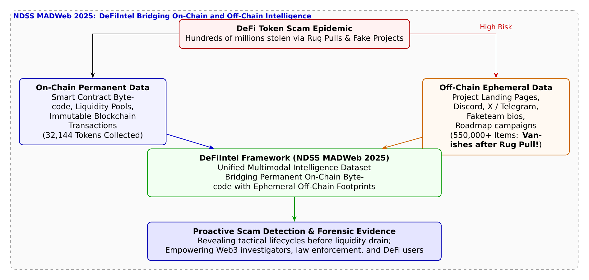

# 第30話 消えゆく足跡と鎖の記憶 〜DeFiトークン詐欺とオン・オフチェーン統合インテリジェンス〜

> **【放課後サイバーディフェンス・ラボ（第2部：大学先端研究の扉 〜横浜国大SPIRAL論文探訪〜）】**
> - **舞台**: 帝都科学大学先端セキュリティ実習室 ＆ 横浜国立大学 SPIRAL Web3・暗号資産フォレンジック研究室
> - **登場人物**: 神崎 蓮（高校1年・IoT班）、白石 結衣（高校1年・暗号数理班）、城崎 悠真（大学1年・芹沢研TA）、芹沢 涼香 准教授（大学メンター）
> - **学習テーマ**: 横浜国立大学 SPIRAL・イン・ミンパパ特任准教授、吉岡克成教授らの最新研究（NDSS MADWeb 2025）、分散型金融（DeFi）におけるトークン詐欺・Rug Pull（資金持ち逃げ）、オンチェーン（改ざん不能なブロックチェーン台帳）とオフチェーン（消えゆくWebサイトやSNS・Discord）の非対称性、世界初の大規模マルチモーダルデータセット「DeFiIntel」（32,144トークン × 55万件超のアーカイブ）、詐欺ライフサイクルの可視化とプロアクティブな予兆検知
> - **探訪・参照研究論文**:
>   - [横浜国立大学 サイバーセキュリティ実践教育研究センター（SPIRAL）](https://spiral.ynu.ac.jp/)
>   - Iori Suzuki, Yin Minn Pa Pa, Nguyen Anh Thi Van, Katsunari Yoshioka. "DeFiIntel: A Dataset Bridging On-Chain and Off-Chain Data for DeFi Token Scam Investigation." *Proceedings of the Workshop on Measurements, Attacks, and Defenses for the Web (MADWeb 2025)*, in conjunction with NDSS 2025, 2025.

---

## 🎨 4コマ漫画・ストーリーイラスト (Draw Things 生成)

---

## 💬 4コマ漫画キャラクターセリフ（日・英対訳）

挿絵の4コマ漫画（文字なし）の各コマに対応したキャラクターのセリフです。小説本文の導入としてもお楽しみいただけます。

| コマ | 展開 / シチュエーション | 🗣️ 日本語セリフ (Japanese) | 🌐 英語セリフ (English) |
|:---:|:---|:---|:---|
| **第1コマ** 【起】 | **蓮のブロックチェーン万能論：改ざん不能だから詐欺は起きない！** 暗号コインのホログラムを掲げ、「台帳が公開されてて絶対改ざんできないから詐欺なんてあり得ない！」と豪語する蓮。 | **蓮**: 「ブロックチェーンは全世界に台帳が公開されてて改ざんできないんだから、詐欺なんて起きるわけないだろ！」 | **Ren**: "Blockchain records are public and immutable! There's no way anyone can pull off a scam!" |
| **第2コマ** 【承】 | **結衣の冷徹な指摘：Rug Pullと消えゆくWebサイトの罠** 「スマートコントラクトが正しくても、資金を持ち逃げされ、宣伝サイトやSNSは一瞬で消されます」と語る結衣。 | **結衣**: 「甘いです。資金を集めて持ち逃げするRug Pullが多発し、宣伝WebやSNSは証拠隠滅で消滅します。」 | **Yui**: "Naïve. Rug pulls drain millions, and promo websites or socials are wiped immediately to destroy evidence." |
| **第3コマ** 【転】 | **悠真TAによるNDSS MADWeb論文『DeFiIntel』解説** 3.2万個のトークンと55万件の消えゆくWeb/SNSデータをリアルタイム統合したSPIRALの最先端研究を紹介する悠真。 | **悠真**: 「イン・ミンパパ特任准教授らのDeFiIntelは、鎖の記録と消滅する55万件のWebデータを結びつけたんだ。」 | **Yuma**: "Assoc. Prof. Yin Minn Pa Pa's DeFiIntel bridged on-chain ledger data with 550,000 ephemeral web records." |
| **第4コマ** 【結】 | **暗号数理と人間心理を見据える守護者へ** 数学の美しさだけでなく、人間の欲望や狡猾さにも立ち向かう真のサイバーディフェンダーとして成長を誓う二人。 | **蓮**: 「改ざんできない鎖の記憶と、消えゆく足跡を繋ぐ……これが最新の捜査学なんだ！」 **結衣**: 「暗号数理の理想と人間心理の現実……二つを極めてこそ本物の防衛者ですね。」 | **Ren**: "Linking immutable chain data with vanishing tracks... this is the future of forensics!" **Yui**: "Mastering both mathematical elegance and human psychology... that is true defense." |

---

## 📖 小説本文

帝都科学大学、先端セキュリティ実習室。
薄暗い室内には、高性能ワークステーションが放つ青白い光と、冷却ファンが回る微かな低周波の唸りだけが漂っていた。壁一面に並んだモニターには、複雑なトランザクションの連鎖と、流動性の推移を示すグラフが絶え間なく更新され続けている。

「……やっぱり、ブロックチェーンって最高だな」

神崎蓮は、画面を指差しながら感嘆の声を漏らした。彼の瞳には、整然と並ぶハッシュ値の列が映っている。

「スマートコントラクトに記述されたルールに従って、すべてが自動で執行される。一度書き込まれたデータは改ざんできない。この『不変性』こそが信頼の根源なんだ。詐欺なんて、この透明な台帳の前では通用しないはずだよ。何かが起きても、すぐに証拠が見つかって、犯人は特定される。それがWeb3の理想だろ？」

隣でキーボードを叩いていた白石結衣は、手元を止めずに短く鼻で笑った。彼女の視線は、別のウィンドウに表示された「Rug Pull（絨毯引き）」の事例集に向けられている。

「蓮、それは『技術的な正しさ』と『人間の悪意』を混同してるわ」

結衣は椅子を回転させ、蓮を真っ直ぐに見つめた。その表情には、冷徹なまでの現実主義が宿っている。

「確かにブロックチェーンの台帳は改ざんできない。でも、そこに書き込まれる『内容』自体を悪意で設計されたものにしたらどうなる？ 開発者が、あらかじめ資金を引き抜くためのバックドアをスマートコントラクトに仕込んでおけば、システムは正しく『詐欺』を実行するだけよ。DeFiの世界では、偽のプロジェクトを立ち上げて投資家から資金を集め、流動性を一瞬で抜き取って逃走する『Rug Pull』が日常的に起きている。数億ドルもの資産が、この『正しいシステム』によって合法的に盗まれているのよ」

「……でも、証拠は残るじゃないか。奪われた瞬間も記録されているんだ」

蓮の反論に対し、結衣はさらに鋭く言葉を継いだ。

「それが罠なの。オンチェーンのデータ――つまり取引の記録は永遠に残るけれど、詐欺師たちが投資家を騙すために使った『武器』は、彼らが逃げた瞬間に消滅する。公式サイト、開発者のプロフィール、宣伝に使われたX（旧Twitter）のアカウントやTelegramのグループ……これらはすべてオフチェーンの情報。資金を奪ったら、彼らは一瞬でそれらを削除する。捜査官が動き出した時には、もうそこには『無』しかない。オンチェーンとオフチェーンの間に巨大な断絶があるのよ。記録は残っても、犯人の足跡は消えてしまう。この非対称性が、今の法執行を阻んでいるの」

✦ ✦ ✦

「その『断絶』を埋めるのが、今まさに最前線で行われている研究なんです」

背後から声をかけたのは、大学のTAである城崎悠真だった。彼はタブレット端末を操作しながら、最新の研究論文の要旨をプロジェクターに映し出した。

「神崎君、白石さん。これを見てください。横浜国立大学のSPIRALチーム、イン・ミンパパ准教授や吉岡教授らが発表した最新の研究です。『DeFiIntel: A Dataset Bridging On-Chain and Off-Chain Data』。NDSS 2025のワークショップで注目された内容です」

画面には、複雑なネットワーク構造と、膨大なデータポイントが結びついた図解が表示された。

「彼らは、Ethereum上の32,144個ものDeFiトークンを網羅的に調査しました。そして重要なのは、それらと紐付いた『消えゆくオフチェーンデータ』を、詐欺が発生する前にリアルタイムで収集・アーカイブしたことです。Webサイトの構造やSNSのログなど、55万件を超える膨大なデータを統合した世界初のデータセットを構築したんです」

悠真は熱を帯びた眼差しで説明を続けた。

「これにより、詐欺師がどのようなプロセスで宣伝を行い、どのタイミングで流動性を引き抜いたかという『ライフサイクル』を可視化できるようになった。オンチェーンの『鎖の記憶』と、消えゆくオフチェーンの『残像』を一つに繋ぎ合わせたことで、単なる事後調査ではなく、詐欺の予兆を検知するインテリジェンスが可能になるんです」

蓮は画面に映し出された膨大な数の羅列を見つめ、言葉を失った。それは彼が信じていた「ブロックチェーンの聖域」の外側に広がる、泥沼のような情報の戦場だった。

✦ ✦ ✦

「技術的な美しさに目を奪われるのは良いことよ。でも、サイバーディフェンダーを目指すなら、その美しさが悪意によって利用される構造を理解しなければならないわ」

実習室の入り口に立っていた芹沢涼香准教授が、静かに歩み寄ってきた。彼女の存在感は、重厚な学術的権威と、現場を支える技術者の鋭さを併せ持っていた。

「数学的に完璧なスマートコントラクトを解析するだけでは、現代の詐欺を防ぐことはできない。人間を騙すためのソーシャルな足跡――つまりオフチェーンの動向までを網羅するマルチモーダルなインテリジェンスが必要なの。DeFiIntelの研究が示しているのは、データは『繋がっている』という事実よ。断絶していると思われていたオン・オフチェーンの境界線は、高度な分析技術によって橋渡しができるようになった」

芹沢は蓮の隣に立ち、モニターを指差した。

「詐欺師は巧妙です。彼らは心理学を使い、SNSで熱狂を生み出し、Webサイトで偽りの信頼を築く。その『人間心理の狡猾さ』を捉えるためのデータこそが、防衛のための最前線になる。蓮君、あなたが信じたブロックチェーンの透明性は正しい。でも、その透明な台帳の周りには、常に影が潜んでいることを忘れてはいけないわ」

蓮は自分の手を見つめた。そこには、コードを書くためのキーボードと、複雑な数式を解くための知性が宿っている。しかし、それだけでは足りない。

「……オンチェーンの記録だけじゃなくて、消えゆく足跡も追いかけなきゃいけないのか」

蓮の声は低く、しかし確かな決意を含んでいた。

「そうよ」と結衣が応えた。彼女の表情には、共鳴するような色が浮かんでいた。「数学の美しさと、人間の狡猾さ。その両方を射抜かない限り、私たちは守りきれない」

✦ ✦ ✦

実習室の外では、横浜の夜景が静かに輝いていた。しかし、彼らの目の前にあるのは、その輝きの裏側に潜む複雑なデータの奔流だ。

蓮は再びモニターに向き直った。今度は、単なる「改ざんできない台帳」としてのブロックチェーンではなく、広大な情報の海の中で失われる証拠をいかに繋ぎ止め、保護するかという視点を持って。

「……やるしかないな。この『鎖の記憶』を、誰も消せない防壁に変えるために」

蓮の言葉に、結衣が小さく頷いた。

二人の視線は、再び加速するデータの波へと注がれた。それは、最先端のテクノロジーと人間の知恵を融合させ、デジタル空間の正義を守るための、長く険しい旅の始まりだった。

彼らはサイバーディフェンダーとしての第一歩を踏み出した。数学的な純粋さと、現実の泥臭い人間心理。その両方を統合するインテリジェンスの地平へ。

---

## 📊 TikZによるセキュリティ構造図解

---

## 💡 高校生のためのセキュリティ深掘りコラム

### 1. Web3・DeFi（分散型金融）で多発する「Rug Pull（絨毯引き）」とは？
ビットコインやイーサリアムに代表されるブロックチェーン技術は、「取引台帳が分散管理され、一度刻まれたデータは絶対に改ざんできない」という画期的な特性を持っています。
しかし、中央管理者のいない**分散型金融（DeFi: Decentralized Finance）**の普及に伴い、悪意ある開発者が自作の偽トークンを発行して投資家を欺く詐欺が急増しています。代表例が**「Rug Pull（ラグプル：足元の絨毯を勢いよく引き抜く詐欺）」**です。
- **手口**: 「将来価値が100倍になる画期的な暗号資産」と偽り、きらびやかな公式サイトやX（旧Twitter）、Telegram、Discordで大々的に宣伝（ハイプ）して資金（流動性）を集めます。
- **持ち逃げ**: 投資家の買いが集まって価格が上がった瞬間、開発者がスマートコントラクト内の流動性プールから資金を一気に引き抜いて雲隠れします。残されたトークンは一瞬で無価値（ゼロ）になり、世界中で年間数億ドルもの被害が発生しています。

### 2. 捜査と防犯を阻む「オンチェーンとオフチェーンの非対称性」
DeFi詐欺の調査における最大の障壁は、**「残るデータ」と「消えるデータ」のギャップ**にあります：
- **オンチェーン（On-Chain）データ**: ブロックチェーン上のスマートコントラクトのプログラムコード（バイトコード）や送金履歴。これらは永久に残り、世界中誰でも閲覧可能です。
- **オフチェーン（Off-Chain）データ**: 詐欺師が投資家を信じ込ませるために作成した「プロジェクト公式サイト」「ホワイトペーパー」「開発チームの経歴」「SNSの投稿やコミュニティチャット」。
詐欺師は資金を持ち逃げした直後、**自らのWebサイトを閉鎖し、SNSアカウントを即座に削除・非公開化（証拠隠滅）**してしまいます。被害が発生した後に警察や研究者が調査しようとしても、肝心の「どのように人間を騙したのか」というオフチェーンの証拠はインターネット上から完全に消滅してしまっているのです。

### 3. 横浜国大 SPIRAL が挑んだ世界初の統合データセット「DeFiIntel」（NDSS MADWeb 2025）
2025年、国際シンポジウム NDSS 2025 併設のワークショップ **MADWeb (Workshop on Measurements, Attacks, and Defenses for the Web)** において、横浜国立大学 SPIRALの**イン・ミンパパ 特任准教授**、**吉岡克成 教授**、鈴木伊織 氏らの研究チームは、この未解決問題に決定的なブレークスルーをもたらす論文『*DeFiIntel: A Dataset Bridging On-Chain and Off-Chain Data for DeFi Token Scam Investigation*』を発表しました。
- **リアルタイム網羅収集**: イーサリアム（Ethereum）ブロックチェーン上で新規にデプロイされた**32,144個のDeFiトークン**をリアルタイムで追跡。
- **55万件超のオフチェーンフットプリントを保全**: トークン生成と同時に、関連するプロジェクトWebサイトのHTMLやスクリーンショット、XやTelegramの投稿など**55万点以上のオフチェーンデータを消え去る前にアーカイブ**しました。
- **マルチモーダル・インテリジェンスの確立**: 「スマートコントラクトのバイトコード（数理的特徴）」と「マーケティング用Web・SNSデータ（ソーシャルな騙しの特徴）」を結びつけることで、詐欺トークンが資金を抜くまでの戦術的ライフサイクルや行動パターンを解明。事後捜査の決定的な電子的証拠を提供するだけでなく、**詐欺が実行される前の「予兆検知」を可能にする世界初の基盤**を築き上げました。
数学的なコードの正しさだけでは防げない「人間の騙しの心理」に対し、多角的なデータ統合で立ち向かう大学先端研究の真骨頂です。
