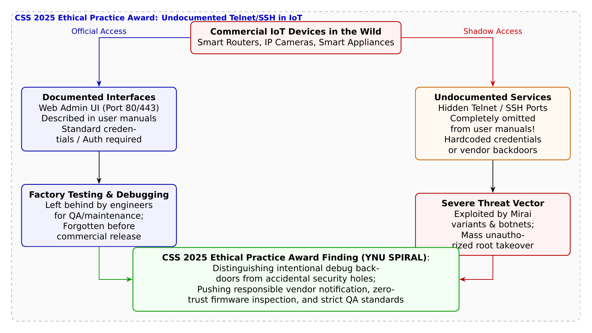

# 第31話 隠された扉と影の合言葉 〜マニュアルにない裏口（バックドア）の真実〜

> **【放課後サイバーディフェンス・ラボ（第2部：大学先端研究の扉 〜横浜国大SPIRAL論文探訪〜）】**
> - **舞台**: 帝都科学大学先端セキュリティ実習室 ＆ 横浜国立大学 SPIRAL CyRaP実証ラボ
> - **登場人物**: 神崎 蓮（高校1年・IoT班）、白石 結衣（高校1年・暗号数理班）、城崎 悠真（大学1年・芹沢研TA）、芹沢 涼香 准教授（大学メンター）
> - **学習テーマ**: 横浜国立大学 SPIRAL・吉岡克成教授、佐々木貴之准教授、宮本岩麒氏らの受賞論文（CSS 2025 エシカルプラクティス賞）、市販IoT機器におけるマニュアル非記載のTelnet/SSHサービスの実態解明、開発・製造現場におけるデバッグ機能の消し忘れと意図的バックドアの境界線、ハードコードされた共通認証情報の脅威、ゼロトラストなファームウェア検証とエシカル（倫理的）研究実践の矜持
> - **探訪・参照研究論文**:
>   - [横浜国立大学 サイバーセキュリティ実践教育研究センター（SPIRAL）](https://spiral.ynu.ac.jp/)
>   - 宮本 岩麒, 九鬼 琉, 藤井 翔太, 佐々木 貴之, 吉岡 克成. "セキュリティホールか意図的なバックドアか？IoT機器におけるマニュアルに記載されていないTelnet・SSHサービスの調査." *コンピュータセキュリティシンポジウム 2025 (CSS2025)*, 2025. **【CSS2025 エシカルプラクティス賞受賞】**

---

## 🎨 4コマ漫画・ストーリーイラスト (Draw Things 生成)

---

## 💬 4コマ漫画キャラクターセリフ（日・英対訳）

挿絵の4コマ漫画（文字なし）の各コマに対応したキャラクターのセリフです。小説本文の導入としてもお楽しみいただけます。

| コマ | 展開 / シチュエーション | 🗣️ 日本語セリフ (Japanese) | 🌐 英語セリフ (English) |
|:---:|:---|:---|:---|
| **第1コマ** 【起】 | **蓮の素朴な興奮：マニュアルにない裏ポート発見！** ポートスキャンで23番ポート（Telnet）を見つけ、「裏コマンドみたいでカッコいい！」とはしゃぐ蓮。 | **蓮**: 「見てよ結衣！ 説明書に書いてないTelnetポートが開いてる！ ゲームの裏技みたいでカッコいいだろ！」 | **Ren**: "Look Yui! An unlisted Telnet port is open! It's like finding a secret cheat code in a game!" |
| **第2コマ** 【承】 | **結衣の冷徹な指摘：デバッグ残骸とバックドアの罠** 「裏技ではなく致命的な脆弱性です。共通パスワードなら数秒でボットネットの餌食になります」と戒める結衣。 | **結衣**: 「甘いです。工場デバッグの消し忘れか意図的バックドアであり、数秒で乗っ取られる致命傷です。」 | **Yui**: "Naïve. It's either an unremoved factory debug port or a backdoor, inviting botnets in seconds." |
| **第3コマ** 【転】 | **悠真TAによるCSS 2025受賞論文の実態解説** 市販IoT機器の大規模調査で非公開ポートや共通認証の放置実態を暴いたSPIRALの研究成果を紹介する悠真。 | **悠真**: 「吉岡教授らのCSS 2025エシカルプラクティス賞論文では、市販機器に潜む非公開ポートの実態を解明したんだ。」 | **Yuma**: "Prof. Yoshioka's CSS 2025 award-winning paper uncovered the reality of hidden ports in retail IoT devices." |
| **第4コマ** 【結】 | **裏口を残さない！エンジニアの誠実さに目覚める二人** 都合の良い抜け道を許さず、ゼロトラストで安全を検証する技術者の倫理と誇りを胸に刻む二人。 | **蓮**: 「便利だからって勝手口を残しちゃダメなんだ。いかなる裏口も塞ぐエンジニアになるよ！」 **結衣**: 「責任ある開示とファームウェアの完全性……これこそ真のエシカルですね。」 | **Ren**: "Convenience is no excuse for backdoors! I'll become an engineer who seals every hidden entrance!" **Yui**: "Responsible disclosure and firmware integrity... that is true ethical engineering." |

---

## 📖 小説本文

帝都科学大学の先端セキュリティ実習室は、深夜に近い時間帯にもかかわらず、微かな電子機器の唸り音と青白いモニターの光に満ちていた。
「……あった。見つけたぞ」
　神崎蓮は、手元のノートPCから発せられる快活な電子音に反応し、顔を輝かせた。画面上には、彼が用意したスマートホーム用ハブのポートスキャン結果が羅列されている。
「これだよ、結衣。マニュアルには一切の記載がないのに、Telnetポートの23番が開いてる。これって、開発者が自分たちのために残した『裏技』みたいなものじゃないか？ 隠しコマンドとか、特別な設定をいじれる秘密の扉だ」
　蓮は興奮を隠せず、椅子の背もたれに寄りかかった。自作ガジェットの開発に没頭する彼にとって、公式ドキュメントの外側にある「秘密」は、技術者としての好奇心を刺激する最高のスパイスだった。

　しかし、隣で腕を組んで画面を見つめていた白石結衣は、眉をひそめたまま動かない。彼女の瞳には、蓮のような高揚感ではなく、冷徹な分析の光が宿っていた。
「……『裏技』なんて甘い言葉で片付けないで。それはただの『放置された脆弱性』よ」
　結衣の声は低く、鋭い。
「マニュアルに載っていないということは、ユーザーに知られることを想定していない。でも、ポートが開いているということは、ネットワークを通じて誰でもアクセスを試みられるってこと。もしパスワードが工場出荷時のデフォルトのまま、あるいはハードコードされた共通の文字列だったらどうなるか分かってる？ Miraiのようなボットネットに数秒で検知されて、このデバイスは踏み台にされるわ」
　彼女はキーボードを叩き、過去のインシデント事例を呼び出した。
「『便利な抜け道』だと思って開けておいた扉が、悪意ある攻撃者にとっては最高に使い勝手の良い侵入口になる。それがこの世界の現実よ」

✦ ✦ ✦

　二人の間に緊張した沈黙が流れた時、実習室のドアが開き、大学のTAである城崎悠真が入ってきた。彼は手元のタブレットを操作しながら、二人のやり取りを察したように微笑んだ。
「お、いいところに来たな。ちょうどいい、その『隠された扉』の話なら、最近すごく注目されている研究があるんだ」
　悠真はホワイトボードに『CSS 2025 エシカルプラクティス賞』という文字を書き込んだ。
「横浜国立大学のSPIRAL、吉岡克成教授や佐々木貴之准教授たちのグループが発表した論文だ。『IoT機器におけるマニュアル非記載Telnet/SSHサービスの調査』。これ、かなり大規模な調査なんだよ」
　悠真は画面を操作し、研究の概要を映し出した。
「彼らは市販されている多種多様なIoT機器を網羅的に解析して、マニュアルに載っていないポートの実態を突き止めた。結果、多くの機器が非公開ポートとハードコードされたパスワードを放置していることが判明したんだ。なぜこんなことが起きるのか？ それは、製造現場での『QA（品質保証）の漏れ』や、エンジニアがデバッグ用に一時的に開けたポートが、最終的なファームウェアへの統合プロセスで閉じられずに市場へ流れてしまう『サプライチェーンの隙間』なんだよ」
　悠真の説明に、蓮は少しだけ表情を曇らせた。自分が「カッコいい」と思ったものが、実は製造工程の不備という名の遺物であるという事実に。

✦ ✦ ✦

　数日後、二人は横浜国立大学SPIRALのCyRaP実証ラボへと足を運んでいた。そこには、研究の核心を支える芹沢准教授の姿があった。
　ラボ内は、無数のサーバーラックと最新の解析機器が整然と並び、高度な技術の熱気が肌で感じられる空間だった。芹沢は、蓮と結衣を前にして、静かに語り始めた。
「セキュリティの研究において、最も重要なのは『技術的な発見』そのものではないわ。その発見をどう扱うかという『倫理（エシカル）』の部分よ」
　彼女の言葉には、教育者としての重みがあった。
「脆弱性を見つけた時、それを公開して自分の技術力を誇示するのも、悪用して利益を得るのも、自由な世界では可能かもしれない。けれど、大学の研究者、そしてこれからのエンジニアに求められるのは『知の守護者』としての姿勢です」
　芹沢はホワイトボードに「CVD（Coordinated Vulnerability Disclosure）」という文字を記した。
「脆弱性を発見したら、まずは製造元に責任を持って報告する。サプライチェーン全体で製品の品質を底上げし、『セキュア・バイ・デザイン』――設計段階から安全を組み込む文化を社会に問いかけること。それが私たちの矜持。単に穴を見つけるのではなく、その穴を埋めるための仕組みを構築することこそが、技術者が背負うべき責任なのよ」
　蓮は、彼女の言葉を噛み締めるように聞き入った。自分たちがこれから作るシステムは、誰かを守るためのものだという自覚が、胸の奥に熱く灯った。

✦ ✦ ✦

　実習室に戻り、二人は再び自分のプロジェクトに向けた設計図を見つめていた。
「……結衣、わかったよ。俺たちの作るスマートガジェットに、『都合の良い裏口』なんて絶対に作らない」
　蓮は真剣な眼差しで言った。以前の彼なら、デバッグを楽にするためにポートを空けておこうとしただろう。しかし今は違う。
「あのアカデミックな調査が証明したように、たった一つの『消し忘れ』が、世界中のネットワークを脅かす一歩になる。俺たちは、ユーザーに便利さを提供する前に、まず安全を保証するエンジニアにならなきゃいけない」
　結衣は小さく頷き、蓮の横顔を見た。
「ええ。マニュアルに載っていない扉を作るんじゃなくて、誰にも侵せない強固な城を作るのよ。それが私たちの誇りになる」
　二人の視線は、再びモニターへと向けられた。そこには、単なる「便利さ」を超えた、誠実な技術への意志が宿っていた。
　窓の外では、横浜の夜景が静かに輝いている。それは、彼らが守ろうとしている未来の光のようにも見えた。

---

## 📊 TikZによるセキュリティ構造図解

---

## 💡 高校生のためのセキュリティ深掘りコラム

### 1. なぜ市販のIoT機器に「マニュアルにないポート」が存在するのか？
ユーザーが家電量販店やネット通販で購入するWi-Fiルーターやネットワークカメラ、スマート家電の取扱説明書には、「ブラウザから設定画面（ポート80や443）を開いて初期設定してください」と書かれています。
しかし、ネットワーク探索ツール（Nmap等）でスキャンすると、**マニュアルのどこにも書かれていない「Telnet（ポート23）」や「SSH（ポート22）」が開いている機器**が少なからず存在します。
これらには主に2つの要因があります：
- **開発・工場検査時の消し忘れ（デバッグ残骸）**: 製造ラインでファームウェアの書き込みテストを行ったり、基板の品質検査を行うために一時的に開けられたポートが、出荷前の最終ビルドで無効化されずにそのまま市場へ出荷されてしまったケース。
- **意図的な保守用裏口（ベンダーバックドア）**: 修理サポートや故障診断を容易にするために、メーカー側が故意に内部シェルへの侵入経路を残していたケース。

### 2. 世界最高峰のサイバー犯罪温床：ハードコードされた共通パスワード
マニュアルに書かれていないポートがなぜ極めて危険なのかというと、**「root/root」「admin/123456」といった脆弱な初期パスワード、あるいは全製品で共通のパスワードがプログラム内に直書き（ハードコード）されていることが多いから**です。
- ユーザーはマニュアルに載っていないためポートの存在すら知らず、パスワードを変更することもできません。
- インターネット全体を常時スキャンしている**Miraiやその亜種（IoTボットネット）**は、こうした既知の非公開ポートとデフォルトパスワードの組み合わせリストを保持しており、見つかった瞬間に数秒で侵入・乗っ取りを完了してしまいます。

### 3. 横浜国大 SPIRAL が受賞した「CSS 2025 エシカルプラクティス賞」の意義
コンピュータセキュリティシンポジウム 2025（CSS2025）において、横浜国立大学 SPIRALの**吉岡克成 教授**、**佐々木貴之 准教授**、**宮本岩麒 氏**らの研究論文『*セキュリティホールか意図的なバックドアか？IoT機器におけるマニュアルに記載されていないTelnet・SSHサービスの調査*』が、**「エシカルプラクティス賞」**を受賞しました。
- **徹底した実態調査**: 実際に市場で流通している多種多様なIoT機器を購入・精査し、どのようなカテゴリの機器に非公開サービスが残存しているのか、その認証仕様を体系的に解明。
- **学術的倫理（エシカル）の実践**: 脆弱性を見つけて単に公表するだけでなく、製造メーカーへの責任ある協調的開示（CVD: Coordinated Vulnerability Disclosure）を実施し、サプライチェーン全体でのファームウェア品質管理基準の向上を提唱しました。
サイバー防衛とは、コードの穴を見つけるだけでなく、「社会や製造現場にいかに誠実に向き合い、安全なモノづくりを支えるか」という倫理観（エシカルマインド）の上に成り立っていることを示す、大学研究の模範です。
