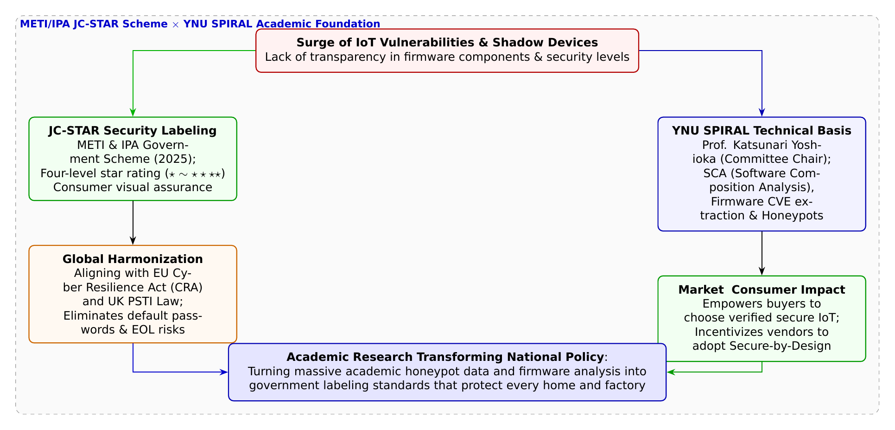

# 第32話 星の標識と消費者の砦 〜国家基準「JC-STAR」と安全の証明〜

> **【放課後サイバーディフェンス・ラボ（第2部：大学先端研究の扉 〜横浜国大SPIRAL論文探訪〜）】**
> - **舞台**: 帝都科学大学先端セキュリティ実習室 ＆ 横浜国立大学 SPIRAL 社会共創ラボ
> - **登場人物**: 神崎 蓮（高校1年・IoT班）、白石 結衣（高校1年・暗号数理班）、城崎 悠真（大学1年・芹沢研TA）、芹沢 涼香 准教授（大学メンター）
> - **学習テーマ**: 経済産業省・IPAが運用を開始した国家セキュリティラベリング制度「JC-STAR（IoT製品セキュリティ適合性評価制度）」、技術審議委員会委員長を務める横浜国立大学 SPIRAL・吉岡克成教授らの学術的貢献、製品の外見からは見えない「情報の非対称性（レモンの市場）」の克服、ファームウェアに含まれるオープンソースソフトウェア（OSS）の脆弱性検査（SCAツール）、欧州サイバーレジリエンス法（CRA）や英国PSTI法との国際協調
> - **探訪・参照研究論文**:
>   - [横浜国立大学 サイバーセキュリティ実践教育研究センター（SPIRAL）](https://spiral.ynu.ac.jp/)
>   - 経済産業省・独立行政法人情報処理推進機構（IPA）. "IoT製品のセキュリティ適合性評価及びラベリング制度（JC-STAR）実施要領・技術基準." 2025.
>   - 吉岡克成（技術審議委員会委員長）. "IoTセキュリティを取り巻く国内外の最新動向とJC-STAR制度の技術的視点." *IPA/JC-STAR記念シンポジウム*, 2025.

---

## 🎨 4コマ漫画・ストーリーイラスト (Draw Things 生成)

---

## 💬 4コマ漫画キャラクターセリフ（日・英対訳）

挿絵の4コマ漫画（文字なし）の各コマに対応したキャラクターのセリフです。小説本文の導入としてもお楽しみいただけます。

| コマ | 展開 / シチュエーション | 🗣️ 日本語セリフ (Japanese) | 🌐 英語セリフ (English) |
|:---:|:---|:---|:---|
| **第1コマ** 【起】 | **蓮の安易な製品選び：値段が安ければどれも同じ！** 量販店のルーター売り場で「見た目も同じだし、一番安いので十分でしょ！」と値段だけで決めようとする蓮。 | **蓮**: 「量販店のルーターなんてどれも同じ電波を飛ばすんだから、一番安いやつを買えばお得だろ！」 | **Ren**: "Routers in the store do the same thing, so getting the cheapest one is obviously the best deal!" |
| **第2コマ** 【承】 | **結衣の経済学的指摘：中身の見えないレモンの市場** 「食品と違って古いOSSやパッチ放置が見えない情報の非対称性。安価な機器は感染源になります」と説く結衣。 | **結衣**: 「甘いです。食品と違って中身が見えず、古いOSSや脆弱性が放置された悪貨が市場を蝕みます。」 | **Yui**: "Naïve. Unlike food, firmware ingredients are hidden—outdated OSS and unpatched bugs poison the market." |
| **第3コマ** 【転】 | **悠真TAによる国家制度「JC-STAR」とSPIRALの解説** 星の数（★1〜★4）で安全性を可視化する国家制度と、吉岡教授が委員長として注入した実証データを語る悠真。 | **悠真**: 「経産省とIPAが始めたJC-STARだ。吉岡教授が委員長として長年の観測データを基準に注ぎ込んだんだ。」 | **Yuma**: "It's JC-STAR by METI & IPA. Prof. Yoshioka chaired the technical committee, infusing decades of empirical data." |
| **第4コマ** 【結】 | **消費者を守る透明な星の砦へ** 消費者が正しい安全を選べる仕組みに感銘を受け、市場と技術を繋ぐ架け橋の大切さに目覚める二人。 | **蓮**: 「星のマークがあれば、誰もが迷わずに本物の安全を選べるんだ！」 **結衣**: 「市場の透明性とSecure-by-Design……これこそ社会を動かす工学ですね。」 | **Ren**: "With these star badges, anyone can choose verified security with total confidence!" **Yui**: "Market transparency paired with Secure-by-Design... this is engineering that transforms society." |

---

## 📖 小説本文

帝都科学大学、先端セキュリティ実習室。壁一面を埋め尽くす棚には、無機質なプラスチックの筐体に数多のアンテナを備えたWi-Fiルーターや、レンズの奥に赤外線センサーを秘めたネットワークカメラが整然と並んでいた。

「……なあ、結衣。結局どれも同じに見えるんだけどさ。これ、一番安いやつを買っておけばいいんじゃないか？」

　神崎蓮は、ディスプレイの端に置かれた小型のIPカメラを手に取りながら、困惑したように眉を寄せた。彼の視線は、製品パッケージに踊る「高速通信」「高画質」「簡単設定」といった派手なキャッチコピーと、それとは対照的な低価格のタグの間で揺れている。

　隣でタブレットを操作していた白石結衣が、眼鏡の奥の瞳を鋭く光らせた。彼女は蓮の手元を冷ややかな視線で見つめる。

「蓮、それは『情報の非対称性』という経済学の罠にハマってるわよ。食品なら成分表示があるけれど、IoT製品のセキュリティはどう？ 外見から中身の脆弱性がわかるの？」
「え、いや……まあ、動けばいいっていうか」
「それが問題なのよ。安価な製品ほど、開発コストを削るために古いバージョンのOSS（オープンソースソフトウェア）をそのまま流用したり、脆弱性パッチの提供を放棄したりすることが多いわ。いわゆる『レモンの市場』の状態ね。消費者は中身が腐っているかどうかも知らずに、安さだけで「レモン」を掴まされる。その結果、君の家にあるカメラが、知らない誰かの攻撃の踏み台になるかもしれないのよ」

　結衣の淡々とした、しかし重みのある指摘に、蓮は手に持っていたカメラを少しだけ引き戻した。

✦ ✦ ✦

「……結衣さんの言うことは正しい。でも、消費者にそのリスクをすべて理解してもらうのは難しいことだ」

　背後から声をかけたのは、大学のTAを務める城崎悠真だった。彼は実習室のデスクに歩み寄り、壁に掲げられた一枚のポスターを指差した。そこには「JC-STAR」というロゴと、星のマークが並んでいた。

「2025年3月から運用が始まった『JC-STAR』。これは経済産業省とIPA（情報処理推進機構）が立ち上げたIoTセキュリティ適合性評価・ラベリング制度だ。蓮君、この星の数を見てごらん」
「……星の数？ これが安全性の指標になるのか？」

　蓮が身を乗り出す。悠真は頷き、解説を続けた。

「そう。★1から★4までの段階的な基準がある。例えば★1なら、初期パスワードの禁止やファームウェアの更新手順の明示といった基本的な対策。そして星が増えるほど、より高度なセキュリティ要件を満たしていることを示すんだ。これがあれば、消費者はパッケージを見るだけで『この製品は信頼できる』という判断ができるようになる」

　悠真は手元の資料をめくりながら、さらに踏み込んだ。

「ただの理想論じゃないのがこの制度の強みだ。この基準策定には、横浜国立大学SPIRALの吉岡克成教授たちが長年積み上げてきたデータが注ぎ込まれている。彼らは数百万件もの攻撃観測データや、ファームウェアに含まれるOSS部品の構成分析（SCA）の結果を解析し、どこに致命的な穴があるのかを徹底的に洗い出してきたんだ」

　蓮は「SCA」という言葉に顔をしかめたが、悠真は補足した。

「製品の中身を解剖するように、どの部品がどのライブラリを使っているかを特定する技術だ。吉岡教授たちの知見があるからこそ、この星の数は『現場で本当に攻撃を防ぐための実践的な基準』として成立しているんだよ」

✦ ✦ ✦

　実習室の扉が開き、落ち着いた足取りで芹沢涼香准教授が入ってきた。彼女は学生たちの会話に耳を傾けながら、柔らかい微笑みを浮かべて歩み寄る。

「悠真君、いい説明ね。でも、この制度の意義は国内に留まるものじゃないわよ」

　芹沢は大きなモニターに映し出された国際的な規制のリストを表示した。

「今、世界は大きな転換点にあるの。欧州のサイバーレジリエンス法（CRA）や英国のPSTI法を見てちょうだい。これらはメーカーに対して『初期パスワードの禁止』や『脆弱性情報の開示』を法的に義務付けるものね。日本もJC-STARを通じて、そうした国際的な潮流に呼応しているのよ」

　彼女は蓮と結衣の顔を交互に見つめた。

「大切なのは『セキュア・バイ・デザイン』という考え方。製品を作る段階からセキュリティを組み込むこと。JC-STARはそのための道標であり、消費者に『選ぶ力』を与える砦でもあるの。日本発のサイバーインテリジェンスが、国際標準を牽引していく……そんなダイナミズムがここにあるのよ」

　蓮は再び、手元のカメラを見つめた。先ほどまでただの「安価なガジェット」に見えていたそれが、今は複雑なサプライチェーンと、それを守ろうとする人々の知恵の集積体のように見えた。

「……つまり、この星のマークは、技術者が消費者に送る『安心』のサインってことか」

　蓮の言葉に、結衣が小さく頷いた。

「ええ。情報の非対称性を埋めるための、透明な盾。それが技術と社会を繋ぐ架け橋になるのね」

　窓から差し込む午後の光が、実習室の棚に並ぶデバイスたちを照らしていた。その一つひとつに刻まれるべき「星」の輝きは、見えない脅威から日常を守るための、静かな、しかし力強い意志の象徴だった。

---

## 📊 TikZによるセキュリティ構造図解

---

## 💡 高校生のためのセキュリティ深掘りコラム

### 1. IoT市場の病理：「レモンの市場（情報の非対称性）」
家電量販店やECサイトに並ぶWi-Fiルーターやネットワークカメラ、スマート照明などのパッケージには、「超高速Wi-Fi」「4K高画質」といった派手な宣伝文句が並んでいます。
しかし、その製品のファームウェアの中に**「何年前の古いLinuxカーネルが使われているか」「既知の脆弱性（CVE）を抱えたオープンソースソフトウェア（OSS）が何個放置されているか」「セキュリティアップデートが何年間提供されるか」**といった情報は、外箱を見ても一般の消費者には全く分かりません。
結果として、セキュリティ対策にコストをかけた優良な製品よりも、安全性を削って安売りする低品質な製品が売れてしまう**「レモンの市場（悪貨が良貨を駆逐する現象）」**が長年続いてきました。

### 2. 経済産業省とIPAが始動した国家基準「JC-STAR」
この悪循環を断ち切るため、経済産業省（METI）と独立行政法人情報処理推進機構（IPA）が2025年3月から本格運用を開始したのが、日本初となるIoT製品のセキュリティ適合性評価・ラベリング制度**「JC-STAR（Japan Cyber-Security Trust and Assessment Scheme for IoT Products）」**です。
製品が満たすセキュリティ要件に応じて、消費者が一目でわかる**「星マーク（★1〜★4）」**のラベルを製品パッケージやWebサイトに表示できる制度です：
- **★1（星1つ：自己適合宣言）**: 「初期パスワードの推測禁止（出荷時個別パスワード）」「脆弱性報告窓口の設置」「安全なファームウェア更新手順」など、最低限満たすべき必須防護ライン。
- **★2〜★4（星2〜4つ：第三者検証・高度防護）**: 暗号鍵のセキュアエレメント保護、通信の暗号化検証、さらには第三者評価機関によるファームウェア詳細監査やサプライチェーン検証を伴う高度なセキュリティ。

### 3. 横浜国大 SPIRAL・吉岡教授が技術基準をリード
この国家スキームの策定において極めて大きな役割を果たしたのが、横浜国立大学 SPIRALセンター長である**吉岡克成 教授**です。
吉岡教授はJC-STARの**「技術審議委員会委員長」**を務め、机上の法規制論ではなく、研究室で長年蓄積してきた**「ハニーポットによる数百万件のリアルなサイバー攻撃観測データ」**や**「数千台の市販ルーターから抽出したファームウェアSCA（ソフトウェア構成分析）データ」**を基準策定に注ぎ込みました。
- 欧州の**CRA（サイバーレジリエンス法）**や英国の**PSTI法**、米国の**Cyber Trust Mark**とも歩調を合わせ、日本発のサイバーインテリジェンスが世界の国際標準をリードしています。
学術研究室の膨大なデータが、全国民の家庭と社会インフラを守る国の制度設計そのものを支えているのです。
