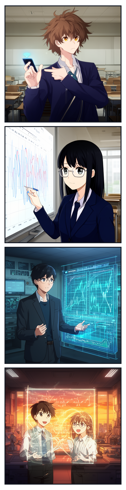
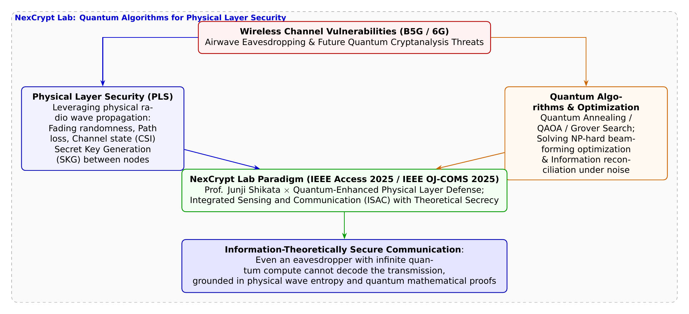

# 第33話 空間を翔ける乱数と量子の極致 〜電波の物理現象で紡ぐ破られない暗号〜

> **【放課後サイバーディフェンス・ラボ（第2部：大学先端研究の扉 〜横浜国大SPIRAL論文探訪〜）】**
> - **舞台**: 帝都科学大学先端セキュリティ実習室 ＆ 横浜国立大学 SPIRAL 次世代暗号ラボ（NexCrypt Lab）
> - **登場人物**: 神崎 蓮（高校1年・IoT班）、白石 結衣（高校1年・暗号数理班）、城崎 悠真（大学1年・芹沢研TA）、芹沢 涼香 准教授（大学メンター）
> - **学習テーマ**: 横浜国立大学 SPIRAL・四方順司教授（NexCrypt Lab長）らの先端論文（IEEE Access 2025 / IEEE OJ-COMS 2025）、物理層セキュリティ（PLS: Physical Layer Security）の基本原理、電波のフェージング・マルチパス伝搬による物理層鍵生成（SKG）、量子アルゴリズム（量子アニーリング・QAOA）を用いた無線パラメータ最適化、計算能力無限の盗聴者でも数学的に解読不可能な「情報理論的安全保障（Information-Theoretic Security）」、次世代通信（B5G/6G）と通信センシング統合（ISAC）の未来
> - **探訪・参照研究論文**:
>   - [横浜国立大学 サイバーセキュリティ実践教育研究センター（SPIRAL）](https://spiral.ynu.ac.jp/)
>   - Toshiki Matsumine, Hideki Ochiai, Junji Shikata. "Quantum Algorithms for the Physical Layer: Potential Applications to Physical Layer Security." *IEEE Access*, Vol. 13, pp. 13988-14009, 2025.
>   - Toshiki Matsumine, Hideki Ochiai, Junji Shikata. "Physical Layer Security for Integrated Sensing and Communication: A Survey." *IEEE Open Journal of the Communications Society*, Vol. 6, pp. 6690-6743, 2025.

---

## 🎨 4コマ漫画・ストーリーイラスト (Draw Things 生成)

---

## 💬 4コマ漫画キャラクターセリフ（日・英対訳）

挿絵の4コマ漫画（文字なし）の各コマに対応したキャラクターのセリフです。小説本文の導入としてもお楽しみいただけます。

| コマ | 展開 / シチュエーション | 🗣️ 日本語セリフ (Japanese) | 🌐 英語セリフ (English) |
|:---:|:---|:---|:---|
| **第1コマ** 【起】 | **蓮の固定観念：電波は垂れ流しだから暗号を強めるしかない！** Wi-Fiアンテナを指差し、「電波なんて誰にでも傍受されるんだから、アプリの暗号を強くするしかないだろ」と語る蓮。 | **蓮**: 「電波なんて空中に飛び交ってて誰でも受信できるんだから、アプリ側で暗号を強めるしかないだろ！」 | **Ren**: "Radio waves fly freely through the air for anyone to grab! We can only rely on heavier app encryption!" |
| **第2コマ** 【承】 | **結衣の物理層への着眼：電波の揺らぎが鍵になる** 波形を描きながら、「発信者と受信者しか観測できない電波のノイズから固有の鍵を生み出せます」と説く結衣。 | **結衣**: 「甘いです。電波の物理的フェージングや反射特性から、誰にも真似できない秘密鍵を作れるのです。」 | **Yui**: "Naïve. Radio wave fading and multipath noise let transmitter and receiver generate unstealable secret keys." |
| **第3コマ** 【転】 | **悠真TAによる四方教授らの量子×物理層暗号解説** IEEE Access 2025論文の、量子アルゴリズムで電波伝搬を最適化し情報理論的秘密性を守る最先端を紹介する悠真。 | **悠真**: 「四方教授らの最新論文では、量子アニーリングで電波制御を極限まで高め、情報理論的安全性を実現したんだ。」 | **Yuma**: "Prof. Shikata's latest paper uses quantum annealing to optimize radio channels for information-theoretic security." |
| **第4コマ** 【結】 | **計算力に屈しない物理と数理の調和へ** 無限の計算力を持つ量子コンピュータでも破れない物理層の深淵に触れ、サイバーの広大な宇宙に感動する二人。 | **蓮**: 「数学と電波の物理が合体すれば、未来の量子マシンでも絶対解読できないなんて……凄すぎる！」 **結衣**: 「計算量の限界を超えた自然の理……これが暗号数理の最高峰ですね。」 | **Ren**: "Fusing physics and math makes codes unbreakable even to future quantum supercomputers! Amazing!" **Yui**: "Transcending computational limits through natural laws... this is the zenith of cryptographic math." |

---

## 📖 小説本文

帝都科学大学の先端セキュリティ実習室は、深夜に近い時間になっても微かな熱を帯びていた。壁一面に並んだサーバーラックからは、一定の周期で低周波の駆動音が響き、数台の高性能ワークステーションが放つ排熱が、空調の風と混ざり合って独特の匂いを漂わせている。

神崎蓮は、モニターに映し出されたスペクトラムアナライザの波形を見つめながら、眉間に深い皺を刻んでいた。
「結局のところ、無線通信っていうのは『空中に垂れ流している』のと同じなんだよな」
蓮は椅子にもたれかかり、投げやりな口調で言った。
「どれだけ高度な暗号アルゴリズムを使っても、アンテナを立てて傍受しようとする奴がいれば、物理的にはデータは飛んでいる。だからこそ、僕たちはアプリケーション層の暗号強度を極限まで高めるしかない。それ以外の解決策なんて、理想論に過ぎないだろ」

隣で端末を操作していた白石結衣が、キーボードを叩く手を止め、視線を上げた。彼女の瞳には、複雑な数式ではなく、空間の幾何学的な構造を見通すような鋭い光が宿っている。
「蓮、それは『暗号』の定義を狭く捉えすぎよ」
結衣は画面を指し示した。そこには、複数の障害物によって減衰し、乱反射する電波の伝搬シミュレーションが表示されている。
「確かに、RSAやAESのような計算量的複雑さに頼る手法は重要。でも、それだけじゃない。電波そのものが持つ『物理的特性』に注目したことはある？ フェージング、ノイズ、そして空間座標による伝搬差。これらは発信者と受信者の二点間だけでしか観測できない、固有の物理量なの」

結衣は椅子を回転させ、蓮の方へ向き直った。
「電波が壁に跳ね返り、障害物で歪められる過程そのものが、一種の『秘密の鍵』になる。これを物理層セキュリティ（PLS）と呼ぶわ。通信路の物理的な揺らぎを利用して、あらかじめ共有された鍵を生成するのではなく、通信路そのものから直接鍵を取り出す。そうすれば、傍受者がどれだけ強力な計算機を持っていても、彼らがいる場所の『物理的環境』が違えば、情報は届かない。あるいは届いてもただのノイズにしか見えないのよ」

蓮は呆然と、彼女の言葉を反芻した。
「……電波そのものを、鍵にするっていうのか？」
「そう。数学的な壁を作るんじゃなくて、物理的な『届かなさ』を設計するのよ」

✦ ✦ ✦

実習室の重い扉が開き、大学のTAである城崎悠真が入ってきた。彼は手にしたタブレット端末を操作しながら、二人の会話に加わった。
「二人とも、いい議論をしてるね。特に結衣さんの言っていることは、今まさに最前線の研究テーマなんだ」

悠真はホワイトボードの前に立ち、プロジェクターの光を浴びながら説明を始めた。
「最近、横浜国立大学のSPIRALにあるNexCrypt Labの四方順司教授たちが発表した論文を読んだ？ IEEE Access 2025やIEEE OJ-COMS 2025で出されているものだけど……『物理層セキュリティにおける量子アルゴリズムの応用』という非常に野心的な研究だよ」

悠真はタブレットの画面を投影した。そこには、複雑な数式と、量子回路のトポロジーを示す図が並んでいる。
「彼らが提唱しているのは、物理層セキュリティと量子計算の融合だ。無線チャネルから秘密鍵を直接生成するSKG（Secret Key Generation）において、最大の課題は『情報の蒸留』なんだ。ノイズの多い環境で、発信者と受信者がいかに一致した鍵を取り出すか。この最適化問題は、通信路が複雑になればなるほど、古典的な計算では指数関数的に困難になる」

悠真は図の一角を強調した。
「そこで四方教授たちは、量子アニーリングやQAOA（量子近似最適化）を導入している。これを使えば、極めて複雑なマルチパス伝搬路の最適化や、秘密鍵蒸留のプロセスを高速に処理できる。つまり、次世代の通信網では『量子計算機を使って盗聴しようとする者』に対して、『量子アルゴリズムを使って守る側が防御を最適化する』という、高度ないたちごっこが行われることになるんだ」

蓮は、モニターに映る「QAOA」という文字列を見つめた。
「つまり、僕たちがソフトウェアで必死に鍵を長くしようとしている間に、あっちの陣営では『物理的な伝搬路そのもの』を量子計算で制御して守ろうとしてるってことか……」

「その通り。それは単なる防御の強化じゃない。通信プロトコルのパラダイムシフトなんだよ」悠真は誇らしげに頷いた。

✦ ✦ ✦

実習室の奥にある会議スペースでは、大学准教授の芹沢涼香が、最新のシミュレーション結果をモニターに映し出していた。彼女は研究室の重鎮の一人であり、次世代通信のグランドデザインを描く人物だ。
「今の話、非常にいいわね。でも、それだけではまだ足りない。未来を見据えるなら、B5Gや6Gにおける『統合センシング・通信（ISAC）』の視点が必要よ」

芹沢はゆっくりと歩み寄り、蓮と結衣の前に立った。
「次世代ネットワークでは、基地局や端末は単にデータを送受信するだけじゃない。レーダーのように周囲の空間をスキャンし、物体や人の位置、動きまでを検知しながら通信する。つまり、『空間そのものを把握すること』と『情報を運ぶこと』が不可分になるの」

彼女の声は静かだが、確かな説得力を持って響いた。
「ISACが進展すれば、物理層セキュリティはさらに深化する。周囲の物体による反射パターンや環境の変化がリアルタイムでセンシングされ、それが動的なセキュリティプロトコルに組み込まれる。物理空間そのものが、情報の安全性を担保するための『動く壁』になるのよ」

芹沢は手元の資料をめくり、ある定義を強調した。
「そして、ここで最も重要な概念を覚えておいてほしい。それが『情報理論的安全保障（Information-Theoretic Security）』。これはシャノンが提唱した以来の究極の安全保障よ。RSAのような計算量的安全性は、『解くのに時間がかかる』ことを保証するけれど、情報理論的安全保障は、『物理的に情報が存在しない』ことを保証する」

彼女は蓮の目を真っ直ぐに見つめた。
「どんなに超高速な量子コンピュータを持った盗聴者が現れたとしても、物理的なノイズや空間の幾何学的制約によって、彼らには最初から『正しい信号』が届いていない。数学的に解読する余地そのものがゼロである状態。これこそが、私たちが目指すべきサイバーディフェンスの最高峰なの」

✦ ✦ ✦

実習室の照明が少しだけ落ち、夜の静寂が部屋を包み込んだ。
蓮は自分の手を見つめ、それから窓の外に広がる横浜の夜景を見つめた。見えない電波が、ビル群の間を縫い、海を越え、複雑な反射を繰り返しながら飛び交っている。

「今まで、僕は『暗号』っていうのは、コンピュータの中にある数式の迷宮のことだと思ってた」
蓮はぽつりと呟いた。
「でも、結衣の言ったことや、芹沢先生の話を聞いて……違うことに気づいたよ。電波が通るこの空間そのものが、巨大な計算装置であり、同時に複雑な防壁でもあるんだ。僕たちが守ろうとしているのは、ただのデータじゃない。物理世界とデジタル世界が交差する、その境界線そのものなんだな」

結衣は隣で小さく微笑んだ。
「そうよ、蓮。数学的な美しさと、物理的な自然法則。その二つが融合したところにこそ、真の安全がある。私たちが今学んでいるのは、単なる技術じゃない。この世界の理を書き換えるための知恵なのよ」

蓮は再びモニターに向き直った。そこには、まだ誰も手をつけていない空白のシミュレーション・シートがあった。彼はマウスを握り、新しいプロジェクトのファイルを作成した。
「……よし。じゃあ、その『物理的な防壁』、僕も設計してみるか」

彼の指が動き出し、画面上に新たな数式と空間座標のプロットが描かれ始めた。目に見えない電波の揺らぎと、量子の数理が交差するフロンティアへ、彼らの挑戦は加速していった。

---

## 📊 TikZによるセキュリティ構造図解

---

## 💡 高校生のためのセキュリティ深掘りコラム

### 1. 「暗号を複雑にする」だけでは限界が来る？
現代のインターネット通信（HTTPSやWi-FiのWPA3など）は、主にRSA暗号や楕円曲線暗号、AES暗号といった**「計算量的安全性（Computational Security）」**に基づいています。
これは、「現代のスーパーコンピュータで解くのに何千年もかかるから安全」という前提に立っています。しかし、ショアのアルゴリズムを走らせる**大規模な量子コンピュータが実用化されれば、既存の公開鍵暗号は瞬時に破られてしまう**リスクを抱えています。
これに対抗するため、上位レイヤー（アプリケーション層やトランスポート層）で「耐量子計算機暗号（PQC）」への移行が進んでいますが、根本的なもう一つのアプローチとして熱い注目を浴びているのが**「物理層セキュリティ（PLS: Physical Layer Security）」**です。

### 2. 電波の物理現象そのものを「天然の鍵」にする技術（SKG）
電波は送信アンテナから受信アンテナへ飛ぶ間に、壁や床、動く人体などに反射して複雑に干渉し合います（これを**マルチパス・フェージング**と呼びます）。
- **可逆性（Reciprocity）**: 送信者Aと受信者Bの間の電波伝搬特性（CSI: Channel State Information）は、物理的に全く同一になります。
- **空間的独立性**: 送信者や受信者から波長の半分（数センチメートル）以上離れた場所にいる盗聴者Eには、全く異なる反射ノイズしか届きません。
この「AとBの二者間しか知り得ない電波の物理的揺らぎ」をサンプリングして乱数ビットに変換する技術を**「物理層秘密鍵生成（SKG: Secret Key Generation）」**と呼びます。空中に飛び交う電波そのものを、誰にも盗まれない天然のワンタイムパッド（共通鍵）に変えてしまうのです。

### 3. 横浜国大・四方順司教授が切り拓く「量子アルゴリズム×物理層暗号」（IEEE Access 2025）
横浜国立大学 SPIRALの次世代暗号ラボ（NexCrypt Lab）長を務める**四方順司 教授**らの研究チームが、国際学術誌 **IEEE Access 2025** で発表した論文『*Quantum Algorithms for the Physical Layer: Potential Applications to Physical Layer Security*』は、この物理層セキュリティに**「量子アルゴリズム」**を融合させた世界的先駆研究です。
- **電波最適化の壁を量子で突破**: 多数のアンテナから電波を特定の方向へ集中させる「ビームフォーミング」や、ノイズ混じりの観測値から完全に一致する鍵を復元する「情報調停（Information Reconciliation）」は、古典コンピュータでは計算が爆発する超難問（NP困難な組合せ最適化問題）です。
- **量子アニーリングとQAOAの導入**: 研究チームは、量子アニーリングやQAOA（量子近似最適化アルゴリズム）などのハイブリッド量子・古典手法を電波伝搬制御へ応用する枠組みを体系化しました。
- **情報理論的安全性（Information-Theoretic Security）の実現**:
  電波の物理的エントロピーと量子最適化を組み合わせることで、**「仮に盗聴者が無限の計算能力や未来の超量子マシンを持っていたとしても、物理的に情報が到達していないため数学的に100%復号できない」**という究極の安全保障を証明しました。
さらに、次世代通信（Beyond 5G / 6G）の柱である**「ISAC（通信とセンシングの統合）」**においても、レーダー波による空間認知と暗号通信を両立する新時代のサイバーフィジカル防衛を牽引しています。
