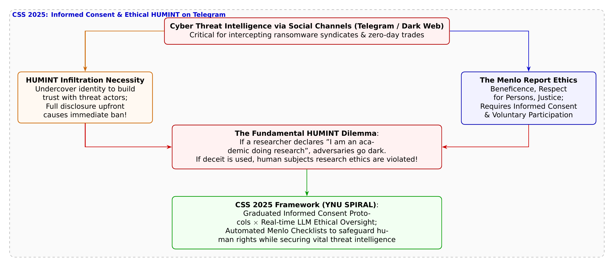

# 第34話 潜入の影と倫理の光 〜Telegram犯罪捜査とインフォームド・コンセントのジレンマ〜

> **【放課後サイバーディフェンス・ラボ（第2部：大学先端研究の扉 〜横浜国大SPIRAL論文探訪〜）】**
> - **舞台**: 帝都科学大学先端セキュリティ実習室 ＆ 横浜国立大学 SPIRAL サイバー犯罪インテリジェンス研究室
> - **登場人物**: 神崎 蓮（高校1年・IoT班）、白石 結衣（高校1年・暗号数理班）、城崎 悠真（大学1年・芹沢研TA）、芹沢 涼香 准教授（大学メンター）
> - **学習テーマ**: 横浜国立大学 SPIRAL・吉岡克成教授、イン・ミンパパ特任准教授、久保颯汰氏らの先端研究（CSS 2025）、暗号化メッセージングアプリ（Telegram）上での脅威アクターに対する人的情報収集（HUMINT）、サイバー脅威インテリジェンス（CTI）における研究倫理原則「メンロレポート（Menlo Report）」、インフォームド・コンセント（事前説明と同意）の必然性と実施困難性、身分偽装によるおとり捜査リスク、段階的合意形成モデル（Phased Informed Consent）、倫理監視LLMによるリアルタイム・コンプライアンス検証
> - **探訪・参照研究論文**:
>   - [横浜国立大学 サイバーセキュリティ実践教育研究センター（SPIRAL）](https://spiral.ynu.ac.jp/)
>   - 久保 颯汰, イン ミンパパ, 吉岡 克成, ほか. 『インフォームド・コンセントに基づくTelegram上の人的情報収集の実施可能性の検証』. コンピュータセキュリティシンポジウム 2025 (CSS 2025), 2025年10月.

---

## 🎨 4コマ漫画・ストーリーイラスト (Draw Things 生成)

---

## 💬 4コマ漫画キャラクターセリフ（日・英対訳）

挿絵の4コマ漫画（文字なし）の各コマに対応したキャラクターのセリフです。小説本文の導入としてもお楽しみいただけます。

| コマ | 展開 / シチュエーション | 🗣️ 日本語セリフ (Japanese) | 🌐 英語セリフ (English) |
|:---:|:---|:---|:---|
| **第1コマ 【起】** | **蓮の潜入捜査論：悪人を騙して捕まえるなら偽アカウント潜入も当然！ Telegramのチャット画面を掲げ、「犯罪者を捕まえるためなら偽アカウントで騙して情報を引き出せば手っ取り早いだろ！」と意気込む蓮。** | **蓮: 「悪人を捕まえるためなら、裏垢で騙して潜入して情報を引き出すのが手っ取り早いだろ！」** | **Ren: 'To catch bad guys, going undercover with burner accounts and extracting intel is the fastest way!'** |
| **第2コマ 【承】** | **結衣の倫理的指摘：メンロレポートとインフォームド・コンセントの原則 倫理指針の資料を広げ、「研究対象が人間である以上、事前の説明と同意（インフォームド・コンセント）が必須です」と冷徹に戒める結衣。** | **結衣: 「甘いです。研究対象が人間である以上、メンロレポートの原則に従い同意を得る義務があります。」** | **Yui: 'Naïve. As long as humans are research subjects, the Menlo Report mandates informed consent.'** |
| **第3コマ 【転】** | **悠真TAによるCSS 2025論文のHUMINTジレンマと倫理監視LLM解説 CSS 2025論文の図を指差しながら、正直に名乗れば逃げられ偽れば倫理違反になるジレンマと、段階的同意およびLLM監視のブレークスルーを解説する悠真。** | **悠真: 「名乗れば逃亡、偽れば倫理違反。SPIRALの研究チームは段階的告知とLLM監視で突破口を開いたんだ。」** | **Yuma: 'Confess and they flee, conceal and you violate ethics. SPIRAL cracked this via phased consent and LLM monitoring.'** |
| **第4コマ 【結】** | **正義の手段を選び抜く！真のサイバー守護者への誇りを誓う二人 透明な監査ログが流れる画面を見つめ、犯罪者と同じ闇に堕ちることなく、法の光の下で戦う誇りと覚悟を胸に刻む蓮と結衣。** | **蓮: 「目的が正義でも、汚い手段じゃ悪党と同じだ……倫理の光の下で戦ってこそ真のディフェンダーだな！」 結衣: 「ええ。高い倫理観を胸に刻んでこそ、私たちは胸を張って科学の刃を振るえます。」** | **Ren: 'Even for justice, foul means make us no better than villains. We must defend in the light of ethics!' Yui: 'Indeed. With unyielding ethical integrity, we wield the blade of science with unwavering pride.'** |

---

## 📖 小説本文

帝都科学大学、先端セキュリティ実習室。
薄暗い室内には、数台のモニターから放たれる青白い光だけが漂っていた。蓮は身を乗り出し、Telegramのインターフェースが映し出されたメインディスプレイを指差した。

「いいか、結衣。あいつらは暗闇の中で商売をしてるんだ。俺たちが正義を掲げて正面から突っ込んでいっても、奴らはすぐに逃げちまう。だからこそ、こちらから『獲物』に化けて潜り込む必要がある。偽のアカウントを作り、信頼を得て、内情を引き出す。それこそが、最速で犯罪組織を壊滅させるための最短ルートだろ？」

蓮の瞳には、獲物を狙う猟師のような鋭い光が宿っていた。彼の拳は机を軽く叩み、その熱量は室内の空気をわずかに震わせる。

しかし、隣に座る結衣は微動だにせず、冷徹な視線をモニターに向けたままだった。彼女は眼鏡のブリッジを押し上げ、淡々と、しかし断固とした口調で言葉を紡ぐ。

「蓮、それは『正義』という言葉で自分の倫理観を塗りつぶしているだけよ。私たちがやろうとしているのは、単なる警察の摘発活動じゃない。学術的な調査なの。研究対象が人間である以上、私たちは『メンロレポート（Menlo Report）』という国際的な倫理原則に従わなければならないわ」

「メンロ……？ そんなの、犯人を捕まえる邪魔になるだけだろ」

蓮が眉をひそめた瞬間、結衣は鋭く言葉を重ねた。

「邪魔どころか、研究の根幹を揺るがす問題よ。インフォームド・コンセント――つまり、被験者に対して調査の目的を事前に説明し、同意を得るというプロセスを無視することは、学術研究における重大な規約違反になる。私たちが『騙して』情報を引き出せば、それはもはや科学ではなく、ただの潜入工作に成り下がるわ。情報の正当性も、私たちの研究成果の信頼性も、すべてが崩壊するのよ」

✦ ✦ ✦

「……なるほど。まさにそれが『HUMINT（人的情報収集）のジレンマ』というわけだね」

背後から声をかけたのは、大学のTAを務める城崎悠真だった。彼は手元のタブレットを操作しながら、二人の間の緊張した空気を和らげるように歩み寄った。

「蓮君の言う通り、正直に『私は研究者です。調査のためにあなたの発言を記録します』と告げれば、犯罪者は即座にブロックをかけ、チャンネルから逃げ出す。逆に結衣さんが言うように、身分を偽って潜入すれば、それは倫理違反になる。この『正義のための欺瞞』という矛盾こそが、サイバー犯罪捜査における最大の壁なんだ」

悠真は画面をスワイプし、ある論文のタイトルを表示させた。

「でも、そのジレンマを突破しようとしている最先端の研究がある。横浜国立大学のSPIRAL、吉岡克成教授やイン・ミンパパ特任准教授たちがCSS 2025で発表した内容だ。『インフォームド・コンセントに基づくTelegram上の人的情報収集の実施可能性』という論文。彼らは、この絶望的なジレンマに対して非常に高度な科学的アプローチを提示している」

蓮と結衣は同時に画面に視線を移した。

「ポイントは『段階的合意形成』だ。最初からすべてを明かすのではなく、対話の深化に合わせて、どのタイミングで、どの程度まで目的を開示すべきかというプロセスを実証実験している。そして何より画期的なのが、『倫理監視LLM』の導入だ」

悠真の声が熱を帯びる。

「研究者が犯罪者と対話する際、AIがリアルタイムでそのやり取りを監視する。研究者が過度な誘導を行っていないか、あるいは倫理的な一線を越えようとしていないかを、LLM（大規模言語モデル）が判定する枠組みだ。人間による主観的な判断ではなく、あらかじめ定義された倫理規定に基づいてAIが『ブレーキ』をかける。これにより、実効性を保ちながら、いかにして学術的な正当性を確保するかという難題に挑んでいるんだ」

✦ ✦ ✦

「素晴らしい研究ね。しかし、技術や仕組みだけでは解決できない問題もあるわ」

静かな声が室内に響いた。振り返ると、そこには芹沢准教授が立っていた。彼女の表情は穏やかだが、その眼差しには深い思慮が宿っている。

「蓮君、君は『悪い奴らを捕まえるため』と言った。その志は正しい。でも、我々が守ろうとしているのは『法と人権に守られた正義の社会』なの。目的が正義であっても、手段が不当であれば、その瞬間から私たちは、追うべき対象と同じ地平に立ってしまうことになるわ」

芹沢はゆっくりと歩み寄り、モニターに映るTelegramの混沌とした文字の羅列を見つめた。

「サイバーセキュリティの究極の目的は、技術で悪を制圧することではない。法の支配と人権の尊重という土台の上で、誰もが安心して暮らせる社会を守ることにある。研究倫理とは、私たちが闇に堕ちないための『光』なのよ。手段としての正当性を担保し、科学的な厳密さを持ってアプローチすること。それこそが、大学の研究が持つ気高さであり、真のプロフェッショナリズムなの」

彼女の言葉は、蓮の胸に重く、しかし確かな熱を持って響いた。それは単なるルールへの従順ではなく、より高次な目的のための制約であった。

「……そうか。俺たちが『正義』を語るなら、それ相応の『正しさ』を背負わなきゃいけないってことか」

蓮は呟き、拳を握りしめた。その手はまだ震えていたが、先ほどまでの焦燥感とは違う、覚悟に近い感情に支配されていた。

結衣もまた、深く頷いた。

「そうよ。技術や話術の巧みさだけで勝とうとするのは簡単。でも、その裏にある倫理的な重みを引き受けることこそが、真のサイバーディフェンダーへの第一歩なのね」

実習室の青い光の中に、二人の表情が変わった。
それは単なる高校生としての好奇心ではなく、守るべき社会の在り方を背負う者としての、静かな決意へと変質していた。モニターの向こう側に広がる闇を前に、彼らは今、最も重要な「光」の正体を理解したのだ。

---

## 📊 TikZによるセキュリティ構造図解

---

## 💡 高校生のためのセキュリティ深掘りコラム

### 1. サイバー犯罪の温床「Telegram」とHUMINT（人的情報収集）の最前線

近年、ランサムウェア組織、初期アクセスブローカー（IAB）、マルウェア開発者などのサイバー犯罪者は、追跡が容易な従来の掲示板から、暗号化チャットアプリ「Telegram」や「Discord」のクローズドな地下コミュニティへと活動拠点を急速に移行させています。
こうした地下チャットルームでは、攻撃ツールの売買、標的企業の脆弱性情報、盗み出されたクレデンシャル（認証情報）がリアルタイムに取引されています。
外部からのクローリングや自動スクレイピング（OSINT）だけでは全体像の把握が難しいため、研究者や捜査官が自らアカウントを作成し、アクターと直接コミュニケーションをとって脅威インテリジェンス（CTI）を収集する**「HUMINT（Human Intelligence: 人的情報収集）」**が不可欠な手法となっています。

### 2. Menlo Report（メンロレポート）が突きつける「HUMINTの根本的ジレンマ」

しかし、大学や公的研究機関がHUMINTを行う場合、避けて通れないのが**「研究倫理原則」**です。
情報通信技術（ICT）研究における国際的な倫理ガイドラインである**「メンロレポート（Menlo Report）」**では、医療研究におけるベルモントレポートの精神を継承し、以下の4大原則を定めています。
- **人々の尊重（Respect for Persons）**: 被験者の自律性を尊重し、調査目的やリスクを開示して**「インフォームド・コンセント（事前説明と同意）」**を得ること。
- **善行（Beneficence）**: 社会的利益を最大化し、被験者や社会への危害（プライバシー侵害や身体的危険）を最小化すること。
- **正義（Justice）**: 研究の負担と利益が特定集団に不当に偏らないこと。
- **法と公共利益の尊重（Respect for Law and Public Interest）**: 法令を遵守し、透明性と説明責任を果たすこと。

ここで絶望的な**「HUMINTのジレンマ」**が発生します。
サイバー犯罪者に「こんにちは、私は大学の研究者です。学術調査のためにあなたの発言を記録・分析させてください」と正直に告知（インフォームド・コンセント）すれば、犯罪者は即座にチャットから研究者をブロック・追放し、別のチャンネルへと逃亡します。
一方で、身分を偽り「同業のハッカー」や「ツールの買い手」になりすまして情報を引き出せば、それは**被験者を欺く違法なおとり捜査や倫理違反**に直結し、学術論文として発表することもできなくなってしまうのです。

### 3. 横浜国大SPIRALのブレークスルー：段階的合意形成と「倫理監視LLM」（CSS 2025）

横浜国立大学 SPIRALの**吉岡克成 教授**、**イン・ミンパパ 特任准教授**、**久保颯汰 氏**らの研究チームは、国内最高峰の暗号・情報セキュリティシンポジウム **CSS 2025** において論文『*インフォームド・コンセントに基づくTelegram上の人的情報収集の実施可能性の検証*』を発表し、この極めて困難なジレンマに世界初の工学的・倫理的ブレークスルーを提示しました。
- **段階的インフォームド・コンセント（Phased Informed Consent）のモデル検証**:
  最初からすべてを開示して即座に遮断されるのを防ぎつつ、欺瞞を最小限に抑えるため、「対話の初期フェーズ」「信頼関係構築フェーズ」「核心的脅威情報の聴取フェーズ」のどの段階でどのように研究目的を開示すべきか、受容性と情報収集効率の境界線を厳密に実験検証しました。
- **HUMINT対話における「倫理監視LLM（Ethical Guardrail LLM）」**:
  対話を行う研究者が感情や功名心に流され、犯罪行為の教唆・幇助や、相手の人権を侵害する発言をしてしまわないよう、バックエンドのLLMが対話ログをリアルタイムに監視。メンロレポートのチェックリストに照らして「越えてはならない一線」を判定し、警告を発する先駆的セーフガード技術を導入しました。

目的が正義であっても、手段が不当であってはならない――。犯罪者と同じ闇に堕ちることなく、法の光と高い倫理観を堅持しながらサイバー社会の深淵に挑む、学術研究の崇高なプライドがここに確立されています。
