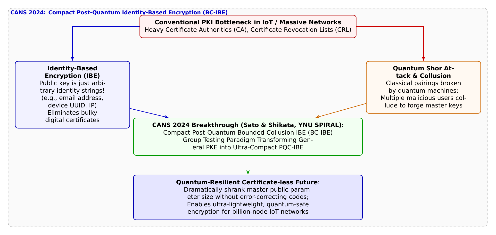

# 第35話 証明書なき星群と格子の絆 〜耐量子IDベース暗号と群テストの奇跡〜

> **【放課後サイバーディフェンス・ラボ（第2部：大学先端研究の扉 〜横浜国大SPIRAL論文探訪〜）】**
> - **舞台**: 帝都科学大学先端セキュリティ実習室 ＆ 横浜国立大学 SPIRAL 次世代暗号ラボ（NexCrypt Lab）
> - **登場人物**: 神崎 蓮（高校1年・IoT班）、白石 結衣（高校1年・暗号数理班）、城崎 悠真（大学1年・芹沢研TA）、芹沢 涼香 准教授（大学メンター）
> - **学習テーマ**: 横浜国立大学 SPIRAL・四方順司教授（NexCrypt Lab長）、佐藤慎悟氏らの国際会議論文（CANS 2024 / LNCS 14905）、数十億台のIoT・自動運転スマートシティにおける公開鍵暗号基盤（PKI）の限界、デジタル証明書発行・失効リスト（CRL/OCSP）の通信・管理ボトルネック、相手の識別子（メールアドレスや機器ID）そのものを公開鍵として使うIDベース暗号（IBE）、量子コンピュータの脅威とペアリング暗号の終焉、耐量子計算機暗号（PQC / 格子暗号）、悪意ある共謀に対抗する有界共謀耐性IBE（BC-IBE）、情報理論・組合せ数学の「群テスト（Group Testing）」による公開パラメータの極限小型化（Compact IBE）
> - **探訪・参照研究論文**:
>   - [横浜国立大学 サイバーセキュリティ実践教育研究センター（SPIRAL）](https://spiral.ynu.ac.jp/)
>   - Shingo Sato, Junji Shikata. "Compact Post-Quantum Bounded-Collusion Identity-based Encryption." *Cryptology and Network Security (CANS 2024)*, Lecture Notes in Computer Science (LNCS), Vol. 14905, pp. 119-139, Springer, 2024.

---

## 🎨 4コマ漫画・ストーリーイラスト (Draw Things 生成)

---

## 💬 4コマ漫画キャラクターセリフ（日・英対訳）

挿絵の4コマ漫画（文字なし）の各コマに対応したキャラクターのセリフです。小説本文の導入としてもお楽しみいただけます。

| コマ | 展開 / シチュエーション | 🗣️ 日本語セリフ (Japanese) | 🌐 英語セリフ (English) |
|:---:|:---|:---|:---|
| **第1コマ 【起】** | **蓮の証明書万能論：数十億のIoTに全部証明書を配れば解決だろ！ 街灯やセンサーの模型を指差し、「数億台のIoT機器すべてに電子証明書を配って管理すれば安心だろ！」と主張する蓮。** | **蓮: 「数十億台のIoT機器すべてに電子証明書（PKI）を発行して配れば、身元確認なんて完璧だろ！」** | **Ren: 'If we just issue digital certificates (PKI) to billions of IoT devices, identity verification is totally solved!'** |
| **第2コマ 【承】** | **結衣の証明書管理破綻と量子の壁の指摘 サーバーパンクのグラフを示し、「失効管理（CRL）でインフラが破綻し、量子コンピュータで既存暗号は破られます」と論破する結衣。** | **結衣: 「甘すぎます。失効リストの配信でサーバーはパンクし、量子マシンが来れば既存証明書は全滅です。」** | **Yui: 'Hopelessly naive. Certificate revocation will choke the servers, and quantum computers will crush legacy PKI.'** |
| **第3コマ 【転】** | **悠真TAによる四方教授らのCANS 2024論文「群テストによる超コンパクト耐量子IBE」解説 CANS 2024論文の格子数理スライドを投影し、相手のIDがそのまま鍵になるIBEを群テスト理論で超小型化した四方教授らの偉業を熱く語る悠真。** | **悠真: 「四方教授らは『群テスト』の数理を融合し、耐量子環境で公開鍵サイズを極限まで小型化したんだ！」** | **Yuma: 'Prof. Shikata merged Group Testing math to achieve ultra-compact public parameters under post-quantum IBE!'** |
| **第4コマ 【結】** | **証明書のない星群に咲き誇る数学の絆に感動する二人 証明書の問い合わせなしにIDだけで瞬時に暗号通信を確立するスマートシティの未来図を見つめ、数学の美しさに目を輝かせる蓮と結衣。** | **蓮: 「証明書サーバーがなくても、相手のIDだけで瞬時に安全に通信できるなんて……未来すぎる！」 結衣: 「幾何学と組合せ論の奇跡……これこそが未来のスマート社会を支える不可視の礎ですね。」** | **Ren: 'Instant, secure communication using just IDs, completely free of certificate servers... mind blown!' Yui: 'A miracle of geometry and combinatorics... the invisible foundation empowering future smart societies.'** |

---

## 📖 小説本文

帝都科学大学、先端セキュリティ実習室の空気は、高機能なサーバーラックから発せられる微かな熱気と、電子機器の駆動音が混ざり合って独特の密度を保っていた。
窓の外には夕刻の街並みが広がり、無数の灯りが点滅している。その光の一つひとつが、ネットワークに接続されたデバイスであること。神崎蓮はモニターを見つめながら、拳を握りしめた。

「いいかい、結衣。このスマートシティのビジョンを実現するなら、正解はシンプルだ。すべての街灯、センサー、自動運転車に『デジタル証明書』を発行して配ればいい。PKI（公開鍵基盤）を徹底すれば、信頼の連鎖は完璧に構築できる」

蓮の言葉には、技術に対する純粋なまでの楽観主義が宿っていた。彼はこのプロジェクトのIoT班として、数億台のデバイスが安全に通信するインフラの構築を夢見ていた。

しかし、その隣で腕を組んでいた白石結衣は、氷のように冷ややかな視線を投げた。
「……蓮、あなたの計算には『現実』という名の摩擦係数が抜けているわ」

結衣は手元のタブレットを操作し、複雑なグラフを表示させた。
「数十億のデバイスに証明書を発行するだけならいいわ。問題はその後の管理よ。失効した証明書や更新のタイミングをチェックするためのCRL（証明書失効リスト）の配布、あるいはOCSPによる問い合わせ。それらすべてを処理するサーバーが、数億台のデバイスからのリクエストに耐えられると思っているの？ インフラコストと通信遅延でシステムは瞬時にパンクするわ」

「でも、証明書がないと身元確認ができないじゃないか」

「だからこそ『IDベース暗号（IBE）』が必要なのよ。でもね……」
結衣の声に、わずかな陰りが生じた。
「今の主流であるペアリングを用いたIBEは、量子コンピュータの登場によって一瞬で無力化される。耐量子計算機暗号（PQC）への移行は避けられないけれど、格子暗号ベースのIBEをそのまま実装しようとすると、公開鍵のサイズが巨大化しすぎて実用性を失う。今のところ、それは『理論上の夢』でしかないのよ」

✦ ✦ ✦

「その『夢』を現実へと引きずり下ろしたのが、この論文です」

静かな声が響いた。大学のTAである城崎悠真が、プロジェクターに映し出された最新の国際会議論文『Compact Post-Quantum Bounded-Collusion Identity-based Encryption』を指し示した。
横浜国立大学SPIRALの四方順司教授と佐藤慎悟氏らによる研究成果だ。

「蓮君、結衣さん。このCANS 2024で発表された論文は、IBEにおける最大のボトルネックを突破したんです」
悠真はホワイトボードに数式を書き込みながら、熱を帯びた口調で解説を始めた。

「従来の耐量子IBEは、エラー訂正符号の複雑な構造に依存していたため、公開パラメータが非常に大きくなっていました。しかし、四方教授たちはここで『群テスト（Group Testing）』という情報数学の理論を融合させたんです」

悠真の説明に従い、蓮と結衣は数式の変遷を追った。
「群テストとは、本来、不純物が混ざったサンプルの中から特定の個体を特定するための効率的な手法です。これを暗号の公開パラメータ構成に応用することで、悪意ある複数のユーザーによる共謀（Collusion）に耐えつつ、必要な情報を最小限のデータ量で表現することに成功したんです」

「群テスト……？」
蓮が呟く。

「そうです。この数理的なブレークスルーによって、公開パラメータを劇的に小型化――つまり『コンパクト』にすることが可能になりました。これにより、格子暗号の安全性を保ちながら、IoTデバイスでも扱えるサイズでIDベース暗号を実現した。これが、論文にある『Compact BC-IBE』の意味です」

結衣の瞳に、驚愕と歓喜の色が混ざり合った。
「……群テストを融合させて、共謀耐性とコンパクトさを両立させたってこと？ それは、従来の証明書管理のオーバーヘッドを完全にバイパスできるってことじゃない……」

✦ ✦ ✦

実習室の扉が開き、凛とした足音が響いた。
入ってきたのは、横浜国立大学SPIRALから視察に来ていた芹沢涼香准教授だった。彼女は学生たちの熱気を感じ取ったように、穏やかな笑みを浮かべた。

「素晴らしい議論ね。特に結衣さん、あなたの指摘した『インフラの限界』こそが、現代のセキュリティが直面している最大の壁だわ」

芹沢はモニターに映る論文の図解を指先でなぞった。
「従来のPKIは、中央集権的な信頼の鎖を必要とした。しかし、この『Compact BC-IBE』がもたらすのは、証明書そのものを必要としない世界……『証明書レス社会』の到来よ」

彼女は一歩前へ出た。その瞳には、数式を超えた先にある未来が見えているようだった。
「想像してみて。スマートシティを駆け巡る無数の自動運転車や、空を舞うドローンたちが、通信のたびに中央サーバーへ『私は私です』という証明書を問い合わせる必要がない世界を。彼らは自分のID――例えば車両識別番号や機体固有のMACアドレスさえあれば、その瞬間に相手と安全な暗号鍵を共有できる。数学の幾何学的な美しさが、物理的な通信のボトルネックを鮮やかに解決するの」

芹沢の声には、一種の詩的な響きがあった。
「技術は、時に冷徹な道具だと思われがちだけど、高度な数理の極致は時として芸術に近い。この論文に刻まれた『群テスト』の知恵は、未来の巨大な社会を支えるための、見えない柱になる。数学という純粋な美しさが、現実の社会を動かす力へと昇華される瞬間……これこそがアカデミズムの醍醐味よ」

✦ ✦ ✦

実習室の照明の下、蓮と結衣はしばらく言葉を失っていた。
プロジェクターに映る複雑な格子構造の数式。それは単なる記号の羅列ではなく、膨大なデータの海から秩序を見出し、安全な道筋を切り拓くための地図だった。

「……すごいな」
蓮が初めて、技術的なことよりも先に、その概念の純粋さに感動したことを口にした。
「証明書なんていらない。IDがあるだけで、世界と繋がれる。俺たちが作ろうとしていた未来が、こんなにも美しい数学で支えられていたなんて……」

結衣もまた、手元のタブレットを閉じ、深く息を吐いた。彼女の表情には、厳しい論理の裏側にあった情熱が溢れ出していた。
「そうね。効率やコストの議論の先に、これほど鮮やかな解決策があるなんて。群テストという知恵が、量子コンピュータという脅威すら跳ね返す盾になる……」

二人は顔を見合わせた。
窓の外では、夜の帳が降り、街の灯りがより一層輝きを増している。その光の粒の一つひとつが、今この瞬間、数学の絆によって守られる未来へと繋がっている。
蓮と結衣の顔には、技術への畏怖を超えた、新しい時代の幕開けを祝福するような笑顔が浮かんでいた。

---

## 📊 TikZによるセキュリティ構造図解

---

## 💡 高校生のためのセキュリティ深掘りコラム

### 1. 「証明書の海」で溺れるIoT社会と公開鍵暗号基盤（PKI）の限界

スマートシティ、自動運転車、ドローン、スマートグリッドなど、無数のIoT機器が瞬時に連携し合う現代社会において、長年サイバー空間を支えてきた**「公開鍵基盤（PKI: Public Key Infrastructure）」**が悲鳴を上げています。
PKIでは、各機器が本物であることを証明するために、認証局（CA）が発行した「電子証明書」を保持し、通信相手に提示します。
しかし、デバイスが数十億台規模に爆発すると、以下の深刻な問題に直面します。
- **証明書失効リスト（CRL / OCSP）のパンク**: 万が一デバイスが故障やハッキングを受け、証明書を失効（Revocation）させた場合、世界中の通信端末がその最新失効情報を頻繁に問い合わせるため、ネットワーク帯域とCAサーバーが瞬時に飽和します。
- **証明書検証の遅延**: コンマ数秒の遅れが人命に関わる自動運転（V2X通信）において、重厚な証明書チェーンを検証する処理時間は致命的なボトルネックとなります。

### 2. 夢の「IDベース暗号（IBE）」と耐量子（PQC）の厚い壁

そこで1984年にシャミア（Shamir）によって提唱された究極の暗号技術が**「IDベース暗号（IBE: Identity-Based Encryption）」**です。
IBEでは、相手の**「メールアドレス」「IPアドレス」「MACアドレス」「ドメイン名」といった任意の識別子（ID）そのものが公開鍵**になります。送信者は相手の証明書を取り寄せて検証する必要が一切なく、IDを指定するだけで暗号文を送信できます。
しかし、従来のIBE（Boneh-Franklin等）は「楕円曲線上のペアリング暗号」に強く依存しており、**量子コンピュータが実用化されるとショアのアルゴリズムによって完全に解読されてしまう**という致命的な弱点を抱えていました。
量子耐性を持つ「格子暗号（Lattice-based Cryptography）」を用いてIBEを構築する研究も進められてきましたが、悪意あるユーザー複数人が秘密鍵を持ち寄ってマスター鍵を不正に復元しようとする「共謀攻撃（Collusion Attack）」を防ぐため、**公開パラメータのサイズが数ギガバイトにも巨大化してしまう**という致命的な壁に阻まれていました。

### 3. 横浜国大・四方順司教授が証明した「群テスト×耐量子BC-IBE」（CANS 2024）

横浜国立大学 SPIRALの次世代暗号ラボ（NexCrypt Lab）長を務める**四方順司 教授**と**佐藤慎悟 氏**は、暗号・ネットワークセキュリティの国際シンポジウム **CANS 2024**（Lecture Notes in Computer Science 14905）において、論文『*Compact Post-Quantum Bounded-Collusion Identity-based Encryption*』を発表しました。
本研究は、共謀可能な攻撃者の上限数を設定した「有界共謀耐性IBE（BC-IBE）」において、公開鍵サイズを劇的に小型化する世界初の汎用理論を打ち立てました。
- **情報数学「群テスト（Group Testing）」の融合**:
  従来のエラー訂正符号を用いるアプローチでは、パラメータサイズが共謀者数に対して指数関数的に肥大化していました。四方教授らは、多数の検体から少数の感染者を効率的に特定する組合せ数学理論である「非適応的群テスト（Non-Adaptive Group Testing）」の概念を暗号パラメータの設計に導入しました。
- **NIST標準の汎用PQC暗号から直接構成**:
  格子暗号をはじめとするNIST選定の耐量子公開鍵暗号（PKE）をブラックボックスとして利用し、量子耐性を完全に維持しながら、公開パラメータサイズを従来比で劇的に圧縮（Compact化）することに成功しました。

認証局（CA）への問い合わせを一切不要にし、相手のIDだけで瞬時に安全な暗号通信を可能にするこの数理のブレークスルーは、未来の超巨大スマート社会や宇宙通信インフラを根底から支える最強の防盾となります。
