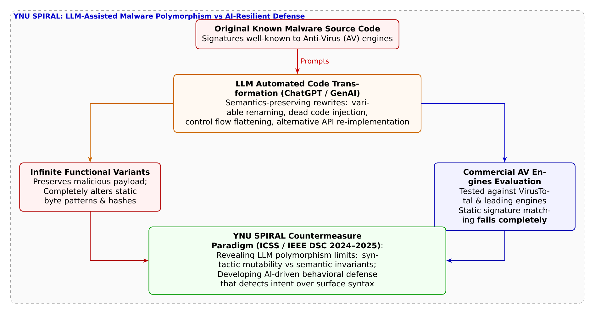

# 第36話 千の貌を持つ影と振る舞いの砦 〜生成AIマルウェア変種と動的防御の夜明け〜

> **【放課後サイバーディフェンス・ラボ（第2部：大学先端研究の扉 〜横浜国大SPIRAL論文探訪〜）】**
> - **舞台**: 帝都科学大学先端セキュリティ実習室 ＆ 横浜国立大学 SPIRAL マルウェア解析・AIセキュリティ研究室
> - **登場人物**: 神崎 蓮（高校1年・IoT班）、白石 結衣（高校1年・暗号数理班）、城崎 悠真（大学1年・芹沢研TA）、芹沢 涼香 准教授（大学メンター）
> - **学習テーマ**: 横浜国立大学 SPIRAL・吉岡克成教授、イン・ミンパパ特任准教授、松本勉名誉教授らの先端研究（ICSS / IEEE DSC）、生成AI（ChatGPT / 大規模言語モデル LLM）を悪用したマルウェアの自動変種生成・ポリモーフィズム（多態性）、アンチウイルスソフト（AV）の静的シグネチャ検知（ハッシュ値・パターンマッチング）の完全な無力化、コード難読化・無意味命令挿入・制御フロー平坦化による変装、VirusTotal等による実態検証、静的防御から動的挙動検知（振る舞い検知・EDR / XDR）へのパラダイムシフト、AIと人間の共創による新時代のディフェンス
> - **探訪・参照研究論文**:
>   - [横浜国立大学 サイバーセキュリティ実践教育研究センター（SPIRAL）](https://spiral.ynu.ac.jp/)
>   - 黄 哲維, イン ミンパパ, 吉岡 克成, 松本 勉. 『大規模言語モデルを用いたマルウェアの変種生成とその回避性能の評価』. 電子情報通信学会 情報セキュリティ研究会 (ICSS), 2024.
>   - Zhewei Huang, Yin Minn Pa Pa, Katsunari Yoshioka, Tsutomu Matsumoto. "Evaluating the Evasion Capabilities of LLM-Assisted Polymorphic Malware against Antivirus Solutions." *IEEE Conference on Dependable and Secure Computing (IEEE DSC)*, 2024.

---

## 🎨 4コマ漫画・ストーリーイラスト (Draw Things 生成)

---

## 💬 4コマ漫画キャラクターセリフ（日・英対訳）

挿絵の4コマ漫画（文字なし）の各コマに対応したキャラクターのセリフです。小説本文の導入としてもお楽しみいただけます。

| コマ | 展開 / シチュエーション | 🗣️ 日本語セリフ (Japanese) | 🌐 英語セリフ (English) |
|:---:|:---|:---|:---|
| **第1コマ 【起】** | **蓮のアンチウイルス過信：定義ファイルが最新なら100%安全だろ！ ノートPCのセキュリティソフト画面を誇らしげに見せ、「指名手配犯の顔写真（シグネチャ）が最新なら絶対安全だろ！」と豪語する蓮。** | **蓮: 「最新の定義ファイルに更新しておけば、ウイルスなんて侵入した瞬間に100%検知できるだろ！」** | **Ren: 'With virus definitions fully updated, any malware will get 100% blocked on entry!'** |
| **第2コマ 【承】** | **結衣のAIコード変形とアンチウイルス素通りの指摘 難読化されたコードを提示し、「生成AIを使えば意味を保ったまま見た目だけ無限に変装できます」と警告する結衣。** | **結衣: 「甘すぎます。生成AI（LLM）を使えば、同じ挙動のまま無限の変装コードを自動生成できるのよ。」** | **Yui: 'Naive. Using generative LLMs, attackers can synthesize infinite functionally identical disguises.'** |
| **第3コマ 【転】** | **悠真TAによるSPIRAL論文「LLM変種マルウェアと振る舞い防御」解説 IEEE DSC / ICSS研究スライドを投影し、主要AVが変種を素通りさせた実験データと、動的振る舞い検知の重要性を説く悠真。** | **悠真: 「SPIRALの研究では市販AVの多くが素通りした。だからこそ『静的ハッシュ』から『動的挙動』への転換が必要なんだ。」** | **Yuma: 'SPIRAL proved commercial AVs were completely blinded. Defense must shift from static hashes to dynamic behaviors.'** |
| **第4コマ 【結】** | **千の貌に惑わされず悪意の核を見抜く！決意を固める二人 エンドポイントの挙動ツリーを見つめ、見た目の変装に惑わされず、悪意の振る舞いそのものを捉えるサイバーの真髄に目覚める蓮と結衣。** | **蓮: 「コードの皮をいくら被っても、悪事を働く瞬間を見逃さない！それが僕たちの新しい砦だな！」 結衣: 「ええ。AIが千の変装を生み出そうとも、私たちはその深層にある意図を捉えてみせます。」** | **Ren: 'No matter how it disguises its code, we catch the exact moment it acts malice! That is our fortress!' Yui: 'Indeed. Even if AI generates a thousand faces, we will pierce through to its underlying malicious intent.'** |

---

## 📖 小説本文

帝都科学大学、先端セキュリティ実習室。
窓の外は薄暗い夕刻を迎えつつあったが、室内には数台のモニターから放たれる青白い光と、唸りを上げるサーバーの排気音が充満している。

「……だから、結論としては『安心』ってことじゃないか」

神崎蓮は、自分のノートPCの画面を指差しながら、自信たっぷりに胸を張った。画面の隅には、大手セキュリティソフトのアイコンが誇らしげに緑色に点灯している。

「最新の定義ファイルをダウンロードして、自動更新をオンにしておけばいい。ウイルス対策ソフトっていうのは、いわば『指名手配犯の顔写真』を集めてるデータベースなんだ。新しい犯人の顔が登録されていれば、あいつらが侵入しようとした瞬間に捕まえられる。これ以上、僕たちが気をつけることはないだろ？」

蓮の言葉は、純粋なまでの信頼に基づいたものだった。彼はIoT班として、デバイスの接続やネットワークの構築を担っているが、セキュリティに関しては「守りの壁」としてのソフトウェアを盲信している節があった。

その隣で、白石結衣は低く、しかし鋭い声で反論した。彼女は数式と暗号理論を極める暗号数理班の精鋭だ。

「……蓮、その『顔写真』の概念が、今まさに崩壊しようとしていることに気づいてる？」

結衣は手元のタブレットを操作し、一つのコードブロックを表示させた。それは、ある既知のマルウェアのソースコードだった。しかし、そこには異常な変化があった。

「見て。このプログラム、中身は同じ『悪意ある挙動』をするものだけど、見た目は完全に別物よ。変数の名前はランダムな文字列に置き換わり、本来の処理とは無関係な『ゴミコード』が至る所に挿入されている。さらに、制御構文を複雑に組み替えて、論理的な流れを意図的に難解にしているわ」

蓮は眉をひそめた。
「……これじゃあ、何を見ればいいのかわからないじゃないか」

「そうよ。そして、これが『生成AI』の恐ろしさなの」
結衣の声には、警告に近い響きが含まれていた。「LLM（大規模言語モデル）を使えば、同じ機能を維持したまま、見た目だけを数千、数万通りに自動で書き換えることができる。つまり、ウイルス対策ソフトが持っている『顔写真』の数よりも、AIが生み出せる『変装』の数の方が圧倒的に多いってこと。これじゃあ、従来のシグネチャ検知なんて、穴の空いたザルと同じよ」

✦ ✦ ✦

「その『ザル』の正体を、実際のデータで証明した研究があるんです」

背後から声をかけたのは、大学のTA（ティーチング・アシスタント）を務める城崎悠真だった。彼は数歩歩み寄り、メインプロジェクターに資料を映し出した。

「横浜国立大学のSPIRAL、吉岡克成教授やイン・ミンパパ特任准教授らのグループが発表した最新の研究です。ICSSやIEEE DSCといった権威ある国際会議でも注目されている内容ですが……これを見てください」

画面には、衝撃的なグラフが表示された。
研究チームは、既知の著名なマルウェアをプロンプトエンジニアリングを用いてLLMに流し込み、自動で変種を生成させた。そして、それらをVirusTotalなどの市販アンチウイルスエンジン数十社に一斉にスキャンさせたのだ。

「結果は衝撃的でした」
悠真はレーザーポインターでグラフの急落地点を指した。
「LLMによって『見た目』を変形されたマルウェアに対し、従来の静的パターン照合――つまり、蓮君が言った『顔写真』による検知率は劇的に低下しました。AIが生成した変種は、既存のデータベースを軽々とすり抜けてしまう。これは単なる理論上の話ではなく、今この瞬間に起きている現実なんです」

蓮は言葉を失い、画面を見つめた。
「……じゃあ、今まで信じてきた『定義ファイル』だけでは、もう防げないっていうことか？」

「正確には、そうですね」
悠真は冷静に補足した。「表面的なコードの文字列を比較するだけの防御は、AIによる自動変種生成の前では無力化されつつあります。攻撃者はAIを使って『隠れ方』を自動化し、防御側はそれに追いつけなくなっているんです」

✦ ✦ ✦

「だからこそ、私たちは『視点』を変えなければならないのよ」

実習室の入り口から、凛とした声が響いた。
入ってきたのは、大学の准教授である芹沢涼香だった。彼女は研究者としての知性と、現場を統括する指導者の風格を併せ持っていた。

「蓮君、結衣さん。AIが生み出す『千の貌（かお）を持つマルウェア』に対抗するには、防御側の進化も不可欠です。私たちは、表面的なシンタックス――つまり、コードの書き方や変数名といった『外見』に惑わされてはいけません」

芹沢はプロジェクターの前に立ち、複雑なシステムコールの遷移図を映し出した。

「マルウェアがどれほど巧妙に変装しようとも、OSに対して行う『悪意あるシステムコールの連鎖』――つまり、プログラムの本質的な挙動（ビヘイビア）までは隠せない。ファイルを開く、メモリを書き換える、外部と通信する……それら一連の動作は、プログラムの『意図』そのものなんです」

彼女は指先で図をなぞった。
「私たちは、表面的な文字列ではなく、プロセスの振る舞いと意味不変性を捉える『振る舞い検知』へとシフトしなければならない。そして、その『振る舞い』を自律的に分析し、悪意のパターンを見破るためにも、我々もまたAIを駆使するのです」

「AIとAIがせめぎ合う……」
結衣が呟いた。

「その通りです」芹沢は頷いた。「攻撃者がAIを使って防御をすり抜けるなら、防御側もAIを駆使して悪意のパターンをリアルタイムで抽出する。技術の進化によって防衛の地平を押し広げる。これこそが、次世代のサイバーセキュリティの最前線です」

✦ ✦ ✦

実習室の静寂の中に、サーバーのファンが回る音だけが響いた。
蓮は自分のノートPCを見つめ直した。先ほどまでの「安心感」は、今や「責任感」へと変質していた。

「……今まで、僕は『守られている』と思い込んでた。でも、本当の防波堤になるためには、技術の裏側にある『本質』を理解しなきゃいけないんだな」

蓮の声には、以前とは違う重みがあった。
結衣は隣に座り、彼と視線を合わせた。彼女の瞳にも、同じ決意の火が灯っている。

「そうよ。AIに怯えるだけじゃ何も解決しない。AIがどうやってコードを書き換え、どうやって防御をすり抜けるのか。その仕組みと、プログラムの『真意』を誰よりも深く理解すること。それが、僕たちがこの技術を学ぶ理由じゃないかな」

結衣はキーボードを叩き、新しい解析プロジェクトのフォルダを作成した。
「まずは、LLMが生成する変種コードの共通項を抽出する解析から始めましょう。基礎を固めるのよ」

蓮は力強く頷き、自分のPCの電源を入れた。
モニターの光が二人の顔を照らす。それは、技術の進化という荒波の中で、知性の盾を掲げて立ち上がるための夜明けの光のようだった。

彼らはもう、ただの学生ではない。
AIと影が交錯するデジタルな戦場において、情報の平穏を守るための「防波堤」としての第一歩を踏み出そうとしていた。

---

## 📊 TikZによるセキュリティ構造図解

---

## 💡 高校生のためのセキュリティ深掘りコラム

### 1. 「指名手配写真」を買い集めるアンチウイルスの限界

パーソナルコンピュータや企業の端末を守るアンチウイルスソフト（AV）は、長年にわたり**「シグネチャ検知（パターンマッチング）」**を防御の第一防衛線としてきました。
これは、既知のマルウェアファイルからSHA-256などのハッシュ値を計算したり、特徴的なコードパターン（バイト列）を抽出して「指名手配リスト（定義ファイル）」に登録しておき、ファイルがダウンロード・実行される瞬間に照合する仕組みです。
この方式は動作が極めて高速で誤検知が少ないという絶大なメリットがありますが、**「1バイトでも中身が変わるとハッシュ値が全くの別物になり、検知できなくなる」**という致命的な弱点を抱えています。

### 2. 生成AI（LLM）がもたらした「悪意の自動変装革命」

かつて、アンチウイルスの検知を回避する「ポリモーフィック（多態性）マルウェア」を作成するには、高度なアセンブラ技術を持つトップクラスのウイルス作者が手作業で難読化ルーチンを組む必要がありました。
しかし、ChatGPTをはじめとする**大規模言語モデル（LLM）の台頭**によって、このパワーバランスは根底から覆されました。
攻撃者はLLMのプログラミング支援能力を悪用し、以下のようなコード変換を瞬時に全自動で実行できるようになったのです。
- **等価構文変換**: `for`ループを`while`ループに書き換える、条件分岐の順序を反転させるなど、プログラムの論理的振る舞いを保ったまま構文構造を一新する。
- **無意味命令（Junk Code / NOP）の大量挿入**: 実行結果に影響を与えない無意味な算術演算やダミーの関数呼び出しを無数に散りばめ、コードのバイト列を完全に破壊する。
- **変数名・関数名のランダム化と文字列暗号化**: 解析の手がかりとなるAPI名や文字列を難読化・動的復号化する。

これにより、**「機能はまったく同一の悪意あるマルウェアでありながら、外見（ハッシュ値やバイトパターン）が無限に異なる新種」**が、1秒間に何千個も全自動で量産される悪夢が現実となったのです。

### 3. 横浜国大SPIRALの衝撃的検証と「動的振る舞い検知」へのパラダイムシフト

横浜国立大学 SPIRALの**吉岡克成 教授**、**イン・ミンパパ 特任准教授**、**松本勉 名誉教授**、**黄哲維 氏**らの研究グループは、情報セキュリティ研究会（ICSS）および信頼性・セキュリティの国際会議 **IEEE DSC** において論文『*大規模言語モデルを用いたマルウェアの変種生成とその回避性能の評価*』を発表しました。
- **市販アンチウイルスソフトに対する実態解明**:
  研究チームは、既存の著名なマルウェアをLLMによって自動で構文変換・難読化し、VirusTotalに登録されている世界中の主要アンチウイルスエンジン群に対して検知実験を実施しました。
  その結果、オリジナルのマルウェアであればほぼ100%検知されていたにもかかわらず、**LLMによって変種生成されたマルウェアは、大半の商用アンチウイルスエンジンの静的シグネチャ検知をやすやすと回避（Bypass）できる**という衝撃的な実態が実験的に立証されました。
- **「静的防御」から「動的挙動検知（Behavioral Defense）」への脱却**:
  この研究が突きつけた教訓は極めて明確です。**「ファイルの見た目やハッシュ値で止める防御は完全に終わった」**ということです。
  どんなにコードが巧妙に変装していようとも、マルウェアが目的を果たすためには、最終的に「不正なレジストリ書き換え」「権限昇格」「不審な外部IPへの通信」「プロセスメモリの改ざん」といった**実際の悪意あるアクション（振る舞い）**を起こさざるを得ません。
  研究チームは、エンドポイントの振る舞いを監視する**EDR（Endpoint Detection and Response）**や、システムコール・プロセストリーを追跡する動的サンドボックス解析こそが、生成AI時代のサイバー空間を守る絶対的な防壁になると結論づけています。

AIが変幻自在の影を生み出すならば、人間はその影の足跡を捉える知恵を磨く。攻撃と防御のフロンティアを切り拓く横浜国大SPIRALの知見は、次代を担う高校生たちに真のサイバーディフェンスの覚悟を教えています。
