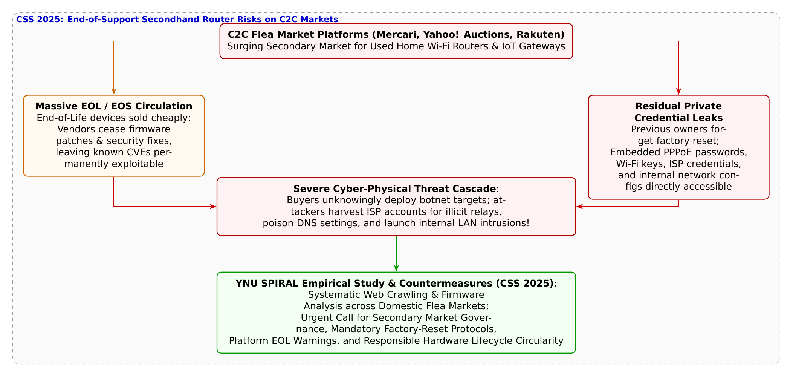

# 第37話 巡る古城と消えぬ記憶 〜中古ルーター流通とサポート終了の落とし穴〜

> **【放課後サイバーディフェンス・ラボ（第2部：大学先端研究の扉 〜横浜国大SPIRAL論文探訪〜）】**
> - **舞台**: 帝都科学大学先端セキュリティ実習室 ＆ 横浜国立大学 SPIRAL IoTセキュリティ実態調査ラボ
> - **登場人物**: 神崎 蓮（高校1年・IoT班）、白石 結衣（高校1年・暗号数理班）、城崎 悠真（大学1年・芹沢研TA）、芹沢 涼香 准教授（大学メンター）
> - **学習テーマ**: 横浜国立大学 SPIRAL・佐々木貴之准教授、吉岡克成教授、新堀寛大氏らの先端研究（CSS 2025 学生論文賞）、国内主要フリマサイト（メルカリ・ヤフオク・ラクマ等）における中古家庭用Wi-Fiルーターの流通実態、メーカーのセキュリティサポート終了（EOL: End-of-Life）機器の大量出品と既知脆弱性放置、出品者による初期化（ファクトリーリセット）の不徹底とISP認証情報（PPPoE ID/PW）・Wi-Fi暗号鍵の残存、ボットネット踏み台リスク、サーキュラーエコノミー（循環社会）とセキュリティガバナンス
> - **探訪・参照研究論文**:
>   - [横浜国立大学 サイバーセキュリティ実践教育研究センター（SPIRAL）](https://spiral.ynu.ac.jp/)
>   - 新堀 寛大, 九鬼 琉, 藤井 翔太, 佐々木 貴之, 小林 信博, 吉岡 克成. 『国内フリマサイトにおけるサポートが終了した中古ルーターの流通状況の調査』. コンピュータセキュリティシンポジウム 2025 (CSS 2025), CSS2025学生論文賞, 2025年10月.

---

## 🎨 4コマ漫画・ストーリーイラスト (Draw Things 生成)

---

## 💬 4コマ漫画キャラクターセリフ（日・英対訳）

挿絵の4コマ漫画（文字なし）の各コマに対応したキャラクターのセリフです。小説本文の導入としてもお楽しみいただけます。

| コマ | 展開 / シチュエーション | 🗣️ 日本語セリフ (Japanese) | 🌐 英語セリフ (English) |
|:---:|:---|:---|:---|
| **第1コマ 【起】** | **蓮のフリマ爆買い自慢：新品の10分の1！中古ルーター最高じゃん！ 届いたばかりの中古ルーターを掲げ、「フリマなら数百円でルーターが手に入る！安くて動くんだからコスパ最強だろ！」と笑顔の蓮。** | **蓮: 「フリマなら定価の10分の1以下！安くて普通に動くんだから、中古ルーターこそ最強の選択だろ！」** | **Ren: 'Flea markets sell routers at a tenth of retail price! Cheap and working—secondhand is hands down the best choice!'** |
| **第2コマ 【承】** | **結衣の型番調査と戦慄：5年前にサポート終了、しかも前の持ち主のISP情報が残存！ ノートPCの脆弱性データベースを指差し、「型番を調べたら5年前にEOL、しかも前の契約情報が丸見えよ！」と警告する結衣。** | **結衣: 「甘すぎます！5年前にサポート完全終了（EOL）でパッチなし、前の持ち主のプロバイダ認証情報まで残存してます！」** | **Yui: 'Hopelessly naive! Support ended 5 years ago with zero patches, and previous owner ISP credentials are still wide open!'** |
| **第3コマ 【転】** | **悠真TAによるCSS 2025受賞論文「国内フリマの中古ルーター実態」解説 CSS 2025学生論文賞のデータを投影し、数千台の流通実態調査で浮き彫りになった高いEOL率とリセット不徹底の脅威を解説する悠真。** | **悠真: 「佐々木准教授・吉岡教授らの研究では、フリマ流通品の多くがEOLで、ファクトリーリセット不徹底が多発していたんだ。」** | **Yuma: 'Prof. Sasaki & Yoshioka found most flea-market routers were EOL and frequently lacked proper factory resets.'** |
| **第4コマ 【結】** | **物を大切にする心とサイバー安全の調和を誓う二人 初期化ボタンを慎重に確認し、単なる安さではなく製品ライフサイクル全体の安全を見極める責任を胸に刻む蓮と結衣。** | **蓮: 「安さの裏に放置された穴があったんだな……リサイクルするならセキュリティの寿命も確認しなきゃ！」 結衣: 「ええ。物理的な機器が動いても、安全の息が止まっていては使えません。責任ある循環社会を創りましょう。」** | **Ren: 'Unpatched holes lurked behind that cheap price... recycling hardware means verifying security lifespans too!' Yui: 'Indeed. Hardware may function, but without security life support, it is dead on arrival. Let us champion responsible lifecycles.'** |

---

## 📖 小説本文

帝都科学大学、先端セキュリティ実習室の大型作業机の上には、大小さまざまなダンボール箱が山のように積まれていた。
箱の隙間からは、緩衝材のプチプチと、どこか古びたプラスチックの独特な匂いが漂っている。

神崎蓮は、その中から誇らしげに一台の黒い筐体を取り出し、頭上に掲げて満面の笑みを浮かべた。
「見たか、結衣！ これ、メルカリでなんと一台五百円！ ヤフオクとラクマも合わせて、ギガビット対応のWi-Fiルーターを十台まとめて落札したんだ。新品で揃えたら十万円コースだぜ？ これで僕たちのIoT実験環境用ネットワークも、部室のスマートホームハブも格安で構築し放題だ。安くて普通に動くんだから、中古ルーターこそ最強のコスパだろ！」

蓮の瞳は、掘り出し物を手に入れた少年のように輝いていた。彼はさっそくACアダプターをコンセントに差し込み、背面のLANポートにケーブルを繋ごうとする。

だがその瞬間、隣でノートPCのキーボードを軽快に叩いていた白石結衣が、冷徹な声でその手を制した。
「……蓮。その手を今すぐ止めなさい」

結衣は銀縁眼鏡のブリッジを指先で押し上げ、凍りつくような視線を蓮が掲げるルーターの底面ラベルに向けた。
「『安くて普通に動く』？ あなたのその浅はかなコスト感覚には、セキュリティという概念が完全に欠落しているわ。型番を見せなさい」

「え？ 底面のシール？ えっと……『WHR-1166DHP』……かな？」

結衣は手元の端末に型番を素早く打ち込み、メーカーの公式製品サポート一覧とJVN（Japan Vulnerability Notes）の脆弱性データベースを照合した。
画面に真っ赤な警告バナーが表示された瞬間、結衣の瞳に険しい光が走る。

「……やっぱりね。蓮、その製品、メーカーのセキュリティサポートが【五年前に完全終了（EOL: End-of-Life）】しているわ」

「えっ……サポート終了？ でも、電源も入るしWi-Fiの電波も飛んでるぜ？」

「物理的に通電することと、サイバー空間で安全に稼働できることは全くの別問題よ！」
結衣はノートPCの画面を蓮の目の前に突きつけた。
「サポートが終了しているということは、その後に発見された重大な脆弱性――リモートからの認証回避やOSコマンドインジェクション、DNSキャッシュポイズニングの修正パッチが二度と提供されないということよ。インターネットに繋いだ瞬間、世界中の自動スキャンボットから数十秒で検知されて乗っ取られるわ」

さらに結衣は、コンソールケーブルをルーターのシリアルポートに接続し、内蔵フラッシュメモリの環境変数をダンプした。画面に流れるテキストを目にした蓮の息が止まる。

「な、なんだこれ……？ 英数字の羅列が……」

「……前の持ち主の、プロバイダ接続設定（PPPoE認証IDとパスワード）よ。暗号化もされずに平文のまま残っているわ。出品者が『工場出荷時初期化（ファクトリーリセット）』を行わずに、設定を残したまま箱に詰めて売り払ったのね」

結衣の厳しい声が、静まり返った実習室に重く響いた。

✦ ✦ ✦

「二人とも、まさにその『中古ルーターの闇』こそが、いま日本のサイバーセキュリティ界で最も深刻視されている課題なんだよ」

実習室の引き戸が開き、コーヒーカップを手にした大学院生TAの城崎悠真が入ってきた。
悠真は二人の机の上に置かれたルーターの山を一瞥すると、穏やかな、しかし研究者としての熱を帯びた眼差しを向けた。

「蓮君がやってしまったこと、実は全国の何万人ものユーザーが知らず知らずのうちにフリマアプリで日常的に行っているんだ。そして、その危険性を科学的なデータで初めて白日の下に晒したのが、横浜国立大学SPIRALの最新研究なんだよ」

悠真はプロジェクターの電源を入れ、ホワイトボードに論文のスライドを投影した。
『国内フリマサイトにおけるサポートが終了した中古ルーターの流通状況の調査』――コンピュータセキュリティシンポジウム（CSS 2025）で学生論文賞を受賞した、佐々木貴之准教授、吉岡克成教授、新堀寛大氏らによる先駆的研究だ。

「この研究ではね、国内の主要C2Cフリマサイト――メルカリやYahoo!オークション等に出品されている家庭用中古Wi-Fiルーターのデータを数千台規模で体系的にクローリングして分析したんだ。その結果、市場に流通している中古ルーターの【極めて高い割合】が、すでにメーカーのセキュリティサポートが終了したEOL製品であることが判明したんだよ」

蓮は唾を飲み込んだ。
「そ、そんなにたくさん……？」

「そうだよ。一般の出品者や購入者は『Wi-Fiが繋がるなら何でもいい』と思って出品・購入してしまう。しかも、研究チームが流通している中古ルーターを実際に購入して内部データを検証したところ、結衣さんが見抜いた通り、多数の端末でファクトリーリセットが不徹底で、前の所有者の接続IDやWi-Fi暗号化キーが不揮発性メモリに残存していたんだ」

悠真はスライドを切り替え、攻撃者がこの中古ルーターを悪用するシナリオを示した。
「もし悪意ある攻撃者がこの中古ルーターを購入したらどうなるか？ 前の持ち主のISPアカウントを使って攻撃パケットを送信し、犯罪の発信元を元の持ち主に偽装（冤罪）することができる。さらに、EOLルーターを買い集めて自宅やオフィスに設置した被害者のネットワークは、MiraiやMoziのような巨大ボットネットに瞬時に取り込まれ、国家や重要インフラを麻痺させるDDoS攻撃の踏み台に仕立て上げられてしまうんだ」

✦ ✦ ✦

「素晴らしい講義ね、悠真君。そして蓮君、身をもって学んだようね」

実習室の奥から、白衣を纏った芹沢涼香准教授が静かに歩み出てきた。
彼女の手元には、環境省と経済産業省が発行したサーキュラーエコノミー（循環経済）の基本方針資料があった。

「蓮君、君が『使える物を安く再利用したい』と考えたこと自体は、決して悪いことではないわ。資源を無駄にせず、リユースを推進するサーキュラーエコノミーは、持続可能な社会のために極めて重要な理念よ」

芹沢准教授はルーターの黒い筐体に優しく触れた。
「けれど、IT機器におけるリユースは、家具や洋服とは根本的に異なるの。衣服なら多少ほつれていても他人に危害は及ばない。けれど、セキュリティパッチの供給が止まったネットワーク機器は、ネットという血管に接続された瞬間、世界中を脅かす『サイバー兵器の弾薬』へと変貌してしまう」

蓮は深くうなだれ、自分の拳を見つめた。
「僕……ただ、安くてお得だってことしか考えていませんでした。これが誰かを傷つける踏み台になるなんて……」

「気づけたなら、それが第一歩よ」
芹沢准教授は微笑み、黒板に一本のタイムラインを描いた。
「今、国際的にも『ハードウェアのライフサイクル・セキュリティ（Lifecycle Security）』が強く叫ばれているわ。EUのサイバーレジリエンス法（CRA）や、日本のJC-STAR制度でも、メーカーに対してセキュリティサポート期間の明示や長期パッチ供給が義務付けられ始めている。そして同時に、フリマプラットフォーム側でも『サポート終了品の出品警告』や『確実なデータ消去手順のガイド』といった市場ガバナンスが不可欠なのよ」

✦ ✦ ✦

夕暮れの光が実習室の窓から差し込み、机の上のルーターたちを琥珀色に染めていた。
蓮は椅子から立ち上がり、手元の中古ルーターの背面にある小さな穴――「Reset」の文字が刻まれたピンホールを見つめた。

「悠真先輩、結衣。このルーターたち、まずは完全にファクトリーリセットをかけて、前の持ち主のデータを安全に消去する手伝いをしてくれないか？」

結衣は驚いたように目を見張り、それから柔らかく微笑んだ。
「ええ、もちろんよ。ペーパークリップを持ってくるわ。長押ししてLEDが全点滅するまでリセットシーケンスを実行しましょう」

「そして、この子たちは外部のインターネットには一切繋がない、完全に閉じた隔離ローカル環境（エアギャップ・テストベッド）でのパケット解析用に使おう。それなら、脆弱性が悪用されることなく、僕たちの生きた教材として最後まで役立てることができる」

蓮の言葉に、悠真と芹沢准教授が力強く頷いた。

「物を大切にする心と、サイバー空間を守る冷徹な知性。その二つが揃って初めて、私たちは本当の意味で持続可能なデジタル社会を築くことができるのよ」

青い夕闇が広がる空の下、少年と少女はハードウェアの命と安全の重みを胸に刻み、新たな検証作業へと歩みを進めたのだった。

---

## 📊 TikZによるセキュリティ構造図解

---

## 💡 高校生のためのセキュリティ深掘りコラム

### 1. C2Cフリマアプリの普及と「中古Wi-Fiルーター」の隠れた爆弾

メルカリ、Yahoo!オークション、楽天ラクマなどのC2Cフリマプラットフォームの爆発的普及により、スマートフォンだけでなく家庭用Wi-Fiルーターやネットワーク機器の中古取引が日常的なものとなりました。
「一人暮らしを始めるから」「自宅のWi-Fiを安く中継したいから」と、新品の数分の一から数百円という破格の値段で中古ルーターを購入するユーザーは後を絶ちません。
しかし、一般の消費者はもちろん、ITに詳しい高校生やエンジニアであっても見落としがちな**「二重のサイバーリスク」**がここに潜んでいます。
1. **セキュリティサポート終了（EOL: End-of-Life / EOS: End-of-Support）機器の蔓延**: メーカーが脆弱性修正パッチの提供を停止しているため、既知のセキュリティホールが永久に塞がれない。
2. **不揮発性メモリ内の個人情報・接続設定の残存**: 前の所有者が適切な「工場出荷時初期化（ファクトリーリセット）」を行わずに売却したため、ISPの接続ID・パスワード、Wi-Fi暗号化キー、VPN設定がそのまま読み出せてしまう。

### 2. なぜ「動く」のに危険なのか？ 放置された既知脆弱性とボットネット

「電源が入ってインターネットに繋がるなら何の問題もないのでは？」と考えるのは致命的な誤りです。
ルーターは家庭やオフィスの「外の世界（インターネット）」と「中の世界（プライベートLAN）」を隔てる玄関口（ゲートウェイ）です。
ルーターのファームウェアにリモートコード実行（RCE）やDNSキャッシュポイズニング、WebUI認証回避などの脆弱性が存在する場合、攻撃者はインターネット側から数秒で機器を乗っ取ることができます。
- **MiraiやMoziなどのIoTボットネットへの自動編入**: 乗っ取られた中古ルーターは、国家や重要インフラを標的としたDDoS攻撃の踏み台として24時間悪用されます。
- **中間者攻撃とフィッシング誘導**: ルーター内のDNS設定が犯罪者のサーバーに書き換えられると、家庭内のPCやスマホが正規の銀行やショッピングサイトにアクセスしようとした際、本物そっくりの偽サイトへ強制転送されてパスワードやクレジットカード情報を盗まれます。
サポートが終了したルーターは、どんなに外観が綺麗で通信速度が出ていようとも、**「鍵の壊れた玄関ドア」**をネット上に晒しているのと同じなのです。

### 3. 横浜国大SPIRALの衝撃的実態調査（CSS 2025 学生論文賞）

横浜国立大学 SPIRALの**佐々木貴之 准教授**、**吉岡克成 教授**、**新堀寛大 氏**らの研究チームは、国内シンポジウム **CSS 2025** において論文『*国内フリマサイトにおけるサポートが終了した中古ルーターの流通状況の調査*』を発表し、優れた学術的・社会的価値が認められ**CSS2025学生論文賞**を受賞しました。
- **数千台規模のフリマ出品データを体系的クローリング**:
  国内主要フリマサイトにおける中古Wi-Fiルーターの出品情報を自動収集し、各メーカーの公式サポート状況データベースと照合。その結果、**取引されている中古ルーターの極めて高い割合がすでにサポート終了（EOL）を迎えた危険なモデルである**という実態を初めて定量的に立証しました。
- **実機検証によるファクトリーリセット不徹底の露見**:
  研究チームが実際に流通している機器を抽出調査したところ、前の持ち主のプロバイダ接続情報（PPPoE ID/PW）や宅内SSID・暗号化キーが残存している個体が多数確認されました。悪意ある第三者がこれを購入すれば、元の持ち主のISPアカウントを不正利用してサイバー攻撃の発信元を偽装することも可能です。

サーキュラーエコノミー（資源循環型社会）の推進と、サイバー空間の安全性担保。フリマ事業者によるEOL警告表示の義務化や、ハードウェアの寿命とパッチの責任ある管理（Lifecycle Security）をどう社会実装すべきか、SPIRALの先駆的警鐘は産業界・政策決定者からも熱い注目を集めています。
