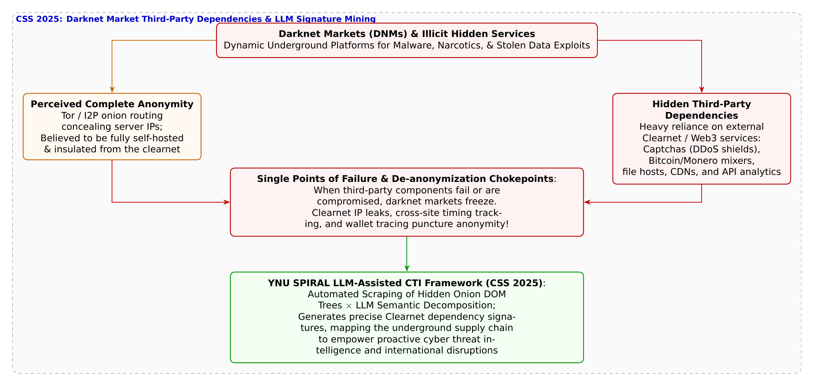

# 第38話 闇市を支える蜘蛛の糸 〜ダークネットの外部依存性とLLMシグネチャ〜

> **【放課後サイバーディフェンス・ラボ（第2部：大学先端研究の扉 〜横浜国大SPIRAL論文探訪〜）】**
> - **舞台**: 帝都科学大学先端セキュリティ実習室 ＆ 横浜国立大学 SPIRAL サイバーインテリジェンス研究室
> - **登場人物**: 神崎 蓮（高校1年・IoT班）、白石 結衣（高校1年・暗号数理班）、城崎 悠真（大学1年・芹沢研TA）、芹沢 涼香 准教授（大学メンター）
> - **学習テーマ**: 横浜国立大学 SPIRAL・イン・ミンパパ特任准教授、吉岡克成教授、内野彰紀氏らの先端研究（CSS 2025）、Torオニオンルーティングによるダークネットマーケット（DNM: Darknet Market）の実態、外界と完全遮断されているという「完全匿名性の神話」の崩壊、現代Webサイトとしての外部サービス依存（DDoS防御CAPTCHA、CDN、暗号資産決済API、外部ホスティング）、クリアネット（表層Web）依存がもたらす単一障害点（SPOF）とIPアドレス漏洩リスク、大規模言語モデル（LLM）を用いたOnion DOM構造の自動意味解析と第三者依存シグネチャ自動生成、国際法執行機関（ユーロポール・FBI等）によるサプライチェーン遮断捜査
> - **探訪・参照研究論文**:
>   - [横浜国立大学 サイバーセキュリティ実践教育研究センター（SPIRAL）](https://spiral.ynu.ac.jp/)
>   - 内野 彰紀, イン ミンパパ, 吉岡 克成. 『ダークネットマーケットの第三者サービス依存性調査：LLMによる検知とシグネチャ生成』. コンピュータセキュリティシンポジウム 2025 (CSS 2025), 2025年10月.

---

## 🎨 4コマ漫画・ストーリーイラスト (Draw Things 生成)

---

## 💬 4コマ漫画キャラクターセリフ（日・英対訳）

挿絵の4コマ漫画（文字なし）の各コマに対応したキャラクターのセリフです。小説本文の導入としてもお楽しみいただけます。

| コマ | 展開 / シチュエーション | 🗣️ 日本語セリフ (Japanese) | 🌐 英語セリフ (English) |
|:---:|:---|:---|:---|
| **第1コマ 【起】** | **蓮のダークウェブ幻想：Torの闇市は外界から遮断された無敵の要塞だろ！ Onionブラウザの画面を指差し、「ダークウェブの闇市は表のネットと完全に切り離された無敵の匿名要塞だろ！」と興奮する蓮。** | **蓮: 「Torのダークネットマーケットは、表のネットから完全に隔離された無敵の匿名要塞だろ！」** | **Ren: 'Darknet markets on Tor are invincible anonymous fortresses completely severed from the clearnet!'** |
| **第2コマ 【承】** | **結衣の冷徹な指摘：CAPTCHAや決済APIなど外部サービスなしに運営不可能！ Webインスペクターのコードを示し、「CAPTCHAや暗号資産決済など、表のクリアネットAPIに依存しているわ」と看破する結衣。** | **結衣: 「幻想です。DDoS対策のCAPTCHAや暗号資産決済APIなど、表のサービスを繋がなければ動かないわ。」** | **Yui: 'Pure fantasy. Without external DDoS CAPTCHAs and crypto payment APIs, they cannot function for a second.'** |
| **第3コマ 【転】** | **悠真TAによるCSS 2025論文「LLMによる外部依存検知とシグネチャ生成」解説 CSS 2025論文の相関図を投影し、LLMでOnionサイトのDOMを解析して外部依存の単一障害点を特定するSPIRALの手法を語る悠真。** | **悠真: 「イン特任准教授らはLLMでOnionサイトの依存関係を暴き、闇市のアキレス腱を突くシグネチャを作ったんだ。」** | **Yuma: 'Assoc. Prof. Yin used LLMs to map onion dependencies and generate signatures targeting darknet Achilles heels.'** |
| **第4コマ 【結】** | **闇を支える蜘蛛の糸を断つ！真のインテリジェンスへの目覚め 巨大な脅威マップを見つめ、要塞そのものではなくそれを支える外部サプライチェーンを見抜く洞察力に感動する蓮と結衣。** | **蓮: 「要塞を正面から叩くんじゃなく、外から支えてる蜘蛛の糸を断ち切る……インテリジェンスって奥が深い！」 結衣: 「ええ。複雑なネットワークの依存構造を暴く数理とAIこそ、悪の根を断つ真の力ですね。」** | **Ren: 'Don\'t breach the fortress walls—sever the invisible web threads holding it up! Intelligence is brilliant!' Yui: 'Indeed. Tracing complex dependency graphs with AI is the true power that uproots cybercrime.'** |

---

## 📖 小説本文

帝都科学大学先端セキュリティ実習室の大型ディスプレイには、漆黒の背景に怪しく浮かび上がる玉ねぎのシルエット――Tor（The Onion Router）ブラウザの起動画面が映し出されていた。

神崎蓮は、机に両肘をつき、画面に表示された複雑怪奇な英数字のドメイン名――いわゆる「.onionアドレス」を見つめながら、熱を帯びた声で呟いた。
「……すげえな。何重もの暗号化ノードを経由して、発信元のIPアドレスもサーバーの物理的な位置も完全に隠蔽される世界。外部のインターネットから完全に切り離された、まさに鉄壁の『難攻不落の匿名要塞』だ。これじゃあ、どれだけ世界中の警察が束になって追跡しようとしても、手も足も出ないんじゃないか？」

蓮の言葉には、映画や小説で描かれるダークウェブに対する、どこか無邪気な畏怖と好奇心が滲んでいた。違法薬物や盗難クレジットカード、サイバー攻撃用のマルウェアが売買される地下市場――ダークネットマーケット（DNM）。蓮はそこが、現実世界の法律やネットワーク技術が一切通用しない、完全な異界であると信じ込んでいた。

だが、その隣で冷たい緑茶のペットボトルを手にしていた白石結衣は、ため息混じりに首を横に振った。
「相変わらず、ファンタジーと現実の工学を混同しているのね、蓮」

結衣は端末のキーボードを引き寄せ、ブラウザの開発者ツール（Webインスペクター）を起動した。
画面には、ある著名なダークネットマーケットのトップページのDOMツリーと、ロードされている外部リソースのネットワークリクエスト一覧が一気に展開された。

「よく見なさい。その『無敵の要塞』とやらが、一体何の上になり立っているのかを」

蓮は目を凝らし、ネットワーク通信ログを追った。
「……ん？ これって……画像の読み込み先や、スクリプトの呼び出しURLか？ なんだか普通のWebサイトと変わらないような……」

「そうよ。TorのOnionサービスは、サーバーの通信パケットを多重暗号化してルーティングしているだけに過ぎないわ。その上で動いているシステム自体は、私たちが普段見ているショッピングサイトと何ら変わらない『現代のWebアプリケーション』なのよ。数千人、数万人のユーザーがアクセスし、商品を検索し、レビューを書き、決済を行う。そんな巨大なWebサービスを、自分たちの閉じたサーバー一台だけで自給自足できると思う？」

結衣は画面の一角を赤枠で囲んだ。
「見て。アクセス過多やDDoS攻撃でサイトが落ちないようにするための『CAPTCHA認証（画像パズル）』、ビットコインやMoneroの着金を自動確認する『暗号資産決済API』、ページの読み込みを高速化するための『CDN（コンテンツ配信網）』。これらはすべて、ダークネットの内部ではなく、表層のインターネット――クリアネットの第三者サービスを呼び出しているのよ」

蓮の表情が凍りついた。
「ま、待てよ……！ 完全に外界と遮断されてるんじゃなくて、表のネットのサービスと通信してるってことか！？」

「そうよ。どんなに重厚な暗号の城壁を築いていようと、その城はクリアネットという外部のインフラから無数の『蜘蛛の糸』を引いて命脈を保っているの。そして、外部に依存しているということは――そこが致命的な弱点になるということよ」

✦ ✦ ✦

「白石さんの言う通り。まさにその外部依存性こそが、地下犯罪インフラを解体するための最大の急所なんだよ」

背後から穏やかな声が響いた。大学院生TAの城崎悠真が、手元のタブレットからプロジェクターへ最新の研究スライドを転送した。
スクリーンに映し出されたのは、蜘蛛の巣のように張り巡らされたネットワークの依存関係グラフだった。

『ダークネットマーケットの第三者サービス依存性調査：LLMによる検知とシグネチャ生成』――コンピュータセキュリティシンポジウム（CSS 2025）で発表された、横浜国立大学SPIRALのイン・ミンパパ特任准教授、吉岡克成教授、内野彰紀氏らによる最前線の研究成果だ。

「悠真先輩、これって……！」
蓮が身を乗り出す。

「横浜国大SPIRALのイン特任准教授たちの研究チームはね、ダークウェブ上にある多数のマーケットプレイスを体系的に収集・クローリングして、それらがどのような外部サービスに依存しているのかを網羅的に解明したんだ。でもね、ダークウェブのWebサイトは、警察や研究者の追跡を逃れるために、HTMLソースやスクリプトが極めて複雑に難読化されている。人間の手作業で一つひとつ解析していたら、何年あっても足りない」

悠真は誇らしげに微笑み、スライドの核心部分を指差した。
「そこで研究チームが導入したのが、【大規模言語モデル（LLM）を用いた自動意味解析】なんだ」

「生成AI……LLMですか！？」
結衣が身を乗り出し、眼鏡の奥の瞳を輝かせた。

「そう。クローリングしたOnionサイトの難解なDOM構造やJavaScriptのコード断片をLLMに読み込ませ、文脈から『これはどの外部サービス（CAPTCHA、決済、ホスティング）を呼び出しているのか』を高精度に自動特定させたんだ。さらに凄いのは、LLMがその解析結果をもとに、侵入検知システム（IDS）や脅威インテリジェンス（CTI）でそのまま使える『検知シグネチャ』を自動生成するパイプラインを確立したことなんだよ」

悠真は画面を切り替え、外部依存がもたらす致命的なリスクを示した。
「この研究によって、ダークネットマーケットが抱える【単一障害点（SPOF: Single Point of Failure）】が白日の下に晒された。もし依存している外部のCAPTCHAプロバイダがダウンすれば、闇市場全体がログイン不能になり機能停止する。さらに、外部サービスとの通信時に発生するDNSパケットやクリアネットへの通信ログから、サーバーの本当のIPアドレスや運営者の痕跡が漏洩し、国際警察の捜査によって摘発される決定打になるんだ」

✦ ✦ ✦

「素晴らしい視点ね、悠真君。そして二人とも、サイバーインテリジェンスの真髄が見えてきたかしら？」

実習室の扉が開き、凛とした足音とともに芹沢涼香准教授が入ってきた。
彼女は机の上のディスプレイに映る巨大な相関図を見つめながら、静かに語り始めた。

「サイバー犯罪組織を追跡するとき、多くの人は『暗号を力づくで解読する』とか『サーバーの脆弱性を突いてハッキングする』といった派手な手法を想像しがちよ。けれど、現実のサイバーディフェンスはもっと構造的で、エレガントなものなの」

芹沢准教授は蓮と結衣の前に立ち、優しく語りかけた。
「闇の組織がどれだけ巧妙に姿を隠そうとしても、彼らが社会の中で活動し、利益を得ようとする限り、必ず既存のインフラやサプライチェーンに頼らざるを得ない。その見えない繋がり――依存関係のグラフを解き明かし、最も脆弱なチョークポイント（要衝）を特定して断ち切る。これこそが、法執行機関や学術機関が連携して行う現代の『サイバー脅威インテリジェンス（CTI）』の真の力なのよ」

蓮は深く息を吐き、画面の相関図を見つめた。
「無敵の要塞なんて、最初からどこにもなかったんだ……。外から支えている糸が見えれば、そこが最大の弱点になる」

「そうよ、蓮君」芹沢准教授は微笑んだ。「敵の強大さに圧倒されるのではなく、相手が何に依存して生きているのかを冷静に分析する。科学の眼を持つ者だけが、その蜘蛛の糸を見抜くことができるの」

✦ ✦ ✦

夜の静寂が、帝都科学大学の実習室を包み込んでいた。
蓮はノートPCに向かい、先ほど悠真から教わったLLMによるコード解析のプロンプトを熱心に打ち込んでいた。

「結衣、見てくれ！ 僕たちが収集したサンプルのOnionスクリプトから、外部のMonero決済ノードと通信しているエンドポイントをLLMが抽出してくれたぞ！」

結衣は隣から画面を覗き込み、満足そうに頷いた。
「上出来ね、蓮。そのシグネチャがあれば、どの闇サイトが同一の決済インフラを使い回しているのか、背後の資金洗浄ネットワークまで一網打尽に炙り出せるわ」

「よーし！ 見かけの暗号に騙されず、背後で蠢くネットワークの繋がりを全部暴いてやる！」

モニターの青白い光に照らされた二人の横顔には、もうダークウェブへの根拠のない幻想はなかった。
複雑に絡み合うサイバー空間の深層に分け入り、悪の根源を構造から断ち切る知恵――真のディフェンダーとしての矜持が、彼らの瞳の中に力強く宿っていた。

---

## 📊 TikZによるセキュリティ構造図解

---

## 💡 高校生のためのセキュリティ深掘りコラム

### 1. 「無敵の孤島」ではないダークネットマーケット（DNM）の現実

違法薬物、不正取得されたクレジットカード情報、サイバー攻撃ツールやゼロデイエクスプロイトが売買される「ダークネットマーケット（DNM: Darknet Market）」。
これらはTor（The Onion Router）やI2Pなどの暗号化匿名通信ネットワーク上で運用される「Hidden Services（Onionサービス）」として構築されており、一般的なWebブラウザからはアクセスできず、サーバーの物理的なIPアドレスや設置場所は多重の暗号化によって隠蔽されています。
そのため、一般には「表層のインターネット（クリアネット）とは完全に切り離された孤立無援のブラックボックス要塞」であるかのように錯覚されがちです。
しかし、現実のDNMは数千〜数万人のユーザーが売買を行う**極めて複雑で高度な「現代のWebアプリケーション」**です。自分たちだけの閉じたサーバーだけで完結させることは技術的にもコスト的にも不可能であり、表層のクリアネットや外部の第三者サービスに深く依存しています。

### 2. 外部依存がもたらす「単一障害点（SPOF）」と匿名性の崩壊

DNMが依存している主な外部第三者サービスには以下のようなものがあります。
- **DDoS防御とCAPTCHA（画像認証）**: ライバル組織や法執行機関からの妨害DDoS攻撃を防ぐため、外部のアンチDDoSプロバイダやCAPTCHA検証サーバーを利用。
- **暗号資産（ビットコイン・Monero等）決済APIとミキシングサービス**: トランザクションの着金確認やブロックチェーン追跡を難読化するための外部ウォレットAPI。
- **CDN（コンテンツ配信網）や外部ホスティング・アナリティクス**: サイトのロードを高速化するための画像キャッシュやアクセス解析スクリプト。

ここに、犯罪インフラの**「アキレス腱（単一障害点: Single Point of Failure）」**が存在します。
もし依存している外部のCAPTCHAプロバイダがダウンしたり、法執行機関に押収されれば、ダークネットマーケット全体がログイン不能となって取引が停止します。
さらに、ブラウザが外部サービスと通信する際に発生する「クリアネットへのIPパケットリーク」「タイミング解析」「クロスサイト・フィンガープリント」によって、Torの暗号化のベールが剥がされ、サーバーの真のIPアドレスや管理者の足跡が特定される契機となるのです。

### 3. 横浜国大SPIRALの革新：LLMによるDOM構造の自動意味解析とシグネチャ生成（CSS 2025）

横浜国立大学 SPIRALの**イン・ミンパパ 特任准教授**、**吉岡克成 教授**、**内野彰紀 氏**らは、**CSS 2025** において論文『*ダークネットマーケットの第三者サービス依存性調査：LLMによる検知とシグネチャ生成*』を発表しました。
- **手作業の限界を超える「LLM意味解析エンジン」**:
  ダークウェブ上のサイトは、解析や摘発を妨害するためにHTMLのソースコードや難読化JavaScriptが極めて複雑に入り組んでいます。研究チームは、クローリングした膨大なOnionサイトのDOM（Document Object Model）構造を、最新の**大規模言語モデル（LLM）**に読み込ませ、外部サービスへの通信やAPI呼び出しを行っているコード箇所を文脈から高精度に自動検出する枠組みを開発しました。
- **検知シグネチャの自動生成とサプライチェーン・マッピング**:
  LLMは単に検出するだけでなく、侵入検知システム（IDS）や脅威インテリジェンス（CTI）プラットフォームで即座に利用可能な「正規表現シグネチャ」や「YARAルール」を自動生成。どの闇市場がどの外部インフラを共有しているかという**「地下サプライチェーンの全体相関図」**を世界で初めて可視化しました。

正面から要塞の扉を叩くのではなく、要塞を外側から支えている細い蜘蛛の糸（外部依存）を断ち切る。国際警察機構やセキュリティベンダーと連携し、サイバー犯罪エコシステムの中枢を兵站から制圧する最先端サイバーインテリジェンスの神髄がここにあります。
