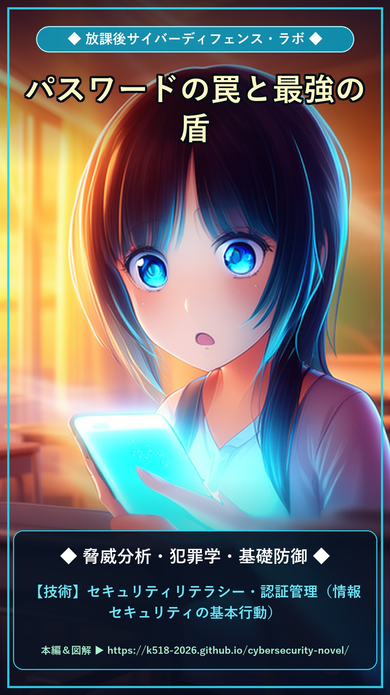

# 第1話 『秘密の合言葉と見えない鍵』 — YouTube Shorts 投稿データ

- **エピソードID**: `ep01_passwords_and_authentication`
- **分野**: 脅威分析・犯罪学・基礎防御
- **動画尺**: 42.7 秒
- **音声**: `ja-JP-NanamiNeural`
- **動画ファイル**: [video.mp4](video.mp4)
- **サムネイル**: [thumbnail.jpg](thumbnail.jpg)
- **更新日時**: 2026-11-27 09:51:35

## YouTube タイトル

```text
【衝撃】パスワードの使い回しが危険な理由とは？MFAの仕組みを徹底解説！ #サイバーセキュリティ #情報科学 #IT解説 #Shorts
```

## YouTube 概要欄（コピペ用）

```text
「パスワードを変えたのに乗っ取られた…」そんな恐怖の裏にある『アカウントリスト攻撃』の正体とは？

今回の動画では、葵たちが放課後のラボで学んだ『多要素認証（MFA）』の基礎を解説します。
知識・所持・生体。この3つの要素を組み合わせることで、あなたのデジタルライフはどう守られるのか？

続きはWebサイトでチェック！
https://k518-2026.github.io/cybersecurity-novel/
```

## サムネイルプレビュー


