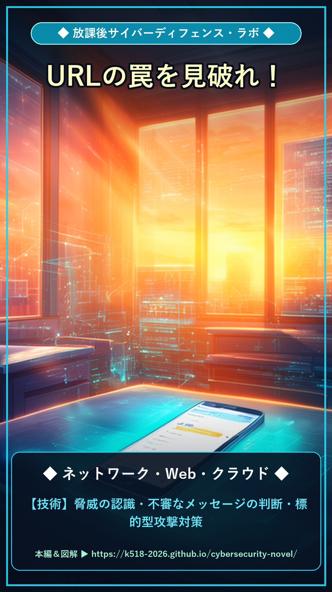

# 第2話 『偽りの手紙と本物の目印』 — YouTube Shorts 投稿データ

- **エピソードID**: `ep02_phishing_and_social_engineering`
- **分野**: ネットワーク・Web・クラウド
- **動画尺**: 44.1 秒
- **音声**: `ja-JP-NanamiNeural`
- **動画ファイル**: [video.mp4](video.mp4)
- **サムネイル**: [thumbnail.jpg](thumbnail.jpg)
- **更新日時**: 2026-11-27 19:33:29

## YouTube タイトル

```text
【サイバー防衛】フィッシング詐欺の巧妙な手口を暴け！ #サイバーセキュリティ #Shorts
```

## YouTube 概要欄（コピペ用）

```text
宅配便を装ったSMSの罠…！URLの階層構造やHTTPSの真実を知り、自分と大切な資産を守るための知識を身につけよう。 

Web本編はこちら：https://k518-2026.github.io/cybersecurity-novel/
```

## サムネイルプレビュー


