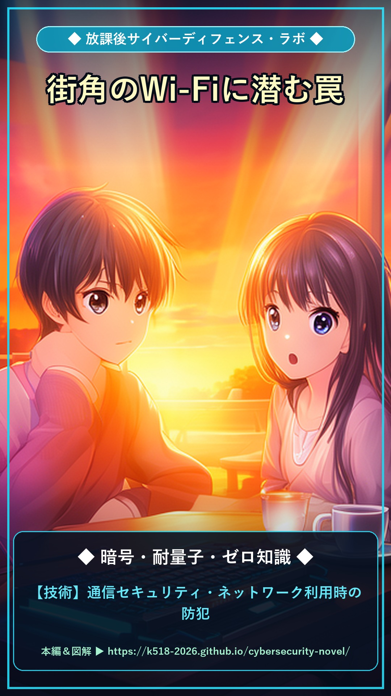

# 第3話 『街角の電波は誰のもの？』 — YouTube Shorts 投稿データ

- **エピソードID**: `ep03_free_wifi_and_encryption`
- **分野**: 暗号・耐量子・ゼロ知識
- **動画尺**: 41.1 秒
- **音声**: `ja-JP-NanamiNeural`
- **動画ファイル**: [video.mp4](video.mp4)
- **サムネイル**: [thumbnail.jpg](thumbnail.jpg)
- **更新日時**: 2026-11-27 19:41:03

## YouTube タイトル

```text
【衝撃】無料Wi-Fiの正体は？HTTPSの魔法で守れ！ #サイバーセキュリティ #Shorts
```

## YouTube 概要欄（コピペ用）

```text
カフェの無料Wi-Fiに潜む『中間者攻撃』の恐怖を知っていますか？なぜHTTPSやVPNが必要なのか、その裏にある数学の美学を解説。 

本編Webサイト：https://k518-2026.github.io/cybersecurity-novel/
```

## サムネイルプレビュー


